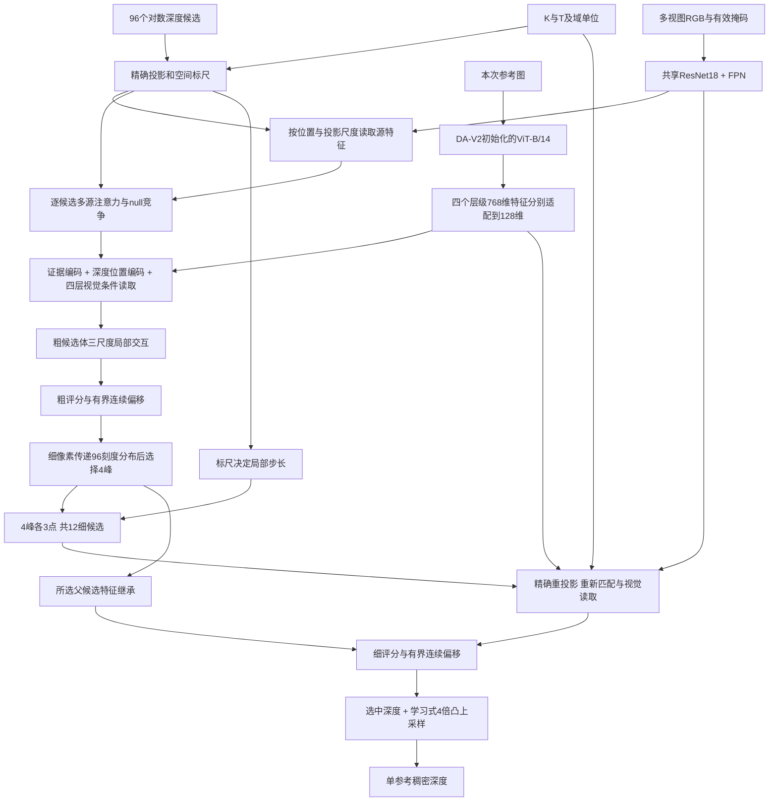

# RulerMVS-V2：供外部 AI 分析的完整模型说明

文档核对日期：2026-10-29，北京时间。依据当前源码、版本登记和实验记录编写；本次只整理说明，没有重新训练或测评。

## 0. 阅读约定与版本边界

请将本文件视为实际实现说明，而不是已经被论文验证的理想设计。后续分析时请区分：代码事实、实验观察、原因假设、待验证改进。不要把“几何上可以投影”解释为“确定看见同一真实表面”，也不要默认本方法已优于所有 baseline。

- 主体模型公开名称：**RulerMVS-V2**。旧序列化标识：`ruler_direct_v2`。
- 当前主体：`PretrainingModel → CalibratedDecoder`，`decoder_kind=calibrated`。
- 任务：已知标定的多视图 RGB → 一个参考视图的稠密光轴深度；输出可反投影为该参考图可见表面的点云。
- 本文件重点是网络结构。2026-10-29 独立新训练沿用这一计算图，主要改变初始化、解冻、数据配比和损失细节，不能称为新架构。
- 默认保留的公共权重 SHA 前缀 `b411275c3203`；旧 CARLA 推荐权重为 `7888b8b637d1`。新训练产物单独保存，不自动替换默认。
- 仓库另有 **RulerMVS-V3**：连续面片与逐像素选面读出实验，替换 V2 的末端凸上采样。该分支完整训练未通过升级标准，**不是本文主模型**。
- 早期实验曾接入完整 MVSAnywhere/Hero 初值通路。当前 V2 不加载 Hero 任务权重、特征缓存或教师；不能把早期 Hero 适配成绩算作本文模型成绩。
- 当前使用 DA-V2 通用编码器初始化与 ImageNet ResNet-18 初始化。没有使用 DA-V2 的完整深度解码头，也没有复制 MVSAnywhere 的完整匹配—融合—DPT 通路。ViT 构造器借用了本地官方仓库包装，底层是 DINOv2 ViT-B/14；代码复用与加载 Hero 任务参数是两件不同的事。

## 1. 研究目标与设计理念

面向自动驾驶及一般多视图重建，目标是在已知内外参下提高初始表面候选的准确性，同时控制推理成本。车端期望约10次/秒的三维更新，目标硬件尚未固定；5090网络延迟不能直接代表车端完整管线速度。

当前设计遵循以下分工：

1. **几何规定在哪里取证。** 用标定精确投影候选，不让网络从头学习投影关系。
2. **图像决定候选是否可信。** 保留多个深度假设，通过跨视图匹配、图像先验与邻域计算共同评分。
3. **空间标尺描述几何分辨能力。** 计算深度变化引起的像素变化率，用于匹配描述、源权重、尺度读取和局部搜索步长。
4. **先传递候选分布，再在细像素上保留峰。** 避免粗像素过早只留下一个表面，再复制到边界上的所有细像素。
5. **粗层扩大判断范围，细层重新取证。** 不把父特征继承当作细层真实匹配的替代。
6. **允许拒绝信息。** 缺失/不合法的源硬屏蔽，合法但可能不可靠的源通过学习权重及空选项降低影响。

这是本项目的组合设计意图，不是已经完成文献排查的首创性声明。

## 2. 输入、单位与输出契约

### 2.1 输入

```yaml
inputs:
  rgb:                  [B, N, 3, 256, 448]
  matching_rgb:         [B, N, 3, 512, 896]
  K:                    [B, N, 3, 3]
  T_cam_from_rig:        [B, N, 4, 4]
  view_mask:            [B, N]
  image_mask:           [B, N, 256, 448]
  matching_image_mask:  [B, N, 512, 896]
domain_configuration:
  near: 搜索近界，来自预先固定的域配置
  far: 搜索远界，来自预先固定的域配置
  depth_scale: 域级固定单位归一化尺度
  reference_index: 本次输出的参考相机
```

- `B`为batch；`N`可变，公共数据真实使用N=2或4；CARLA有四固定槽，允许缺源图。
- `matching_rgb`通常由同一原始照片单独缩放到较高分辨率，可能包含比主图更多的像素信息。公平比较另有仅从256×448主图放大形成matching图的对照，不能把两种输入混同。
- K对应主图像素坐标。匹配图与主图的比例显式参与投影坐标换算。
- 内部rig采用右手系x前/y左/z上；CV相机x右/y下/z前，`T_cam_from_rig`明确是rig→相机。
- 深度是参考相机Z-depth，不是欧氏射线距离。CARLA为米；部分公共域只认证为scene_unit，不混称米。
- 前向中深度与外参平移同时除以域尺度s；内参、旋转不变，输出后乘s恢复原单位。s是TRAIN统计得到的域常量，**不是逐帧由GT算出的尺度，也不是相机基线长度**。
- 缺失源槽置零并带mask；不复制其他相机凑数量。参考图缺失不能直接当成正常参考预测。
- 模型前向只读inputs和预先固定的域配置，GT深度/语义/占据放在独立targets中。

### 2.2 输出

```yaml
depth:       [B, 1, 256, 448]  # 模型原始内部单位；乘unit_scale恢复外部单位
confidence:  [B, 1, 256, 448]  # 候选softmax及上采样得到，未做可靠性标定
valid:       [B, 1, 256, 448]  # 参考图有效区域，不等于几何认证
support:     [B, 1, 256, 448]  # 所选候选几何可采样源数
coarse:      粗候选采样/连续深度、分数、概率、上下界等
fine:        细候选对应字段
unknown:     当前通路全部true
observed:    当前通路全部false
state:       当前通路全部为unknown编码2
unit_scale:  输出单位还原系数
```

**真实能力边界：**当前主模型预测的是深度假设，没有完成可靠的free/surface/unknown认证；没有已训练的占据、语义、法线或全场景融合输出头。支撑视图数不是无遮挡同表面证明。点云转换和跨参考融合应视为额外后处理。

## 3. 全流程计算图



这是两级粗→细前馈网络，不是反复循环至收敛的优化器。当前每次forward有一个参考视图；源融合共享权重不等于整个网络完全无参考或完全对称。依次轮换四参考时，当前调用会重复编码，不能把尚未实现的跨参考特征缓存算作已获得的速度。

## 4. 编码器：两种不同职责

### 4.1 多视图匹配编码器

所有相机共享`MatchingPyramid`：ImageNet初始化ResNet-18，分类头替换为Identity。

| 步骤 | 通道 | 每台相机空间尺寸 | 相对512×896匹配图stride |
|---|---:|---|---:|
| 7×7 stem卷积 | 64 | 256×448 | 2 |
| 3×3 maxpool | 64 | 128×224 | 4 |
| layer1，2个BasicBlock | 64 | 128×224 | 4 |
| layer2，2个BasicBlock | 128 | 64×112 | 8 |
| layer3，2个BasicBlock | 256 | 32×56 | 16 |
| layer4，2个BasicBlock | 512 | 16×28 | 32 |

各stage用1×1卷积投影为64维，按stride32→16→8→4自顶向下相加，插值通过显式像素格点保持对齐。输出stride4/8/16三层；stride32参与FPN但不作为单独匹配输出。

每个输出平滑层：`3×3 depthwise Conv2d(64组) → 1×1 Conv2d(64→64) → GroupNorm(8组) → GELU`。

```text
F4  = [B,N,64,128,224]
F8  = [B,N,64, 64,112]
F16 = [B,N,64, 32, 56]
```

ResNet BatchNorm运行统计固定为eval；有梯度的卷积等参数仍可训练。K/T不直接输入这一路CNN。

### 4.2 单参考深层视觉编码器

`TrainableFoundation`只对本次参考图运行：

```text
参考RGB [B,3,256,448]
→ ImageNet均值/标准差归一化
→ 缩放14/16为[B,3,224,392]
→ ViT-B/14：12个Transformer block，隐藏768维
→ 提取block索引[2,5,8,11]，即第3/6/9/12层
→ 每层去CLS、使用共享最终norm
→ 四份[B,768,16,28]
→ 四个独立1×1适配器768→128
→ 四份[B,128,16,28]
```

权重来自原始Depth Anything V2 Base的`pretrained.*`编码器；不是完整DA深度头，也不是MVSAnywhere Hero训练后的编码器权重。

四层输出是不同网络深度的特征，**空间分辨率相同**，不能写成四种图像分辨率。随后会按候选网格分别对齐到32×56和64×112。这里保留四份128维信息，不先全部压成一个32维瓶颈；但仍存在768→128的有损学习投影。

## 5. 候选坐标、精确投影与空间标尺

### 5.1 深度坐标

运行时`CalibratedDecoder.set_range()`使用域near/s、far/s生成96个**对数均匀Z深度**。父类构造器中历史hybrid初始化会被覆盖；不能按父类注释把当前运行格点写成均匀逆深度。

粗候选张量为`[B,96,32,56]`，对应主图整数格点`u=8j,v=8i`。相邻候选单元边界采用算术中点，端点为near/far。

### 5.2 几何公式

采用列向量约定，参考像素齐次坐标p=[u,v,1]，参考光轴深度z，外参为`X_cam=R X_rig+t`：

```text
X_rig(z) = R_ref^T · (z K_ref^(-1) p - t_ref)
X_src(z) = R_src · X_rig(z) + t_src
uv_src(z) = π(K_src X_src(z))
g_src(z) = d uv_src / dz = J_src · dX_rig/dz
```

J是二维投影对三维位置的Jacobian；g是二维向量，表示候选深度变化导致的源像素移动。外参平移缩放后，导数单位是“像素/内部深度单位”。CARLA s=1时就是像素/米。

主图到匹配图的像素转换为`uv_match=(uv+0.5)*ratio-0.5`，ratio为宽高缩放比例。采样函数再按FPN stride换算，`grid_sample(align_corners=False)`。标尺送入匹配网络前乘ratio/4，统一为匹配F4特征像素/内部深度单位。四份ViT特征对齐使用其原图中心7.5的显式偏移，不直接假设与CNN格点原点相同。

### 5.3 几何尺度路由

对每个源、每个候选计算三个投影跨度：参考网格横向宽度的投影、纵向宽度的投影、候选深度区间的投影。取最大跨度p（匹配图像素），计算：

```text
level = clip(log2(max(p,1)/16), 0, 2)
weight_l = max(1-|level-l|, 0), l∈{0,1,2}
source_feature = Σ_l weight_l · sample(F_stride[l], uv_match)
stride = [4,8,16]
```

16匹配图像素对应F4上的4个格点。由此按候选投影尺度混合最多两个相邻FPN层。当前代码仍对三层执行采样再乘权重，**不是稀疏跳过所有零权重层计算的实现**。

参考锚点始终读取F4；源特征和参考特征在64维通道上L2归一化。

### 5.4 合法性与退化

屏蔽图外、相机后方、缺失视图、无效像素及投影深度导数范数小于阈值的源候选；参考图不作为自己的匹配源。共中心纯旋转不会被当成正常深度视差证据。

这些检查只能说明可采样及局部几何敏感，不能证明对应点无遮挡、有纹理、属于同一真实表面。推理中没有源GT深度来做真正的遮挡认证。

## 6. 逐候选跨视图注意力：几何信息怎样进入学习

记参考64维特征为r，某源候选采样特征为f_i，转换后的投影导数为g_i，候选区间半宽为h。

### 6.1 3维标尺描述与139维配对描述

```text
direction_i = g_i / max(||g_i||, 1e-6)
geometry_i = [direction_x, direction_y, min(log(1 + ||g_i||*h), 8)]

pair_i = concat(
    r * f_i,                  # 64维逐通道乘积
    abs(r - f_i),             # 64维逐通道差
    group_sum(r * f_i),       # 8组，每组8通道求和
    geometry_i               # 3维
)                            # 共139维

value_i = Linear139→64 → GELU → Linear64→64
reliability_i = Linear64→4(value_i)
```

geometry同时改变value与可靠性。它不是三维XYZ位置，也不是经过显式监督的匹配移动方向；direction来自几何导数，不是图像匹配分数的上升梯度。

### 6.2 四头源竞争与null

```text
Q = Linear64→64(r)            # 无bias，4头，每头16维
K_i = Linear64→64(f_i)        # 无bias
logit_i,h = dot(Q_h,K_i,h)/sqrt(16) + reliability_i,h
null_logit_h = Linear64→4(r)
weights = masked_softmax([所有源logit, null_logit], dim=源)
```

注意力沿**源相机维**竞争，不是在全部图像token之间做全局attention。其logical输入包含`[B,S,64,D,Hc,Wc]`源特征；S为有效槽数量减参考槽或保留了被屏蔽参考槽。

源value分为四头加权聚合，得到`[B,64,D,Hc,Wc]`。null有logit但没有非零value，所以它能降低聚合信息幅度；不是强制把全部权重重新分给某台源相机。

再计算：

```text
mean_weight_i = 各head权重平均
information = Σ_i mean_weight_i * ||g_i||²
null_mass = null权重的head平均
evidence = Conv1×1×1(66→64) → GELU → Conv1×1×1(64→64)
输入66通道 = pooled64 + null_mass1 + log(1+information)1
```

`information`只是加权几何敏感度代理，没有结合完整图像特征梯度与噪声协方差，不是经过概率校准的Fisher信息或误差方差。

## 7. 候选位置编码与四层视觉条件读取

### 7.1 一维深度位置编码

```text
t = (log(z)-log(near))/(log(far)-log(near))
position = MLP3→64→64([t, sin(πt), cos(πt)])
candidate_feature = evidence + position
```

这是每个候选的一维深度位置编码，不是PETR式完整三维位置嵌入。当前没有把整套K/T直接展平送进ViT，也没有往RGB或GT图像上真正画尺子。

### 7.2 在四个视觉层之间读取

四份128维视觉特征对齐后组成`bank=[B,128,4,Hc,Wc]`：

```text
q = Conv1×1×1(64→128)(candidate_feature)
logit_l = dot(q, bank_l)/sqrt(128)
alpha = softmax(logit, dim=四个编码层)
visual = Conv1×1×1(128→64)(Σ_l alpha_l bank_l)
feature = ChannelLayerNorm(candidate_feature + visual)
```

每个候选根据自己的几何/匹配证据选择读多少浅层或深层信息。这里attention沿四个编码层，不是对所有空间位置做全局cross-attention。LayerNorm只归一化同一候选的64通道，不跨候选/像素做统计。

这一步在粗阶段和细阶段分别执行，两次共享参数与原始bank，但query不同。当前不能把第二次读取直接删成父特征继承，相关实验确有明显退化。

## 8. 粗阶段：保留96候选进行空间联合判断

粗特征体`[B,64,96,32,56]`进入`CandidateScaleSpace`：

1. 本尺度分支：3×3×3 depthwise Conv3d（64组）→GELU→1×1×1 Conv3d。
2. 仅在H/W上做两次2倍掩码归一化平均池化，得到`[B,64,96,16,28]`与`[B,64,96,8,14]`。
3. 两个低尺度各有同型depthwise+pointwise块，由最粗到较细逐级上采样传递消息。
4. 将低尺度消息与本尺度消息相加，再由外层残差加回候选特征。

**深度维96始终保留，池化不合并深度候选。**但这是图像网格×候选序号上的局部3D卷积，不是均匀物理体素卷积，也不是精确遵循3D表面的邻接。

粗评分与连续回归：

```text
cosine_i = dot(r, f_i)
similarity = Σ_i mean_weight_i * cosine_i
score_k = Conv1×1×1(64→1)(feature_k) + 4 * similarity_k
P = softmax(score, dim=96个候选)

fraction_k = tanh(Conv1×1×1(64→1)(feature_k))
offset_length = upper_k-z_k if fraction_k>=0 else z_k-lower_k
continuous_k = clip(z_k + fraction_k*offset_length, near, far)
coarse_depth = continuous[argmax(score)]
```

偏移限制在该候选单元内。全分布仍保留给细阶段，粗输出不是所有深度的soft-argmin平均。当前V2粗/细共享score与offset头；另有独立细头实验配置，但不是默认推荐和10月29新训练主体。

## 9. 细阶段：先传递分布，再保留四峰，最后精确取证

### 9.1 SubrayTransport

粗32×56到细64×112。对细像素的四个粗邻居，逐深度刻度使用双线性空间权重加权各自概率，得到细网格上的96刻度分布。

同一刻度下，父连续候选深度及父特征按“空间权重×父候选概率”的条件权重传递；**不跨不同刻度平均前后表面**。当前模式为bilinear，无新增学习参数。

在细像素上贪心取4个高分峰，排除相距过近者。当前`peak_separation_m=0.1`，但在跨域归一化后的代码中它实际按**内部深度单位**使用；只有s=1时才等于0.1米，不能被配置名称误导。

### 9.2 局部搜索步长

每峰取得原刻度单元半宽w，并从父网格传递投影导数幅度g。g先在几何有效源之间取最大，再按父候选条件权重传到细网格：

```text
step = clip(max(w, 0.5/max(g,1e-6)), 0.005, 100.0)
fine_candidates = [peak-step, peak, peak+step]
```

0.5是匹配F4特征像素，0.005/100.0为当前**内部深度单位**的上下限，最后候选截断到域搜索范围。四峰各三点得到`[B,12,64,112]`；每个细候选回归半宽为step/2。

重要：这里用局部导数确定步长，导数还经过父邻居传递；不是保证实际前后候选恰好移动0.5像素。每个生成的候选之后都重新精确投影。

### 9.3 精确细取证与读出

对12候选重新执行第5–7节：源位置/尺度采样→匹配注意力→标尺融合→四层视觉条件读取，得到`[B,64,12,64,112]`。

再加上经过1×1×1卷积的父候选继承特征并做ChannelLayerNorm。细阶段**没有再运行一套CandidateScaleSpace**。

用共享score/offset头预测12候选分数和有界连续深度，当前`fine_readout=winner`：选最高分候选的连续值，而不是四峰均值。argmax与top峰筛选是离散操作；对选中深度可反传，但没有对“换成哪个峰”实现完全可微的路径。

## 10. 最终输出：4倍学习式凸上采样

细网格每个位置取获胜候选的64维特征：`[B,64,64,112]`。

```text
Conv3×3 64→64 → GELU → Conv1×1 64→144
144 = 4×4个目标子像素 × 3×3个细网格邻居
reshape → 每个子像素对9邻居softmax
depth_full = Σ_j weight_j * depth_fine_neighbor_j
```

最终输出`[B,1,256,448]`。confidence使用相同权重混合；support采用最近细网格点对应候选的实际可采样源数，不把加权插值当新证据。

这一操作有平滑和边缘重建能力，但也可能把不同表面的深度混合，当前V2没有显式逐输出像素的表面身份硬约束。退化位置若无正深度，返回预设范围几何均值作为假设，不能将该像素静默删出评测。unknown/observed保持前述保守定义。

## 11. 训练监督：结构事实与10月29新配方分开

### 11.1 基础损失

在内部单位下，最终深度损失为有效像素平均：

```text
L_full = |log(z_pred)-log(z_gt)|
         + 0.2 * clip(|z_pred-z_gt|/max(z_gt,0.1), max=100)
L_edge = 水平/垂直相邻有效像素的log深度差分误差均值

L_total = L_full + 0.05*L_edge
          + Σ_{coarse,fine}(0.25*CE + 0.2*L_location + 0.1*L_risk)
          + λ_corr*L_correspondence
```

- CE标签：与GT的log深度距离最近的采样候选。不是直接标注最终连续候选的最佳类别。
- location：上述候选的连续回归值与GT的log误差，仅在GT落入允许回归区间时监督。
- 基础risk：各候选概率加权的采样log深度误差，误差上限4。
- coarse/fine分别在主图stride8/4对应GT格点监督；标签不进入前向推理。

可见对应监督：参考GT反投影到源图，用源GT深度一致性（约2%容差）筛对应；沿标尺构造9个由近偏差到大错峰的候选，训练匹配特征识别真实对应。只在双方标签存在的域/帧计算，推理禁用；这不是渲染人工尺子到RGB。新四目CARLA支持每台相机自己的真实深度，旧单深度CARLA训练时不能声称使用了四目独立对应监督。

### 11.2 2026-10-29 独立新训练

这是新的训练实例，**不等于旧推荐权重已经由此产生**。初始化仅原始DA-V2编码器＋ImageNet ResNet-18；FPN/decoder随机；不使用旧V2/Hero教师或任务权重。

公共七域每轮先覆盖全部42598唯一组，再有限重放：Tartan/Matrix/Hypersim/Synth/VKITTI/Blended/Dynamic倍率为1/1/8/1/1.5/1/4。每轮53440曝光、1670更新；8卡、每卡batch4、global32，同一更新内同域。

| 阶段 | 轮数 | 可训练部分 | decoder/FPN学习率 | ResNet学习率 | ViT学习率 |
|---|---:|---|---|---|---|
| 1 | 3 | 随机FPN与decoder | 2e-4 / 2e-4 | 冻结 | 冻结 |
| 2 | 5 | FPN、decoder、匹配骨干 | 1e-4 / 1e-4 | 1e-5 | 冻结 |
| 3 | 12 | 再解冻ViT末4块 | 5e-5 / 5e-5 | 5e-6 | 5e-7 |

共享ViT最终norm仍冻结，ResNet BN统计固定；FP32、TF32关闭；AdamW、weight_decay1e-4（bias/一维参数不衰减）、grad_clip1。每阶段5%预热且最多500步，随后余弦衰减至峰值10%。总33400更新。

阶段2/3用连续修正后候选误差替换原fine风险项，仍用0.1系数，不叠加两份风险；误差目标对候选位置stop-gradient，位置由原回归损失训练。对应损失权重0.1→0.05→0.02。没有额外旧模型蒸馏。

阶段连续从last继续，不加载阶段best回退，不要求训练中每轮必须超过旧V2。完整VAL选择本次best，另存真实final；TEST不参与选模。评分为各域等权的`[log1p(MAE/s_select)+log1p(RMSE/s_select)+log1p(AbsRel)]/3`，公共s_select为TRAIN中位深度，CARLA预登记10m；它不是MAE，也不保证各域同时改善。

新CARLA接续本次公共best：先6轮训练FPN/decoder，再18轮共同训练匹配骨干，ViT冻结；按左/右/上/下四参考完整VAL等权选模。训练轨迹captured_data0+2，共497帧；VAL轨迹1；TEST轨迹3。完整/缺图分开记录，不使用tele或radar。

本文件不对该训练队列作实时完成声明；截至研究记录158的中途记录，仅有完整VAL结果，不能将它当成该次训练最终TEST。

## 12. 推理优化与网络机制的区别

默认稳妥部署使用局部depthwise3D卷积连续NCDHW布局，减少不利内存布局开销；公共推荐权重还删除参考图作为源时恒被屏蔽的计算。旧CARLA推荐配置未开启该源裁减，新训练开启。

可选快速部署另外开启：

- `hoist_reference`：Q和null只算每个参考像素一份，沿深度广播。
- `compact_pair`：把分组相关的线性权重折叠到逐通道乘积权重，保留原函数的代数形式，不是删去逐通道描述。当前autocast下不做该折叠。
- `factorized_fusion`：利用线性结合律，把对每个候选重复的视觉投影移到四层bank端。
- `projective_ruler`：把同一射线的源坐标写成a*z+b，精确投影为分式函数，复用导数常量；没有新增传感信息或大范围一阶近似。

这些主要是计算复用，不是更强的新学习架构。FP32下聚合指标接近不代表逐像素恒等；硬选峰会放大微小舍入差。历史实验还发现FP32推理等价的布局改动在BF16训练下改变梯度与候选，不能用部署等价推断训练等价。

## 13. 已知实验证据与限制

以下是已有固定实验，不是本文件新测。默认公共V2与给定相同TRAIN搜索范围的官方MVSAnywhere一轮细化，在公共TEST11970组上的MAE：

| 数据域 | V2 | MVSAnywhere细化 | 单位 |
|---|---:|---:|---|
| TartanAir | 2.5064 | 2.6240 | 米 |
| MatrixCity | 10.3261 | 10.6170 | 米 |
| Hypersim | 0.4321 | 0.2235 | 米 |
| MVS-Synth | 103.6072 | 257.1828 | scene_unit |
| VKITTI2 | 6.6541 | 5.2243 | 米 |
| BlendedMVS | 0.7389 | 0.7997 | scene_unit |
| DynamicReplica | 0.09369 | 0.07646 | scene_unit |

不能跨单位平均绝对误差。双方预训练数据、曝光与匹配输入像素信息不同，所以这些数不是严格隔离架构的因果实验。4/7域MAE较低不等于所有指标全面较好。

另外，10月28日那轮**新CARLA微调实验权重**（不是默认旧CARLA7888、也不是10月29新训）在新上参考TEST181上MAE3.2881m，官方baseline细化1.9350m，仍有差距。该轮同卡5090、FP32/TF32off单参考31.47ms对37.10ms；顺序四参考125.56ms对148.38ms，不含读取/预处理/场景融合，尚未达到四参考10Hz。Hero首遍历史约22ms，不能把“比细化版快”写成“比所有baseline版本快”。

本模型主要已知问题：

1. 不同域的供给不足、选峰错误、峰内定位不足比例不同，不能全部归因于编码器或初始候选数量。
2. 弱视差下`0.5/g`很大，细候选组可能覆盖很宽深度区间；当前所谓细化不总是精细局部搜索。
3. 标尺表示“移动如何投影”，尚未直接得到“图像匹配分数往哪边变好”的有符号定位证据；没有显式基于特征梯度的Gauss–Newton更新。
4. null和几何合法mask不等于真实遮挡判断；无对应区域仍要依赖单图先验补全深度，尺度可能漂移。
5. 最后凸上采样可能跨表面混合，但直接删除它通常更差；V3新读出也未普遍改善，不能仅由表达能力推断实际收益。
6. 实验曾删除细阶段视觉读取，省约1ms却明显损害精度；匹配通道压成组统计也出现跨域退化。标尺节点插值虽减少MLP求值，访存和小算子开销让整网更慢。这些只否定对应实现/初始化/训练条件，不是否定所有同类思路。
7. 新CARLA上一轮与baseline的净误差差距约84%来自近距，提示近距归属/定位和参考视角训练偏好也重要，不应只盯远距。
8. 公共多域训练存在小域重复曝光与特征漂移风险；更多epoch或更大网络不能保证升级。

## 14. 实现边界清单

```yaml
implemented_and_active_in_V2:
  - 已知标定下的精确候选重投影
  - 单参考ViT四层特征 + 全视图共享ResNet/FPN
  - 标尺条件化匹配value与视图可靠性
  - 源视图null竞争与几何掩码
  - 标尺控制FPN尺度混合与细搜索步长
  - 96粗候选的三尺度局部空间交互
  - 细像素分布传递后四峰筛选
  - 12细候选重新取证与连续偏移
  - 学习式凸上采样
  - 缺源图输入和逐相机独立监督接口
not_implemented_as_current_main_model:
  - 完全无参考或完全对称的联合三维生成
  - 一次编码复用给四参考的完整部署入口
  - PETR式全三维位置token注入ViT
  - 在RGB中绘制人工标尺
  - 显式有符号匹配梯度驱动的GN求解
  - 激活的全局MetricSceneFusion场景节点分支
  - 树/八叉树或完整高分辨率世界体素解码
  - 时间融合、tele输入、雷达输入
  - 经认证的free/surface/unknown或语义占据输出
  - 已证明创新首创性或全面超过baseline
```

`use_geometry=false`只关闭部分学习式几何嵌入，不会自动关闭精确投影、尺度路由和几何搜索步长；做标尺消融时必须分别声明关闭了哪些环节。

## 15. 给外部 AI 的分析请求模板

请基于上述真实实现，而不是自行假定不存在的模块，分析如何改进本模型：

1. 优先找出最可能同时影响精度与效率的结构瓶颈，区分候选供给、相机可靠性、选峰、连续定位、上采样归属和训练漂移。
2. 重点讨论如何更深地利用已知标定/有限公制区间/投影导数，让模型获得有方向的匹配定位证据；几何敏感度本身不能替代匹配正确性。
3. 允许借鉴成熟编码、匹配或优化思想，但不要建议完整替换为baseline后仍称独立架构。请明确复用与新增的边界。
4. 不要只加深/加宽或堆模块。说明可删除或替换的模块、张量尺寸、计算/显存代价、理论或经验依据及失败条件。
5. 每个建议需要可区分假设的小规模对照：固定旧模型、同预算旧模型续训、新方法；报告各域/距离/边界，不用TEST调参，不只看全局均值。
6. 如果涉及多候选、新注意力或几何求解，请给出输入输出、核心公式、mask/退化处理、梯度路径、初始化、损失与推理步骤。
7. 不要求保证尚未实验的收益；请明确哪些是合理推断，哪些需要实验。不要把标准投影公式、分组相关、凸上采样或多阶段训练单独包装成首创。

## 16. 本地源码与证据索引

网页AI无需访问下列路径也能理解本文；这些路径供本地复核：

| 内容 | 相对jar_reconstruction的路径 |
|---|---|
| 主模型、标尺采样、源注意力、视觉融合 | `jar/pretraining/model.py` |
| 两路图像编码器 | `jar/pretraining/encoders.py` |
| 粗细主流程、共享预测头、凸上采样 | `jar/models/ruler_direct.py` |
| 三尺度候选交互 | `jar/models/ruler_spatial.py` |
| 细像素分布传递与候选生成 | `jar/models/ruler_proposals.py` |
| 基础训练目标 | `jar/pretraining/losses.py` |
| 精确投影编译与推理开关 | `jar/pretraining/projective_ruler.py`、`inference.py` |
| 当前受保护版本登记 | `configs/current/rulermvs_versions.json` |
| 10月29日新训练配方及覆盖逻辑 | `research/v2_restart_20261029/configs/`、`training.py` |
| 最新已完成固定评测说明 | `docs/v2_evaluation_20261029.md`，实验155 |
| 统一研发经验 | `docs/research_memory.md`，尤其119–126、131–158 |

本文不把研究记录中的建议写成已实现功能，也不把当前新训的中间VAL成绩替换成最终TEST结果。
