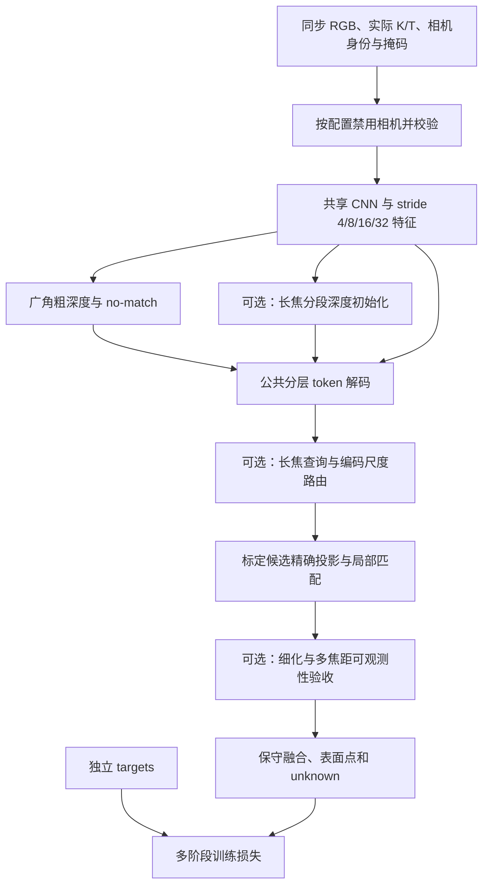

# MF-ET-JAR：保留的一套模型

模型入口是 `jar/model.py:ReconstructionModel`。四目和六目属于同一架构的不同运行模式；两者复用相同的编码器、标定投影、粗匹配和基础分层解码。长焦专用部分位于 `jar/multifocal/`，不将其他旧模型混入网络。

## 各文件的职责

| 文件 | 内容 |
|---|---|
| `jar/encoder.py` | 每张图独立提取特征；按明确像素格对齐不同编码层 |
| `jar/coarse.py` | 已知标定下的候选深度匹配，保留多峰及无匹配状态 |
| `jar/models/token_hierarchy.py` | 继承已有查询，逐层读取编码特征，通过局部 Transformer 更新，并允许产生新细节查询 |
| `jar/models/ray_polish.py` | 可选的沿参考射线局部重采样细化 |
| `jar/models/oriented_polish.py` | 可选的局部有向平面匹配细化 |
| `jar/multifocal/frontend.py` | 按真实图像尺寸编码；长焦独立搜索范围 |
| `jar/multifocal/proposals.py` | 长焦候选查询及可学习评分 |
| `jar/multifocal/matching.py` | 跨焦距尺度对齐、局部窗口采样 |
| `jar/multifocal/decoder.py` | 在基础分层解码上组合独立的多焦距模块 |
| `jar/multifocal/evidence.py` | 多视图支持与冲突检查，不把未知区域当作空闲 |
| `jar/multifocal/fusion.py`、`jar/fusion.py` | 可选的分辨率感知融合和公共保守空间融合 |
| `jar/multifocal/options.py` | 集中声明配置文件开关和生效状态 |

## 模式与消融

`wide4` 运行基础分层路径。`wide4_tele2` 且 `model.multifocal.enabled=true` 时启用扩展；`model.multifocal.enabled=false` 可以在六目输入下关闭整个扩展，保留公共解码做对照。扩展内的六项开关仍各自独立。

配置文件还可分别控制编码查询、几何步长、后续细节查询、全局搜索、图像匹配及查询条件化匹配。数值参数与细化层级仍在 JSON 中配置，不通过删除代码做消融。各开关的具体作用域见主 README；关闭模块不是关闭所有其他模块中的同类运算。

已知相机参数只用于精确投影、反投影和投影导数，不预测标定修正。导数指导局部步长，实际候选点仍精确重投影。图像缩放同步更新 K；特征采样遵守像素中心和 stride 约定。

## 数据与输出

输入为 `rgb[B,N,3,H,W]`、`K[B,N,3,3]`、`T_cam_from_rig[B,N,4,4]` 及有效掩码。身份协议下可增加有序 `camera_ids`、角色和真实尺寸。右手 rig 为 x 前、y 左、z 上，相机为 x 右、y 下、z 前；长度单位为米。

每帧输出可变数量的 `points / normals / scales`、`valid / support / confidence / state`、分层中间结果及射线证据。`FREE=0, SURFACE=1, UNKNOWN=2`。连续点存在不等于已确认表面，应同时查看 `valid` 与 `state`；遮挡后方和证据不足的区域保留 unknown。

标签只进入损失和评测。缺失相机不会贡献匹配或标签监督；主动禁用的相机不读取文件，即使其路径损坏也不影响该消融。不同缺失数量须分别统计，不能删掉 unknown 或无输出帧美化结果。
