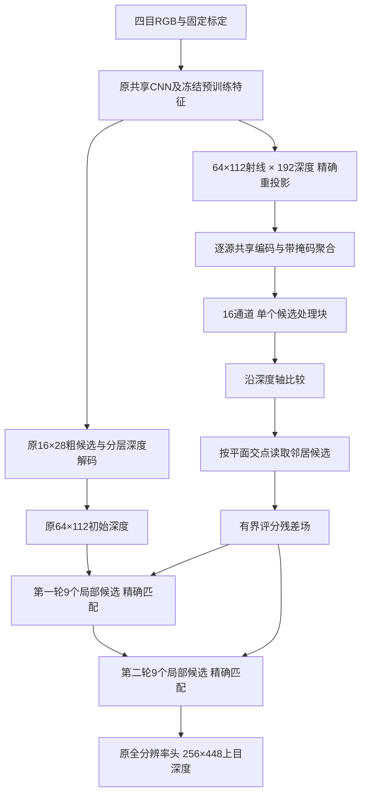

# 候选表面细化：逐层诊断、结构减法与实际结果

本轮已完成源码修改、四组短训练、逐层和逐算子诊断、完整 DEV25 对照以及正式推理入口验证。推荐候选为 `configs/candidate_revision_20261018/recommended.json`，完整模型为 `runs/candidate_revision_20261018/recommended.pt`。原默认配置和权重仍保留，官方 baseline 核心没有修改。

**结论：保留密集候选依据、减少候选处理层数，比继续堆叠编码器更有本轮实验依据。** 相同四目输入、只输出上相机深度，最终平均误差从 1.102178 降至 1.012171 米，约降低 8.17%；当前网络前向约 77.06 毫秒。尚未超过高分辨率 MVSAnywhere，也没有解决初始深度落在错误表面的问题。

## 1. 先定位问题

### 1.1 不能凭源相机权重的排名变化判断不稳定

三帧固定诊断中，九个局部深度候选之间，最高权重源的 ID 变化约 79%/75%。但它们的实际权重十分接近：与窗口共享权重的平均总变差只有 0.00531/0.00483。替换为共享权重，只改变约 0.83%/0.94% 的候选赢家；第二轮锚点误差从 1.07690 变为 1.07745 米。

因此没有增加新的源权重网络。ID 排名不稳定，不等于权重对结果有足够大的影响。详见 `witness_diagnosis/summary.json`。

### 1.2 一部分困难射线根本没有接近真实表面的匹配峰

完整 DEV25 粗候选诊断：7,876 条有 GT 射线，其中 7,656 条有合法候选。远处原始匹配最高峰误差超过 4 米的 406 条射线中，255 条在所有源视图都没有真值 ±1 米内的局部峰，占 62.81%。

这只针对原始粗匹配曲线，不能外推为整个网络错误的归因比例。但它否定了“总有一张相机匹配正确，只需把它挑出来”的假设。单点的相机加权无法凭空生成空间结构证据，需要让邻近射线的表面假设参与判断。详见 `source_limits/summary.json`。

### 1.3 图像特征分辨率、候选射线密度和邻域跨度是三个不同问题

原主初始化在 16×28 网格处理 192 个深度候选，后续才恢复为 64×112 的细化射线。把粗候选分数插值到细网格，会混合相邻射线的表面解释；遮挡边界两侧甚至可能支持不同表面。

控制同一组旧记忆头权重、CNN 特征来源和 16 像素邻域跨度，三帧最终误差为：

| 候选场 | 最终 MAE |
|---|---:|
| stride8 精确采样，插值供细化使用 | 1.032534 m |
| stride4 精确采样，与细化射线一致 | **0.972079 m** |

这里 stride4 不是把低分代价图放大：每条细射线、每个深度候选都重新精确投影到源相机。保持 CNN16 来源，是为了单独改变射线采样，而不是同时换一个特征层。细网格可以读取描述子中不同位置的信息，但不会凭空恢复 CNN16 已丢失的细节。

### 1.4 深层语义并非只贡献了约 4%

逐层记录发现，预训练语义支路的门控值约 0.032–0.044，但后续还有带归一化的适配器。门控前后的幅度不能直接解释成最终语义贡献比例。适配后语义与本地分支 RMS 已在相近范围。本轮没有据此删除或加深预训练分支。

完整层输入、输出和调用时间在 `layer_audit/summary.json`；没有实际调用的稀疏解码和长焦模块也单独标记，不能把它们计入当前计算深度。

## 2. 保留的设计：判断依据与最终深度分开保存

设计主线是：**保留多个表面的解释依据，由标定决定邻域信息怎样传递，再用当前图像观测决定精确位置。**

实现为独立可关闭的 `PersistentCandidateField`，没有另造一套完整编码器：

1. 保留原模型的图像编码、初始深度和两轮局部细化。
2. 在细化使用的 64×112 网格重新建立 192 个深度候选的观测证据。
3. 用一个小模块沿深度轴比较相邻候选，并沿几何平面读取左右上下邻居的对应候选。
4. 保存随像素位置、物理逆深度变化的评分残差，不把它提前压成唯一深度。
5. 每轮细化仍重新精确投影九个局部候选；同时读取残差，结合局部观测进行判断。



平面有两个方向假设：参考相机的正面平面和 rig 水平面，另有“不读取邻居”选项。这些是消息传递假设，不表示场景真实表面都满足这两种方向。坡面和复杂细物体仍可能不适配。

残差扣除了记忆头显式加入的 Hero 均值项，避免该直接项重复相加；剩余学习残差仍依赖图像匹配，不能解释成与观测统计独立的概率。权重固定为 3，沿用原局部评分温度 12 与记忆头温度 4 的换算，没有扫描调参。

这不是完整世界坐标体素场，而是参考射线与物理逆深度组成的候选场。各源共享同一处理规则，但本轮仍只读出上目深度，不声称已实现完整四目共同场景输出。

## 3. 逐层尺寸与算子取舍

以下省略批量维；图像分支同时处理四个相机。

| 层或数据 | 实际尺寸 / 设置 | 本轮处理 |
|---|---|---|
| 场景 RGB | 4×3×256×448 | 保留 |
| 匹配 RGB | 4×3×512×896 | 保留，匹配读取较高分辨率 |
| CNN五级宽度 | 12、24、36、48、48；块数2、3、4、3、2 | 审计后保留，没有盲目加深 |
| CNN五级空间大小 | 128×224、64×112、32×56、16×28、8×14 | 保留 |
| FPN | stride4/8/16/32，各32通道 | 保留 |
| 冻结图像上下文 | 四层768通道、16×28特征，适配到32通道 | 保留已有任务预训练来源 |
| 原粗候选 | 192×16×28；12通道观测描述 | 保留作为原初始化路径 |
| 原候选打包 / 解码 | 773→64通道；两层空间Transformer；32→16→8→4→1 | 保留已训练初始化与输出头 |
| 新候选观测 | 12×192×64×112 | 精确细射线采样，复用CNN16特征来源 |
| 源证据小编码器 | 每源2→4→4通道，两个1×1×1卷积 | 源均值与最大值各4通道，不绑定源排序 |
| 记忆头输入 | 24→16通道 | 12观测＋2匹配统计＋2深度坐标＋8源聚合 |
| 候选深度比较 | 16→16，核3×1×1 | 比较相邻深度，不直接做巨大3×3×3卷积 |
| 几何空间消息 | 2种平面×4个邻居；相隔16原图像素 | stride4跳4格，stride8跳2格，保持物理跨度 |
| 消息权重 | 16→3，核1×1×1 | 两种平面或不取邻居；屏蔽无效消息 |
| 消息融合 | 16→16，核1×1×1 | 候选处理块从2个减到1个 |
| 输出残差 | 16→1，有界tanh | 每个候选共享评分规则 |
| 局部细化 | 两轮，每轮9候选；跨度上限12/4米 | 每轮新观测＋同一候选残差场 |
| 全分辨率输出头 | 64→16通道，再恢复256×448 | 保留，未用插值深度替代已训练输出头 |

新增单块头仅 1,620 参数，双块为 2,759。但参数少不等于便宜：细网格有 1,376,256 个候选位置，16通道激活有 22,020,096 个数。优化重点应该是这些数如何搬运、汇总，而不是只数参数。

### 3.1 有实证支持的结构减法

相同 TRAIN66、seed73、stride8缓存、400步、16通道、GN，只将处理块由2减到1：

| 完整 DEV25 | 两块 | 一块 |
|---|---:|---:|
| 全图 MAE | 1.013369 | **1.012171** |
| 20厘米内比例 | **46.39%** | 45.95% |
| 边界 MAE | **1.788719** | 1.804960 |
| 同轮网络时间 | 99.82 ms | **83.24 ms** |

一块并非所有指标更好，但节省约16.6毫秒、总体误差相当，符合当前实时性优先的取舍。没有依据删除深度比较或几何传播本身。

### 3.2 保留数学操作，改进执行方式

单个候选块约16.3毫秒，其中邻域运输约8.2毫秒，两个归一化合计约6.0毫秒；深度卷积约0.44毫秒、空间卷积约0.11毫秒。问题主要在内存搬运和归约。

已实现：

- 四邻域每次只移动一个非零方向，避免沿零位移轴再复制完整特征。
- 两种平面的消息分别累加，最后拼接一次，保留原邻居加法顺序。
- 对CUDA上的巨大FP32候选场，用 `var_mean` 计算同一组的均值和总体方差。分组数、统计范围、eps、affine和参数键不变；CPU、小张量、非FP32仍调用原GN。

算子对照中，大尺寸单次GN由3.882降为0.540毫秒；中尺寸0.448→0.089毫秒，小尺寸新写法反而较慢，因此没有全网替换。最终完整网络的加速以第5节为准，不能把算子倍率套到整网。

**浮点归约顺序不同，不是逐位等价。** 同权重25帧全输出平均差为0.0000271米，但硬候选选择会放大极少数近似平分的变化：103个有效GT像素变化超过0.1米，GT内最大差约0.732米。整体MAE只变化约0.000000324米。这暴露了离散选峰的数值敏感性，不能用平均指标声称每个像素都不变。记录为 `operator_output_parity.json` 和 `reduction_ties.json`。

## 4. 没有采用的改动

### 候选内 LayerNorm

同seed、数据和400步训练，在相同stride8候选上，GN最高峰MAE1.56494米，逐候选LN为1.62014米；远处2.68163→2.93083米。三帧完整管线也未优于GN。没有改推荐归一化。

LN可能删除了候选之间有用的强弱差异，但当前对照同时改变了统计区域和通道分组，不能宣布已经证明这一解释。它只保留为归一化消融选项。

### 将训练网格也改为stride4

维持单块、16通道、seed73、400步，改用精确stride4缓存训练。相同fine4评价网格上，候选最高峰MAE从1.548676变为1.575995米；完整DEV25最终MAE从1.012171变为1.012699米。没有足够收益，不采用这组新权重。

该实验还增加了每步4倍候选射线及监督量，因此不能把结果纯归因于GN统计域；它是整体训练网格方案的对照。同400步也不是同计算预算。

## 5. 最终完整结果与实际改善阶段

协议：DEV25同一批2,087,873个GT像素，评价2–80米；所有变体预测覆盖100%，没有按预测置信度删除困难点。四目输入、上目输出；场景256×448、匹配512×896。本轮没有读取TEST。

| 指标 | 原单上目模型 | 推荐单块候选场 |
|---|---:|---:|
| 全图 MAE | 1.102178 m | **1.012171 m** |
| 全图 RMSE | 2.697366 m | **2.593309 m** |
| 20厘米内比例 | 42.70% | **45.95%** |
| 边界 MAE | 1.946207 m | **1.804955 m** |
| 2–10米 MAE | 0.344445 m | **0.304926 m** |
| 10–24米 MAE | 1.089263 m | **0.961849 m** |
| 24–80米 MAE | 2.531556 m | **2.388436 m** |

同129,587条stride4射线的阶段结果：

| 阶段 | 原模型 | 推荐模型 |
|---|---:|---:|
| 细化前初值 MAE | 2.428773 m | 2.428773 m |
| 两轮细化后 MAE | 1.162034 m | **1.053430 m** |
| 远处细化前 | 7.240916 m | 7.240916 m |
| 远处细化后 | 2.635336 m | **2.477371 m** |

初值逐值差为0。这说明收益来自保留候选上下文、改进局部表面解释；不是初始表面已经选得更准，也没有扩大原搜索窗口。因此不能认为主要瓶颈已经消失。

单张5090，FP32；固定三帧分别预热3次、测量5次，共15次，显式CUDA同步：

| 计时 | 原单上目模型 | 推荐单块候选场 |
|---|---:|---:|
| 网络前向平均 | 44.40 ms | 77.06 ms |
| 网络前向P90 | 46.02 ms | 81.06 ms |
| 预解码CPU输入→CPU结果平均 | 50.22 ms | 83.15 ms |
| 上述管线P90 | 51.99 ms | 86.94 ms |
| 峰值已分配显存 | 870.92 MiB | 2697.82 MiB |

管线包括输入传输、网络内候选场及后验验证、深度/有效性/两个诊断阶段回CPU；不含图像文件解码、模型加载、写盘或点云融合。约12次/秒只适用于本次单上目深度管线，不能称为完整四目三维场景或车端10Hz。显存不是nvidia-smi进程总显存。

之前相同开发协议的MVSAnywhere低分辨率约0.9384米、高分辨率约0.6857米，均仍优于本轮。这两项是历史结果，本轮没有重新测其时间或宣称相同训练预算；CARLA微调后也不是零样本成绩。

## 6. 设计独立性与仍需完成的研究

复用Hero预训练图像/匹配知识是现有模型的一部分，不能把整网能力归于新增1,620参数。本轮没有移植MVSAnywhere的双流ViT/DPT解码头，也没有移植MVSFormer++的候选全局Transformer。新的接口把**物理候选上的空间评分残差**保存到每轮细化，使用平面交点传递邻域信息；精确观测始终独立重采样。

传播和多候选本身已有先例：[PatchmatchNet](https://arxiv.org/abs/2012.01411)学习候选传播与评价；[NP-CVP-MVSNet](https://arxiv.org/abs/2205.03783)保留多峰深度假设以减少早期单峰误判。这些支持设计方向，不证明当前组合首创或达到论文级成果。

下一次优先研究全局换面决策，而不是继续加深本地CNN：让旧表面与少量分离的全局表面假设在同一个物理评分尺度下竞争，保留拒绝替换能力；训练要同时惩罚灾难性错峰，检查搜索窗口之外的错误能否被真正修复。当前的残差场可以提供统一判断依据，但这一全局竞争机制尚未实现。

本轮未完成独立新地图泛化、整网充分联合训练、新分支多卡DDP、坏图噪声完整鲁棒性曲线、真实小障碍实例召回，以及全四参考场景计时。原始CARLA深度编码仍缺采集脚本核验。不能宣称剩余限制只在数据。

## 7. 代码、配置和验证

主要代码：

- `jar/models/candidate_field.py`：独立候选场、物理逆深度读取、支持掩码。
- `jar/models/initial_surface_memory.py`：已有几何记忆头复用，单/双块及归一化消融、执行优化。
- `jar/coarse.py`：`return_evidence=True`只生成观测，跳过随后会丢弃的原评分与深度头。
- `jar/model.py`、`jar/models/dense_decoder.py`：显式局部接线，没有在前向动态替换函数。
- `jar/multifocal/checkpoint.py`：可选分支严格加载及完整模型恢复。
- `tools/cache_candidate_field.py`、`tools/train_initial_surface_memory.py`、`tools/evaluate_candidate_field.py`：缓存、独立小头训练、同协议完整比较。

参数均在JSON控制。关闭新分支可使用原 `configs/reference_camera_20261018/up_single.json` 和原权重；完整推荐配置与权重对应使用，不混用未声明的新分支状态。

正式推理入口已实际完成一帧CARLA输出：

```bash
official_methods/.venv/bin/python infer.py \
  --config configs/candidate_revision_20261018/recommended.json \
  --checkpoint runs/candidate_revision_20261018/recommended.pt \
  --split val --limit 1 --device cuda:0 \
  --output runs/candidate_revision_20261018/standard_inference
```

推荐完整权重包括冻结预训练模块和新增分支，不依赖小头初始化文件；实际严格重载无缺键，真实帧输出逐位一致。它用于推理或 `--init-checkpoint` 开始新训练，不含整网优化器续训状态，不能作为 `--resume` 使用。

本轮实测97项测试通过，包含CPU模型/几何/检查点测试与两项真实CUDA归一化前后向测试：

```bash
official_methods/.venv/bin/python -m pytest -q \
  tests/test_candidate_memory_normalization.py tests/test_initial_surface_memory.py \
  tests/test_candidate_field.py tests/test_candidate_field_integration.py \
  tests/test_dense_decoder.py tests/test_matching_evidence.py \
  tests/test_context_checkpoint.py tests/test_nested_checkpoint.py
```

覆盖N=2/3/4、B=2、奇数图像尺寸、缺图/纯旋转/无效候选、实际逆深度插值、分支梯度、标签隔离及严格完整恢复。另使用真实Hero/DINO权重，在GPU3上完成64×112几何一致四目场景的整网反向：新双块分支26组参数梯度均有限且非零；全缺图时无有效深度、状态unknown且无NaN。双块GPU反向只证明训练路径可用，不是推荐单块的训练精度指标。

训练与完整比较的实际命令及更多证据见 `runs/candidate_revision_20261018/verification.json`。重跑有保护的训练/比较脚本需在对应JSON更换输出目录，避免覆盖历史结果。

全部缓存、预测、日志和checkpoint位于数据盘：

```text
runs/candidate_revision_20261018
  -> /data/liuzonghao_data/3Dscene_runs/candidate_revision_20261018
```

关键结果：`full25/summary.json`为块数减法对照；`final25/summary.json`为最终精度、阶段与时间；`norm_*/plane/summary.json`为四组短训练；`export.json`为完整权重来源及重载记录。结果文件和缓存未搬入代码目录。
