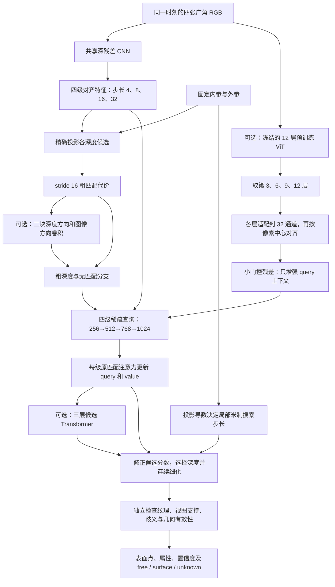

# 从浅层匹配到深层候选推理：本轮架构设计说明

> 历史版本说明：保留设计与诊断依据；旧缓存和部分旧命令已归档。日常运行使用[当前配置](../../configs/current/README.md)，恢复方法见[整理记录](project_cleanup_20261019.md)。

日期：2026-10-14。本文解释已经实现的结构、设计依据和实验计划，不提前宣称精度提升。
用户提到的 MVSAnything 在本轮按此前已集成的 **MVSAnywhere** 理解；
另一项参考为 **MVSFormer++**。更详细的官方代码核查见
源码依据（历史内容已归档，见[整理记录](project_cleanup_20261019.md)），原结构的问题见
容量与信息流审计（历史内容已归档，见[整理记录](project_cleanup_20261019.md)）。

## 先理解这次要解决什么

可以把多相机重建拆成三个问题。

第一，每张图片里有哪些纹理、边界和较大的结构？这是图像编码器负责的事情。
第二，假设一个像素对应的表面在 5 米、10 米或 20 米，其他相机的观测分别支持哪一个假设？
这是投影和候选匹配负责的事情。第三，综合这些互相矛盾的证据，选择哪一个深度、是否还能
继续修正、这个结果是否值得相信？这是解码器和几何验证负责的事情。

旧结构的第一和第三部分都较小。而且存在一个比“层数少”更具体的问题：
部分解码层虽然更新了特征，但更新结果没有参与当前层的深度候选排序。
继续在这个位置堆层，可能只让法线或很小的深度修正变复杂，仍不能把错误深度选回来。

本轮因此拆成四个独立模块：增加细节编码深度、增加候选判断深度、增加粗代价的上下文，
以及可选的预训练场景理解分支。每个模块都能通过配置文件关闭，分别检查是否值得保留。
**层数增加只是实验条件，不能当作效果保证。**

## 整体计算图

图中的“候选”指沿某个参考像素的相机射线，尝试放置的若干可能表面位置。
它还不是已经确认存在的物体。

正式实现仍保留之前有效的候选上下文、曲线传递和定向局部精修。
图中为了阅读清楚，没有把全部已有支路逐一展开。这些旧模块在六组实验中保持相同，
它们的收益不能重新计入本轮新增模块。

## 一、深 CNN：先在当前分辨率多看几遍，再缩小图像

代码：`jar/models/deep_encoder.py` 中的 `DeepImageFPN` 和 `ResidualStageBlock`。

一次取四张 256×448 的 RGB 图片，输入尺寸是 `[1,4,3,256,448]`。
这里依次表示“一组场景、四台相机、三个颜色通道、高度、宽度”。
编码时将前两维临时合并，变成 `[4,3,256,448]`。四张图使用相同卷积参数，
但此时仍是分别处理，尚未互相匹配。

本轮 `backbone_width=12`。五个阶段如下：

| 阶段 | 本阶段总块数 | 首块做什么 | 额外块做什么 | 阶段输出 `[图像数,通道,高,宽]` |
|---|---:|---|---|---|
| 1 | 2 | 尺寸减半，3→12 通道 | 1 块，保持尺寸 | `[4,12,128,224]` |
| 2 | 3 | 尺寸减半，12→24 通道 | 2 块，保持尺寸 | `[4,24,64,112]` |
| 3 | 4 | 尺寸减半，24→36 通道 | 3 块，保持尺寸 | `[4,36,32,56]` |
| 4 | 3 | 尺寸减半，36→48 通道 | 2 块，保持尺寸 | `[4,48,16,28]` |
| 5 | 2 | 尺寸减半，保持48通道 | 1 块，保持尺寸 | `[4,48,8,14]` |

`stage_blocks=[2,3,4,3,2]` **包含每阶段原来的首块**，不是额外再加这么多块。
因此从原来的5块变成14块，新增9块。原有下采样层的参数名称和计算顺序保持不变，
已有权重可以直接迁移，不需要把已学会的部分全部推倒重训。

每个额外块依次包含普通3×3卷积、逐通道3×3卷积和1×1通道混合，以及相应归一化与激活。
普通卷积组合邻近位置和通道；逐通道卷积继续处理各类局部模式；1×1卷积重新组合不同模式。
其结果乘一个可训练的小系数后，加回原特征。初始系数是0.01，意味着新块刚加入时
只作小修正，同时第一步就能训练内部卷积。系数若严格为零，内部卷积在第一步会没有梯度。

随后仍由原来的特征金字塔完成从粗到细融合，输出统一为32通道：

| 输出层 | 恢复相机维后的尺寸 | 对应原图采样步长 |
|---|---|---:|
| 细节层 | `[1,4,32,64,112]` | 4 |
| 中细层 | `[1,4,32,32,56]` | 8 |
| 中粗层 | `[1,4,32,16,28]` | 16 |
| 粗结构层 | `[1,4,32,8,14]` | 32 |

这样的设计依据是：不要刚刚提取一点局部信息就再次降低分辨率，尤其应让细边界在
stride 4/8 阶段多处理几次。中间阶段安排更多块，是兼顾空间细节与计算成本的初始选择，
目前没有证据证明 `[2,3,4,3,2]` 是最优分配。

这条支路仍然是规模较小、主要依靠现有 CARLA 数据学习的 CNN。
它不会凭空获得预训练大模型的知识，也无法保证恢复在输入缩小前已经消失的小障碍。

## 二、冻结的预训练分支：帮助理解场景，但不冒充新的观测

代码：同文件中的 `FrozenFoundation`。

这一分支直接从已有官方 Hero checkpoint 的 `encoder.model.*` 中，严格提取完整
图像 ViT-B，包含12个 Transformer 块、每个位置768维特征。
架构与 DINOv2 对应，但**权重来源是 Hero 检查点中的图像编码器，包含 DAV2
（Depth Anything V2）起点及 MVSAnywhere 训练经历，不是未经微调的原始 DINOv2 自监督权重**。
这也不能与 MVSFormer++ 官方使用的 DINOv2 预训练来源视为同一个控制条件。

官方主配置给该图像编码器设置 `lr_da_encoder=0.000005`，其优化器实际接收
`self.encoder.parameters()`；因此不能说 Hero 训练时始终冻结了它。
本项目在迁移时才冻结该权重，只训练接在外面的适配层和门控，
避免66个训练帧快速改变已有表示。这是本轮的迁移策略，包含额外外部训练先验。
[官方训练配置](https://github.com/nianticlabs/mvsanywhere/blob/5bd49bba0992aa56060e1aa3bb40b2150b04726f/configs/models/mvsanywhere_model.yaml)，
[官方模型初始化与优化器](https://github.com/nianticlabs/mvsanywhere/blob/5bd49bba0992aa56060e1aa3bb40b2150b04726f/src/mvsanywhere/experiment_modules/sr_depth_model.py)。

借鉴依据是两项工作的实际结构：MVSFormer++ 保留卷积特征并使用冻结的 DINOv2 及旁路融合；
MVSAnywhere 在处理多视图代价时逐层读取单目编码信息。这里采用的是两者的设计思路，
没有复制它们的整个深度预测网络，也没有把它们的实验结果当成本模型的结果。
[MVSFormer++ 官方实现](https://github.com/maybeLx/MVSFormerPlusPlus/blob/bdd980cfbae9a863b5489e2ed973612b192d11a5/models/networks/DINOv2_mvsformer_model.py)，
[MVSAnywhere 官方 ViT 模块](https://github.com/nianticlabs/mvsanywhere/blob/5bd49bba0992aa56060e1aa3bb40b2150b04726f/src/mvsanywhere/modules/vit_modules.py)。

256×448 输入在该分支中先按照官方方式缩成224×392，再以14×14 patch 划分，
得到16×28，即每图448个位置。四张图的 patch 特征可以写成 `[4,448,768]`。
每个 Transformer 块都在这448个位置上继续处理，**经过更多块并不会继续缩小空间尺寸**。

我们读取第3、6、9、12块，即代码中的零基编号 `[2,5,8,11]`。
四组原始特征全部是 `[4,768,16,28]`，不是天然的四个图像分辨率。
它们分别经过独立的1×1卷积、归一化、激活，压到32通道，再对应到解码所需的四种格点：

| 预训练层 | 压缩后的原始格点 | 对齐后的用途 |
|---|---|---|
| 第3块 | `[4,32,16,28]` | 给 stride 4 查询补充上下文 |
| 第6块 | `[4,32,16,28]` | 给 stride 8 查询补充上下文 |
| 第9块 | `[4,32,16,28]` | 给 stride 16 查询补充上下文 |
| 第12块 | `[4,32,16,28]` | 给 stride 32 查询补充上下文 |

这里把较早的语义层分配给细层、较晚的语义层分配给粗层，是可检查的设计假设。
插值只是在所需位置读取已有上下文，**没有把16×28的语义特征变成真实64×112细节**；
细节仍由原 CNN 和原始图像提供。

像素中心也不能随意忽略。CNN stride 16 格点位于原图0、16、32……像素，
而该 ViT patch 的中心位于7.5、23.5、39.5……像素。代码显式换算后采样，
没有直接用一次普通 resize 把它们当成相同位置。奇数尺寸先在右侧和下侧补到16的倍数，
保持左上角与原图像素中心不变；图像有效掩码继续控制哪些位置可以使用。

每层上下文乘一个初始为0.01的可训练门控后，作为原查询的补充。
默认 `foundation.fuse_matching=false`，因此原始多视图匹配仍读取深 CNN 特征，
预训练分支只帮助解释候选。`fuse_matching=true` 是额外消融选项；本轮 foundation 组未启用。

这一点关系到结论的可信度：大模型认为“这里像一条路”，与多相机实际确认“路面就在这个深度”
是不同证据。预训练知识不能增加相机支持数，不能让图外位置变有效，也不能把未观测区域标为空闲。

## 三、候选 Transformer：让新增深度真正参与选深度

代码：`jar/models/candidate_reasoning.py`，由每一级原 `RayTokenTransformer` 调用。

旧结构先计算候选分数，再通过 attention 汇总 value、更新 query、执行前馈层。
但是本级深度选择仍读取先前计算的分数。审计发现，只看最后一级候选分类损失时，
value、输出映射和前馈层没有直接的训练路径。

新模块放在这些步骤**之后**，接收两类信息：已经更新的64维 query，
以及尚未被压成一个向量的、每个候选各相机的64维 value。
它的输出重新修正候选分数，使分类监督可以经过更新后的 query 回到旧 attention 的
输出映射与前馈层，也可以经过 value 支路返回图像表示。这是接线方式的改变，
不只是重复添加同一种层。

每级最多有9个局部候选加192个全局候选，共201个。
用 `Q` 表示本级查询数，各级预算分别为256、512、768、1024：

| 信息 | 尺寸 | 含义 |
|---|---|---|
| 更新后的 query | `[Q,64]` | 这条射线当前综合判断 |
| 各候选各视图 value | `[Q,201,4,64]` | 每个可能深度在各相机中的特征内容 |
| 各候选各视图元数据 | `[Q,201,4,8]` | 外观差异、几何敏感度等已有信息 |
| 按已有可靠性聚合视图后 | `[Q,201,64]` | 每个深度仍保留独立表示 |
| 最终分数修正 | `[Q,201]` | 哪些候选更值得相信 |

相机维保留四个槽位方便批处理，但参考相机自身不作为额外匹配视图。
缺失、出界和其他无效槽位由已有掩码排除，不能用零填充值当成真实观测。

三个 `CandidateReasoningLayer` 连续执行，每层依次做以下事情：

1. **query 读取候选。** 用注意力从201个可能解释中汇总需要的信息，更新当前判断。
2. **更新后的判断反馈给候选。** 每个候选通过可训练门控决定接收多少上下文。
   这里不用“只有一个 key 的 attention”，因为那样 softmax 永远等于1，没有选择作用。
3. **候选之间直接比较。** 同一射线的201个候选相互 attention，区分连续可信峰与孤立假匹配。
4. **前馈层进一步加工。** 64→192→64，配合归一化与残差，保留原信息并学习修正。

使用四个注意力头，每头16维。每级有自己的三层参数，不是四个阶段共享同一层。
候选 Transformer 内部更新的 query 用于本模块的分数推理；原解码器的几何属性头仍保留。

候选还附带由真实深度构造的逆深度、对数深度及正余弦编码。
目的只是让网络知道“这是哪个深度”，避免把候选编号误当作物理位置。
本模块不跨不同射线按第k项连接局部候选，因为两条射线的第k个局部候选可能相距很远。
此前的跨射线候选上下文仍仅在共同全局深度格上交流。

输出是限制在约±4以内的分数残差，加回已有分数，保留原匹配器作为起点。
最后一层用很小但非零的权重初始化，让修正起初较小，同时第一步分类损失即可训练前面各层。
所有候选均无效时，attention 显式返回有限值，最终修正归零。

设计依据是：候选深度维度一旦过早消失，错误模式很难靠很小的位置修正恢复。
MVSFormer++ 的粗代价推理和 MVSAnywhere 的代价解码均支持“先充分处理候选证据，再输出深度”
这一思路。不过，本模块的射线内 query—候选反馈是自研组合假设；有效性与创新性仍待实验。
[MVSFormer++ 代价模块](https://github.com/maybeLx/MVSFormerPlusPlus/blob/bdd980cfbae9a863b5489e2ed973612b192d11a5/models/module.py)，
[MVSAnywhere 代价编码实现](https://github.com/nianticlabs/mvsanywhere/blob/5bd49bba0992aa56060e1aa3bb40b2150b04726f/src/mvsanywhere/modules/vit_modules.py)。

## 四、粗代价上下文：第一次选深度时也增加结构判断

代码：`jar/models/cost_context.py`，接在 `PlaneSweep` 的原代价体旁边。

对于一张参考图，stride 16 下有16×28个图像位置，每个位置尝试192个深度。
当前8组相关特征加4项已有信息，组成 `[1,12,192,16,28]`。
这不是把整个三维场景填满的稠密体素；三个轴分别是候选深度、参考图高度和宽度。

新分支加入一条归一化逆深度坐标，通道数12→13，然后用1×1×1卷积映射到24通道。
之后是三块残差处理，每块先做3×1×1卷积，沿相邻深度候选比较；
再做1×3×3卷积，沿图像邻域比较。尺寸始终为 `[1,24,192,16,28]`。
最后压成 `[1,192,16,28]` 的有界修正，加到原粗分数上。

把两种方向分开，在同通道数下，每块卷积核位置数由完整3×3×3的27个变为3+9=12个，
但两者不是严格等价的运算。它是限制计算成本的结构选择，需要与完整卷积或更强注意力比较。

这里的深度格并非米制等间隔，因此不能把这种邻域传播解释为精确的三维欧氏卷积。
额外深度坐标帮助网络区分位置，但不能自动解决所有非均匀采样问题。
原支持数掩码、无匹配分支和深度峰选择继续保留；新分数不能把无支持候选变成有效观测。

本轮没有直接复制 MVSFormer++ 的六层全体积 Transformer。
先用可单独开关的轻量因式卷积，检验“粗候选上下文不足”这个具体假设。

## 五、深网络之后，几何仍做哪些事

相机内外参始终已知，不由新网络自由预测或修正。
所有候选先生成三维位置，再精确投影到每个相机，检查是否位于相机前方、图像范围内及有效区域内。

原“空间尺子”继续描述：沿参考射线移动一定米数，源图像中的位置大约会移动多少像素。
它用于选择合理的局部深度步长。真正读取候选特征时仍使用精确投影，
不会用导数的局部近似代替大范围投影。

纹理、候选歧义、视图支持和几何有效性仍单独检查。
更强网络可以改变候选排序，但没有足够观测证据的结果仍须保留 unknown。
遮挡后方不会因为一个预测表面而自动变成 free。

输入支持缺失相机，缺相机槽位和无效图像区域会被屏蔽。
本轮深编码路径仅支持统一图像尺寸的广角阵列，尚未接入 tele 分支和不同原生尺寸的混合编码；
这些组合会明确报错，不能绕过配置后假称已经支持。
原远焦/混合尺寸架构仍可使用原编码器，未被删除。

## 六、六组控制实验各自回答什么

所有配置位于 `configs/deep_architecture/`。六组均从同一
`runs/carla_vggt_20261011/experiments/field200/last.pt` 初始化已有层，
使用新的 AdamW、seed 17、TRAIN66，再训练200次更新，之后在DEV25评价。
输入256×448、四广角、查询1024、现有损失和评价协议相同；不使用TEST选择模型。
独立 smoke 配置只用于流程验收，不计入正式200步，正式实验重新从上述共同权重开始。

| 配置文件 | 深 CNN | 新候选推理 | 粗代价上下文 | 冻结 ViT | 回答的问题 |
|---|---|---|---|---|---|
| `control.json` | 否 | 否 | 否 | 否 | 原模型再训练200步本身能改善多少 |
| `encoder.json` | 是 | 否 | 否 | 否 | 只增加编码深度是否有效 |
| `decoder.json` | 否 | 是 | 否 | 否 | 候选选择的连接方式与推理深度是否有效 |
| `volume.json` | 否 | 否 | 是 | 否 | 初始粗深度上下文是否有效 |
| `joint.json` | 是 | 是 | 是 | 否 | 三项组合是否相互帮助或干扰 |
| `foundation.json` | 是 | 是 | 是 | 是 | 在组合结构上额外引入预训练场景表示是否有效 |

最后一组不能单独回答“仅冻结 ViT 是否有效”，因为它是在 joint 上加分支。
六组也没有覆盖所有两两组合与预训练条件，不能完全分离各模块的交互作用。
若它有收益，还需要后续的单分支、随机初始化、预训练冻结/微调等对照。

按实际代码在 CPU 上统计，参数如下：

| 设置 | 全部参数 | 可训练参数 |
|---|---:|---:|
| control | 522,840 | 338,568 |
| encoder | 648,489 | 464,217 |
| decoder | 1,380,956 | 1,196,684 |
| volume | 544,225 | 359,953 |
| joint | 1,527,990 | 1,343,718 |
| foundation | 88,207,034 | 1,442,282 |

foundation 的总参数大幅增加，主要因为冻结的12层 ViT；这部分仍有推理成本和权重存储成本，
不能因“不训练”就忽略。六组控制了数据和更新次数，没有控制相同 FLOPs；
需要连同延迟、显存和预训练来源一起分析，而不是只对比最终误差。

结果文件必须来自实际完成的训练与评价，本文不预填结果。
一组实验若训练误差变好、DEV变差，首先考虑过拟合或旧功能被扰动；
若最终投影误差改善但覆盖率明显下降，要排查是否只是拒绝了更多困难点；
若深编码没有改善但候选推理改善，不能继续把全部问题归因于编码深度。

目前缺少独立的小障碍物实例标签，深度边界只能作为代理指标，不能宣称小障碍召回率已经提升。
后续需要更大训练集、独立地图/路线、多个随机种子和真正的小物体投影实验来检验结论。
