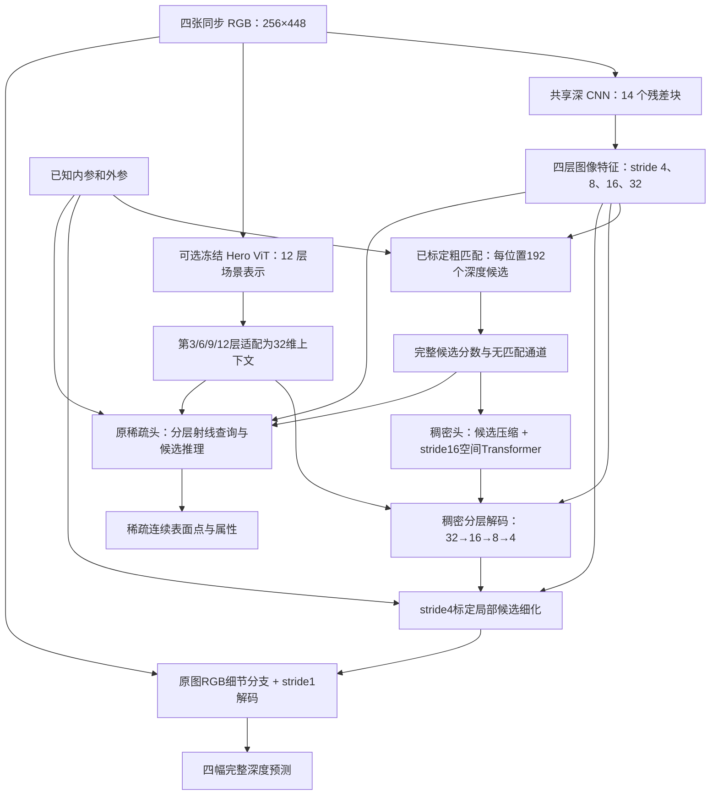
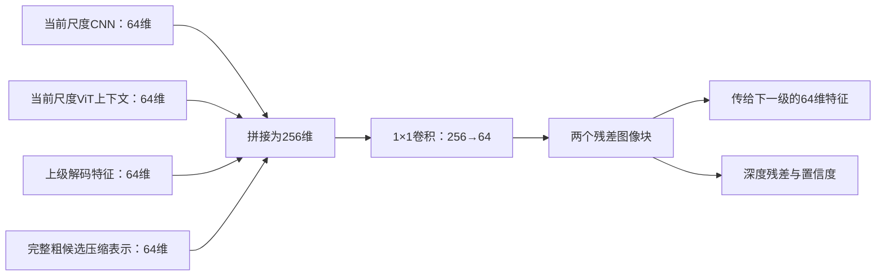
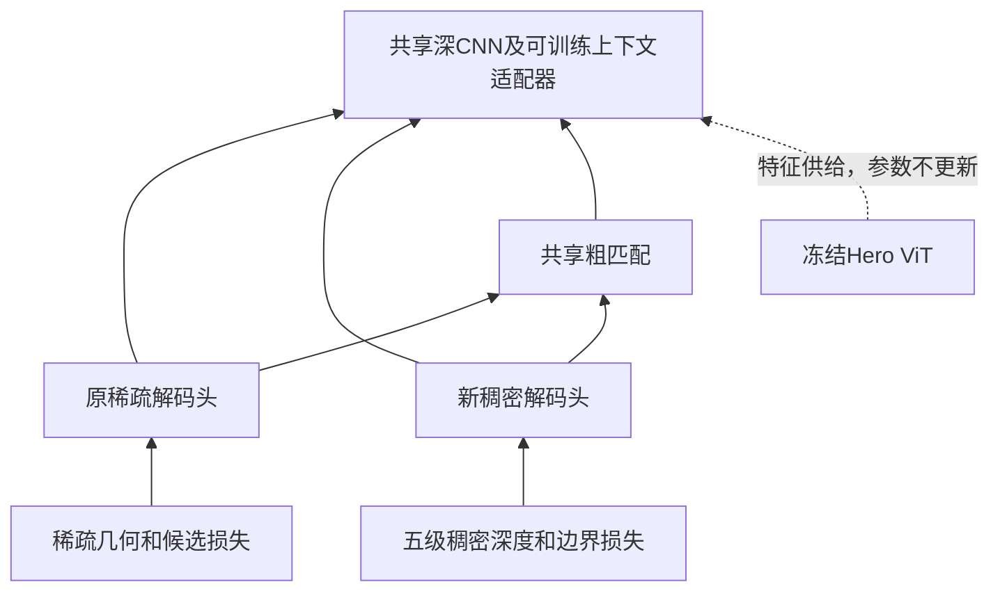

# 从稀疏查询到双解码头：当前架构怎样完成重建

> 历史版本说明：保留设计与诊断依据；旧缓存和部分旧命令已归档。日常运行使用[当前配置](../../configs/current/README.md)，恢复方法见[整理记录](project_cleanup_20261019.md)。

这次改变的重点，是让网络既能对整个图像建立连续的深度解释，也能保留原来逐条射线做精细匹配的能力。
实现不是把稀疏点插值成一张图，而是在共享编码器后增加一个独立、可训练的稠密解码头。
原来的稀疏头仍可单独运行，两者也可以一起训练。

以下按当前实验尺寸讲解：一组场景包含四张256×448图像，编码特征32维，解码特征64维，
粗匹配尝试192个深度。所有数字均可通过配置修改。代码主要在
[`jar/models/dense_decoder.py`](../../jar/models/dense_decoder.py)，
总入口为 [`jar/model.py`](../../jar/model.py)。

## 1. 先看整个信息怎样流动

可以把网络分成三个部分：**读图、收集多相机证据、解码出几何**。



两条解码支路目前共享图像编码和粗匹配结果；一起训练时，两种损失都能更新共享部分。
**没有把稠密预测直接填进稀疏点，也没有用稀疏点给稠密头硬贴几何答案。**
这样先检查稠密解码本身与共享学习是否有用，避免多个新机制同时混在一起。

## 2. 编码器：细节与场景理解分别从哪里来

输入 `[1,4,3,256,448]` 表示“一组场景、四相机、RGB三通道、高256、宽448”。
编码时暂时把场景和相机维合并，成为 `[4,3,256,448]`。
四张图使用同一套参数，但编码阶段仍分别处理；此时尚未做跨相机匹配。

深 CNN 有五个阶段，块数为 `[2,3,4,3,2]`，共14块。
每阶段第一块把高宽各减半，其余块在当前分辨率继续处理纹理。
宽度参数为12时，阶段通道依次是12、24、36、48、48。
后面的特征金字塔把它们整理成四张32通道特征图：

| 编码输出 | 四目尺寸 | 主要提供什么 |
|---|---|---|
| stride 4 | `[1,4,32,64,112]` | 边缘、局部纹理、较细的匹配定位 |
| stride 8 | `[1,4,32,32,56]` | 局部结构和邻域关系 |
| stride 16 | `[1,4,32,16,28]` | 成本可控的全深度范围粗匹配 |
| stride 32 | `[1,4,32,8,14]` | 较大范围的整体形状 |

“stride 4”表示特征图上相邻位置对应原图约4个像素，并不表示深度只有4种。
细层多做几次卷积，是为了让边缘在再次缩小图像前得到更多处理；
但已经在256×448输入中消失的细物体，不能指望增加层数自动恢复。

可选的第二条编码支路是冻结的 Hero 图像 ViT-B，包含12层 Transformer。
它来自已有 MVSAnywhere Hero 检查点，带有 DAV2 起点与后续训练的先验，
不是未经微调的原始 DINOv2 权重。
读取第3、6、9、12层时，每层原始输出都是 `[4,768,16,28]`：层数变深，但这四个输出的空间尺寸相同。
经过各自适配层后变成32维，再与所需的四种图像格点对齐。

这条分支提供较长距离的图像联系和场景知识；CNN继续提供较细的位置。
默认 `foundation.fuse_matching=false`，先验作为解码上下文单独输入，
不会直接替代粗匹配和局部细化中的 CNN 特征。
更详细的编码层说明见[深架构设计文档](deep_architecture_design_20261014.md)。

## 3. 粗匹配：不要太早把192种可能压成一个深度

默认对于每个相机的16×28个粗位置，网络依次假设表面位于192个深度，
用固定标定投到其余相机读取特征，比较它们是否相容。
粗模块同时保留“可能没有可靠匹配”的额外通道。
四目粗分数的尺寸是 `[1,4,193,16,28]`，其中193等于192个候选加1个无匹配通道。

原稀疏头用粗深度峰帮助初始化查询。新稠密头则读取**全部192个候选的分数和有效性**，
不只拿一个最可能深度去放大。它为每个粗位置整理以下信息：

| 每位置的信息 | 通道数 | 用处 |
|---|---:|---|
| 每个候选相对最高分的差距 | 192 | 看清强峰、次强峰与背景响应 |
| 每个候选的概率 | 192 | 保留不确定性和多个解释 |
| 每个候选是否有有效证据 | 192 | 区分低分与根本没有观测 |
| 每个候选的真实逆深度位置 | 192 | 避免只凭候选编号理解距离 |
| 无匹配概率、深度均值、离散程度、熵、有效比例 | 5 | 给出整体状态摘要 |

共 `192×4+5=773` 通道，所以合并相机维后得到 `[4,773,16,28]`。
这里保留的是完整的候选**响应**，没有声称保留所有源相机的原始高维特征。
1×1卷积将773维压成64维，接一个残差图像块，得到 `[4,64,16,28]`。
这一步学习如何把一整条深度响应曲线变成可供后续解码使用的表示。

`full_range_stride`控制稠密头收集候选的位置密度，默认16；改为8后，
四目粗分数变为`[1,4,193,32,56]`，候选位置增至四倍。
这会重新执行更细格点的匹配，不是把原来的粗分数插值放大；匹配模块参数共享，
原稀疏头仍使用stride16。空间Transformer保持在stride16，只把上下文修正传回细格点，
因此保留更细的原始候选响应，又控制全局注意力的计算量。

`depth_initialization`控制第一版深度怎样建立。`candidate_mean`使用候选概率加权的
对数深度作为起点，再逐层修正；它可能把前后两个峰混成不合适的初值。
`learned`取消这条候选平均值直达深度的路径：初始编码置零，由第一层融合特征预测完整深度编码，
后续层继续预测残差。零编码对应配置范围的对数中点，并不表示零米。
**两种模式都保留全部候选响应作为每一级的输入**，区别在于是否让候选均值直接成为输出起点。

## 4. 新增 stride 16 Transformer：让相邻和远处结构一起帮助判断

候选压缩后，每张图有 `16×28=448` 个位置，每位置64维：
`[4,64,16,28] → [4,448,64]`。
这448个 token 在每张图内通过两层 Transformer 交流，再恢复成特征图。

每层包含四头注意力和64→256→64的前馈网络，并带归一化、残差连接。
每个头处理16维。位置编码包含原图坐标、rig坐标下的射线方向和相机中心，
因此网络知道这个图像位置向哪里看；标定仍是固定输入。

这一步想解决的问题是：单个位置的匹配可能模糊，但周围路面、墙体或物体边界能提供结构线索。
在16×28上做注意力，比直接让256×448个像素两两交流节省得多。
**这里是每张图内448个位置的注意力，不是跨相机全局注意力，也不是192个深度候选之间的注意力。**
跨相机证据已经由前面的标定匹配引入。

`context_layers=0` 可以单独关闭这部分，保留其余稠密解码结构。
它与原稀疏头的 `candidate_reasoning` 是两个不同模块：
前者传播图像位置之间的结构，后者比较一条射线上的不同深度假设。

## 5. 32→16→8→4→1：逐层恢复，而不是只把一张小深度图放大

每一级都读取四类信息：当前尺度的 CNN、当前尺度的 ViT 上下文、上一级解码结果、
以及重采样到当前尺度的粗候选表示。四者各为64通道，拼成256通道，再压回64通道。
随后经过两个残差图像块，输出本级深度修正和置信度。



第一个stride32阶段没有父解码结果，该输入为零。
未启用ViT时，对应上下文输入为零，整个稠密头仍可运行。

| 解码阶段 | 主特征尺寸，已合并场景和相机 | 每相机深度图 | 为什么安排这一层 |
|---|---|---|---|
| stride 32 | `[4,64,8,14]` | 8×14 | 先形成大范围、低成本的结构解释 |
| stride 16 | `[4,64,16,28]` | 16×28 | 重新读取原始粗候选分辨率的信息，修正大尺度判断 |
| stride 8 | `[4,64,32,56]` | 32×56 | 从较细编码特征恢复局部形状和边界 |
| stride 4 | `[4,64,64,112]` | 64×112 | 接收细节特征，并执行下一节的标定匹配细化 |
| stride 1 | `[4,16,256,448]` | 256×448 | 结合原图纹理，预测最终像素级残差 |

前四级的两个残差块使用普通卷积；全分辨率阶段先将通道压到16，
再使用逐通道3×3卷积与1×1混合，控制高分辨率计算成本。
这是成本与表达能力的设计折中，16通道不被视为已证明最优。

最后一级还可读取原始 RGB：用浅卷积把三通道变成16通道，
与上采样后的16维解码特征拼接，再融合。
这样，前几级没有保住的细线条和颜色边界仍有机会影响最终预测。
但颜色边界不必然是深度边界，是否应当改变几何仍需训练学习。

各级的深度头预测的是**前一级深度编码的修正**，不是互相独立的五张深度图。
编码通过平滑映射变成2–80米范围内的光轴深度，避免直接输出负距离。
第一层建立的编码会一路被修正；它来自候选均值还是学习预测，由`depth_initialization`决定。
最后一级也可以修正stride4后的深度。
所有特征重采样按原图 `stride×索引` 的格点对齐，避免把图像缩放的半像素规则误套到卷积特征上。

## 6. stride 4标定细化：让“哪里更准确”重新接受多相机匹配

到stride4时，每个相机有64×112，即7168个深度位置。
这个阶段暂时把每个深度当作候选表面，用已知标定精确投到其他图像。
然后询问：如果沿这条参考射线稍微前后移动，其他图像中的匹配是否更好？

“空间尺子”在这里控制搜索跨度：根据当前位置移动1米会引起多少像素变化，
选一个大约对应**一个stride4特征像素**的米制半跨度，再限制在0.02–4米。
在前后两个方向共放9个候选，逐个精确投影，不能以一阶近似直接读取图像。
9个候选覆盖整个正负跨度，相邻间距不是一个完整特征像素。

每个候选、每台源相机都提供：参考与源特征的差、逐通道乘积，以及视差敏感度、
基线与深度比例、射线夹角和实际像素位移等几何信息。
特征各32维，所以差与积共64维，加7项几何信息，成为71维描述。
描述压成32维，再与当前64维解码特征映射出的查询结合，预测匹配分数和各源视图可靠性。

网络先聚合支持同一候选的源视图，再比较9个深度，得到小幅连续修正。
更新门控初始约为0.05，目的是让新增模块先作温和调整，再通过训练决定是否增大更新。
缺失相机、投影出界、同中心或没有可用视差时，不能提供这一步的有效匹配修正。
查询按1024个一块处理，不一次建立全图、全深度、全相机的巨大张量。

这是现阶段的局部细化，不是全局搜索；初始深度严重错误时，9个局部候选可能都错。
因此前面的完整粗候选和上下文解码仍然必要。
它也没有保证概率平均总能避免前后表面混合，这仍是后续可独立改进的部分。

## 7. 稀疏头保留什么，两个头怎样一起学习

原稀疏头仍按256→512→768→1024的查询预算逐层工作，
读取对应编码层，用局部与全范围候选进行匹配、候选推理、连续细化，最后输出表面点和属性。
它的强项是把计算集中到选中的射线，并保留显式几何检查；稠密头则能学习整张图像的结构，
向所有有效像素提供深度预测。

双头训练时，共享部分收到两类梯度：



稠密监督包含米制误差、对数深度误差、相邻有效位置的深度变化误差，以及预测误差置信度。
五级都接受监督，当前阶段权重为 `[0.25,0.5,0.75,1,1]`。
较细层权重更高，但粗层也必须学会建立可用结构，避免所有责任落到最后一层。
只有存在标签的相机/像素才产生对应监督，标签不进入推理输入。

目前没有直接的两头点对点一致性损失，也没有双向几何注入。
共享梯度可能互相帮助，也可能冲突，所以需要比较“仅稠密”与“双头”配置。
不能因为多了一个损失，就预先断言稀疏头也会更好。

## 8. 输出中 valid 和 observed 的区别

`dense_depth` 为 `[1,4,256,448]` 的米制光轴深度。
`dense_valid` 表示这个像素来自有效输入且输出数值可用；
`dense_observed` 则要求另外通过真实 RGB 补丁、视差和跨视图预测深度一致性筛选。
两者不能混为一谈：单目先验也能产生有效预测，但不一定已被多相机证实。

筛选只给 surface 或 unknown，不从一张预测深度图直接填充 free。
推理可通过 `model.dense_evidence.enabled` 开关控制这一附加过程；
训练时不运行此筛选，也不靠它删除困难监督像素。
公开评价将原生稠密结果记为 `native_depth`，通过筛选的子集另记为
`verified_dense_diagnostic`；原稀疏点流仍单独保存。

## 9. 配置怎样控制架构

参数仍只改JSON文件。下面是修改片段，不是一份完整训练配置：

```json
{
  "model": {
    "sparse_decoder": {"enabled": true},
    "dense_decoder": {
      "enabled": true,
      "hidden_dim": 64,
      "blocks_per_stage": 2,
      "context_layers": 2,
      "context_heads": 4,
      "full_range_stride": 16,
      "depth_initialization": "learned",
      "full_resolution_dim": 16,
      "rgb_skip": true,
      "calibrated_refinement": {"enabled": true}
    }
  }
}
```

| 字段 | 作用 |
|---|---|
| `model.sparse_decoder.enabled` | 是否执行原稀疏头；关闭时跳过前向并冻结该头，兼容保留其参数键 |
| `model.dense_decoder.enabled` | 是否构建并执行新稠密头；旧配置默认不开启 |
| `dense_decoder.hidden_dim` | 前四级解码和空间Transformer宽度，当前64 |
| `dense_decoder.blocks_per_stage` | 每个融合阶段的残差块数，当前2 |
| `dense_decoder.context_layers` | stride16空间Transformer层数；0表示关闭 |
| `dense_decoder.context_heads` | 空间注意力头数；须整除hidden_dim |
| `dense_decoder.full_range_stride` | 全深度范围匹配的格点间隔，默认16，可选4/8/16/32；8比16多四倍位置，空间Transformer仍在16上运行 |
| `dense_decoder.depth_initialization` | `candidate_mean`从候选对数深度期望开始修正；`learned`由第一层学习完整编码，后续逐层修正；缺省为前者 |
| `dense_decoder.full_resolution_dim` | 全分辨率分支宽度，当前16 |
| `dense_decoder.rgb_skip` | 最后一级是否重新读取RGB细节 |
| `dense_decoder.calibrated_refinement.enabled` | 是否执行stride4的标定局部候选细化 |
| `model.deep_encoder.enabled` | 是否使用深CNN；编码器对两头共享 |
| `model.deep_encoder.foundation.enabled` | 是否加入冻结Hero上下文；需同时开启深编码器 |
| `model.cost_context.enabled` | 共享粗匹配中的额外代价上下文 |
| `model.candidate_reasoning.enabled` | 原稀疏头的候选Transformer，不是新稠密空间Transformer |

两个解码头至少开启一个。现成配置包括：

- [`dense.json`](../../configs/dense_architecture/dense.json)：仅稠密头，保留标定细化。
- [`dual.json`](../../configs/dense_architecture/dual.json)：两头共同训练。
- [`dense_no_refinement.json`](../../configs/dense_architecture/dense_no_refinement.json)：仅稠密，关闭stride4几何细化。
- [`dense_direct.json`](../../configs/dense_architecture/dense_direct.json)：在无细化配置上使用`depth_initialization="learned"`。
- [`dense_fine8.json`](../../configs/dense_architecture/dense_fine8.json)：保留候选期望初始化和标定细化，全范围匹配改到stride8。

本轮深编码与稠密路径针对统一尺寸的广角输入；缺相机通过掩码处理，
长焦和混合原生分辨率尚未接入这条新路径。

## 10. 参考了哪些思想，接下来比较什么

多尺度图像上下文参与逐层深度解码，参考了 MVSAnywhere 的实际结构；
CNN保留定位信息、冻结预训练ViT提供更广上下文，参考了 MVSFormer++ 的组合思路。
具体官方模块对应见源码核查（历史内容已归档，见[整理记录](project_cleanup_20261019.md)），
[MVSAnywhere官方仓库](https://github.com/nianticlabs/mvsanywhere)和
[MVSFormer++官方仓库](https://github.com/maybeLx/MVSFormerPlusPlus)。

这里的完整候选响应打包、独立空间Transformer、共享双头及标定局部细化是本项目的组合设计，
不等同于上述任何官方网络，也没有凭结构相似就继承其精度。
本轮优先比较三个问题：完整稠密解码是否比继续扩大稀疏匹配器更有效；
双头共享是否带来互补；stride4标定细化是否改善细节而不引入错误更新。
已完成五组400步训练，实际结果、逐层深度图及分析见
稠密架构实验报告（历史内容已归档，见[整理记录](project_cleanup_20261019.md)）。
其中学习式第一层初始化改善最明显；新图像编码实验见
[图片特征架构与实验](image_feature_architecture_20261014.md)。
