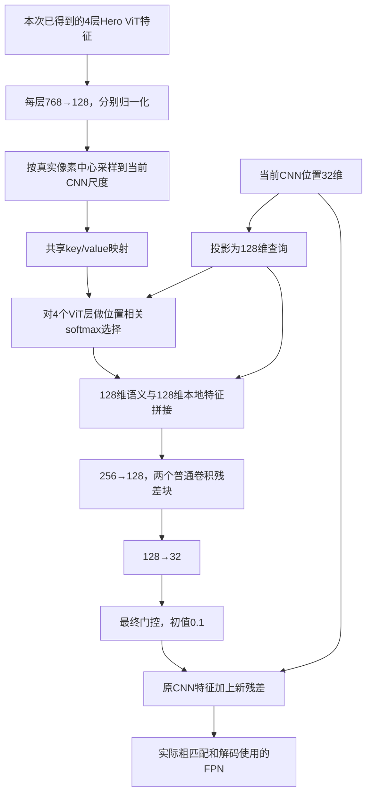
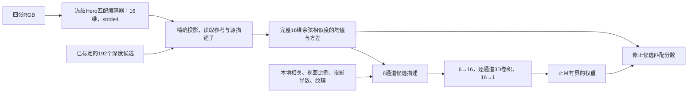

# 图片特征怎样真正帮助三维匹配

> 历史版本说明：保留设计与诊断依据；旧缓存和部分旧命令已归档。日常运行使用[当前配置](../../configs/current/README.md)，恢复方法见[整理记录](project_cleanup_20261019.md)。

本轮重点是改进图像编码与特征利用方式。一个网络即使有很多层，如果较好的图像信息
没有进入决定深度的匹配过程，增加层数也可能只让后面的修补更复杂。
我们参考MVSAnywhere与MVSFormer++，实现三项可分别开启的改动：
**让多层语义参与实际匹配特征；让已经训练好的匹配描述子直接参与候选评分；
让不同相机沿标定候选交流特征。**

## 1. 两个官方方法分别提供了什么启发

### MVSAnywhere：理解图像和寻找同一点，使用两条不同通路

它的匹配编码器输出16维描述子，可以把它理解成每个图像位置的“小型特征签名”：
两个相机如果看见同一块表面，它们的签名应该更容易匹配。
虽然类名是`ResnetMatchingEncoder(18,16)`，实际只保留ResNet的前段，
共7个卷积，约18.4万参数，**不是完整18层ResNet**。
结构包含最初7×7卷积、抗混叠下采样、两个残差块，以及64→128→16的输出卷积。
已有Hero权重让这16维特征经历过重建任务训练，优势不能只归因于层数。

另一条图像ViT负责较大范围的场景表示。Hero取六个中间层，
其中较早两层进入代价体的卷积编码，后四层以768维表示多次进入代价Transformer。
之后的DPT解码采用96/192/384/768维层级投影和128维融合。
因此，它不是把一个768维表示立刻压成32维，然后期待后面重新恢复全部信息。

这里有两个值得保留的原则：匹配描述子要经过适合匹配的训练；
较丰富的场景信息要在候选判断中持续发挥作用。
官方还使用元数据MLP处理参考与源特征、点积和几何信息；本项目的新分支没有复制完整MLP。
[官方匹配编码器](https://github.com/nianticlabs/mvsanywhere/blob/5bd49bba0992aa56060e1aa3bb40b2150b04726f/src/mvsanywhere/modules/networks.py#L138)，
[官方图像与代价ViT](https://github.com/nianticlabs/mvsanywhere/blob/5bd49bba0992aa56060e1aa3bb40b2150b04726f/src/mvsanywhere/modules/vit_modules.py)。

### MVSFormer++：让预训练语义、细节和其他相机在匹配前结合

它保留CNN与冻结DINOv2两条编码路径。CNN从原图分辨率开始处理，保留细节；
ViT提供第4、8、12层的768维表示，先逐层交流，再经256→128→64通道进入CNN金字塔。
匹配用的最终金字塔可以只有64/32/16/8维，说明**最终维度较小本身不一定是问题**，
关键还在于压缩前如何处理信息，以及有没有保住细节位置。

官方有两个位置进行跨视图交流：先在ViT旁路执行Side View Attention，
再在融合后的stride8特征上执行FMT的self/cross/self/cross，并把结果传向细尺度。
两处机制都是真正让一张图读取另一张图的特征。
本轮新增的`feature_exchange`也让图像特征跨相机交流，但只沿标定候选读取，
并增加拒绝消息的选项；它不是官方SVA/FMT的复刻。
[官方旁路与金字塔](https://github.com/maybeLx/MVSFormerPlusPlus/blob/bdd980cfbae9a863b5489e2ed973612b192d11a5/models/module.py)，
[官方FMT](https://github.com/maybeLx/MVSFormerPlusPlus/blob/bdd980cfbae9a863b5489e2ed973612b192d11a5/models/FMT.py#L140)。

## 2. 原来我们的信息在哪里被限制了

当前深CNN已有14个残差块，不能只继续用“太浅”概括全部问题。
更具体的限制有三点：

- 每个ViT层各自768→32维，然后固定分配到一个FPN尺度，其他尺度无法选择它。
- 默认ViT上下文只给解码器；实际粗匹配主要使用小数据训练的本地CNN。
- 已有官方16维描述子原先主要服务稀疏头，稠密路径的粗匹配没有使用它。

768→32线性映射最多保留32个独立方向，但不能据此声称“损失95.8%的有用信息”：
有用信息是否确实需要更多方向，仍取决于特征内容与任务。
所以本轮先改善压缩前的交互和信息去向，而不是直接把所有层宽度翻倍。

## 3. 新模块一：每个位置自己选择需要哪一层语义

代码：[`feature_enrichment.py`](../../jar/models/feature_enrichment.py)。
配置：`model.feature_enrichment`。当前设置新增 **2,956,292个可训练参数**。

以四张256×448图像为例，四层原始ViT特征各为`[4,768,16,28]`。
投影后各为`[4,128,16,28]`。处理stride4时，CNN是`[4,32,64,112]`；
把四个先验层采到这些位置后，得到`[4,4,128,64,112]`，第二个4表示ViT层数。
每个CNN位置产生四个分数，softmax得到四层权重，再组合成128维语义。
stride8、16、32执行同样过程，空间尺寸分别为32×56、16×28、8×14。

这样，物体边缘可以偏向较早的表示，弱纹理区域可以偏向较深表示；
这是可学习的选择能力，不是预先认定某层一定对应某种物体。
四个key/value来自**同一图像位置的不同ViT层**，不是其他相机，也不是全图所有像素。

后面的两个普通3×3残差块，在128维中同时处理邻近位置和不同通道，
让语义与CNN细节真正相互作用，最后才返回公共32维接口。
门控在所有分支归一化之后，初值0.1，避免紧接着的单独归一化把小残差重新放大。
原CNN残差路径和旧ViT解码上下文字典保留，冻结ViT每次只运行一次。

采样也有明确位置：ViT的patch中心是原图7.5、23.5……像素，
CNN格点是0、4、8……像素，不能直接把两张图resize后当作同一位置。
缺失相机和无效像素继续归零。上采样只重用已有先验，没有凭空生成小物体的真实像素证据。

## 4. 新模块二：保留官方16维匹配特征，学习何时相信它

代码：[`matching_evidence.py`](../../jar/models/matching_evidence.py)。
配置：`model.matching_evidence`。隐藏16维时新增 **609个可训练参数**，
另外复用已有冻结Hero匹配编码器，不能把其计算成本忽略。

256×448输入下，四目官方描述子为`[1,4,16,64,112]`。
我们不先用随机32维投影改变这16维特征的相似性，而是在每个精确投影位置直接比较完整向量。
有效源相机之间的平均相似度与方差，分别表示“总体是否像”和“相机之间是否意见不一”。

这两项加上本地相关均值、有效源视图比例、投影导数和纹理，共六项。
在stride16、192候选时，单参考图的输入尺寸为`[1,6,192,16,28]`。
1×1×1卷积映射到16维，逐通道3×3×3卷积读取附近候选与像素，再输出一个权重。
当前实验使用`initial_weight=2.0, max_weight=4.0`；这是配置值，
模块缺省值分别为0.5和2.0。学习的是该位置应加入多少官方描述子分数。

官方描述子的原图中心为1.5、5.5……像素，与本地CNN格点不同，
代码使用独立采样换算。该分支只改变分数，不增加视图支持、不把未知区域改成已观测。
它迁移了官方描述子并重新融合，**不等同于官方完整元数据匹配网络**。

## 5. 两项改动分别回答什么问题

第一项改变“拿什么特征去匹配”：让CNN位置主动读取全部ViT层，再与本地纹理融合。
第二项增加“已经学会怎样匹配的证据”：保留预训练16维描述子的相似度。
两项可单独开启；先区分各自收益，再判断是否互补，避免将联合效果全归因于网络加深。

局限也不同：语义融合可能把相似物体变得过于相似；官方描述子可能受CARLA域差异影响。
128维是可调整的工程起点，不是已证明的最优维度；两项组合也不能直接宣称首创。
跨视图交流由独立的`feature_exchange`分支承担，不能把“跨ViT层选择”称作“跨视图交流”。

## 6. 本轮配置与实验问题

对照为[`dense_direct.json`](../../configs/dense_architecture/dense_direct.json)：
首级从候选与图像特征直接预测深度编码，后续逐层修正；关闭稀疏头与stride4标定细化。
以下四组与它使用相同foundation权重初始化、TRAIN66/DEV25、seed17、
400步AdamW、学习率0.0003；**不是从dense_direct训练结果继续训练**。

| 配置 | 新匹配证据 | 跨层语义增强 | 全范围匹配步长 | 要回答的问题 |
|---|---|---|---:|---|
| [matching](../../configs/feature_architecture/matching.json) | 开启 | 关闭 | 16 | 预训练描述子能否改善粗候选证据 |
| [semantic](../../configs/feature_architecture/semantic.json) | 关闭 | 开启 | 16 | 语义进入真实匹配特征后是否更有用 |
| [joint](../../configs/feature_architecture/joint.json) | 开启 | 开启 | 16 | 两种改动是否互补 |
| [fine8_direct](../../configs/feature_architecture/fine8_direct.json) | 关闭 | 关闭 | 8 | 更细匹配格点是否比增强特征更直接有效 |

fine8_direct把候选位置从16×28增加到32×56，是原来的四倍；它没有开启上面两个新模块。
所有开关在JSON中修改，checkpoint仍写到`runs/deep_architecture_20261014`对应的数据盘软链接。
源码依据和更完整官方模块对应见调研记录（历史内容已归档，见[整理记录](project_cleanup_20261019.md)）。

## 7. 实际结果

以下为五组400步训练后的完整DEV25结果，均比较参考相机2的`native_depth`，
2–80米共同范围内的2,087,873个标签像素，覆盖率均为100%。MAE和RMSE单位为米，
AbsRel为相对误差，三者越低越好；20厘米成功率为误差严格小于0.2米的标签像素比例。

| 配置与原始报告 | MAE ↓ | RMSE ↓ | AbsRel ↓ | 20厘米成功率 ↑ |
|---|---:|---:|---:|---:|
| [dense_direct对照](../../runs/deep_architecture_20261014/dense_direct_dev/comparison.json) | 2.7207 | 5.3421 | 0.1133 | 22.13% |
| [matching](../../runs/deep_architecture_20261014/feature_matching_dev/comparison.json) | **2.5298** | **4.9370** | 0.1062 | **33.26%** |
| [semantic](../../runs/deep_architecture_20261014/feature_semantic_dev/comparison.json) | 2.5768 | 5.0463 | 0.1104 | 25.59% |
| [joint](../../runs/deep_architecture_20261014/feature_joint_dev/comparison.json) | 2.6142 | 5.2304 | **0.1042** | 33.04% |
| [fine8_direct](../../runs/deep_architecture_20261014/feature_fine8_direct_dev/comparison.json) | 2.7804 | 5.4980 | 0.1098 | 27.50% |

下表每格为“MAE（米）／20厘米成功率”；各距离段完整RMSE和AbsRel也保存在上面的报告中。

| 配置 | 近处2–10米 | 中距10–24米 | 远处24–80米 |
|---|---:|---:|---:|
| dense_direct | 0.4943／41.19% | 1.7728／8.20% | 7.9223／1.85% |
| matching | 0.4373／61.41% | 1.7545／14.06% | 7.2914／1.84% |
| semantic | 0.4881／48.16% | 1.8314／8.44% | 7.2983／2.30% |
| joint | 0.4119／59.23% | 1.6254／16.91% | 7.8159／1.90% |
| fine8_direct | 0.4142／50.91% | 1.7327／11.42% | 8.3531／1.47% |

**最明确的收益来自matching：整体MAE降低7.01%，20厘米成功率提高11.14个百分点。**
这支持让已有匹配描述子直接参与候选评分。但近、中距RMSE分别从1.0053、2.6455升到1.0879、2.8132米，
表明更多位置变准的同时仍存在较大的错误，不能说所有指标都改善。
semantic的主要MAE收益来自远处；近处只略降，中距反而变差，因此更丰富的语义未自动转化为精细定位。
joint相对matching进一步降低近、中距MAE，却使远距MAE从7.2914升到7.8159米，二者收益并非简单叠加。
fine8_direct改善近处，却恶化远处与整体MAE；仅把匹配格点加密，尚未带来总体提升。

这些是单种子、同路线小数据开发实验；自研分支借用了Hero先验，并非从零学习全部表征。
与完整官方模型的预训练规模和训练预算不同，不能把局部改动的收益等同于超过基线。
[已核查官方Hero实现的MVSAnywhere微调参考](../../runs/mvsanywhere_audit_20261013/dev_finetuned_verified/comparison.json)
在相同DEV像素上仍达到MAE **0.9384米**、RMSE 2.2880米、AbsRel 0.0513、20厘米成功率38.31%，
整体明显领先；这是CARLA微调结果，不是零样本成绩，也不是本轮400步等预算实验。

补充两组400步结果：

| 配置 | MAE ↓ | RMSE ↓ | AbsRel ↓ | 20厘米成功率 ↑ |
|---|---:|---:|---:|---:|
| [matching_refine](../../runs/deep_architecture_20261014/feature_matching_refine_dev/comparison.json) | 2.5417 | 5.1716 | **0.0991** | 33.24% |
| [exchange](../../runs/deep_architecture_20261014/feature_exchange_dev/comparison.json) | 2.6538 | 5.0684 | 0.1174 | 18.50% |

matching_refine在matching基础上重新开启stride4局部标定细化。
近、中距MAE分别改善为0.3847、1.5178米，但远距变为7.6972米，
整体MAE和RMSE均未超过matching。因此不能概括为细化总是有用或完全无用。

exchange在matching基础上开启下节的跨相机特征交流。
这轮没有获得总体收益，尤其20厘米成功率下降，暂不纳入推荐配置。
一个待检验的原因是：同一条射线的多个深度位置会混入不同物体特征；
即使精确投影限制了搜索位置，也未消除沿射线的匹配歧义。
将这样的粗尺度消息传到细尺度可能损害定位。这是结构假设，不是由上述数字单独证明的因果结论。
代码作为独立消融分支保留，默认关闭。

上述exchange的第一次训练以及matching_refine的第一次DEV评测被会话中断终止，
未完成目录以`_interrupted`结尾归档。表内只使用重跑完成后的报告；没有把部分帧结果记作完整评测。

## 8. 新模块三：沿标定候选交流图像特征

代码：[`feature_exchange.py`](../../jar/models/feature_exchange.py)，配置`model.feature_exchange`。
每个stride16位置沿其参考射线提出32个深度，精确投影到其他相机。
查询和键读取本地CNN及语义上下文，分数还可读取冻结的16维官方描述子。
softmax同时保留一个“不读取其他相机”的空消息选项。

读取的值是“源图CNN特征减去参考CNN特征”。两层交流中，值始终来自原CNN，
查询和键可以更新，尽量避免反复复制已经交流过的值。
最终增量经各尺度的1×1适配器和初始0.1门控，加到stride4/8/16/32。
低纹理、无视差、缺失图像、越界位置屏蔽；只有旋转时不传递深度相关消息。
候选数量的对数补偿避免仅仅增加源相机或候选就自动压低拒绝概率。

这是与“同一位置选择不同ViT层”不同的机制，但仍不等于官方SVA/FMT。
交流后的特征相关性不能作为新增的独立观测，支持数仍由原始几何与图像验证计算。

## 9. 候选排序是否真的变好了

最终深度变准，可能来自更好的跨相机匹配，也可能来自解码器更会利用场景先验。
为区分这两种解释，使用[`probe_image_features.py`](../../tools/probe_image_features.py)
检查DEV中第0、12、24帧的粗候选分数。标签仅在模型完整推理结束后用于统计。
三个帧合计981个有效GT格点，每隔16个原图像素取一个位置；四组模型使用相同的192个候选深度，
合法候选集合也相同。其中948个格点至少有一个合法候选，33个格点完全没有合法候选。

“第一候选命中”表示分数最高的候选与GT深度相差严格小于0.2米；
“前5候选命中”表示前五名中至少有一个满足条件，二者都以全部981个格点为分母。
“最近GT候选排名”先找合法候选中深度最接近GT的那个，再检查它排在第几名，越小越好；
该项只统计有合法候选的948个格点，即使最近的候选离GT仍较远，也不会删除它。
粗深度期望先对合法候选的对数深度加权，再取指数，其MAE也只统计这948个格点，
不使用网络的置信度或已观测标记筛选。

| 配置 | 第一候选命中 ↑ | 前5候选命中 ↑ | 最近GT候选平均排名 ↓ | 粗深度期望MAE（米）↓ |
|---|---:|---:|---:|---:|
| dense_direct | 11.93% | 26.20% | 26.62 | 13.48 |
| matching | 23.96% | 41.59% | 15.84 | 7.06 |
| semantic | 18.25% | 32.82% | 21.58 | 10.34 |
| joint | 24.67% | 42.51% | 15.18 | 6.84 |

matching与semantic在三个帧上都提高了第一候选命中率、降低了平均排名，
说明两项改动确实让粗候选的判断更接近标签，其中matching改善更明显。
joint在这三个帧的汇总结果略好，但完整DEV25仍是matching最好，
因此这里用于理解改动怎样起作用，最终配置选择仍依据完整开发集。

还要注意一个与网络排序无关的限制：**只有669/981，即68.20%的格点，
存在距离GT不足20厘米的合法候选。** 对当前离散候选和有效性掩码而言，
即使排序完美，第一候选命中率也不能超过68.20%；这不是连续稠密深度预测的准确率上限。
另外312个格点中有33个完全无合法候选，剩余279个可能受候选间隔或有效性屏蔽影响，
现有统计没有区分这两种原因，不能全归咎于图像特征不足。

这些分数包含特征相关、代价正则化、上下文以及预训练描述子修正的共同作用。
所以结果支持“完整匹配评分过程有所改善”，尚不能把收益全部归因于某个独立编码层，
也不能证明每个源相机都找到了同一真实表面。排除no-match后的排序还没有衡量网络拒绝错误匹配的能力。
这里仅分析三个开发帧，且粗格点与前面的全分辨率深度评测使用不同像素集合，
不能直接拿两种MAE相减来量化解码器的贡献。
