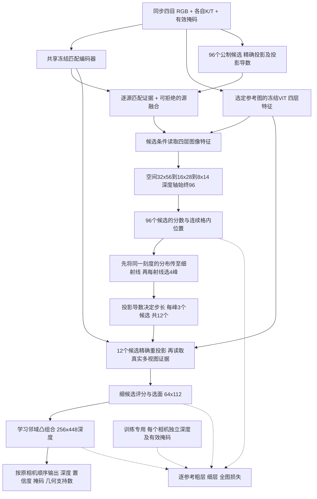
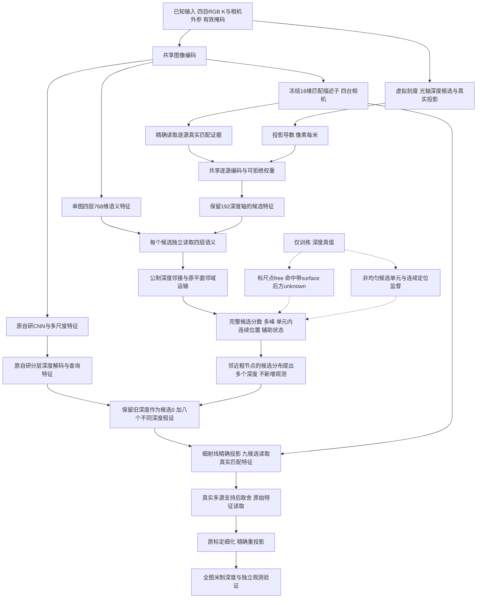

# 公制标尺候选重建网络：完整架构与实验

## 2026年10月24日：当前独立直接解码分支

本节对应 `ruler_direct` 的 `scale_transport` 配置。本文后面的10月22日图仍是历史完整架构，**不能当作本节结构的计算图**。当前分支保留两个冻结预训练图像编码器，独立实现候选取证、选面与深度读出；没有调用完整 MVSAnywhere 的 metadata/CPE/融合 ViT/DPT，也不再调用旧自研的整套候选场和迭代后端。权重来源和预训练预算差异见实验经验记录081、092。

这次重点不是继续加深图像网络，而是改变信息被压缩的时机：**在空间判断和射线细分之前，保留完整深度候选；到细射线重新取证时，才使用少量候选。** 新增的空间层只增加3,904个可训练参数，主编码器不变。这是有实测有限收益的结构方案，尚未达到baseline测试精度，不宣称首创。



一个或多个参考相机使用同一套解码参数；所有参考共享四目匹配编码，ViT对选择的有效参考图批量编码。每个参考的候选轴是自己的光轴深度，不能直接把不同参考的深度数组当成同一三维坐标。当前逐参考解码不等于已经实现单一共享三维世界场。

| 层或交接 | 单参考主要尺寸，省略batch | 本轮检查与处理 |
|---|---|---|
| 输入及匹配编码 | 主图4×3×256×448；匹配图4×3×512×896→4×16×128×224 | 保留冻结权重与像素相位；新一轮不同时改变分辨率，避免混淆结构收益 |
| 单图上下文 | 4层×768×16×28，每层适配为64维 | 由候选特征读取多层信息；不新增ViT，也不恢复Hero完整解码链 |
| 粗候选取证 | 32×96×32×56 | 真实精确投影与源掩码不变；标定可计算不等于匹配可靠 |
| 新空间判断 | 32×96×16×28及32×96×8×14 | 只缩小图像平面，96深度格不合并；归一化掩码池化、逐通道3D卷积和1×1通道融合，零初始化新增输出保持公共起点 |
| 新粗细交接 | 96×32×56概率传至96×64×112，再选4峰 | 原先先选4峰再复制到2×2射线，会过早丢失相邻射线需要的假设；现在只混合同一公制格，不把前后表面平均成一个深度 |
| 细层精确取证 | 32×12×64×112 | 仍是4峰×3点；插值J只设搜索半径，实际候选精确投影；只获取所选峰特征，避免生成32×96的高分辨率特征体 |
| 全图读出 | 1×256×448 | 保留现有学习凸组合；控制实验中它优于固定插值。没有为追求新颖而删去有效模块 |
| 多相机监督 | B×N×H×W，各自depth_valid | 不复制上相机GT；有图无标签仍参与匹配；缺图或缺标签分别处理；训练标签不会进入forward |

`use_geometry=false` 关闭的是旧可选几何特征/节点分支，不会关闭已标定投影、真实基线和J步长。`dense_support` 是几何可采样源数，不是遮挡认证。当前直接深度分支仍输出“待验证深度假设”；不能将全部预测点称为已观测表面，空间状态保留unknown。

数学上，细射线每个刻度的概率是相邻粗射线**同一刻度**概率的空间加权和；该刻度内的位置和特征再按其条件权重组合。先传分布，再选峰，避免先删后补。不同刻度之间不求深度均值。极低概率的归一化不能用固定1e-12截断后直接乘深度，否则权重和不再为1，会把米制位置缩小；本次已修复并补充极小概率/零概率/无效候选测试。

设计参考的是“候选存在时先联合解释”和“粗提议必须在细射线重新验证”的一般原则：[MVSFormer++](https://arxiv.org/abs/2401.11673)、[PatchmatchNet](https://arxiv.org/abs/2012.01411)。本实现没有移植其完整候选Transformer或PatchMatch网络；多尺度代价聚合和概率插值本身都有先例，不能把组合命名当作独创性证明。

实测与局限：相同2000步下，DEV全图MAE由.95217降至.93553m；固定权重TEST由1.67457降至1.59883m，但baseline为1.12001m。同GPU3完整RGB单上参考网络19.23→21.13ms，baseline21.73ms，速度余量已经很小。20cm成功率与远距RMSE并非都改善，详见研究记录090–093。该结果不包含旧后端，也不是四参考总耗时。四参考真实精度和新数据训练尚未运行。

当前剩余缺口仍在**候选解释与选面**：DEV同stride4，候选集合的事后最优MAE由.5013降至.4155m，实际选面却只从1.1280降至1.0916m。这里的事后最优使用GT，只是诊断；它说明新的候选供给没有被细层充分利用。不能把全部差距归咎数据，也不能据此直接堆更深编码器。下一次应检验细候选邻域的物理对应关系或选择目标，避免把每像素不同的12个候选编号直接当成公共深度轴卷积。该后续结构尚未实现或验证。

新数据配置与启动命令见[数据契约](../data_contract.md)，逐次实验结论仍统一记录在[research_memory](../research_memory.md)，不另建第二份经验库。

---

## 2026年10月22日：历史完整集成方案

本轮把空间标尺用于初始表面的取证与竞争，不再在最终深度上追加一个较重的偏差修正器。完整架构沿用原自研的图像编码与稠密输出，新增的核心在候选还没有被压成单张深度图时工作：比较逐源观测、公制局部变化和候选之间的关系，输出整条竞争曲线，再进行细粒度选面与标定细化。

它是已实现、可训练和推理的研究架构。公式成立的限定条件、程序通过、候选指标改善和完整模型改善是四件不同的事，不能从结构图推断性能已经达标。本轮没有调用完整 MVSAnywhere 初值通路，也没有修改原默认模型。精度保持对照与省算力主线分别报告，不能把两条路径的最佳数字拼在一起。

## 先理解标尺究竟提供了什么

假设在空气中摆一把刻度尺，我们能计算每个刻度在四台相机里应该落在哪个像素。这只说明“去哪里看”，不说明那个刻度处真的存在物体。

本架构不绘制虚拟 RGB 点阵，也不把相同 XYZ 位置编码直接当成相似度奖励。一个简单反例是：对两个视觉向量施加同一个正交位置旋转，内积不变。因此共同刻度本身不能区分真实对应与空气中的错误候选。

标尺实际改变以下计算：

1. 把不同相机里的图像变化换算为同一米制空间变化，检查真实特征是否相容。
2. 让候选在参考相机光轴深度相差0.25、1、4米的位置交换信息，而不把“不等距深度数组中的相邻编号”误当成固定深度跨度。
3. 先在少量射线保留完整深度竞争，再把多个深度假设移到真实细射线重新观察，区分“可以提出”和“确实有图像支持”。

第一项的完整纹理导数在消融中没有净收益，已从轻量主线删去，仅保留研究开关。第二、三项构成当前重点。它们都不添加新传感观测。真实匹配、纹理、遮挡与未知状态仍须分别处理。

## 完整计算图



可编辑图见 [公制标尺候选重建网络](diagrams/公制标尺候选重建网络_20261022.drawio)。

本轮集成继续使用原自研九候选选择头、原始特征读取器、标定细化与全图头。新候选核内部的连续偏移头有训练与独立评价；原九候选接口仍使用全局候选轴，不能声称该偏移已参与当前整网输出。粗节点分布只用于提出假设，不能用其插值相似度冒充精确高分辨率重匹配。

另有一条独立性能保持对照：完整保留原细候选场，只追加粗标尺核相对原 memory 的评分改变量。该路径确实保留了旧精度，但增加计算；它不是上图省计算主线的速度结果。

## 按代码执行顺序说明

### 输入与坐标

输入与原项目相同，只有 RGB、已知 `K`、`T_cam_from_rig` 和相机／图像掩码。rig 为右手坐标，x 前、y 左、z 上；CV 相机为 x 右、y 下、z 前；平移和深度单位为米。候选 Z 是参考相机光轴深度，不是沿射线长度。

本轮主图 256×448，匹配编码图 512×896，只输出上相机。后者是原自研已有设置，不是新增传感器或新图像。四个相机共享匹配编码参数；参考相机可以配置，其他相机参与取证。

实际层级尺寸如下。`R`是本次解码的参考相机数，当前为1；原生输出保留N个相机槽位，未计算槽位为invalid／unknown。

| 阶段 | 当前尺寸 | 设计用途 |
|---|---|---|
| 主图输入 | `[B,4,3,256,448]` | 保留原数据协议 |
| 匹配编码图 | `[B,4,3,512,896]` | 原自研已有的匹配输入 |
| 冻结匹配描述子 | `[B,4,16,128,224]` | 四台相机各编码一次，多阶段复用 |
| 参考图原始视觉信息 | 四层`[B,R,768,16,28]` | 在候选竞争前按需读取 |
| 原CNN多尺度 | 32通道，stride4/8/16/32 | 局部细节与原深度解码；参考快速路径按实际需要执行 |
| 初始匹配证据 | `[B,12,192,16,28]`，另有2通道统计及逐源观测 | 192个深度不提前平均 |
| 新候选核心 | `[B,24,192,16,28]`，两个交互块 | 有限公制邻接、平面运输与候选条件视觉读取 |
| 精确九候选 | `[9,19,64,112]` | 少量真实细格取证、独立选择 |
| 原分层解码 | 隐藏64通道，stride32→16→8→4 | 每级融合图像、上下文、父特征与候选信息 |
| 原全图细节头 | 16通道，256×448 | 接RGB局部信息，连续深度输出 |

24通道与两个块是本轮预算选择，不是已经证明的最优宽度／深度；没有做穷举搜索。更关键的设计选择是保留深度竞争、避免全局两两注意力、只对少数细候选精确取证。

### 共享编码与刻度生成

原自研前端生成四台相机的 16 维匹配描述子、CNN 多尺度特征，以及参考图的四层 768 维原始特征。冻结编码器只表示参数不更新，不表示图像无关；每帧必须重新编码。

候选格点使用原图整数中心 `16*j`。原始 ViT 特征中心为 `7.5+16*j`，不能直接按数组下标融合。`MetricRulerCandidateNetwork.aligned_raw` 先按真实中心对齐，再读取视觉内容。

匹配描述子采用 Niantic 原生 stride-4 格点，匹配图放大系数为 s 时，读取坐标为：

\[
u_f=(u+0.5)s/4-0.5.
\]

实际候选由反投影得到三维点，再用精确针孔投影读取所有源视图。投影导数只负责局部变化分析，不代替大范围精确投影。

### 公制纹理变化

这一节说明已完成消融的可选分支，不是当前轻量主线。代码先对单位化匹配描述子求像素梯度，再根据匹配图缩放和特征步长换算到 scene 像素。记图像梯度为 `∇F_i`，投影导数为 `J_i`：

\[
G_i=(\nabla F_i)J_i.
\]

`G_i` 表示三维点沿 rig 某方向移动一米时，视觉特征局部会如何变化。其最后两个维度为 `[16,3]`。这一步让相机内外参进入真实特征比较，而不是仅生成另一张位置图片。

若各视图真的观察同一个光滑表面，沿表面两个切向的特征变化应一致。因此 `G_i-G_ref` 应共享一个法向方向，堆叠差分至多秩一。设：

\[
A=\sum_i w_i(G_i-G_r)^\top(G_i-G_r),\qquad
q=1-\frac{\|A\|_F^2}{\operatorname{tr}(A)^2+\epsilon}.
\]

默认只计算 3×3 矩阵的不变量，不逐候选进行特征分解。`q` 较大提示不相容，但较小不证明匹配正确；线性纹理的错误候选也可能满足条件。实际 CNN 特征并不严格满足视点等变，DEV 诊断也已否定直接用理想阈值删候选。

八通道标尺证据保留缺陷、纹理能量、视差变化和有效支持等量。零纹理、缺视图、相机后方、梯度足迹出图或纯旋转不形成新的测距支持。预测值不能被直接标成已验证表面。

实际消融后，轻量版本将前五个纹理条件置零，只保留每米投影变化均值、最大值和真实可用源比例；不再读取特征梯度或计算 Gram。GPU91帧与真实RGB3帧均证实，这个减法与关闭相应通道的已训练模型输出完全一致，并节省约4.46ms。几何导数并未被当作测量深度，而是影响逐源取舍和公制邻接。

### 逐源取舍与四层视觉读取

逐源编码器共享权重，每个候选保留每台源相机的中心相关性、分歧、梯度能量和标尺变化。可靠性使用独立 sigmoid，并在聚合分母保留一个固定 null 权重：所有源都不可靠时可以同时拒绝，不必在坏视图中强选一个。

均值与最大值两个通路都服从同一个可靠性权重。否则模型即使在均值分支拒绝了坏视图，它仍可能从最大值分支污染结果。这个细节有独立测试。

每个深度候选再用自身 query 读取四层视觉特征。四层分别有 key/value 投影，同一像素处的不同深度可以选择不同层。投影仍然是信息压缩，并不保证保留全部信息；区别在于压缩后的多层内容在候选竞争尚保留时反复参与判断，不只在选峰后做修正。

### 公制候选关系

候选特征默认 `[B,24,192,16,28]`，两个交互块。每块在 `Z±0.25/1/4 m` 的位置线性读取候选特征，同时保留自身。逆深度非均匀，所以必须用实际候选值搜索插值区间，不能用固定数组步数冒充米制距离。

任一插值端点无效时不跨越该间隙；越出深度范围时屏蔽。所有 192 个候选仍保留，本轮没有复用已失败的单像素阈值删峰策略。

这里的米制坐标是参考相机光轴深度Z：斜射线上两点的欧氏距离还要乘反投影射线向量的长度。因此本实现不是rig空间XYZ各向同性均匀点阵，也不把Z间隔冒充单位射线距离。投影导数同样使用`dX/dZ`，与该参数化一致。

深度消息由当前图像内容和有界相对Z距离共同决定。之后复用原自研的两类平面邻域运输；它是已有模块，不计为本轮独创。计算量与候选数、固定邻居数线性相关，不构造所有候选的两两注意力矩阵。

### 多峰与连续输出

分数头在整个深度轴上进行竞争，不先把前景和背景加权平均成中间深度。每个候选的连续位置为：

\[
\hat Z_k=\operatorname{clip}(Z_k+\Delta Z_k\tanh(o_k),l_k,u_k).
\]

`[l_k,u_k]` 是实际米制单元边界，`ΔZ_k=u_k-l_k`。零偏移严格回到原锚点，任何大偏移也不能跨越该单元。候选核独立评价时先选峰，再取该峰内部的连续位置；当前完整后端尚未接入该位置。概率是候选分类模型的输出，不解释为物理体密度，也不额外机械乘以单元宽度。

另有三类辅助状态头和逐源可靠性输出。候选有效性只表示可采样和可计算；最终已观测表面／空间状态仍需独立验证。低置信度区域不会从精度评价分母中消失。

### 为什么不能直接把粗曲线插值成细表面

最初版本要求四个粗插值端点均有证据，才能让细格候选继续存在。这个规则对“传递真实观测”是保守的，却不适合“提出待验证假设”：一根细杆只在一个粗节点可见，附近其它粗节点没有对应证据，就会在提议前被删除。实际DEV25有约15.5%的细格GT射线完全无候选。

因此现在将两个接口分开：

- `field.valid`：后端仍可使用的取证有效性，保持保守，不因扩充提议而放开。
- `proposal_prior.eligible`：附近粗节点至少有一个对应候选证据，只允许提出这个假设，尚不能采用。

`coarse_proposal_prior` 对附近不同的2×2粗节点分别进行深度轴归一化，再按图像平面距离混合分布。固定尺度为16个原图像素，借用半径不超过 `sqrt(2)*16`。只在相同深度编号之间混合概率，不把前景和背景深度平均。一个粗节点给整条评分加常数，不影响提议。

从该先验提八个相隔至少1米的候选，再加旧学习式深度作为候选0，总数仍为九。旧的“两源粗插值支持”不会在这个阶段删除假设；但配置必须开启精确取证器，否则明确报错。

### 九候选精确观察与选择

对 `[9,64,112]` 的米制假设，在实际 `4*j` 射线上反投影，精确投到四台相机。读取原有匹配描述子，不再运行额外图像编码器。重新计算19维选择特征中的12–17维：真实相似度、候选内标准化相似度的均值／最小／最大／分歧与有效源比例。几何及粗评分上下文保留各自的“假设先验”身份。

非0候选最终须同时满足先验允许提出、参考图有效、至少两台真实源相机图内／有纹理／有视差支持。候选0保留参考有效回退。纯旋转、缺失图像、无纹理和无可用源均不能通过这一门槛。它仍不证明无遮挡或正确匹配。

随后使用原2,185参数共享评分头、留一源投票和原四层视觉读取器进行竞争。选择结果进入原标定细化与全图输出头，输出 `[B,N,256,448]` 原生槽位，独立推理导出时只保留实际计算的参考相机。全流程未调用完整 Hero 解码。

当前单参考配置没有另外三台相机的预测深度，原双向验证器不能确认多源深度一致，实际空间状态为100% unknown。深度图是可评测的预测假设，不是已经确认的表面。没有降低验证门槛来改变这个结果；需要以后完整多参考评价才能检查该验证器的表面覆盖。

### 评分上下文对照的准确边界

`fine_evidence_mode="residual"` 保留原192×stride4的全部真实取证。粗新核输出减去它的粗 memory 起点，只将这个差值乘固定权重加给原细场；K9分数与后端残差同步更新。粗上下文缺失时原细证据仍在，α为0时直接旁路。α=0.25只由TRAIN66的预设三组对照选定。

这个对照有小幅整网精度收益，但增加约12ms，没有充分理由将其当作最终实时结构。它与稀疏提议主线为独立配置，不组合开关掩盖归因。

## 把深度图用于标尺监督

不往深度图片画一排白点再当新标签。训练代码显式生成候选三维点，投到深度标签中读取真实 Z：

- 点明显在首表面之前：该相机观察到的 free。
- 点位于命中容差带：surface。
- 点在首表面后、图外、缺标签：unknown。

深度标签采用最近像素读取，避免跨遮挡边界双线性插值出虚构表面。非均匀深度单元另有类别和连续位置监督，候选点状态与单元包含表面是两种标签，不能混为一谈。

当前数据只有上相机深度，另外三路 RGB 没有对应 GT。故本轮状态辅助损失来自参考深度射线；缺失源 GT 不能被训练成“坏匹配”。`visible_correspondence_targets` 已实现双方有 GT 且均命中的对应监督接口，但当前缺失部分不使用。

训练总损失包括候选单元交叉熵、单元内米制定位、概率加权米制风险和类均衡标尺状态辅助项。GT 只传给损失函数，推理模型不接收 targets。实际关闭辅助项的同预算对照已完成：候选核心DEV MAE从1.11372退化到1.15012米，支持这种监督在当前条件下具有正则化收益；尚不是跨地图结论。

训练分两阶段：先冻结原编码与后端，训练158,052参数的候选核心；再冻结该核心和候选提议，适配原2,185参数的细选择头。硬选峰不是可微操作，当前不宣称用最终全图损失端到端穿过argmax训练了全部模块。每阶段都有自身的真实标签与损失。

## 对照与性能测量

三组结构使用相同参数量、候选、输入、原候选记忆起点和训练顺序：

| 配置 | 改变的内容 |
|---|---|
| appearance | 原标定投影保留，关闭新增标尺条件，用候选编号邻接 |
| channels | 常规几何通道，仍使用候选编号邻接 |
| metric | 公制纹理条件与实际米制候选邻接 |

三组都有同样的参考深度辅助监督，以先比较架构；随后再单独关闭该监督。不同 mode 的全部参数键与尺寸相同。未使用参数可以有零梯度，但实际训练分支不能断开。

候选阶段只在原图 `16*j` 射线上比较。原学习式初值也采到同一射线，不能拿该数字直接与全图 MVSAnywhere 或原最终深度比较。完整模型另从真实 RGB 重算，不读取特征缓存。DEV 选权重，新测试结果不能用于架构搜索。

须报告平均误差、RMSE、远近区间、边界、候选 top8 覆盖、无候选回退和固定 GT 分母。当前没有小物体实例标签，深度边界指标不能冒充小物体性能。

时延区分几何预计算、冷启动、稳态网络和完整管线。模型输入已在 GPU 的时间不是车端读盘／传输／融合总时间；候选数减少也不直接等于速度提高。

## 代码与实验入口

| 模块 | 路径 |
|---|---|
| 真实早期证据缓存 | `tools/cache_metric_ruler.py` |
| 公制导数与反例约束 | `jar/models/metric_ruler_geometry.py` |
| 图像证据提取 | `jar/models/metric_ruler_evidence.py` |
| 轻量几何取证与有界缓存 | `jar/models/metric_ruler_geometry_evidence.py` |
| 候选核心 | `jar/models/metric_ruler_network.py` |
| 粗假设传播与精确九候选取证 | `jar/models/metric_ruler_fine.py` |
| 标尺监督 | `jar/models/metric_ruler_supervision.py` |
| 完整模型封装 | `jar/models/metric_ruler_model.py` |
| 候选训练 | `tools/train_metric_ruler.py` |
| 完整 RGB 验证 | `tools/evaluate_metric_ruler_model.py` |
| 细选择头缓存／训练／完整验证／导出 | `tools/train_ruler_fine_selector.py` |
| 独立无标签CPU/GPU推理 | `tools/infer_metric_ruler.py` |
| 配置 | `configs/metric_ruler_20261022/` |

缓存、checkpoint 和完整日志保留于数据盘软链接 `runs/active/metric_ruler_20261022/`。固定几何以标定、尺寸、候选范围与格点共同 hash；图像相关量不能跨帧冒充几何缓存。缩放、裁剪、缺相机和候选改变必须更新关联掩码或缓存。

## 与相关工作的关系

[PRoPE](https://github.com/liruilong940607/prope/blob/main/prope/torch.py) 与 [URoPE](https://github.com/Applied-Intuition-Open-Source/URoPE/blob/main/urope/urope.py) 的启发是让相机几何改变交互规则，而不只附加绝对坐标。本架构没有复制其位置变换实现；URoPE 的 OpenGL 输入约定也不直接用于本项目 CV 外参。

[NP-CVP-MVSNet](https://openaccess.thecvf.com/content/CVPR2022/html/Yang_Non-Parametric_Depth_Distribution_Modelling_Based_Depth_Inference_for_Multi-View_Stereo_CVPR_2022_paper.html) 和 [GeoMVSNet](https://openaccess.thecvf.com/content/CVPR2023/papers/Zhang_GeoMVSNet_Learning_Multi-View_Stereo_With_Geometry_Perception_CVPR_2023_paper.pdf) 的启发是保留竞争分布并继承证据，而非只继承单个深度。原自研已使用候选轴和平面运输，不能把这些重新包装为本轮首创。

本轮可检验的新假设是公制图像变化、可拒绝的逐源取证与实际米制候选关系是否能共同改善早期选面。其有效性和首创性都需要分别验证，不能靠模块命名保证。

## 实际结果

以下均为真实执行结果，完整日志与逐帧记录在数据盘。[研发经验文档实验030–049](../research_memory.md#实验-030-虚拟公制标尺的数据与接入点核查)逐项区分事实、原因假设和失败条件。

### 候选核：相同stride16射线

这一表只比较DEV25的7,876个共同粗射线GT，不能与全图或TEST直接对比。原学习式初值采到这些射线为2.48407米，冻结memory为1.69826米。

| 相同158,052参数／800步 | DEV MAE／米 | DEV RMSE／米 | 判断 |
|---|---:|---:|---|
| 无新增标尺条件 | 1.11885 | 3.15074 | 共同新结构有候选阶段收益 |
| 常规几何通道 | 1.13733 | 3.11219 | 未优于无标尺 |
| 公制邻接＋完整纹理条件 | 1.11372 | 3.17543 | 只小幅MAE收益，不能称全面有效 |
| 关闭标尺三态辅助 | 1.15012 | 3.28185 | 辅助监督有正则化证据 |
| 公制邻接，关闭rank／能量 | 1.09805 | 3.01756 | 本轮候选核选择；远距仍有退化 |

完整纹理低秩项既不能作为表面证明，也没有净收益证据。后续用纯几何版本精确保留最后一行模型输出，省掉导数与Gram计算，而不是为了讲故事保留复杂分支。

### 完整稀疏架构：覆盖改善后仍需学会选面

从完整DEV25池看，邻域提议让oracle从0.71141降至0.57625米，无有效替代候选从17.55%降至6.28%。oracle只表示池中“存在更好的选项”，不等于网络已经会选。

实际旧初值在TRAIN为0.779米，在DEV为2.429米。原头续训过度学习保留候选0。为区分这个原因，新增训练期旧锚点质量增强：50%训练步骤用与GT无关的平滑log深度偏移，重新计算所有实际图像证据，不改标定、真值及八个独立提议。增强仅在训练发生，推理架构和耗时不增加。

另有米制目标审计：原损失中的期望米制项梯度仅为分类梯度的约0.2%–0.3%；少量大错占据绝大部分可改善米制误差。最后只做一个固定目标对照，将期望米制regret作为主项、0.1倍分类作为校准。

| 同一新提议池与精确取证 | DEV选面后MAE，stride4 | DEV最终MAE，全图 | DEV最终RMSE |
|---|---:|---:|---:|
| 原头起点，正确上下文 | 1.91544 | 1.25788 | 2.81949 |
| 干净样本续训 | best仍起点 | 未重复空对照 | 未重复空对照 |
| 初值质量增强＋分类为主 | 1.55106 | **1.15455** | **2.74799** |
| 相同增强＋米制风险为主 | **1.47771** | 1.15575 | 2.75402 |
| 原自研对照 | 1.17088 | 0.90176 | 2.47057 |

增强和目标对齐均有可归因的候选阶段收益，但风险组更好的初值没有传过原细化后端。选完整DEV结果较好的分类增强组导出研究模型，不按更好看的某个中间指标挑最终成绩。仍明显弱于原自研，未替换默认。

### 精度保持对照与统一速度

保留原细场的残差组合在DEV的最终MAE为0.89534米，原为0.90176；固定权重跨轨迹TEST200为2.16016，原为2.16354。只改善毫米量级，并且中距会退化，不能称为突破。

稀疏主线也已按完整DEV选择后固定权重，独立完成一次TEST200确认：选面／细化／全图MAE为2.56436／2.37689／2.35315米，最终RMSE5.40020。固定确认后没有再据TEST训练或改参数；它的精度仍未保持。[确认结果](../../runs/active/metric_ruler_20261022/sparse_test_confirmation/summary.json)与残差组合分开保存。

| 完整深度输出 | DEV25 MAE | TEST200 MAE | TEST RMSE |
|---|---:|---:|---:|
| 原自研 | 0.90176 | 2.16354 | 5.32505 |
| 标尺残差组合 | 0.89534 | 2.16016 | 5.28856 |
| 稀疏标尺＋增强选择器 | 1.15455 | 2.35315 | 5.40020 |
| MVSAnywhere首遍固定对照 | 0.96201 | 1.12001 | 3.46316 |

前三行是本轮新鲜完整运行；baseline精度沿用同一固定权重和协议的已保存全量评价，本轮重新测了其运行时间，没有重新训练。跨轨迹差距尚大，不能因DEV优于某个baseline就宣称泛化领先。

以下是同一5090／GPU6、FP32／TF32关闭、DEV3各预热10次后各90次轮转的网络时延。所有模型同开可用位置缓存，关闭／冷／热缓存深度逐元素相同，不缓存图像特征。

| 模型 | 中位时延 | 时延倒数 |
|---|---:|---:|
| 原自研 | 69.43ms | 14.40Hz |
| 标尺残差组合 | 81.69ms | 12.24Hz |
| 稀疏标尺＋增强选择器 | 57.60ms | 17.36Hz |
| MVSAnywhere首遍 | 21.93ms | 45.61Hz |

稀疏架构相对原自研省约17%网络时间，但精度未保持；残差组合精度基本保持，时间增加。当前没有同时满足精度与速度不退化的新版本，更没有全面超过MVSAnywhere。主图均256×448；自研匹配图512×896、baseline匹配图256×448是保留的内部差异，不能称同内部资源预算。频率不含读盘、上传和外部融合，不是车端更新频率。

四模型共同进程峰值4307.43MiB不是单模型显存；逐次额外分配也不能直接当作单模型总峰值。[统一计时证据](../../runs/active/metric_ruler_20261022/final_latency/summary.json)保留完整样本、SHA、位置缓存等价和设备信息。

### 可以直接复现的入口

所有参数在JSON中修改；命令行仅指定配置、设备和需要执行的动作。重新训练应先复制配置并设置新的输出目录，保留已有实验。正式推理模板`infer.json`的数据路径默认空，缺少路径会报错，不会切到随机数据。

```bash
# 早期真实图像证据缓存；其输入与GT分别保存。
official_methods/.venv/bin/python tools/cache_metric_ruler.py \
  --config configs/metric_ruler_20261022/cache.json --device cuda:0

# 候选核心训练；同文件夹有appearance/channels/metric/辅助监督消融。
official_methods/.venv/bin/python tools/train_metric_ruler.py \
  --config configs/metric_ruler_20261022/metric_no_jet.json --device cuda:0 --stage train

# 细选择阶段：真实重算clean与增强假设，随后训练、完整验证、导出。
official_methods/.venv/bin/python tools/train_ruler_fine_selector.py \
  --config configs/metric_ruler_20261022/fine_selector_anchor_cache.json --device cuda:0 --action cache
official_methods/.venv/bin/python tools/train_ruler_fine_selector.py \
  --config configs/metric_ruler_20261022/fine_selector_augmented_train.json --device cuda:0 --action train
official_methods/.venv/bin/python tools/train_ruler_fine_selector.py \
  --config configs/metric_ruler_20261022/fine_selector_augmented_eval.json --device cuda:0 --action evaluate
official_methods/.venv/bin/python tools/train_ruler_fine_selector.py \
  --config configs/metric_ruler_20261022/fine_selector_augmented_export.json --device cuda:0 --action export

# 已导出研究模型，真实DEV一帧、只读取RGB和标定。使用新output避免覆盖。
official_methods/.venv/bin/python tools/infer_metric_ruler.py \
  --config configs/metric_ruler_20261022/infer_augmented_fine_dev1.json --device cuda:0

# 四模型同卡计时，不读任何GT。
official_methods/.venv/bin/python tools/benchmark_ruler_models.py \
  --config configs/metric_ruler_20261022/final_latency.json --device cuda:0
```

完整推理权重包括冻结前端和后端参数，恢复不需要外部初始化权重；源码依赖仍是本项目及已有官方模块。输出NPZ可用`allow_pickle=False`读取，只导出实际参考图，保留hypothesis有效性和observed的区别。当前提供单卡分阶段缓存训练；未做新架构的多卡联训、长周期训练或车端部署。

最终相关CPU回归实际通过185项，报告保留在`runs/active/metric_ruler_20261022/final_cpu_tests.xml`；存在一项已有诊断将有梯度张量转标量的warning，不影响通过结果。GPU实际执行候选核及精确观察器N2/3/4、FP32/BF16前后向、真实RGB训练／完整DEV、严格checkpoint恢复、独立无标签推理和四模型计时。合成几何包括纹理平面及遮挡，不以四张无关随机图作为几何证据。

逐模型独立峰值显存、小物体实例指标、未见地图／标定泛化和GT绝对尺度来源仍需分别核实。两条完整新路径的固定跨轨迹确认均已执行且未达综合目标；该研究测试轨迹已有历史复用，不是新的盲测。即便本轮一些阶段有收益，也不能声称数据已经成为唯一限制。
