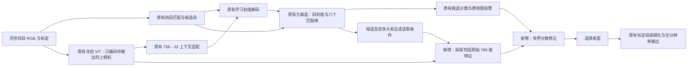

# 保留强特征后再判断表面：架构实现与三轮实验

结论：**已经实现一个独立、可关闭的原始特征读取模块，并完成真实 CARLA 短训及完整管线对照。保守训练后，DEV25 最终深度 MAE 从 0.9141 降到 0.9016 米；同预算只继续训练旧评分头为 0.9085 米。因此新模块的额外收益约为 0.0069 米，尚未解决初始表面选择的主要瓶颈。默认配置未切换。**

“保留更多特征可能有帮助”是合理假设；“768 压到 32 就是主要原因”仍未被证明。这次负面结果和小幅正面结果都保留，不把训练集改善写成泛化收益。

## 1. 改了哪里

保持同一套冻结 ViT、四目匹配、候选生成、标定、局部细化和最终输出头。只在**九个候选竞争、尚未选定一个表面时**增加读取原始图像特征的路径。



这不是接入另一个完整 MVSAnywhere，也没有新增第二个图像 Transformer。原来 768→32 的分支保留，用于保护已有学习能力；新路径从同一次 ViT 前向读取原始特征，不重新编码图像。

### 每一层的尺寸

以一个样本、四目输入、只输出上相机为例：

| 环节 | 尺寸 | 用途 |
|---|---|---|
| 场景 RGB | `[1,4,3,256,448]` | 原有场景输入 |
| 匹配 RGB | `[1,4,3,512,896]` | 同四张图的较高分辨率版本，不是新增相机 |
| 四层原始 ViT 图 | `[4,768,16,28]` | 上相机第 3/6/9/12 层；其他相机仍提供匹配证据 |
| 九候选的原有证据 | `[9,19,64,112]` | 深度、相对位移、匹配分数、支持和分歧等 |
| 候选读取条件 | `[9,64,112,64]` | 19 维先变为 64 维，再融合候选集合的均值与最大值 |
| 每个候选对四层的权重 | `[9,64,112,4]` | 不同候选可以读取不同图像层 |
| 候选条件非线性后的信息 | 每个位置 768 维 | 在压缩之前执行候选相关的变换 |
| 新的评分特征 | 每个候选 64 维 | 再降维、与候选条件共同预测一个分数修正 |
| 新分数 | `[9,64,112]` | 加到旧分数后，保持原有候选选择规则 |
| 最终深度 | `[1,4,256,448]` | 只计算上相机；未计算视图仍为无效/unknown |

实现按 1024 个位置分块，避免一次保留全部“九候选×768 维”的中间激活。候选集合内做均值/最大值聚合，不对整个三维场景做全连接注意力，也不假设相邻像素的第 k 个峰必然属于同一表面。

### 为什么不是直接把 32 改成 768

如果先做线性加权、再做固定线性压缩，两步在代数上可以交换；看起来“延后压缩”，实际未必增加读取能力。

这里先由候选控制四层混合，在完整 768 维内做归一化、候选条件偏移和非线性，最后才压到 64 维。这样不同候选可以提取不同信息，而不是永远接收同一个固定的低维摘要。

候选条件包含原有多目证据。它不等于新增了观测，也不能把单图先验计入视图支持数。新增模块没有直接拼入投影雅可比；已知标定用于原有候选与精确投影，后续几何细化仍保留原来的投影导数。

### 保护原有模型

- 最后一个评分层零初始化：启用模块的第零步，与原模型完整最终深度逐值相同。
- 分数修正有界，默认每个候选最多 ±4；不会修改标定或直接任意移动表面。
- 无效候选不获得新分数；候选合法性、至少两个源视图支持新峰等原规则不变。
- 低纹理、遮挡和未知区域沿用原有证据判断，单图上下文不能凭空证明 free。
- 全部参数在 `dense_decoder.raw_feature_reader` 中，保存、加载和关闭均独立。

## 2. 实验如何区分“有强特征”与“用好了”

固定基础检查点 `metric_supported_k9_train220_consensus.pt`。只训练新评分模块；旧头继续训练是对照。冻结图像编码器、候选和细化器。监督不进入推理。

五种共享实现的设置：

1. **完整条件读取**：保留 768 维，用候选决定读取方式。
2. **秩 32 / 秩 128 条件读取**：在原生 patch 格点做低秩压缩与展开，再执行相同读取。
3. **完整静态读取**：保留原始特征，但各候选共享读取方式，只在最终评分时与候选条件结合。
4. **旧评分头继续训练**：不使用新增原始特征路径。

低秩对照也改变了参数量和初始化，不是对原来 768→32 分支的完全等价替换。因此它不能独立证明原压缩是否足够。

基础完整条件读取 123,141 参数；静态读取 72,965；秩 32 为 172,293；秩 128 为 319,749；旧评分头 2,185。秩对照因包含压缩与展开矩阵，参数反而更多，不能宣称等参数比较。

评价用同一套 DEV25、上相机、2–80 米、相同 ROI 和固定标签分母。初值表是在 stride-4 的 `64×112` 格点上；最终表是全图 `256×448`。**1.122 米是细化前初值，0.914 米是最终输出，两者不能混为一个指标。**

## 3. 第一轮：完整帧短训暴露泛化退化

TRAIN66，660 步，学习率 0.001，AdamW，BF16 训练、FP32 评价，seed 43。

| 方法 | TRAIN66 初值 MAE | DEV25 初值 MAE |
|---|---:|---:|
| 原模型 | 0.7305 | 1.1220 |
| 旧评分头继续训练 | 0.6967 | 1.7461 |
| 完整条件读取 | 0.6521 | 1.4942 |
| 秩 32 条件读取 | 0.6630 | 1.4948 |
| 秩 128 条件读取 | 0.6594 | 1.3569 |
| 完整静态读取 | 0.6497 | 1.3821 |

完整读取的训练误差降低约 10.7%，但开发误差变差。旧头也退化，所以不能仅归咎于新模块。进一步诊断发现：

- 新增 DEV 误差的 88%–99% 来自 24–80 米。
- 完整读取改变了约 33.72% 的选面，其中约 68.27% 更差。
- DEV 候选 oracle 为 0.4686 米；约 24% 的位置在当前候选中没有 0.5 米以内的表面。oracle 只作标签诊断，不能用于推理。
- 旧胜者到 oracle 的分数差超过 8，仅占约 0.977% 像素、5.01% 基础误差。因此放大 ±4 修正限幅不是主要解法。

这先排除了“读取支路完全没梯度”和“只是限幅卡死”两种解释。

## 4. 第二轮：恢复全部监督帧

只把 TRAIN66 恢复为 TRAIN220，包含缺相机帧；其余学习率、660 步、损失不变。

| 方法 | 第 660 步 DEV25 初值 MAE |
|---|---:|
| 旧评分头继续训练 | 1.1688 |
| 完整条件读取 | 1.4277 |
| 秩 128 条件读取 | 1.3328 |
| 完整静态读取 | 1.2559 |

扩充帧数明显减轻旧头遗忘，但新读取仍未改善初值。不能说第一轮仅仅因为完整帧太少，也不能据此断言增加层数即可解决。

每组 660 步中，549 步梯度非零；111 步对应 37 个帧，这些帧全部有效监督位置都只有一个合法候选，选择决策没有可学习自由度，零梯度符合预期。

## 5. 第三轮：约束新先验不要压倒已有多目判断

保留原来的期望风险与分类损失，增加新候选概率相对旧概率的 KL 约束，权重 2。它只用于训练，不增加推理层。旧分数是软约束，不是强制答案；当监督持续提供足够收益时仍可改变选择。

全部 TRAIN220、660 步。另做一组独立低学习率 0.0002 对照，不同时加 KL。

| 方法 | 第 660 步 DEV25 初值 MAE |
|---|---:|
| 旧评分头＋KL | 1.1392 |
| 完整条件读取＋KL | 1.1707 |
| 秩 128 条件读取＋KL | 1.2397 |
| 完整静态读取＋KL | 1.1913 |
| 完整条件读取，低学习率无 KL | 1.2615 |

KL 显著减轻退化，但所有初值实验的最佳检查点仍是第零步。不能把这些 `best.pt` 描述成训练后获益模型。后面的完整管线比较明确使用第 660 步 `last.pt`，检查后续细化是否改变判断。

## 6. 完整管线发现小幅收益，不能冒充初值突破

六组都经过真实模型完整前向、原有两轮局部细化和最终输出，完整 DEV25；共同 GT 像素 2,087,873，预测覆盖率均 100%，没有删掉未知/困难像素改善 MAE。

表中使用原评测器的 `native_depth` 原始预测流。只输出上相机时，另一个需要深度互证的 `verified_dense_diagnostic` 流，本轮六组覆盖率都为 0；不能把下面的预测深度精度当成已确认三维表面或占据精度。

| 方法 | 最终全图 MAE（米） | 相对原模型改善/变差帧数 |
|---|---:|---:|
| 原模型 | 0.914082 | — |
| 首轮完整读取，无 KL | 0.929538 | 12 / 13 |
| TRAIN220，同预算旧头＋KL | 0.908542 | 21 / 4 |
| TRAIN220，完整条件读取＋KL | **0.901629** | 20 / 5 |
| TRAIN220，秩 128 条件读取＋KL | 0.904642 | 20 / 5 |
| TRAIN220，完整静态读取＋KL | 0.904606 | 19 / 6 |

完整读取相对原模型改善约 1.36%；相对同训练预算旧头，额外改善 **0.006913 米、约 0.76%**，19 帧更好、6 帧更差。相对静态读取或秩 128 只好约 3 毫米，尚不足以证明必须使用全部 768 维或候选条件化。

完整条件读取＋KL 的最终近/中/远距 MAE：0.2522 / 0.9254 / 2.0884 米；原模型为 0.2595 / 0.9426 / 2.1052。仍远未达到中远距 0.5 米目标。

**初值更准确不必然意味着细化后更准确。** 一个初值即使距离真值稍远，也可能落在局部匹配能纠正的范围；另一个较近初值可能属于错误表面。这是需要后续用逐候选细化结果验证的解释，不是本轮已证实的具体成因。本次已实际证实的是：只用初值 MAE 选检查点，会漏掉这里的小幅最终收益。

## 7. 实际速度与一次结构减法

单卡 RTX 5090、FP32、batch 1、四目输入只输出上相机。同三帧 DEV，每帧预热 5 次、计时 20 次，前后 GPU 同步。下表使用第三轮真实已训练权重，计入完整模型内部匹配、选面、细化、输出与几何验证，不含读盘、图像解码和搬运。

| 模型 | 完整前向中位数 | 读取模块单独中位数 | GPU allocated 峰值 |
|---|---:|---:|---:|
| 原模型 | 74.91 ms | — | 2697 MiB |
| 完整条件读取＋KL | 81.21 ms | 5.55 ms | 2719 MiB |
| 秩 128 条件读取＋KL | 80.62 ms | 4.32 ms | 2720 MiB |
| 完整静态读取＋KL，计算共享后 | 79.62 ms | 3.71 ms | 2719 MiB |

这几项在上述单参考设置下小于 100 ms，但不等于完整四参考三维场景或车端已达到 10 Hz。完整条件读取约增加 6.31 ms，未实现免费精度提升。计时仅三帧微基准，不能代表所有路线；不与另一次运行的 71.96 ms 基础耗时混算增量。

静态分支里，所有候选读取的是同一份图像摘要，原实现对九个候选重复执行了高维混合与压缩。现改为每个像素计算一次，再共享给九个候选。数学定义与参数不变，候选条件分支不改。新增 8 项 CPU 对照检查旧/新写法的输出、输入梯度和全部参数梯度，并核查真实 DEV25 最终结果不变。避免了为了微小收益保留不必要的重复计算。

详细逐次计时和内存定义：`runs/candidate_revision_20261018/raw_feature_reading/latency_trained_fp32.json`；配置是 `configs/raw_feature_reading_20261019/benchmark_trained.json`。单模块计时不包含候选生成，不能替代完整模型增量。

## 8. 这次对架构的认识

当前证据支持保留“原始信息作为可再读取的记忆”这个研究接口，但不支持把所有差距归结为通道数。主要还有三个限制：

1. **读取发生得偏晚。** 当前只重新评分九个候选，没有改变原学习初值，也不能恢复候选池里不存在的表面。
2. **单点内容解释不等于空间几何推理。** ViT 特征已经含图像上下文，但新模块仍主要在同一像素的候选间竞争，没有让邻域表面共同解释遮挡、连续平面与细物体。
3. **单图强特征不能恢复已丢弃的多目描述子内容。** 若源/参考向量已变成相似度统计，再加入完整参考图特征仍不能还原原来的对应关系细节。

下一步更有依据的方向是：让紧凑的候选结构在淘汰为九个之前读取原始记忆，并让评分目标考虑后续可细化性；同时保留按证据拒绝错误先验的机制。这是后续假设，本轮未实现成已验证的新结果。没有复制完整融合 ViT 或 DPT，也没有宣称本模块具有已确认首创性。

设计借鉴的是条件化读取与延后信息压缩的通用原则。参考：[MVSAnywhere 原论文](https://arxiv.org/html/2503.22430v1)、[Perceiver IO 的查询读取思想](https://arxiv.org/abs/2107.14795)、[FiLM 的条件化机制](https://arxiv.org/abs/1709.07871)。这些参考不构成对当前具体组合的首创证明。

## 9. 文件、配置与复跑

- 模块：`jar/models/raw_feature_reader.py`。
- 同次编码原始特征出口：`jar/models/deep_encoder.py::forward_features(return_raw=True)`。
- 接线：`jar/model.py`、`jar/models/dense_decoder.py::_recover_initial`。
- 严格独立权重分支：`jar/multifocal/checkpoint.py`。
- 配置集中于 `configs/raw_feature_reading_20261019/`；结构、训练设置和输出路径都从文件读取。

```bash
cd /home/liuzonghao/3Dscene/jar_reconstruction

# 缓存真实模型候选与同一次编码的原始特征
official_methods/.venv/bin/python tools/cache_raw_feature_candidates.py \
  --config configs/raw_feature_reading_20261019/cache.json --device cuda:0

# 第三轮完整条件读取；复跑前在JSON里设置新的output，避免覆盖记录
official_methods/.venv/bin/python tools/train_raw_feature_reader.py \
  --config configs/raw_feature_reading_20261019/round3_trust_raw.json --device cuda:0

# 合并为可用原项目推理入口加载的完整权重
official_methods/.venv/bin/python tools/export_raw_feature_reader.py \
  --config configs/raw_feature_reading_20261019/round3_trust_raw.json \
  --checkpoint last --device cpu

# 完整模型接线、两步反向、缺相机和标签隔离短测
official_methods/.venv/bin/python tools/check_raw_feature_integration.py \
  --config configs/raw_feature_reading_20261019/raw_conditioned.json --device cuda:0
```

缓存训练器是单卡固定候选实验，独立保存模块优化器；不是完整端到端或 DDP 训练。完整模型导出只用于推理/初始化，不伪装成完整优化器续训。以后使用通用训练入口训练此分支时，需要在配置里设置 `loss.dense_surface_recovery > 0`，并按目的设置 `train.trainable_prefixes`；硬选面本身不能向评分器传播深度回归梯度。

启用字段是 `model.dense_decoder.raw_feature_reader.enabled`；`conditioned` 控制候选条件读取，`memory_rank=0` 表示保留原始维度。已有完整分支权重做运行时旁路消融，可设 `residual_scale=0`；直接删除分支后不能再声称严格加载了原完整检查点。

### 实际检查与存储

已实际执行针对性 CPU 测试 **116 项通过**，涉及新读取器、分支权重、训练约束、深编码器、稠密解码器和单参考执行。不是声称整个项目的全部测试都已运行。

```bash
official_methods/.venv/bin/python -m pytest -q \
  tests/test_raw_feature_reader.py tests/test_raw_feature_checkpoint.py \
  tests/test_raw_feature_training.py tests/test_deep_encoder.py \
  tests/test_dense_decoder.py tests/test_nested_checkpoint.py \
  tests/test_reference_fastpath.py tests/test_reference_queries.py
```

GPU0 真实 DEV 帧检查通过：缓存/完整模型候选与分数逐值相同、零初始化完整最终输出逐值相同、改标签不改变推理、两步反向后所有读取支路梯度有限非零、冻结参数无梯度，以及缺一/缺三台源相机仍有限。缺图遵循零占位及同步掩码契约；顶层仍拒绝 NaN 图像。测试构造时的契约错误已修正，未通过放松模型校验来掩盖。

大文件全部经 `runs/candidate_revision_20261018` 软链接存到数据盘：

`/data/liuzonghao_data/3Dscene_runs/candidate_revision_20261018/raw_feature_reading/`

包含缓存、14 组短训、完整检查点、三轮诊断、完整管线六组对照、GPU 接线与计时记录。`round12_train_source.py` 保存加入 KL 前的实际训练器源码，其 SHA 与前两轮记录一致。

以上三轮开发阶段未读取 TEST、未重新训练基线、未运行长训练；DEV 曾用于选参且同路线可能有空间重叠，不能写成独立跨地图泛化。原始深度采集脚本仍未取得，绝对尺度定义的既有疑问尚未消除。用户随后要求的冻结 TEST200 与统一计时补测见下一节。

## 10. 用户要求补测：TEST200 与统一运行时间

本节为后续新增实际运行，固定第三轮第 660 步权重，不根据 TEST200 调参。完整读取、静态读取和同预算旧评分头各运行全部 200 帧。共用 15,196,011 个 GT 像素，三组覆盖率均为 100%。该轨迹此前已用于研究诊断，仍不是全新盲测。

| 自研版本 | TEST200 MAE/m | RMSE/m | AbsRel | 20cm成功率 |
|---|---:|---:|---:|---:|
| 原九候选＋视角稳定性 | 2.220637 | 5.422297 | 0.164979 | 36.90% |
| 同预算旧评分头＋KL | 2.222808 | 5.443394 | 0.163343 | 37.76% |
| 新完整条件读取＋KL | **2.163355** | **5.324614** | **0.159257** | 37.40% |
| 新静态读取＋KL | 2.209971 | 5.399960 | 0.163042 | 37.23% |

完整读取相对原版降低约 2.58% MAE；相对同预算旧头降低约 2.67%，200 帧中 186 帧 MAE 更低、14 帧更高。旧头在 20cm 成功率上仍略好，不能说新架构在所有指标上占优。完整读取近/中/远距 MAE 为 0.9988 / 1.6583 / 6.6117 米，远距仍明显不足。MVSAnywhere 低分辨率首遍 TEST200 MAE 为 1.1203 米，当前自研尚未接近它的整体能力。

另在同一张 RTX5090 上串行测量各方法：FP32、batch1、同三帧 DEV、每帧 5 次预热与 20 次正式计时。所有方法四目输入、只执行上相机参考；正常完整 model(inputs)，无标签、无预测缓存替代模型前向。下表为同步墙钟中位数，频率为 1000/中位毫秒；不含读盘、图像解码、搬运和公共输出转换，不等于车端或四参考场景频率。

| 方法 | 前向中位数/ms | 等效Hz |
|---|---:|---:|
| Fast-MVSNet | 13.62 | 73.41 |
| SimpleRecon | 56.11 | 17.82 |
| MVSAnywhere 256×448 首遍 | 64.21 | 15.57 |
| MVSAnywhere 512×896，含范围重估 | 162.15 | 6.17 |
| 自研九候选＋视角稳定性 | 75.01 | 13.33 |
| 自研完整条件读取＋KL | 79.80 | 12.53 |
| 自研静态读取＋KL | 78.72 | 12.70 |

旧 Fast-MVSNet/SimpleRecon 的四参考计时不能除以四冒充新结果；上表均为本次真实单参考前向。高分辨率 MVSAnywhere 包含一次范围重估，低分辨率行关闭它，二者不是只改变分辨率的单因素速度对照。自研使用 256×448 场景编码和同四图的 512×896 匹配支路。速度数值取同三帧 DEV 微基准，不是 TEST200 平均耗时。

实际配置和产物：

- `configs/raw_feature_reading_20261019/full_test200_trust_{raw,static,old_control}.json`
- `configs/weekly_runtime_20261019/benchmark.json`，基线单参考配置在同目录。
- `tools/benchmark_weekly_models.py`：复用既有计时函数和官方分辨率适配，不修改模型核心。
- `runs/candidate_revision_20261018/raw_feature_reading/full_test200/{raw_conditioned,raw_static,old_control}/comparison.json`，各有 200 行逐帧记录。
- `runs/candidate_revision_20261018/raw_feature_reading/weekly_runtime/summary.json`：全部原始计时、权重 SHA、输入与输出尺寸。
- 同目录 `comparison_with_accuracy.json`：两组数据的深度指标与本次计时汇总，未测字段保留 null。
