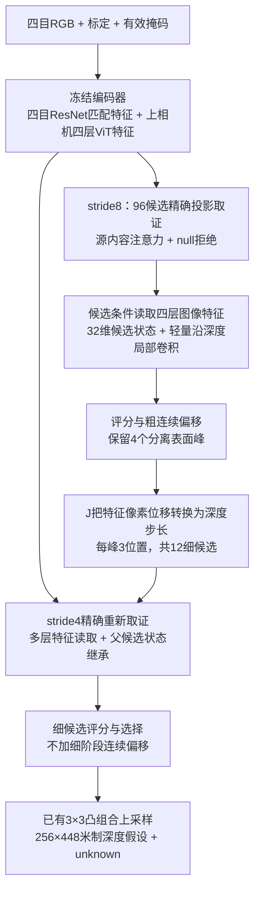
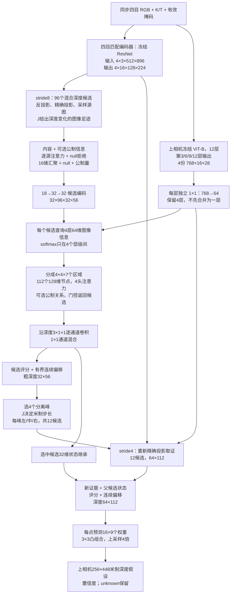

# 公制标尺匹配、融合与直接深度解码：2026-10-22 研究报告

**版本范围：Direct 首轮验证、结构减法、集合监督与读出适配、三项多深度节点返回控制、最终五方完整RGB验证和配对测速，以及固定DEV选择的TEST200确认；另含旧后端的覆盖修复与选择器适配。** 本文解释架构、实验和证据，不替代持续维护的 [research_memory.md](../research_memory.md)。后续版本增量更新，不覆盖本轮失败记录。

最新结果：当前固定候选关闭细阶段偏移和额外场景融合，完整网络耗时 **18.0818ms**，同卡MVSAnywhere首遍 **21.7661ms**，耗时减少 **16.93%**。DEV25 MAE为 **1.01579m对0.96201m**，但固定权重TEST200为 **1.84984m对1.12001m**，RMSE **4.74201m对3.46316m**。因此，**速度优势已得到验证，跨轨迹精度仍明显不足；DEV接近不能代替TEST接近，更不能宣称精度与速度同时超越baseline**。18.0818ms来自相同选定权重的DEV3交替计时，TEST确认本身不计时。

另一个得到支持的结论是：公制面片的真实跨视角投影，确实能改善局部候选区分；修复传播后，九候选集合的事后最好误差也降低约11.54cm，但旧选择器选得更差。只适配选择头没有解决失配，反而学到过多退回旧深度。Direct 的另一组实验则是细层仅好6.52mm、原上采样收益变小；这两类问题应分别处理，不能用最终变差直接否定前端，或笼统归因于细化层。下面保留完整证据和失败边界。

## 1. 本轮比较到底在比什么

| 项目 | 实际设置 |
|---|---|
| 输入 | 同一时刻四台广角相机；不使用 tele、历史帧、雷达或 GT 推理输入 |
| 输出 | 上相机一张 256×448 光轴米制深度图；不是四参考完整重建耗时 |
| 自研图像预算 | 场景图 256×448；同帧额外提供 512×896 的匹配图 |
| baseline 图像预算 | 场景与匹配均为 256×448 |
| 新训练与最终确认 | TRAIN66；只在DEV25选checkpoint与架构；固定权重后仅执行一次TEST200确认，不反选、不追加训练 |
| Direct 训练 | 相同 seed 47、帧序、AdamW、学习率 0.0002、权重衰减 0.0001、2,000 步；每 200 步验证 |
| 完整测速 | RTX 5090 GPU3；FP32、关闭 TF32；相同位置编码缓存；DEV3，每模型共 90 次交替测量 |
| 计时边界 | 含 RGB 编码、匹配、候选生成和全图输出；不含读盘、CPU 到 GPU 搬运、GT 指标计算 |
| 深度评价分母 | 固定 GT 范围、ROI 和有效像素；unknown 不删除，非法深度直接报错 |

两种方法的匹配图预算不同，已明确列出。这是当前各自配置的完整管线对照，不能写成“所有输入分辨率与算力完全相同”。单次上相机深度约 52 Hz，也不能直接换算成车辆上的四视角重建更新频率。

原始深度采集脚本仍未核实；本轮沿用既有数据合同，没有利用测试标签重新拟合尺度。新地图、新阵列、天气和真实车端泛化均未验证。

新Direct训练入口目前是**单卡、冻结编码特征的研究脚本**，尚未接入DDP，也未验证长训练或整网混合精度的精度与速度。模块GPU FP32/BF16前后向通过不等于整网AMP已经验证；旧项目具备的多卡脚本能力不能直接算作新架构已支持。

## 2. 为什么标尺不能只成为几个附加通道

一个候选点投影到三张源图后，标定告诉我们“应该在哪里取特征”；它没有告诉我们这些像素是否来自同一表面。遮挡、重复纹理、反光、无纹理，仍需图像证据判断。

本轮将标尺的作用拆成三个问题：

1. **匹配能分辨多小的深度变化？** 用投影导数估计米制变化对应多少特征像素，再结合内容选择源图，保留拒绝所有源图的选项。
2. **哪些候选可以交换信息？** 候选之间的关系应来自内容和物理位置，而不只是给中心特征一个权重，然后盲目平均邻居。
3. **怎样用有限计算读取更多有效证据？** 先保留多候选，再在少量被选峰周围读取精确的新图像证据；不把大范围线性近似当作真实投影。

这是一套待检验的设计原则，不是已证明的创新贡献。尤其是，标定给出的可辨别能力不能直接当成匹配置信度。

### 2.1 调研依据与本实现的关系

| 原始工作 | 值得吸收的原理 | 本轮采用与边界 |
|---|---|---|
| [PETR](https://arxiv.org/abs/2203.05625) | 将三维坐标信息编码进图像表征，使 query 能在三维位置条件下读取图像 | 认可“几何应参与特征解释”；没有复制其检测 query、检测头或整条网络 |
| [PRoPE](https://arxiv.org/abs/2507.10496) | 相机内外参可作为注意力中的相对关系；不仅是给每个 token 附加射线向量 | 本轮检验了源图注意力与候选关系偏置；并非 PRoPE 算法实现，也不声称继承其泛化结果 |
| [URoPE](https://arxiv.org/abs/2604.18747) | 在射线上取三维锚点，投影进另一图像，再建立位置关系 | 本项目已有显式深度候选，因此重点验证候选的真实投影差；没有照搬其深度锚点 RoPE |
| [ACMM 官方实现](https://github.com/GhiXu/ACMM/blob/master/ACMM.cu) | 局部平面诱导的对应窗口、同刻度匹配与可靠源视图选择，比单点亮度更有约束 | 公制面片用真实投影后的同刻度描述子比较；当前没有实现 ACMM 的完整 PatchMatch、双边 NCC 或多尺度几何一致性 |
| [GoMVS](https://wuuu3511.github.io/gomvs/) | 聚合相邻像素的候选前，要把邻域候选映射到同一几何表面解释 | 启发了平面方向候选读取；本轮只测试固定正视/地面假设，没有 GT 法线，也没有复制其完整网络 |
| [HRoPE](https://arxiv.org/abs/2610.28284) | 用局部倾斜平面及其单应关系，让注意力考虑真实面片的透视变化 | 2026-10-20 的相关预印本已涉及“表面感知位置编码”；我们的固定面片取证不能据此宣称首创，且尚未实现其注意力变换 |
| [RAFT 官方上采样代码](https://github.com/princeton-vl/RAFT/blob/master/core/raft.py) | 学习局部凸组合，让低分辨率预测生成全图输出 | Direct 采用同类 3×3 凸组合思想，但对象为米制深度，空间上采样不能把深度数值乘 4 |

[MVSAnywhere](https://arxiv.org/abs/2503.22430) 将多视角匹配与单图先验结合。本轮保留已有自研 checkpoint 中的冻结匹配 ResNet 和四层 ViT 特征，**不加载它的 metadata MLP、cost-volume Transformer 或 DPT 深度头**。预训练编码器来自已有工作，必须标注；独立解码器不是完全从零训练的整网。

还有一个需要避免的数学误用：如果给已经对应同一三维点的 query 和 key 施加相同正交旋转，二者内积不变，不能凭“加了三维旋转编码”就认为注意力得到了新约束。应先确定关系项确实改变了什么信息。

## 3. 先做减法：为什么建立独立 Direct 架构

旧完整模型保留了自己的 CNN/FPN、学习式初值、密集候选场、九候选重选、四层 raw 特征反复读取、几何细化和全图头。它们并不是全部逻辑重复，但大量计算先后围绕多个候选表示执行；一个新粗候选核还要适应旧后端的评分与支持条件。

速度审计显示：原自研完整网络约 70 ms 的主要代价不只来自编码器，更在细候选取证、候选场解释和后续九候选/细化链。仅复用首遍 sweep 可以省约 2 ms，无法填平与约 22 ms baseline 的差距。[速度审计](latency_audit_20261022.md)、[精确复用实验](../../runs/active/ruler_attention_20261022/sweep_reuse/summary.json)

Direct 用一条新的粗到细候选路径替换上述整个解码链：

- 保留两个冻结预训练编码器。
- 删除旧 CNN/FPN、旧 learned initializer、旧 192 候选细格场、旧 K9、旧 GN 和旧 dense head。
- 粗阶段只维护 96 个深度候选；用少量场景节点交换全局信息。
- 选出 4 个分离的峰，细阶段每峰重新读取 3 个深度位置，共 12 个候选。
- 连续偏移直接影响输出，最终用一次学习式凸组合上采样。

这不是“删掉这些模块已被证明无损”。本轮新网络更快，但精度尚未达到 baseline；它验证的是一种更简洁的可运行架构及其当前上限。

### 3.1 当前DEV候选：保留取证，删除未证明有效的场景压缩

最终已完成RGB、速度与固定TEST确认的配置是`direct_no_scene`。以下是它实际执行的流程，**不包含下文实验过的场景节点、深度节点bank或几何注意力偏置**：



它保留96个粗候选、4峰×3个细候选，特征通道仍为32；四层768维ViT各自适配到64维并由候选查询。几何继续决定实际采样位置和细搜索步长；源注意力按图像内容保留或拒绝证据，null不强迫采用差源图。**额外公制bias与绝对information通道均关闭，不能把这版的成绩归为几何注意力创新有效。**

可训练解码参数由406,267减为222,135。为保留开关和旧权重兼容，checkpoint仍保存被冻结、不执行的场景模块参数，因此不能宣称权重文件或整网参数同比缩小；两个冻结编码器也不计入上述可训练解码参数。去掉额外场景节点不等于没有全局上下文，冻结ViT本身仍提供图像级表征。这里的减法哲学是：**让几何负责获取可比较的证据，把未显示净收益的重复解释步骤移出当前路径。** 减法的净精度收益目前来自DEV同预算对照；TEST只确认这一固定版本，没有比较所有消融，因此不是证明无场景节点在跨轨迹也最优，更不是证明全局推理无用。[当前候选配置](../../configs/ruler_attention_20261022/direct_no_scene.json)、[训练记录](../../runs/active/ruler_attention_20261022/direct_no_scene/summary.json)

## 4. Direct 首轮完整实验形态与每层尺寸

**本节保留首轮架构以解释消融来源，不代表3.1节当前候选仍启用所有模块。** 当前候选跳过场景节点融合，且关闭细阶段连续偏移；图中的其他主要取证、读取、候选传递和上采样步骤保留。

以下以 batch=1 为例。维度顺序明确区分：`B` 为批次，`V` 为相机，`C` 为特征通道，`D` 为深度候选，最后两维为图像格点。



### 4.1 编码与像素中心

上图 ViT 输入来自上相机 256×448 RGB，按已有编码器的 `14/16` 缩放成为 224×392，再经 14×14 patch 化得到 16×28 特征。其原图 patch 中心是 `7.5 + 16j`；匹配 ResNet 的中心是匹配图中的 `1.5 + 4j`。两者不是同一套格点。

因此取特征时分别使用相应坐标换算，不用简单 `u/stride` 猜测；源图候选均采用完整相机投影。推理匹配特征还执行 FP16 后转回 FP32 的量化，以严格匹配本轮训练缓存合同；该开销已计入完整时间。

### 4.2 粗阶段逐层定义

| 操作 | 输入 → 输出（省略 batch=1） | 设计作用 |
|---|---|---|
| 单图四层适配器 | 每层 `768×16×28 → 64×16×28`，共4份 | 每层保留独立信息，避免最初就合成一个32维向量 |
| 深度候选 | `96×32×56` | 2–16m 使用48个均匀逆深度位置；16–80m补48个米制等距位置 |
| 精确源图采样 | `4×16×96×32×56` | 4个槽位中参考视图被屏蔽，最多3个源图提供证据 |
| 源图值编码 | 拼接参考、源、逐通道乘积、绝对差：`64→16→16` | 不先把描述子压成单个相关性分数 |
| 源图融合 | `16×96×32×56`，另有 null 与公制量各1维 | 内容、几何和拒绝选项共同控制来源 |
| 候选入口 | `18→32→32` 的1×1卷积 + GELU | 每个候选拥有32维状态；另加入3维归一化深度位置编码 |
| 层级读取 | query `32→64`；与4份64维 raw 特征比较；读出 `64→32` | 同一像素不同深度候选可以读取不同的编码层组合 |
| 场景汇聚 | `96×32×56` 候选分为 `4×4×7=112` 区域；节点128维 | 全局交互不对172,032个候选两两计算 |
| 节点 Transformer | 112 token，128维，4头，1块；前馈 `128→256→128` | 跨区域交换粗场景信息 |
| 返回候选 | 节点 key/value `128→32`，内容 sigmoid 门控 | 保留全部候选残差；112节点不是唯一的信息通路 |
| 局部深度混合 | 32组 `3×1×1` 卷积，再 `1×1` 混合32通道 | 补充邻近深度的局部关系，不用重型全体积3D网络 |
| 两个输出头 | 各 `32→1` | 一个评分，一个连续深度偏移 |

全部可训练解码参数为 **406,267**，不含两个冻结编码器。这里的容量选择是本轮受预算约束的设计，不是已经证明的最优尺寸。

### 4.3 细阶段与全图输出

粗分数通过米制非极大值抑制选择4个峰，默认至少间隔1m。每个峰保留父候选的32维状态，将位置最近邻传播到 stride4。细候选并非只对粗分数插值：12个位置全部重新投影、读取源图，并再次使用四层单图特征。

| 操作 | 尺寸 |
|---|---|
| 4峰×3局部位置 | `12×64×112` |
| 源图重新采样 | `4×16×12×64×112` |
| 候选编码与父状态融合 | `32×12×64×112` |
| 候选评分及连续偏移 | 各 `12×64×112` |
| 选中深度及32维状态 | `1×64×112`、`32×64×112` |
| 上采样权重头 | `32→32` 的3×3卷积、GELU、`32→144` 的1×1卷积 |
| 权重解释 | 每个细格点的16个子像素，各自对3×3邻居的9个深度求凸组合 |
| 全图 | `1×256×448` |

凸组合权重仅在有效邻居内归一化，不能将图外补零深度混入。若实际RGB像素有效，但其细格邻域没有有效样本，输出显式无证据回退深度并令置信度为0，不通过删像素改善指标。当前输出全部保守标为 unknown；`support` 只是几何可采样源数，不是遮挡验证的表面支持数。

## 5. 公制标尺在 Direct 中具体出现在哪里

### 5.1 源图匹配：把像素变化转换成深度辨别能力

令 `Z` 为上参考相机的光轴深度。候选 `X(Z)` 在源相机中的投影导数为：

\[
g_i=J_i\frac{dX}{dZ}.
\]

乘上匹配图缩放和 stride 换算后，`g_i` 的单位为“匹配特征像素/米”。若候选深度单元半宽为 `h` 米，`h g_i` 就表示这一单元大致覆盖多少特征像素。此处只用一阶导数估计尺度，实际候选仍精确投影。

以 `σ=0.5` 个匹配特征像素作为数值尺度，定义：

\[
S_i=\sigma^2 I+h^2g_ig_i^\top,
\qquad
I_{z,i}=g_i^\top S_i^{-1}g_i
=\frac{\|g_i\|^2}{\sigma^2+h^2\|g_i\|^2}.
\]

`I_z` 的单位是 `1/m²`。这是候选单元尺度下的几何可辨别量；`h²` 并非实测随机误差方差，因此不能把公式包装成已经校准的 Fisher 信息或匹配概率。纯旋转、同相机中心时无法提供米制深度视差，源支持被屏蔽。

内容分支使用归一化 query/key 相似度、完整描述子的学习可靠性，公制分支仅增加有界相对偏置和有界温度调节。三个源图与一个 `null` 选项共同 softmax：

\[
\alpha_i=\operatorname{softmax}_{\{\mathrm{sources},\varnothing\}}
\left(\mathrm{content}_i/\tau_i+\mathrm{reliability}_i+\mathrm{bounded\ geometry}_i\right).
\]

`null` 保留拒绝全部源图的能力。剩余很小的源权重不会被重新归一化成“100%有效证据”。缺图、图外、相机后方和非有限数据均屏蔽；全部源无效时输出有限的无证据状态。

还要区分两件事：源注意力里的公制偏置零初始化；Direct 的公制版本另外把加权 `I_z` 的 `log1p` 数值送入候选特征，并不受同一个零初始化门控约束。后者隐含固定米制数值尺度，目前未证明能跨深度范围、基线和焦距泛化。

### 5.2 场景融合：公制区域关系，而非“同一物体概率”

每个场景节点代表一个候选计算区域。代码从其中的候选三维坐标求中心 `μ` 和空间协方差 `Σ`，再构造节点之间的无量纲关系：

\[
d_{ab}^2=(\mu_a-\mu_b)^\top
(\Sigma_a+\Sigma_b+0.01I)^{-1}(\mu_a-\mu_b).
\]

协方差的单位为 `m²`，`0.01I` 是防退化的固定米制项。注意力加入 `−0.5 min(d²,16)` 的有界偏置，各头学习强度。

这里的 `Σ` 描述**计算区域的大小**，不是物体表面误差，也不是已知同物体概率。空间近只说明值得考虑交互，不能覆盖内容上的不一致。本轮公制版本性能下降，说明该先验及其使用方式没有得到成功验证。

### 5.3 精细取证：按投影灵敏度选择米制步长

在粗峰周围，先按候选单元半宽和约0.5个匹配特征像素对应的深度移动取较大值，再限幅：

\[
\Delta Z=\operatorname{clip}
\left(\max\left(h,\frac{0.5}{\max_i\|g_i\|}\right),0.05,8.0\right)\ \mathrm m.
\]

随后读取 `Z−ΔZ、Z、Z+ΔZ`，三个点都精确投影。无视差时由上限和单图假设维持数值有效，不虚构几何支持。

`direct_content` 的 `use_geometry=false` **只关闭学习式源融合、附加公制通道与场景注意力偏置**。精确投影和上述 J 步长仍保留。因此它是“关闭额外公制融合项的对照”，不是“完全不使用几何”。

当前步长仍使用最灵敏可采样源，而不是已经验证可靠的源；极限视角和遮挡源可能把步长推向不合适范围。这是待验证的算法问题，不能将有界数值稳定等同于采样策略正确。

## 6. 本轮各项假设如何被实验筛选

### 6.1 注意力替换没有自动带来提高

以下是 **stride16 粗候选核**，不是全图输出；统一 TRAIN66/DEV25、800步、seed47、同样帧序与损失。

| 粗候选核 | DEV MAE/m | DEV RMSE/m | 结论 |
|---|---:|---:|---|
| 旧中心门控，单块 | 1.11798 | 3.03595 | 本轮同预算对照 |
| 完整源描述子 + 15邻居内容注意力 | 1.16001 | 3.20995 | 没有改善 |
| 上述结构 + 公制关系 | 1.15660 | 3.21575 | 关几何后1.15815，净敏感性仅约1.55mm |
| 全射线192候选内容注意力 | 1.18569 | 3.27584 | 扩大交互范围仍不够 |
| 全射线 + 精确投影关系偏置 | 1.16201 | 3.22287 | 固定权重关偏置反而1.14726 |

15邻居模块保留中心、6个深度邻居、两个平面的各4个方向；权重真正由 query 与每个邻居 key 计算，不先把4方向平均。全射线模块只在同一个像素的深度轴计算注意力，不做全场景两两注意力。

模块微基准中，全射线内容计算约0.97ms，15邻居约2.98ms；但前者精度更差，且几何版本的1.12ms没有包含偏置构建。这些数字不能当完整网络加速成果。[实验052–053](../research_memory.md)、[注意力实现](../../jar/models/ruler_attention.py)、[射线实现](../../jar/models/ruler_ray_attention.py)

解释应保持克制：这些实验否定的是当前容量、训练和注入形式，不是否定所有几何注意力。几何关系仍主要告诉模型“哪些变化容易分辨”，并未给出“实际哪个表面存在”的新证据。

理论上，平行阵列加纯均匀逆深度会使 `h||g||` 近似恒定；但本数据相机存在约12°汇聚，旧候选是混合采样，不能把这个极限推导说成实际条件。本次实测足迹随深度明显变化。[数值核查](../../runs/active/ruler_attention_20261022/diagnostics/ruler_geometry_static_audit.json)

### 6.2 公制面片改进了证据，但没有改进旧完整后端

面片方案在每个候选附近构造中心与两个切向轴的正负刻度，共5点。测试正视面与 rig 地面方向两种假设，不使用 GT 法线。用 J 将约2个匹配特征像素换成米制长度，范围0.02–1m；再将真实三维刻度精确投影到每个相机。

最初6400对诊断候选中，共同有效5481对，正确候选分数较高的比例为：中心64.04%、普通二维面片73.44%、两公制平面取最大81.34%。但这一对照同时改变了参考足迹和源图透视，不能把全部增益都归给透视几何。

进一步固定参考面片特征、正负候选、每个源图与每个刻度的共同掩码，留下5287对。仅比较“源图真实平面投影”和“同一参考足迹在源中心平移”：

| 严格匹配对照 | 正视面胜率 | 地面方向胜率 |
|---|---:|---:|
| 参考足迹相同，源图只作二维平移 | 73.50% | 76.38% |
| 真实三维面片投影 | **75.51%** | **81.62%** |
| 旧模型实际选错的774对：二维平移 | 37.08% | 40.18% |
| 旧模型实际选错的774对：真实投影 | **38.11%** | **42.38%** |

真实源图透视有独立贡献，但困难样本胜率仍不到50%；地面方向的收益不能直接泛化为任意物体表面。GT只用于事后选正负候选，不进入面片推理。[严格控制诊断](../../runs/active/ruler_attention_20261022/diagnostics/stencil_causal/summary.json)

然后用两个面片分数替换旧候选入口两维汇总，不新增网络分支，运行相同800步训练：

| 方案 | stride16粗核 DEV MAE/m | 接固定旧后端后的全图 DEV MAE/m | 全图 RMSE/m |
|---|---:|---:|---:|
| 中心对照 | 1.11798 | 1.20185 | 2.77084 |
| 二维面片 | 1.09025 | **1.19675** | **2.75964** |
| 公制面片 | **1.05136** | 1.23145 | 2.82807 |
| 原完整自研，未替换候选核 | 不属此粗核对照 | 0.90176 | 2.47057 |

粗网格和全图的采样位置、输出阶段不同，不能把表中两列相减当作同一像素的误差变化。完整接入实验保持旧后端不训练，因此同时检验了候选核与旧后端的接口兼容性，不能给出面片方案充分联合训练后的上限。

公制面片的全候选取证还需约7.96ms模块时间，二维控制约5.95ms。当前接法没有把前端收益转化为完整精度，因此暂不设为默认，但保留前端路线。下一步要具体检查粗到细的候选传递、评分尺度、有效支持、连续偏移及旧后端选择规则在哪一步丢失优势；不能用“整网变差”代替这些分析。[完整接回结果](../../runs/active/ruler_attention_20261022/stencil_full_comparison/summary.json)

### 6.3 后续同格点诊断：收益首先丢在覆盖与选面

随后在同一批129,587个 stride4 有效GT格点上，固定权重、真实RGB，记录候选池、传播、九候选与J细化。这里对齐了评价位置，不再直接比较粗核与细网格不同分母的MAE。

| 桥接量 | 原完整候选路径 | 公制面片粗核接入 |
|---|---:|---:|
| 全合法两源候选池加原初值的 oracle MAE | 0.28906m | 0.48336m |
| 实际九候选集合的 oracle MAE | 0.46867m | 0.69387m |
| 九候选实际选择 MAE | 1.17088m | 1.56623m |
| J细化后的同格点 MAE | 0.95284m | 1.31609m |

物理前端的收益并未完全消失：在完全相同的传播掩码和候选池中，其最大分数候选MAE为1.66461m，中心控制为1.73953m；要求两源合法时为2.00812m对2.09967m。说明应继续保留并改好桥接，而不是否定物理匹配。

已经定位到三处具体问题：

1. **传播后的候选覆盖变差。** 公制方案按最近粗锚点分配时，两源候选缺失约3.36%；实际传播后升至16.82%。其中9.13%的共同GT在粗格最后一行/列之外，另有6.35%是内部缺候选。不能简单放开掩码把未取证位置算成观测，应补充这些细射线的真实证据。
2. **九候选里已有较好答案，但选择器仍经常选错。** 公制方案九候选oracle为0.69387m，实际1.56623m；“GT的1m内答案已经在九候选中却选错”的像素占全部GT约24.19%。这不是增加局部细化次数就能可靠解决的问题。
3. **J细化总体在补救。** 公制方案平均改善0.25014m，原路径改善0.21804m。仍有局部正确变错误的像素，但不是本轮主要净损害来源。

粗连续偏移在这项同格点诊断中只带来约毫米级变化；粗锚点处传播前后掩码相同、分数差仅浮点量级，未发现简单维度错位。oracle只是事后候选集合的能力参照，上述差值也不是各模块独立因果贡献。当前优先级是修复覆盖和候选选择，再评估局部偏移。[同格点桥接诊断](../../runs/active/ruler_attention_20261022/stencil_bridge/dev25/conclusions.json)

### 6.4 修复覆盖以后，旧选择头仍未适应新证据

沿6.3节的定位，先启用已有粗候选先验和无参数的九候选精确取证：粗格只提出可能深度，到了细射线再真实投影、检查匹配支持。没有恢复192候选的完整细格场，也没有新增可训练层。

| 同一DEV25与stride4格点 | 原公制面片接法 | 粗先验＋九候选精确取证 |
|---|---:|---:|
| 没有新候选的位置比例 ↓ | 16.82% | **6.08%** |
| 九候选集合 oracle MAE/m ↓ | 0.69387 | **0.57846** |
| 九候选实际选择 MAE/m ↓ | **1.56623** | 1.76208 |
| 实际选择误差减去 oracle /m ↓ | **0.87236** | 1.18362 |
| J细化后 MAE/m ↓ | **1.31609** | 1.33228 |
| 全图 MAE/m ↓ | **1.23145** | 1.24659 |

这次“前面好、后面差”有明确含义：候选集合确实更好，但评分器没有选出它们。新增条件不仅是覆盖，粗分数变成归一化概率的对数；匹配统计也从原192格标准化改成当前九候选标准化，旧头看到的特征分布发生了变化。[覆盖修复记录](../../runs/active/ruler_attention_20261022/stencil_prior_exact/comparison.json)

随后固定所有其他部分，只训练原2,185参数选择头800步，使用与历史对照相同的seed47、学习率0.0001和损失，没有增强或搜索。

| 选择头适配 | 起点 | 第800步 |
|---|---:|---:|
| TRAIN66 九候选 MAE/m | 0.97495 | **0.71501** |
| DEV25 九候选 MAE/m | **1.76208** | 1.86149 |
| DEV25 九候选 RMSE/m | **3.54882** | 3.92828 |
| DEV25 24–80m MAE/m | **4.30253** | 5.40244 |
| TRAIN选择旧深度比例 | 41.82% | 90.64% |
| DEV选择旧深度比例 | 39.37% | 81.91% |

最佳权重仍为第0步，完整RGB复核也严格回到起点；没有训练收益。训练标签里要求保护旧深度的比例为72.99%，DEV为50.67%，与训练后过度回退相符。这支持“监督目标、旧初值质量和新候选证据之间失配”的解释，但不能断言它是唯一原因，更不能宣称只有扩大数据才有用。

**保留物理匹配和覆盖修复的证据，拒绝本次选择头适配。** 下一次重试应先解决候选之间如何公平比较或保护标签与米制目标的兼容性，不能仅延长同一训练。没有运行TEST，也没有新增公平配对耗时；诊断中不同boundary定义的数值不交叉混用。[训练及完整复核](../../runs/active/ruler_attention_20261022/stencil_prior_exact/selector_adapt/conclusions.json)

## 7. Direct 2k 版完整 RGB 结果

### 7.1 首轮完整配对表，保留作为历史对照

本表是首轮三方实验；最新五方配对结果见7.9节，不跨轮混算精确提速。

| 方法 | DEV25 MAE/m ↓ | RMSE/m ↓ | AbsRel ↓ | 20cm内比例 ↑ | 网络中位/ms ↓ | 中位耗时倒数/Hz ↑ |
|---|---:|---:|---:|---:|---:|---:|
| Direct 内容版本 | 1.07758 | 2.78485 | 0.05210 | 44.38% | **19.3319** | **51.73** |
| Direct 公制融合版本 | 1.82834 | 3.94887 | 0.07491 | 37.27% | 19.3462 | 51.69 |
| MVSAnywhere 首遍 CARLA baseline | **0.96201** | **2.40687** | **0.04492** | **48.88%** | 21.7745 | 45.93 |

Direct 内容版本速度提高约11.2%，MAE高约12.0%。这不是“其他指标持平”。自研有更高匹配分辨率，baseline有完整任务预训练深度通路，两种训练来源的差异也应保留。[完整RGB结果](../../runs/active/ruler_attention_20261022/direct_full_dev25/summary.json)

| 距离/区域 | Direct 内容 MAE/m | Direct 公制 MAE/m | MVSAnywhere MAE/m |
|---|---:|---:|---:|
| 2–10m | 0.23320 | 0.29834 | **0.16412** |
| 10–24m | 1.04431 | 1.23750 | **1.01201** |
| 24–80m | 2.69120 | 5.33622 | **2.39713** |
| 深度跳变边界 | 1.97464 | 2.64418 | **1.89956** |

三者全GT预测覆盖率均为100%。同时驻留条件下，Direct 单次调用额外峰值约508.94MiB，baseline约988.06MiB；这不是单模型独占总显存。原完整自研没有纳入这次三模型交替计时，因此不把另一次测出的70ms加入本表制造精确配对比例。

### 7.2 初始候选仍是关键问题，而不是只缺最后一点细化

Direct 内容版本各自原生网格的粗/细/全图 MAE 为1.33079、1.22094、1.07758m。单看这三个数不足以定位原因；进一步在相同网格上做“GT事后挑出最佳候选”的 oracle 诊断：

| 固定内容版本，诊断位置 | 事后最好候选 MAE/m | 实际选择 MAE/m | 含义 |
|---|---:|---:|---|
| stride8，全部96个连续候选 | 0.22067 | 1.33079 | 候选集合含较好答案，但排序没有充分用好 |
| stride8，只保留粗分数前4个峰 | 0.65535 | — | 峰选择已丢掉部分好表面 |
| stride4，重新取证后的12个连续候选 | 0.49348 | 1.22094 | 后续同时存在覆盖不足和选错的问题 |

oracle 使用 GT，仅用于诊断，不是可部署成绩。细阶段中，约6.38%的像素连最佳候选都在GT的1m以外，却贡献约40.12%的细阶段总绝对误差；这说明“粗峰选错后的候选覆盖”仍是高价值问题。

固定细阶段选择后，将连续偏移拿掉，stride4误差从1.22094降至1.16268m，表明本轮细偏移平均有害；粗阶段偏移则将1.42202改善到1.33079m。同一套偏移机制在两个阶段的效果不同，不能仅凭存在连续头就认为它完成了正确细化。[诊断结果](../../runs/active/ruler_attention_20261022/direct_diagnostics/summary.json)

进一步将“关闭细偏移”的干预传到全图输出，固定原内容版权重的 DEV25 MAE 从1.07758降至 **1.03060m**，RMSE为 **2.74512m**；10cm内命中率略降。它是固定权重的诊断结果，尚不等于重新训练后的结构收益，也尚未替换上方完整RGB配对表。新训练版本需要单独完成完整验证与测速。[细偏移干预](../../runs/active/ruler_attention_20261022/direct_fine_offset_probe/summary.json)

额外公制融合版本的主要下降在粗阶段已经出现：粗2.21767m，细1.95148m，全图1.82834m。它不是实时推理接入错误，因为真实RGB与训练缓存逐元素一致。

对其固定权重做开关干预：关闭源图几何偏置约1.82846m，关闭场景几何偏置约1.83107m；关闭公制数值通道则到4.95933m。只能得出模型强烈依赖该通道，**不能据此证明该通道有益**；从头同预算训练的内容版本反而更好。可能存在深度相关捷径或融合失衡，具体因果尚需后续控制实验。

### 7.3 第二轮已完成：一次只删一个可疑因素

这两组都已完成2,000步训练、使用相同样本顺序，最佳checkpoint均为第2,000步。以下是冻结编码特征上的**完整解码器**验证，包含细候选和全图输出，但还不是重新执行RGB编码器后的完整验证，不能直接沿用第一轮的19.33ms。

| 版本 | 改动相对于哪一组 | 粗层 MAE/m | 细层 MAE/m | 全图 MAE/m | 全图 RMSE/m | TRAIN全图 MAE/m |
|---|---|---:|---:|---:|---:|---:|
| 首轮内容版 | 对照 | 1.33079 | 1.22094 | 1.07758 | 2.78485 | 0.91205 |
| `direct_relation` | 相对首轮公制版，只关闭绝对 `log-information` 通道，保留相对源/场景几何关系 | **1.17670** | 1.20933 | 1.06306 | **2.77938** | 0.91093 |
| `direct_no_fine_offset` | 相对首轮内容版，只关闭细阶段连续偏移；粗偏移仍训练 | 1.24134 | **1.15600** | **1.02519** | 2.81637 | **0.89408** |

移除绝对公制数值后，公制版本从1.82834m恢复到1.06306m；这是重新训练的控制实验，比单纯清零训练后通道更有解释力。它支持“当前绝对公制通道使用方式不适合这套训练”的判断，仍不证明所有绝对几何信息都有害，也不证明相对几何已建立充分优势。

关闭细偏移重训的全图MAE相对内容对照改善约4.86%，20cm内命中从44.38%到46.40%；RMSE却从2.78485到2.81637m，说明部分大误差没有同步改善。两个指标应一起保留，不能只选择好看的平均误差。

关系版的粗阶段较好，但全图收益较小；固定关系版权重再关闭细偏移只改善约7mm，无法解释其主要跨阶段损失。因此后续重点转到“一个粗像素选出的候选，能否覆盖对应细像素中的多个真实表面”，不再把所有问题归咎于偏移头。[关系版训练](../../runs/active/ruler_attention_20261022/direct_relation/summary.json)、[无细偏移训练](../../runs/active/ruler_attention_20261022/direct_no_fine_offset/summary.json)、[关系版细偏移干预](../../runs/active/ruler_attention_20261022/direct_relation_fine_offset_probe/summary.json)

### 7.4 子射线集合监督：小幅细层收益为何没有留到全图

无细偏移版把一个粗位置的四个峰传给四条细射线，原粗监督却只针对中心射线。新的集合监督让粗节点为这四条子射线的表面同时负责；推理结构不变，仍训练2,000步，最佳DEV在1,600步。训练同时改用固定采样格产生粗分类标签，因此本次效果不能全部归于多子射线本身。

先在共同stride4位置检查是否真的保留了更好的候选：

| DEV25同格点指标，MAE/m ↓ | 原无细偏移版 | 子射线集合监督 |
|---|---:|---:|
| 传播后的四峰 oracle | 0.85767 | **0.85337** |
| 十二个细候选 oracle | 0.50162 | **0.49660** |
| 实际细层深度 | 1.15600 | **1.14948** |

候选和实际细层都略好，但只有约4–7mm，尚未构成大的候选覆盖突破。集合版粗中心MAE由1.24134变为1.92804m；由于其训练职责变成区域多表面，中心单答案指标不能独自判断这种设计，但上述oracle也没有证明明显优势。

接着保持每组自己的细层预测不变，只改变读出为全图的方法。下表所有方案均评价相同2,087,873个GT，固定插值严格对齐`4*j`格点：

| 全图读出，MAE/m ↓ | 原无细偏移版 | 子射线集合监督 |
|---|---:|---:|
| 对齐最近邻 | **1.24112** | 1.24554 |
| 对齐双线性 | 1.07254 | **1.07005** |
| 网络原学习式凸组合 | **1.02519** | 1.04174 |
| 3×3可读邻居 oracle，仅诊断 | 0.46647 | **0.45344** |

学习式凸组合对两组都优于固定插值，不能说它整体有害。真正变化是：其相对双线性的MAE收益从47.35mm缩小至28.31mm，未保留细层的小幅改善。同时，集合版全图RMSE为2.77674m，比原版2.81637m好，说明平均误差和尾部风险没有同步变化。

这提供了一个有边界的下一步：**分别冻结两组候选主体，用相同400步只适配已有上采样权重预测头**，验证新的细候选分布能否被更好读出。它不增加推理层，也不是保证成功；随后实际执行的结果见7.5节。与之独立，候选读取同图像区域多个深度节点的返回实验见7.6节。[集合监督训练](../../runs/active/ruler_attention_20261022/direct_subray_set/summary.json)、[固定权重交接诊断](../../runs/active/ruler_attention_20261022/direct_subray_handoff/summary.json)

### 7.5 已完成的读出适配：有小收益，但没有反转集合监督结论

两组各冻结所有候选计算，仅训练原`upsample_mask`的14,000参数；从各自既有best权重开始，相同seed47、400步、学习率0.0002、样本顺序与损失。原网络总参数和推理流程不变，粗/细阶段的DEV指标逐项保持相同。

| DEV25全图，冻结候选主体 | 适配前MAE/m | 适配后MAE/m | 适配前RMSE/m | 适配后RMSE/m | DEV选择步 |
|---|---:|---:|---:|---:|---:|
| 无细偏移对照 | 1.02519 | **1.02277** | 2.81637 | **2.80348** | 300 |
| 子射线集合监督 | 1.04174 | **1.03593** | **2.77674** | 2.77967 | 100 |

集合版MAE改善5.81mm，对照改善2.42mm，说明读出适配能挽回少量损失；集合版仍未胜过同预算对照，而且RMSE略差。不能据此说集合监督原理无效，也不能说它的主要交接问题已解决。候选覆盖本身只改善数毫米，依旧限制可传给全图的收益。

该阶段DEV候选为**无细偏移＋读出适配**：MAE1.0227669m、RMSE2.8034766m、20cm内比例46.63%，对应TRAIN全图MAE0.87082m。它保留为对照；随后7.8节的减法版获得更低DEV MAE，但二者都不代表新的TEST成绩或默认部署模型。两组训练梯度均有限，checkpoint恢复差0，训练样本顺序哈希相同。对照适配版的后续完整RGB及统一耗时见7.9节；集合适配版未做本轮完整RGB测速，两者未运行TEST。[对照适配](../../runs/active/ruler_attention_20261022/direct_no_fine_offset_readout/summary.json)、[集合版适配](../../runs/active/ruler_attention_20261022/direct_subray_set_readout/summary.json)

### 7.6 多深度节点返回：更多选择没有自动转化为更好选面

原场景融合先让112个节点交换全局信息，再把每个候选所属节点的消息返回；候选只通过一个标量门控调节这条消息。实验复用原Q/K/V，让每个候选可读取同图像分区的四个深度节点，另有null表示不接收消息。局部候选状态始终保留，不平均候选深度，也不增加层、参数或节点。

第一版存在一项具体混杂：四个节点与一个null的logit全部相同时，接收消息的总权重为4/5，原单节点门控为1/2。因此又做了独立控制，把null logit设为有效节点数的对数，使等logit时总接收质量保持1/2。两版均按原无细偏移对照相同seed47、2,000步和帧序从头训练；这两版额外公制关系偏置关闭，但依旧使用精确投影和J决定细搜索步长。

| DEV25，三组均406,267参数 | 粗层MAE/m | 细层MAE/m | 全图MAE/m | 全图RMSE/m | DEV选择步 |
|---|---:|---:|---:|---:|---:|
| 原所属节点返回，对照 | **1.24134** | **1.15600** | **1.02519** | **2.81637** | 2000 |
| 四深度节点＋普通null | 2.28297 | 1.88935 | 1.71594 | 3.67193 | 400 |
| 四深度节点＋平衡null | 2.10723 | 1.94654 | 1.77377 | 3.88606 | 600 |

两版都明显退化，平衡接收先验没有挽回差距，因此**不能再把失败仅归因于null权重比例**。更多可选消息并不保证形成可比较的候选解释；原节点已经包含全局上下文，取消所属关系也可能移除了有价值的位置限制。这是下一项机制假设，尚非已证明原因。

实现检查已确认非所属节点能够影响新分支、所有训练参数梯度有限、checkpoint恢复差0；并非新分支根本未参与计算。当前不采用两项多节点返回。随后在平衡null基础上，用候选真实rig坐标相对节点中心和空间尺度的关系约束读取，检验缺少几何所属信息是否是原因，实测见7.7节。[普通返回](../../runs/active/ruler_attention_20261022/direct_depth_bank/summary.json)、[平衡null控制](../../runs/active/ruler_attention_20261022/direct_depth_bank_balanced/summary.json)、[实现检查](../../runs/active/ruler_attention_20261022/depth_bank_checks/summary.json)

### 7.7 几何约束能修复无约束读取，但没有证明优于简单机制

最后一项多节点控制使用候选真实rig点相对节点中心/协方差的距离，给同图像分区的四个深度节点建立归一化读取prior。候选离计算区域越远，先验权重越低；它表示区域相容性，不是该处存在表面的概率。四个prior之和固定为1，content分数相同时总接受质量仍为1/2，避免再次混入节点数量先验。

仍是406,267参数、112节点、相同seed47和2,000步训练，最佳在1,800步；DEV粗/细/全图MAE为1.27384/1.16594/**1.02403m**，全图RMSE2.81089m。相对无几何约束的平衡bank 1.77377m，大幅恢复；相对原所属节点同预算对照1.02519m，仅改善约**1.16mm**，没有充分净收益证据。它也未胜过已有读出适配的1.02277m。

这说明不能在多节点第一版失败后直接否定几何约束：本次确实修复了大退化。但修复可能主要来自软恢复原来的区域归属，还没有产生超出简单机制的强证据。保留独立可选实现，不叠加到当前候选；不会把这一结果包装为几何注意力已经全面优于原架构。[几何返回训练](../../runs/active/ruler_attention_20261022/direct_depth_bank_geometry/summary.json)、[公式及实现检查](../../runs/active/ruler_attention_20261022/depth_bank_geometry_checks/summary.json)

### 7.8 最后做减法控制：额外场景融合在本轮没有必要

此前固定权重关闭场景融合只使首轮内容版退化约13mm，多次增强节点读取也没有稳定净收益。因此做与7.3节无细偏移版相同2,000步、seed47、帧序和损失的重训，唯一变化为`use_scene=false`；没有额外400步读出适配。

| DEV25同预算，MAE/m ↓ | 原所属节点 | 几何约束bank | 关闭额外场景融合 |
|---|---:|---:|---:|
| 粗层 | 1.24134 | 1.27384 | **1.22569** |
| 细层 | **1.15600** | 1.16594 | 1.16125 |
| 全图 | 1.02519 | 1.02403 | **1.01579** |
| 全图RMSE/m | 2.81637 | 2.81089 | **2.80096** |
| 实际可训练解码参数 | 406,267 | 406,267 | **222,135** |

减法版全图小幅更好，但细层比对照略差，不能声称每阶段都提升。其最佳为第2,000步，TRAIN全图MAE0.89224m；DEV20cm内比例45.52%，低于读出适配版46.63%，因此也不是所有指标都更优。按DEV MAE选它后，完整RGB和速度复核见7.9节，固定TEST结果见7.10节；未改项目原默认。

本次删掉的是额外场景节点压缩与返回计算，保留了两个编码器、候选条件多层读取、精确投影、J步长、源null拒绝和凸组合上采样，详见3.1节。**它的改善不能作为几何注意力有净收益的证据，因为当前候选没有执行该模块。** [减法重训](../../runs/active/ruler_attention_20261022/direct_no_scene/summary.json)

### 7.9 最终完整RGB五方复核与公平测速

同一张5090 GPU3、FP32、TF32关闭、相同位置插值缓存；每帧预热10次，DEV3轮转计时，各模型共90次。全部DEV25深度评价保留相同2,087,873个GT。下列速度含四目输入编码、候选生成及全图深度输出，不含读盘、传输、GT计算或四参考轮换。

| 方法 | DEV MAE/m ↓ | RMSE/m ↓ | AbsRel ↓ | 20cm内比例 ↑ | 网络中位/ms ↓ | 耗时倒数/Hz ↑ |
|---|---:|---:|---:|---:|---:|---:|
| Direct首轮内容版 | 1.07758 | 2.78485 | 0.05210 | 44.38% | 19.2310 | 52.00 |
| 无细偏移＋读出适配 | 1.02277 | 2.80348 | 0.04988 | 46.63% | 19.2357 | 51.99 |
| 无细偏移＋几何节点读取 | 1.02403 | 2.81089 | 0.05039 | 44.89% | 19.6123 | 50.99 |
| **无细偏移＋关闭场景融合，固定DEV选择** | **1.01579** | 2.80096 | 0.04912 | 45.52% | **18.0818** | **55.30** |
| MVSAnywhere首遍CARLA baseline | **0.96201** | **2.40687** | **0.04492** | **48.88%** | 21.7661 | 45.94 |

相比baseline，固定候选耗时减少16.93%，MAE高5.59%、RMSE高16.37%；相比同轮Direct首轮，MAE降低约5.73%，耗时减少约5.98%，RMSE仍略差。不能仅凭总体MAE改善就说尾部也更好。两者外部四目RGB为256×448，但自研另用同帧512×896匹配图、baseline匹配图为256×448；这是各自既有配置的完整管线比较，不是相同内部像素或训练预算。

| 固定DEV候选与baseline的分区MAE/m ↓ | Direct减法版 | MVSAnywhere |
|---|---:|---:|
| 2–10m | 0.21906 | **0.16412** |
| 10–24m | **0.98639** | 1.01201 |
| 24–80m | 2.53615 | **2.39713** |
| 深度跳变边界 | 1.95307 | **1.89956** |

当前速度优势真实存在，10–24m DEV MAE也略好；近距、远距、边界及总体风险仍有差距，不能说全面匹敌。55.30Hz是本硬件单上参考网络时间的倒数，不代表车辆四视角完整三维更新频率。

四个Direct版本的实时raw/matching特征、缓存解码和完整checkpoint恢复差均为0；修改targets不改变输出，五方位置缓存关闭/冷/热差均为0，不同RGB均改变深度。单次调用增量显存约508.94MiB，对照约988.27MiB，统计条件是五模型同时驻留，不能当成单模型独占总显存。

按已固定DEV规则选择`direct_no_scene`，完整权重SHA256为`e71d564148b3d4dc6fbf31cfcd9e3df149c809327c9b9d58aff2edd25ca2c66e`。之后只对此权重进行一次TEST确认，不根据TEST反选架构，结果见下一节。[本轮五方完整记录](../../runs/active/ruler_attention_20261022/direct_final_dev25/summary.json)、[固定候选完整权重](../../runs/active/ruler_attention_20261022/direct_final_dev25/direct_no_scene_complete.pt)

### 7.10 固定权重TEST200：速度更快，但跨轨迹差距仍大

完整TEST200使用上节已经固定的SHA权重，只比较选定Direct与baseline，不更新权重、不反选架构、不追加训练。两者评价相同15,196,011个有效GT，预测覆盖率均100%，unknown不删除。该轨迹历史上已多次用于研究，不是新地图盲测。

| TEST200全图指标 | 固定Direct减法版 | MVSAnywhere首遍 |
|---|---:|---:|
| MAE/m ↓ | 1.84984 | **1.12001** |
| RMSE/m ↓ | 4.74201 | **3.46316** |
| AbsRel ↓ | 0.11947 | **0.05860** |
| δ1 ↑ | 88.36% | **96.16%** |
| 20cm内比例 ↑ | 34.04% | **51.22%** |
| 2–10m MAE/m ↓ | 0.67005 | **0.23881** |
| 10–24m MAE/m ↓ | 1.53825 | **0.98288** |
| 24–80m MAE/m ↓ | 6.05594 | **4.11796** |
| 深度跳变边界MAE/m ↓ | 2.94099 | **2.42859** |

自研TEST MAE比baseline高65.16%、RMSE高36.93%，明显大于DEV差距。DEV中10–24m的轻微优势也没有保留；不能将“DEV平均误差约1.016m”描述为跨轨迹已经接近baseline。这里确认的是新架构仍有显著泛化缺口，尚不能把原因单独归为数据量；候选解释、区域先验、训练职责和跨场景表征仍需区分。

与**历史同协议原自研最终深度**MAE2.16354m、RMSE5.32505m相比，本次固定Direct为1.84984m、4.74201m，分别改善约14.50%、10.95%。这说明相对旧自研已有进步，但原自研并未在本次同步重跑，不能将历史对照冒充本轮同场实测，也不能据此缩小与baseline的真实差距。[历史原自研参照](../research_memory.md)

18.0818ms与baseline21.7661ms来自**同一选定权重的DEV3配对时间**，本TEST工具不计时；不能称为TEST200逐帧耗时。其他Direct消融版本没有测试这条轨迹，因此不能说`no_scene`已被证明是TEST最优架构。[一次固定TEST记录](../../runs/active/ruler_attention_20261022/direct_no_scene_test200/summary.json)

## 8. 为什么 baseline 现在约22ms，历史上却更慢

此前混用了至少三种工作量：四参考两遍、512×896单参考两遍、256×448单参考首遍。它们不能互相作为同一方法速度。

同卡、同首遍工作量审计还验证了实际执行优化：

| 同类首遍入口/优化 | 本轮审计中位耗时 |
|---|---:|
| 官方旧入口 | 66.03ms |
| Shared 入口，慢代价、辅助输出 | 65.27ms |
| 官方 `to_fast` 代价向量化 | 28.19ms |
| 再只计算主深度头 | 26.67ms |
| 再缓存冻结的位置编码插值 | 22.01ms |

关键是 cost metadata MLP 的调用由64次合为1次；不是偷偷换了预测网络，也不是四目编码变为一次图像编码。慢/快版本有浮点归约次序差，最大深度差约0.397mm，不能说逐比特等价；主头裁剪和位置缓存逐元素一致。

因此，后续必须对比优化后的约22ms，而不能沿用慢入口数字证明新模型更快。首轮19.33/21.77ms和最终五方18.08/21.77ms分别来自独立配对实验；上表用于解释变化，不跨次计算精确提速比例。[完整速度审计](latency_audit_20261022.md)

## 9. 实现、验证与可复现入口

| 文件 | 职责 |
|---|---|
| [ruler_direct_model.py](../../jar/models/ruler_direct_model.py) | RGB入口；只构建两个冻结编码器与独立decoder；完整checkpoint |
| [ruler_direct.py](../../jar/models/ruler_direct.py) | 96候选、逐层特征读取、112场景节点、12细候选、连续偏移与凸组合上采样 |
| [ruler_attention.py](../../jar/models/ruler_attention.py) | 逐源内容/公制注意力、null拒绝、独立15邻居消融 |
| [ruler_ray_attention.py](../../jar/models/ruler_ray_attention.py) | 全射线候选注意力实验；未进入Direct默认路径 |
| [ruler_stencil.py](../../jar/models/ruler_stencil.py) | 公制面片和二维对照；未叠加进Direct默认路径 |
| [train_ruler_direct.py](../../tools/train_ruler_direct.py) | 冻结特征训练；粗/细分类、连续位置、概率米制风险和全图损失 |
| [evaluate_ruler_direct.py](../../tools/evaluate_ruler_direct.py) | 完整RGB、编码缓存核对、checkpoint恢复、标签隔离、DEV指标与交替计时 |

损失并不是所有头一律回归平均深度。粗细阶段分别监督最接近GT的候选类别、最近连续候选位置与概率加权米制误差；全图另外使用米制、对数深度与梯度误差。推理阶段没有GT选择候选。当前硬选峰和跨尺度继承的优化效果尚有限，不能声称端到端目标已充分协调。

已实际通过的检查：

- 本轮最终受影响模块CPU回归共108项通过，0失败、0跳过；这是下述部分测试的完整受影响集合，不与早期36项重复累加，也不是全仓库所有测试。[实际XML记录](../../runs/active/ruler_attention_20261022/final_affected_regression.xml)
- 注意力、射线注意力、标尺面片合计36项CPU测试；对应GPU FP32/BF16模块前后向已执行。
- 真实首帧四层 raw 特征、量化后 matching 特征与训练缓存逐元素一致；两种Direct的实时/缓存解码深度差0。
- 两个完整checkpoint严格恢复差0；固定输入修改targets输出差0。
- 三模型位置缓存关闭/冷/热差0；不同RGB确实改变深度。
- 全DEV25实时输出与缓存训练评测指标一致；全GT分母保留。
- 已修正细掩码孔洞的无证据回退，以及非整除尺寸时场景上下文与候选分区不一致的问题。

独立推理入口也已实际执行首帧四目RGB：`infer_metric_ruler.py`识别`ruler_direct`完整权重，`load_targets=false`，在GPU2输出`frame000000.npz`和索引。输出是上相机米制Z深度假设；参考有效不等于已验证表面，因此`unknown`保留、`observed=false`、公共已验证支持数为0。这只是无标签推理管线检查，不是新的精度测评；索引继承的深度定义元数据不能代替原采集脚本审计。[实际推理记录](../../runs/active/ruler_attention_20261022/direct_content_infer_dev1/index.json)

最终选定的`direct_no_scene`完整权重也已在GPU1通过同一无标签推理入口，生成首帧NPZ及索引；SHA与TEST固定权重一致，`load_targets=false`。[最终候选推理记录](../../runs/active/ruler_attention_20261022/direct_no_scene_infer_dev1/index.json)

测试及配置入口：

```bash
cd /home/liuzonghao/3Dscene/jar_reconstruction
official_methods/.venv/bin/python -m pytest -q \
  tests/test_ruler_attention.py \
  tests/test_ruler_ray_attention.py \
  tests/test_ruler_stencil.py

official_methods/.venv/bin/python tools/train_ruler_direct.py \
  --config configs/ruler_attention_20261022/direct_no_scene.json --device cuda:0

official_methods/.venv/bin/python tools/evaluate_ruler_direct.py \
  --config configs/ruler_attention_20261022/direct_final_dev25.json --device cuda:3

official_methods/.venv/bin/python tools/infer_metric_ruler.py \
  --config configs/ruler_attention_20261022/direct_no_scene_infer_dev1.json --device cuda:1
```

训练和评测输出已存在时，应在配置中换新的输出目录，保留本轮证据。大权重、完整日志和诊断均位于 `runs/active` 已有数据盘软链接下。最终固定权重为[无场景融合减法版](../../runs/active/ruler_attention_20261022/direct_final_dev25/direct_no_scene_complete.pt)；首轮[内容版](../../runs/active/ruler_attention_20261022/direct_full_dev25/direct_content_complete.pt)和[公制版](../../runs/active/ruler_attention_20261022/direct_full_dev25/direct_metric_complete.pt)保留用于复核历史实验。

## 10. 当前结论与最终确认

读出适配、三版多节点返回及关闭场景融合均已实际运行，结果分别在7.5–7.8节；先前“尚未运行”的状态已更新。剩余工作和研究边界如下：

1. 在粗候选阶段识别正确峰，而不是继续假设更强后端可以追回被删掉的表面。
2. 区分“几何可辨别性”与“表面存在证据”，限制只靠深度相关公制数值走捷径。
3. 粗峰传播和细偏移已分别诊断；删除细偏移及少量读出适配有实测收益，但尚未追平baseline，不再把细化当作唯一问题。
4. 保留已有前端证据的公制面片路线，先定位桥接丢益，再决定是否改成少量困难候选取证；本轮没有将它作为默认加法。

本轮按DEV MAE固定选择`direct_no_scene`，完整RGB DEV MAE1.01579m、同卡网络18.0818ms；固定TEST MAE1.84984m、RMSE4.74201m，仍弱于baseline1.12001m／3.46316m。一次确认后没有反选或追加训练。其他失败分支不叠加进该模型；下一轮应围绕跨轨迹候选解释的损失提出能区分原因的假设，不把DEV局部改善当作已解决问题。目前没有证据支持“数据已成为唯一瓶颈”。
