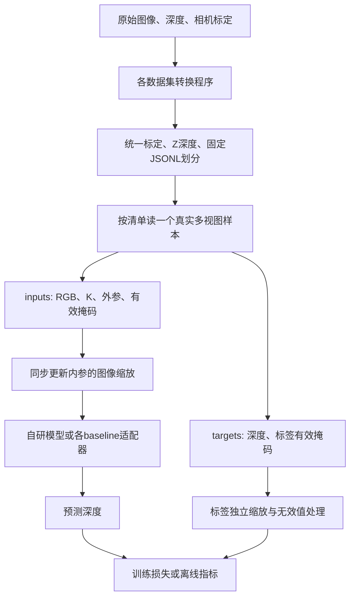
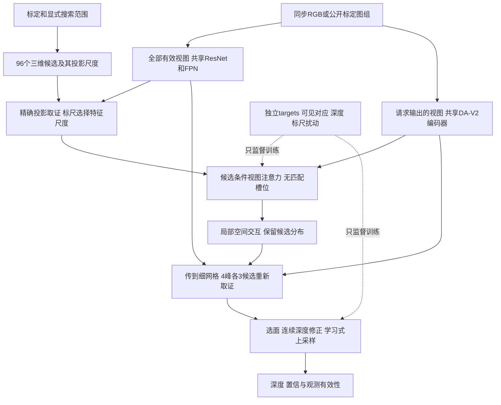

# 公共数据使用说明与自研模型八卡预训练计划

更新：2026-10-25（北京时间）。本文以服务器当前文件和 MVSAnywhere 固定版本源码为依据。读完第 2–4 节即可找到数据、理解对应关系并实际读取样本；第 5–7 节保留设计依据；第 9 节记录本次实际实现、配置差异、八卡启动和恢复方法。

最新训练决定：允许 Depth Anything V2／ImageNet 等通用初始化，编码器由我们继续训练；自研主线不加载 Hero 任务权重。第 5–7 节和 `no_hero_v2.json` 已按此更新；`public_v1.json` 保留原登记哈希，仅复用其中的数据字段。结训空间要求现按至少200GiB执行。

**更新：首次八卡训练与自动公共/CARLA测试已于北京时间2026-10-25 04:19正常完成，退出码0，训练tmux随进程结束而关闭。第9节保留启动时的配方与验收记录，完成结果见research_memory.md实验100。** 七套数据共有 42,598 组训练样本、7,957 组验证样本、11,970 组测试样本。这里“一组”指若干张有标定的图像，不是一张图片。范围、单位、参考轮换和同域分布式采样已经接通，实际配方见第 9 节。

## 1. MVSAnywhere 实际怎样训练

### 1.1 先区分两层“预训练”

MVSAnywhere 并非从随机参数开始，把八套数据训练一遍就得到全部能力。它先继承图像与深度网络的已有知识，再学习多视图重建：

1. 参考图编码器使用 DINOv2 ViT-B 架构，官方训练说明要求加载 **Depth Anything V2 Base** 权重。深度解码器也加载其可兼容部分，不只是参考图编码器获得初始化。
2. 匹配分支使用带预训练的 ResNet 特征；融合分支采用另一套 ViT。哪些层来自已有权重、哪些层新建，要按具体模块加载规则区分。
3. 使用多个数据集的 RGB、相机标定和参考图真值深度，训练多视图匹配、单目/多目融合与深度解码。

因此，下载直接训练集不等于复现 Depth Anything、DINOv2 和 ResNet 的前置训练。历史自研模型的两个冻结编码器继承过官方 Hero 的任务训练权重；本次新模型使用原始通用初始化，不继承这些历史参数。历史报告仍必须披露，不能写成“仅用本地这几万组数据从零获得全部能力”。

代码版本为 `5bd49bba0992aa56060e1aa3bb40b2150b04726f`。项目保留官方源码及已记录的设备/空监督兼容补丁：[源码审计](../official_methods/docs/mvsanywhere_source_audit_20261013.md)、[官方初始化与训练说明](https://github.com/nianticlabs/mvsanywhere#-training)。

### 1.2 数据怎么成为一次训练输入

官方 README 列出 Hypersim、TartanAir、BlendedMVG、MatrixCity、Virtual KITTI 2、Dynamic Replica、MVS-Synth、SAIL-VOS 3D；ScanNet v2 在示例中用于验证。

官方数据配置通常要求 **8 张图：1 张参考图 + 7 张源图**。预先生成的 tuple 文本相当于配组名单，通常每行写“场景编号、参考帧编号、各源帧编号”。加载器根据名单读取图像和位姿，只为参考图加载训练深度，再把源图按相对位姿距离整理。不同数据的原始格式由各自 dataset 类处理。

当前服务器的数据是我们按实际任务重新整理的 **多位置四图或同步双目**，不是官方完整八图训练协议。多位置四图通常依赖静态场景假设，但清单的命名并不能证明物体静止。尤其不能给双目复制图片凑成四目，也不能把动态场景中不同时间的图像说成同步输入。

实际训练入口把各数据集组成 `ConcatDataset`，再打乱取 batch；没有在这里实现“八个数据集等概率采样”。若其他条件一致，条目多的数据集会被取到更多次。详见 [train.py](../official_methods/methods/mvsanywhere/upstream/src/mvsanywhere/train.py) 和 [generic_mvs_dataset.py](../official_methods/methods/mvsanywhere/upstream/src/mvsanywhere/datasets/generic_mvs_dataset.py)。

**清单文件存在不代表官方训练命令一定能原样跑通。** 本地固定版本的 Blended 配置写 `_pair.txt` 后缀，而随仓库提供的是 `train_eight_view_deepvmvs.txt`；直接复现官方入口时需要核实实际名单。我们使用已有独立 JSONL 适配器，不依赖这个未确认的文件名组合。

### 1.3 范围适应比“把数据混在一起”更关键

其匹配体默认在当前范围内放置 64 个**对数间隔**深度候选；输出头预测范围内部的连续位置，不局限于这 64 个离散深度。

训练和部署的范围来源不同，这是本次读代码的重要发现：

| 阶段 | 范围怎样获得 | 本项目怎么处理 |
|---|---|---|
| 官方训练 | 从参考图有效真值深度取最小/最大值，再分别乘 `[0.5,1)`、`[1,2)` 的随机因子扩宽 | 属于训练增强，可借鉴；不允许延伸到测试输入 |
| 官方 `train.py` 内置验证 | 数据加载仍生成标签范围；`step()` 调用 `estimate_depth_range=False` | 不能把这个验证值直接当无标签部署精度 |
| 部署推理 | 用相机间距、焦距、图像宽度估计范围；可根据第一次预测再修正 | 只依赖 RGB、标定和预测 |
| 本项目 Hero 适配器的 eval | 强制使用推理范围，训练标签范围只在 train 准备函数中生成 | 后续公平验证继续采用这个边界 |

这不是说官方训练增强不能使用，而是必须区分“给定覆盖真值的范围时，网络预测得多好”和“完全不知道真值时，系统预测得多好”。本项目选择 checkpoint 也应按后者。

源码依据：[范围与训练调用](../official_methods/methods/mvsanywhere/upstream/src/mvsanywhere/experiment_modules/sr_depth_model.py)、[标签范围生成](../official_methods/methods/mvsanywhere/upstream/src/mvsanywhere/datasets/generic_mvs_dataset.py)、[本项目训练/推理隔离](../official_methods/methods/mvsanywhere/adapter.py)。

### 1.4 实际优化什么，怎样更新权重

代码中参与总损失的是：多尺度对数深度误差、逆深度空间梯度误差、由深度求出的法线误差，以及有天空标签时的天空损失。最终组合为 `ms_loss + 0.1 * sky_loss + grad_loss + normals_loss`。绝对深度误差、尺度不变误差等还会被记录，但不意味着它们全部加进训练目标；`MVDepthLoss` 被实例化也不等于该项参与了当前总损失。

训练使用颜色增强和几何一致的翻转等处理。代码把参数分成匹配/元数据、参考图编码器、融合/解码器三组 AdamW，学习率不同；每两个 micro-batch 进行一次联合更新。不要把三个优化器的调用次数当成三个独立训练 batch。

| 项目 | 论文附录报告 | 固定版本源码 / README 所见 |
|---|---|---|
| 硬件 | 2 张 A100 | 示例 `gpus=2` |
| 尺寸 | 640×480；另有 448×336 版本 | Hero YAML 为 640×480 |
| 每卡 batch | 前者 6、后者 8 | README 覆盖为 6；单看 YAML 的 16 会误读 |
| 累积 | 2 个 batch | `loss/2`，每两批更新三组参数 |
| 总训练长度 | 145k steps | Options 默认 `max_steps=220000`，且 Lightning 步数受三个优化器影响 |
| 匹配/元数据学习率 | `1e-4`，后期降低 | `1e-4`，调度默认分界为 70000/80000 次调度更新 |
| 参考图编码器 | `5e-6`，线性下降 | 同起点，LinearLR 默认 70000 次更新到 0.001 倍 |
| 融合/解码器 | `5e-5`，线性下降 | 同起点和对应 LinearLR |
| weight decay | `1e-4` | `1e-4` |

**论文、配置默认值、训练脚本的计数方式不是完全一致的一套可直接互换数字。** 不声称拷贝默认配置即可严格重现论文训练预算。我们统一把“一步”定义为完成梯度累积后的一次联合参数更新，同时记录处理的样本数。

论文数据来自 [附录 B.3](https://arxiv.org/html/2503.22430v1#A2.SS3)；实现来自 [模型训练函数](../official_methods/methods/mvsanywhere/upstream/src/mvsanywhere/experiment_modules/sr_depth_model.py)、[配置](../official_methods/methods/mvsanywhere/upstream/configs/models/mvsanywhere_model.yaml)、[默认选项](../official_methods/methods/mvsanywhere/upstream/src/mvsanywhere/options.py) 和 [损失](../official_methods/methods/mvsanywhere/upstream/src/mvsanywhere/losses.py)。

## 2. 当前服务器的目录地图

物理数据目录是 `/data/liuzonghao_data/dataset/`。项目中的 `/home/liuzonghao/3Dscene/data/` 放相应软链接。例如：

```text
/home/liuzonghao/3Dscene/
├── data/
│   ├── CARLA_data          → /data/liuzonghao_data/dataset/CARLA_data
│   ├── TartanAir_forest    → 同名数据盘目录
│   ├── MatrixCity_street   → 同名数据盘目录
│   ├── Hypersim_subset     → 同名数据盘目录
│   ├── MVS_Synth           → 同名数据盘目录
│   ├── VKITTI2             → 同名数据盘目录
│   ├── BlendedMVS          → 同名数据盘目录
│   ├── DynamicReplica_valid → 同名数据盘目录
│   └── public_pretraining_v1 → 本次划分/读取检查报告
└── jar_reconstruction/
    ├── configs/public_datasets/  各数据的转换、单模型接入配置
    ├── configs/pretraining/public_v1.json  本次划分登记和拟议训练参数
    ├── tools/prepare_*.py        原始数据转换程序
    ├── jar/data.py              共享数据加载器
    └── docs/                    本文和研究记录
```

各数据根目录的通用含义：

| 目录或文件 | 内容 | 训练时是否直接读 |
|---|---|---|
| `archives/` | 下载的原始压缩包 | 否，用于恢复与校验 |
| `raw/` | 原始 RGB、深度、相机参数等 | RGB 通常从这里读；部分深度也直接读 |
| `processed/` 或 `prepared/` | 转成共享约定的深度、掩码、清单 | 是，具体位置见下一节 |
| `manifests/*.jsonl` | 一行一个训练样本的索引、标定、标签路径 | 是，加载器的入口 |
| `download_evidence.json`、`audit.json`、`logs/` | 来源、哈希、转换和检查记录 | 否，不能当标注数据 |
| `smoke/` | 已有小规模接口测试结果 | 否，不能当原始图像或标签 |

**JSON 不一定是标注，标注也不一定是 JSON。** 相机参数可以在 TXT、CSV、HDF5、压缩 JSON 中；深度监督通常是二维数组。统一的 JSONL 只是告诉程序“这几张图如何配成一组、每张图去哪里找相机和标签”。

## 3. 七个数据集分别怎么使用

本节所有相对路径都相对于对应数据根目录。`0000` 等编号只是展示实际命名规律，不是要求只使用这一帧。

### 3.1 TartanAir_forest：森林环境

根目录：`/home/liuzonghao/3Dscene/data/TartanAir_forest`。

```text
raw/seasonsforest/Easy/P001/
├── image_left/000000_left.png       左目 RGB
├── depth_left/000000_left_depth.npy 同编号的 float32 深度，米
├── seg_left/000000_left_seg.npy     原始分割编号
└── pose_left.txt                   每行一帧，位置和 xyzw 四元数
prepared/manifests/{train,val,test}.jsonl
```

图像文件前六位编号对应 pose 文本从零开始的行号。相机内参来自这个版本的固定相机配置，不需要另找逐帧 JSON。转换器统一像素中心和位姿坐标，按已知相机的几何关系选择四张有重叠的图。

这里下载/接入的是左相机轨迹上的不同帧，**不是同步四台相机**；用于静态森林多视角训练。深度直接引用原 `.npy`，不用再复制一份。已有分割类别不自动等于 CARLA 类别，第一轮只训练深度。

固定划分：P001/002/003/004/005/007/008 训练，P009 验证，P010/011 测试。它们仍是同一个森林环境，测试表示跨轨迹，不表示跨地图。转换代码：[prepare_tartanair.py](../tools/prepare_tartanair.py)。

### 3.2 MatrixCity_street：城市道路静态渲染

根目录：`/home/liuzonghao/3Dscene/data/MatrixCity_street`。

```text
raw/small_city/street/train/small_city_road_outside/
├── 0000.png
├── transforms.json
└── transforms_origin.json
raw/small_city_depth/street/train/small_city_road_outside_depth/
processed/train/depth/000000.optical_z.npy
manifests/{train,train_labeled,val,test}.jsonl
```

`transforms.json` 中的图像路径/帧条目和变换矩阵把 PNG 与相机位姿对应起来；原深度在平行的 depth 目录。转换程序读取作者相机信息，把深度中的厘米换成米，去除姿态基底中的共同尺度，并将光轴深度存为 float32 NPY。`transforms_origin.json` 保留原始来源，不作为第二份不同相机输入。

测试数据对应 `street/test/small_city_road_outside_test/` 及其平行深度目录。项目训练/验证是在原 train 区域按位置切分，源图只从各自划分选；原 test 保留。它们属于同一座 small_city，不是独立城市。

原训练清单有 4,250 组，其中 65 组参考图没有有效深度。正式监督训练选 **`train_labeled.jsonl` 的 4,185 组**；原清单和测试样本均保留，不能为了提高测试数字过滤难样本。训练/测试的相机间距分布不同，需单独报告，不能解释为纯图像域差异。代码：[prepare_matrixcity.py](../tools/prepare_matrixcity.py)。

### 3.3 Hypersim_subset：室内几何与材质

根目录：`/home/liuzonghao/3Dscene/data/Hypersim_subset`。当前为 12 个场景，不是完整 Hypersim。

```text
raw/ai_022_007/
├── images/scene_cam_00_final_preview/frame.0000.tonemap.jpg
├── images/scene_cam_00_geometry_hdf5/frame.0000.depth_meters.hdf5
└── _detail/
    ├── metadata_scene.csv
    └── cam_00/
        ├── camera_keyframe_frame_indices.hdf5
        ├── camera_keyframe_positions.hdf5
        └── camera_keyframe_orientations.hdf5
processed/ai_022_007/cam_00/frame.0000.optical_z.npy
manifests/{train,val,test}.jsonl
```

图像、深度文件的 `frame.0000` 对应关键帧索引数组中的帧号；不能把 HDF5 数组行号不加检查地当成文件编号。相机投影参数还使用项目中的 `docs/download_assets/mvsanywhere_20261023/metadata_camera_parameters.csv`，路径已写进转换配置。

这里原 `depth_meters` 是沿像素射线的距离；转换后 NPY 才是模型使用的光轴 Z 深度。相机平移按 `meters_per_asset_unit` 换成米，原深度已经是米，不能再乘一遍。个别正均匀缩放基底的处理和独立世界点验证已记录在数据审计中。

8 个场景训练、2 个验证、2 个测试，具体场景名固定在 [hypersim_subset_prepare.json](../configs/public_datasets/hypersim_subset_prepare.json)。旧 `Hypersim_sample` 仅用于早期接口展示，本次不另加进训练池。代码：[prepare_hypersim_subset.py](../tools/prepare_hypersim_subset.py)。

### 3.4 MVS_Synth：GTAV 场景

根目录：`/home/liuzonghao/3Dscene/data/MVS_Synth`。

```text
raw/GTAV_540/0000/
├── images/0000.png
├── depths/0000.exr
└── poses/0000.json
prepared/depth_scene_unit/0000/0000.npy
prepared/manifests/{train,val,test}.jsonl
```

第一个 `0000` 是场景编号，第二个是图像编号。同编号 PNG、EXR、JSON 一一对应。JSON 的 `f_x/f_y/c_x/c_y` 是内参，`extrinsic` 是外参；使用原始 960×540 数据，不能混用其他版本的图像宽度。

EXR 解码为 float32 NPY，不人为改变数值尺度。当前还没有足够证据把原始单位认证为 SI 米，所以统一标 **`scene_unit`**。相对标定和深度可以用于几何训练，但其 MAE 不能直接写成“米”。原始外参的手性已在转换层统一，不改变相对投影。

120 个完整场景按 96/12/12 分为训练/验证/测试；四图是在同一序列中按相机关系组合。**MVSAnywhere 论文表 1 将 MVS-Synth 标为含运动物体，因此这里不能保证四张图的所有物体位置不变。** 当前旧清单的 `static_multiview_tuple` 只是转换器历史标记，不是静止性证明；正式联合训练前应改为时序多视图元数据，保留 `synchronized_capture=false`。可用参考图深度监督学习，但不能给所有跨帧像素强加静态光度一致性。代码：[prepare_mvssynth.py](../tools/prepare_mvssynth.py)，运动属性见 [论文表 1](https://arxiv.org/html/2503.22430v1#S3.T1)。

### 3.5 VKITTI2：有动态物体的同步双目道路数据

根目录：`/home/liuzonghao/3Dscene/data/VKITTI2`。

```text
raw/Scene01/clone/
├── frames/rgb/Camera_0/rgb_00000.jpg
├── frames/rgb/Camera_1/rgb_00000.jpg
├── frames/depth/Camera_0/depth_00000.png
├── frames/classSegmentation/...
├── intrinsic.txt
├── extrinsic.txt
└── colors.txt
prepared/Scene01/clone/Camera_0/depth_cm_00000.npy
prepared/Scene01/clone/Camera_0/semantic_00000.npy
prepared/manifests/synchronized2/{train,val,test}.jsonl
```

用“Scene、天气/变体、帧号、Camera 编号”共同定位数据。`intrinsic.txt` 和 `extrinsic.txt` 中的帧号/相机号对应上述 RGB。两台相机同一帧才能组成同步样本。

原深度是 uint16 厘米；转换后 `depth_cm_*.npy` 仍保留厘米数值，JSONL 中 `depth_scale=0.01` 让加载器输出米。65535 饱和值不作为有效表面。分割颜色通过 `colors.txt` 解码，但没有统一多数据集语义表前不参与公共语义损失。

Scene01/02/06 训练、Scene18 验证、Scene20 测试，同一 Scene 的不同天气放在同一划分，避免晴天训练、同一路径雨天测试被误称未见路线。当前只用同步双目 N=2。另存的时序多图名单不进入本次同步协议。代码：[prepare_vkitti2.py](../tools/prepare_vkitti2.py)。

### 3.6 BlendedMVS：多样物体与场景的多视图数据

根目录：`/home/liuzonghao/3Dscene/data/BlendedMVS`。当前是 v1.0.0 基础版 113 场景，不含 MVS+、MVS++。

```text
raw/BlendedMVS/57f8d9bbe73f6760f10e916a/
├── blended_images/00000000.jpg
├── rendered_depth_maps/00000000.pfm
├── cams/00000000_cam.txt
└── cams/pair.txt
processed/57f8d9bbe73f6760f10e916a/depth/00000000.optical_z.npy
manifests/{train,train_labeled,val,test}.jsonl
```

同一个八位编号对应 RGB、深度和相机 TXT。`*_cam.txt` 包含外参和内参；`pair.txt` 提供参考图的源视图匹配关系。转换器保留作者 K，并正确处理 PFM 的行顺序，另存 NPY。这里的尺度暂按 `scene_unit` 保留，不推断成米。

项目从作者训练场景中固定划出 95 个训练场景、11 个验证场景；作者 7 个 validation 场景作为**本项目 test**。项目命名与作者命名不同，必须披露。已发布 Hero 可能见过我们项目划出的部分场景，不能因此宣称全部是 Hero 的未知测试数据。代码：[prepare_blendedmvs.py](../tools/prepare_blendedmvs.py)。

### 3.7 DynamicReplica_valid：动态物体同步双目子集

根目录：`/home/liuzonghao/3Dscene/data/DynamicReplica_valid`。

```text
raw/valid/
├── frame_annotations_valid.jgz
├── 06dcf6-3_obj_source_left/
│   ├── images/06dcf6-3_obj_source_left-0000.png
│   ├── depths/06dcf6-3_obj_source_left_0000.geometric.png
│   └── masks/06dcf6-3_obj_source_left_0000.png
└── 06dcf6-3_obj_source_right/...
prepared/depth/06dcf6-3_obj/left/{000000,000000_valid}.npy
prepared/manifests/val.jsonl                    原官方 valid 来源，保留
prepared/manifests/project_development_v1/
└── {train,val,test}.jsonl                      本次另建的项目开发划分
```

`.jgz` 是 gzip 压缩的 JSON，包含 `sequence_name`、`frame_number`、`camera_name`、图像/深度路径与 `viewpoint` 相机参数。按序列+帧号配对 left/right，不能按文件列表位置碰巧配对。注释包含的序列比本地提取的四条更多，不能直接遍历整份注释当成本地样本。

深度 PNG 存的是 **float16 的位模式**，不能当普通 uint16 整数或厘米值读；转换代码按位恢复浮点深度，再存 float32 NPY。`mask` 表示动态前景，不是“只有这里的深度有效”。相机参数原为 PyTorch3D 约定，转换器统一成 CV 相机。当前仍标 `scene_unit`。MVSAnywhere 论文表 1 把此数据的位姿列为米制，这提供了进一步确认的依据；本次没有直接覆盖历史单位合同，待将原作者深度和位姿尺度一起核实后再版本化升级。

本次新划分：`06dcf6-3_obj`、`0cde48-3_obj` 训练，`151c87-3_obj` 验证，`216ba3-3_obj` 测试，每条 300 个同步双目样本。**四条全部来自官方 validation；这是本项目开发实验划分，不是官方训练集，也不足以保证背景/资产独立。** 以后取得官方 train 后另建 v2，不能混用当前完整 val 清单再次验证，否则会包含已训练的 600 组。

代码：[原格式转换](../tools/prepare_dynamicreplica.py)、[本次开发划分](../tools/prepare_pretraining_registry.py)。

## 4. 固定划分和实际读取方式

### 4.1 本轮采用的清单

| 数据 | 训练组数 | 验证组数 | 测试组数 | 视图数 / 参考槽位 | 单位 |
|---|---:|---:|---:|---|---|
| TartanAir_forest | 3,056 | 710 | 848 | 4 / 2 | 米 |
| MatrixCity_street | 4,185 | 475 | 160 | 4 / 2 | 米 |
| Hypersim_subset | 597 | 199 | 194 | 4 / 2 | 米 |
| MVS_Synth | 9,476 | 1,164 | 1,183 | 4 / 2 | 场景单位 |
| VKITTI2 | 9,500 | 3,390 | 8,370 | 2 / 0 | 米 |
| BlendedMVS | 15,184 | 1,719 | 915 | 4 / 2 | 场景单位 |
| DynamicReplica 项目开发划分 | 600 | 300 | 300 | 2 / 0 | 场景单位 |
| 合计 | **42,598** | **7,957** | **11,970** | 混合协议，分别报告 | 不混算绝对误差 |

“参考槽位 2”指数组的第 3 张图，不表示公共数据真的有一台叫“上相机”的物理相机。两目槽位 0 则是第一张。不要把 CARLA 的相机身份硬套到公共多视图。

注册文件 [public_v1.json](../configs/pretraining/public_v1.json) 保存每套数据的绝对根目录、三个清单路径、单位、视图数、参考槽位和拟议训练权重。它是**划分登记/计划文件，不是 `train.py` 可直接执行的模型训练配置**。原 `configs/public_datasets/*_own.json` 仍是单数据集接口模板，未被静默替换。

六套已有划分未重新打乱。本轮检查包含所有参考图和源图的 RGB/标签路径；每套 train/val/test 间的交叉文件数均为 0。这不等于证明不同文件没有相同内容，也不等于证明同地图不同轨迹完全独立。

### 4.2 一行 JSONL 如何变成张量

用 MVS-Synth 举例，完整一行包含四台相机，每台的结构如下，以下只列第 3 张参考图的关键字段：

```json
{
  "camera_id": "view_2",
  "source_frame_id": "0000",
  "rgb": "raw/GTAV_540/0000/images/0000.png",
  "K": [[578.9237, 0, 480], [0, 578.9205, 270], [0, 0, 1]],
  "targets": {
    "depth": "prepared/depth_scene_unit/0000/0000.npy",
    "depth_type": "optical_z",
    "depth_encoding": "scene_unit_npy",
    "depth_scale": 1.0,
    "depth_units": "scene_unit"
  }
}
```

上面为字段示例，省略了必须从完整清单读取的 `T_cam_from_rig`，不是可单独提交给加载器的完整样本。外层还记录 sequence、配组 frame_id、单位和 reference_slot。配组 frame_id 是接口样本编号；`source_frame_id` 才是这张原始图像的帧号，不要把静态多位置组误认为同一时刻。

数据流是：



当前公共加载器 [jar/data.py](../jar/data.py) 输出的 batch 主要包括：

| 字段 | 形状 | 解释 |
|---|---|---|
| `inputs.rgb` | `[B,N,3,256,448]` | 网络主图；RGB、0–1 浮点，编码器内部按其约定归一化 |
| `inputs.matching_rgb` | `[B,N,3,512,896]` | 自研匹配分支图像，从原图独立缩放 |
| `inputs.K` | `[B,N,3,3]` | 与主图尺寸对应的内参 |
| `inputs.T_cam_from_rig` | `[B,N,4,4]` | 把阵列坐标点变换到相机坐标，不是反方向 |
| `inputs.view_mask` | `[B,N]` | 哪些视图实际存在 |
| `inputs.image_mask` | `[B,N,256,448]` | 图像中的有效区域 |
| `targets.depth`、`depth_valid` | `[B,N,256,448]` | 各视图光轴深度和监督掩码 |

内部 rig 为右手 x前/y左/z上，CV 相机为 x右/y下/z前。缩放使用整数像素中心，位置按 `u_new=(u_old+0.5)*scale-0.5` 更新；不能只缩放图像却保留原 K。标签缩放使用配置中的 `nearest-exact`，避免直接把前后表面平均。匹配分支的采样会显式处理其相对主图的尺寸比例。

### 4.3 现在可运行的检查命令

在主项目目录执行。命令只读取本地数据，不下载数据，不需要电脑代理：

```bash
cd /home/liuzonghao/3Dscene/jar_reconstruction

python tools/prepare_pretraining_registry.py \
  --config configs/pretraining/public_v1.json

official_methods/.venv/bin/python tools/inspect_pretraining_data.py \
  --config configs/pretraining/public_v1.json
```

第一个命令验证所有清单引用的文件、记录清单 SHA256、检查跨划分交叉，并幂等建立 DynamicReplica 开发清单；已有不同内容会报错，不覆盖。第二个命令在七套数据的三个划分各读一个真实样本、组成 batch，并核对移除 targets 后输入完全相同。它检查的是加载器，不是网络精度或完整数据集逐像素正确性。

结果在 [split_audit.json](../../data/public_pretraining_v1/split_audit.json) 和 [loader_audit.json](../../data/public_pretraining_v1/loader_audit.json)。原始格式转换早已完成，正常训练不必每次重新运行 EXR/HDF5 转换；需要重建时使用相应 `tools/prepare_*.py --config configs/public_datasets/*_prepare.json`，先查看同名脚本帮助确认参数。

## 5. 新训练方案的架构和权重边界

**本节起采用 2026-10-24 用户确认后的方案：允许通用预训练初始化，继续训练编码器；自研主线不加载 Hero 任务权重。** 第 1–4 节的数据目录与固定划分继续有效。旧方案“冻结两个 Hero 编码器再训自研头”由本方案替代，历史依据保留在研究记录 097。当前运行代码尚未完成这次改造，以下是待实施设计，不是已经训练好的新模型。

### 5.1 先确定真正需要改变的部分

当前 `RulerDirectModel` 的 scale_transport 版本使用冻结编码器、96 个粗候选、候选分布向细网格传递、4 个峰各 3 个局部候选、连续深度和凸组合上采样。实验 090–093 中候选集合的事后最优误差改善了约 8.6 厘米，实际选面只改善约 3.6 厘米；它说明**候选能否被正确解释**仍是重点，不能只把问题归为编码器太浅。

现有 [FrozenFoundation](../jar/models/deep_encoder.py) 从 Hero 子树加载 ViT-B，并在 `requires_grad`、`train()` 和 `forward()` 三处冻结；[FrozenMVSMatching](../jar/pretrained_matching.py) 也冻结了 Hero 的匹配分支。因此“换一个学习率”不会让编码器开始训练。新的可训练入口须独立实现，历史基线和旧权重加载保持不变。

推荐架构是**可训练的通用图像编码器 + 标定引导的候选匹配 + 自研多候选直接解码**，工作名 `RulerDirect-V2`。首轮保持主图 256×448、匹配图 512×896，先研究特征如何用于选面，不把分辨率变化混入本轮收益。



| 部分 | 推荐初始化及用途 | 与 baseline 的边界 |
|---|---|---|
| 场景上下文 | 原始 Depth Anything V2 Base 的 ViT-B 编码器；逐步解冻，最后全部参与训练 | 不从 Hero checkpoint 抽取；不加载其融合 ViT、DPT 或最终深度头 |
| 局部纹理 | 标准 ImageNet ResNet-18 的卷积主干；新建特征金字塔和匹配投影，继续训练主干 | 不加载 Hero 的 16 通道匹配编码器；不把分类特征未经训练当作可靠对应关系 |
| 跨视角匹配 | 借鉴 UniMatch 的跨图像交互原则，使用标定约束的候选位置读取源特征 | 首轮不加载 UniMatch 整个深度模型；匹配和拒绝权重由本项目训练 |
| 候选解释和输出 | 自研的候选空间交互、分布传递、细格重新取证、连续回归 | 不使用完整 Hero 代价体到融合 ViT 再到 DPT 的解码通路 |

Depth Anything V2 提供接近几何任务的通用初始化；这不意味着它的特征天然能做精确跨视角匹配。[论文](https://arxiv.org/abs/2406.09414)及[官方源码](https://github.com/DepthAnything/Depth-Anything-V2)。UniMatch 的经验支持“图像之间交换信息能改善对应特征”，但不能替我们证明下面的标定注意力有效。[论文](https://arxiv.org/abs/2211.05783)。MVSFormer++ 的可借鉴点是特征交互、候选推理和精细搜索采用不同计算方式，而非整个网络都使用同一种 Transformer。[官方实现](https://github.com/maybeLx/MVSFormerPlusPlus)。

这是**从通用预训练开始的多视图任务训练**，不是全模型随机初始化训练。新任务层随机初始化；旧自研解码器也不作为主实验起点，因为它是在 Hero 特征上训练出来的。旧模型只作独立历史对照。不使用 Hero 特征缓存、深度伪标签或蒸馏教师。每个初始化记录来源、版本、文件 SHA256、实际加载键和许可证；DA-V2 Base 官方权重为 CC-BY-NC-4.0，与其 Small 权重许可不同。

### 5.2 每一层保留什么信息

下表给出默认尺寸，B 表示 batch，N 表示实际相机数，R 表示本次请求输出深度的相机数。通道数是首轮可验证的设计值，不是已经证明的最优值。

| 环节 | 张量或空间尺寸 | 设计理由 |
|---|---|---|
| 局部图像输入 | `[B,N,3,512,896]` | 保持现有取证分辨率，细障碍物不能只靠低分辨率语义特征 |
| ResNet-18 四级特征 | 64×128×224、128×64×112、256×32×56、512×16×28 | 复用完整标准主干，浅层保留位置、深层补上下文；不再只依赖很薄的匹配输出 |
| 匹配金字塔 | 每级投影到 64 通道；默认使用前三个尺度，最深层参与上采样融合 | 64 通道允许 8 组相关性，区分纹理子空间；是否值得增加计算必须与 32 通道对照 |
| ViT 上下文输入 | `[B,R,3,256,448]`，按现有格点约定缩放至 224×392 | 与当前实现同样生成 16×28 个 patch，避免把像素坐标约定一起换掉 |
| ViT 四次中间读取 | 第 3、6、9、12 层各 `[B,R,768,16,28]` | 沿用有明确代码基础的读取位置；不是四个独立编码器 |
| 上下文旁路 | 每层 768→128，保留四层，不提前相加成一个 32 通道图 | 强图像信息可在粗、细两阶段分别读取；128 是低秩折中，仍须检验信息损失 |
| 粗候选 | 每参考 `[B,64,96,32,56]` | 显式保留 96 个深度假设，空间交互之前不压成一个深度 |
| 候选条件交互 | 64 维、4 个头；源视图维注意力 + 一次局部候选空间交互 | 视图数量通常只有 2–4，避免全场景像素两两注意力 |
| 细格重新取证 | 64×112 网格，4 峰×3 局部候选，每候选 64 维 | 保持现有延后筛选机制，着重改进选面而非再堆全范围搜索 |
| 连续输出 | 64×112 的深度与有效性，再到 256×448 | 用有界连续修正补候选间距；沿用轻量学习式上采样，先不增加第二套大型 DPT |

标准 ResNet 与旧 Niantic 匹配编码器的格点中心不一样。新分支按各算子实际 stride、padding、核尺寸推导采样位置；不能直接复用旧分支的 `1.5 + 4*j` 特征中心。ViT 保留既有 `7.5 + 16*j` 主图坐标约定。FPN 上采样按格点对齐，K 的缩放和裁剪仍使用半像素公式。仅有形状一致不足以保证几何一致。

参数由所有相机共享，没有“上相机专属编码器”。训练时在有标签且有 RGB 的视图中轮换输出参考；推理可以请求任意参考或全部参考。**单次解码仍有参考/源角色**：局部 CNN 对全部有效视图计算，ViT 默认只计算本次请求输出的参考，节省算力；这不冒称一次单参考前向内所有视图的分支完全对称。四参考模式对全部四图各编码一次、共享缓存，再执行四份解码，全部开销都计时。若以后试完全对称的场景 token，作为另一个架构实验，不能静默改变当前比较协议。

### 5.3 标尺怎样进入匹配和融合

核心设计假设是：**先把各视角的信息对齐到同一个三维假设，再判断哪些证据支持它；标定决定取证的位置与分辨率，图像决定是否可信。** 这保留用户的虚拟公制标尺思想，但不把几何位置编码当作额外传感器。

1. **标定控制尺度。** 对某个候选 X，取覆盖一个查询像素单元和当前深度区间的三个三维方向，组成局部基 E。`A_i = J_i E` 描述这个单元在第 i 幅图上的投影宽度，以此从匹配金字塔选择相邻 1–2 层。远近表面的取证面积因此随标定变化。候选中心始终精确投影；跨度大的单元检查角点，不用雅可比近似替代真实投影。
2. **候选控制注意力。** 当前候选特征、参考图上下文和归一化深度组成 query；源图精确投影处的局部描述子、分组相关及几何信息组成 key/value。在源视图维上做注意力，得到该候选的观测证据；随后同一候选再读取四层上下文，由候选 query 决定读哪层。这样上下文服务于“哪个表面更合理”，而非只给所有深度加相同偏置。
3. **允许拒绝证据。** 视图注意力加入可学习的无匹配槽位。图外、相机后方、缺图由硬掩码排除；模糊、反光、遮挡或动态冲突通过可见对应监督学习降权。无匹配槽位保留独立质量值，不能把剩下的视图重新归一化后伪装成高置信。全部源无效时输出未知观测状态；可以保留先验深度供诊断，但不算已观测表面。
4. **在候选还存在时做空间判断。** 粗层沿用小型可分离三维卷积和空间尺度交互，不在候选体上堆全局 Transformer。粗候选分布先传递到细层，再保留多个峰、重新读取真实源图。细层选择器直接受监督，避免“候选更好但选择器不会用”。

源图共享 key/value/可靠性网络，按集合聚合。调换源图和对应标定的顺序应保持输出不变；若调换被请求的参考，输出随参考而变。这类对称性可由共享映射和对称聚合实现，但**对称性本身不能证明鲁棒或匹配正确**。[Deep Sets](https://arxiv.org/abs/1703.06114)。雅可比大、秩高也不证明有纹理，更不证明无遮挡。

注意力只在同一候选的少量源视图及四层上下文间计算，不在所有像素之间计算。粗候选体 64×96×32×56 在 BF16 下单份约 21 MiB；这只是一个张量，实际训练还包括梯度、源特征、CNN/ViT 激活，不能据此估算整网显存。源视图和候选分块读取，避免常驻 `[B,R,D,H,W,N,C]` 大张量。首轮固定一次粗层和一次细层交互，不加循环模块、独立质量大网络或额外场景体。

这套实现的“标定控制特征读取 + 保留候选后联合选择”是拟验证的核心设计，不把注意力、FPN、分组相关或凸上采样单独宣称首创。历史实验 052–053 中几何注意力并未取得净收益；本轮改变的是**可训练的原始通用初始化、早期可见对应监督、可用的多尺度匹配特征**，必须与同训练预算的简单相关聚合比较才能确定新条件是否有效。

### 5.4 单位和搜索范围必须先适配

当前固定 2–80 的 `depth_lattice` 是 checkpoint buffer；不能只改配置里的 near/far 就假定候选已换好。先以训练集统计和已知数据约定给各域确定固定范围，记录覆盖率；再检验跨域统一的标定尺度归一化，二者单独比较。

尺度归一化的候选版本：从有效相机中心间非零距离取稳健尺度 s，令 `X'=X/s`、`t'=t/s`、`Z'=Z/s`，K 与旋转不变，输出乘回 s。投影完全不变，导数变为 `J'=sJ`。这有明确代数依据，但基线不等于场景深度；归一化后的候选边界仍须用 TRAIN 统计确定，不能假定仍为 2–80。零基线不执行除法，保留退化标记和显式配置的后备范围。

峰间距、局部步长、位置编码、Huber 阈值和绝对深度损失须同步换算。scene_unit 不因归一化变成米。第一版训练和验证均使用部署可获得的范围，不使用每帧 GT 的最小/最大值作为输入；全局训练统计可以确定配置，TEST 标签不能确定配置。GT 在范围外仍计入最终深度误差，同时记录候选遗漏，不能删除后美化指标。

## 6. 先训练什么和使用多少数据

### 6.1 实际数据量和采样依据

重新统计当前 train 清单的唯一文件路径后，共有 **42,598 组、52,811 个唯一输入 RGB 路径**。这不是 52,811 个独立场景，也没有做 RGB 内容哈希去重；邻近帧和不同天气版本仍高度相关。

| 数据 | 训练组数 | 唯一输入 RGB 路径数 | 第一阶段可见对应监督 |
|---|---:|---:|---|
| TartanAir_forest | 3,056 | 3,056 | 可用，但逐像素检查有效深度和遮挡 |
| MatrixCity_street | 4,185 | 4,208 | 可用，保留大遮挡掩码 |
| Hypersim_subset | 597 | 603 | 可用，保留各场景米制换算 |
| MVS_Synth | 9,476 | 9,560 | 首轮不用于跨帧静态对应监督，后续保留参考深度训练 |
| VKITTI2 | 9,500 | 19,000 | 同步双目；30 个序列标签包含同地图不同天气，不当成30个独立地图 |
| BlendedMVS | 15,184 | 15,184 | 可用，保持原场景单位 |
| DynamicReplica 项目开发子集 | 600 | 1,200 | 同步双目；来自官方 validation 的两条序列，不能称官方训练集 |
| 合计 | **42,598** | **52,811** | 排除 MVS_Synth 后 33,122 组、43,251 个 RGB 路径 |

默认每个“数据遍历轮”访问全部所用训练组一次，域内打乱，不把小数据集强行等概率过采样。每个 micro-batch 保持同域、同视图数，各 GPU 使用同一个域调度但不同样本；尾部为 DDP 对齐而重复的数量单列记录。旧 14%/24% 等手工比例不作为默认；只有按域验证暴露明确欠拟合时，才比较改变比例与原比例同预算续训。

同一组有多个可监督参考时，每次选一个，下一遍轮换；不把所有视图当成独立场景来扩大数据量。双目保持 N=2，不复制图像。缺少源深度时，该源不能生成“已知可见”的对应标签，但可以参与普通深度训练。MVS-Synth 含动态物体，其四个时刻不能全部强制满足静态光度一致性，须更正旧元数据的静态命名。

### 6.2 分阶段训练配方

全局有效 batch 起点为 32：8 卡×每卡 1 组×累积 4 次；显存允许可换成每卡 2 组×累积 2 次。下列更新次数按每轮向上取整估算，实际计数以各域 DDP 尾部对齐和日志为准。

| 阶段 | 训练哪些部分 | 样本量与初始预算 | 这样安排的依据 |
|---|---|---|---|
| 0：训练入口准备 | 不做正式优化；统计训练范围，验证可见对应和所有编码器参数组 | 七域都检查；单卡、2卡、8卡短烟测及恢复 | 新单位、新梯度路径和多域调度不能靠旧冻结模型测试代替 |
| 1：学会对应 | 训练 ResNet、FPN、匹配投影和可见/无匹配评分；ViT 暂时冻结 | 33,122 组，先 2 遍，约 66,244 组曝光、2,072 次更新；最多 3 遍 | 通用图像特征未必擅长精确对应；先给直接对应监督，避免深度解码器只学单图猜测 |
| 2：让候选头接上特征 | 训练全部新候选层；匹配主干低学习率；解冻 ViT 最后4个block | 42,598 组，先 1 遍，约 1,332 次更新 | 新头随机初始化，其早期大梯度不宜立即改写全部通用特征；所有域先完整接触一次 |
| 3：联合任务预训练 | 解冻整个 ViT 和匹配编码器，连同自研候选/输出模块联合更新 | 先 10 遍，约 425,980 组曝光、13,320 次更新；VAL仍改善才延长，最多30遍 | 差分学习率保留通用能力，同时让编码特征真正适配匹配与选面；轮数由验证学习曲线控制 |
| 4：CARLA 迁移 | 固定公共预训练模型先零样本测试，再另建 CARLA 微调权重 | 先保持历史 TRAIN66/DEV25/TEST200 可比协议；扩到更多训练帧须先建立不交叉验证集 | 区分公共预训练、任务域微调和历史轨迹反复查看的影响 |

**2遍、1遍、10遍不是数学最优训练量。** 它们是明确可复查的初始预算：匹配阶段先看完整数据两次，随机头先经历一个全域遍历，联合阶段先看十次，再由验证曲线决定是否继续。理论支持来自几何可见性、尺度变换及网络的信息流；已有论文支持通用初始化、跨视角特征交互和小学习率适配。具体轮数、通道和学习率属于待实验的工程假设，不能声称有定理保证。

每遍结束做固定、按场景分层的 VAL 子集评估，每三遍做全部 VAL；子集在训练前固定，不按误差挑容易样本。连续三个完整 VAL 检查没有改善时诊断/停止；优先看逐域 AbsRel 与候选遗漏/选错情况，米制室外域另看远距 MAE/RMSE。一个域改善、另一个域明显恶化时，不以总平均掩盖问题。TEST 只在配方和 checkpoint 选定后报告。

现有 CARLA `train_supervised` 共319组，但旧8卡配置的 `val_manifest` 为空；不能直接用它启动“带验证的大训练”，也不能把319组全部用于训练后继续沿用可能重叠的 DEV。当前数据量允许做本轮研究，不足以保证跨地图泛化或中远距离0.5米目标。

### 6.3 训练目标和标尺监督

第一阶段用 GT 深度反投影参考点，再用已知标定投到源图，检查图内、正深度、双方深度有效和源深度遮挡。只有通过检查的点构成正对应；容差按数据精度与相对深度设置，并由 TRAIN 检查后固定。参考表面被源图挡住时，不强迫两点特征相同。深度边缘附近检查多值/无效情况，避免双线性混合前后表面产生假正样本。

负对应既包括相近的易混淆候选，也包括远离当前表面的错误候选。标尺把深度偏差换成源图像素偏差，帮助安排有辨识意义的难负样本；不能因为投影距离很小就断言两者是同一表面，也不能把重复纹理强行标成可确定的负例。训练采用可见对应交叉熵/多正样本对比目标，并单独监督无匹配；先不增加独立大教师或图像重建解码器。

用户提出的“在深度监督中加入标尺点”可以落实成**由 GT 表面生成锚点及其附近的虚拟深度扰动**：真表面锚点用于正确对应和连续深度监督；前后扰动用于候选排序、可见性与误差大小监督。它们只在 targets 中。GT 后方可能有未知表面，不能自动标为空闲；同一个原始像素派生多个扰动也不增加独立数据量。

第二、三阶段的主损失包括：

- **粗候选分布监督**：真实深度所在区间及邻近可表达区间获得软目标；全范围候选直接受监督，避免离散 top-k 截断使粗层得不到纠错梯度。
- **细候选选择与连续定位监督**：根据实际提出的候选计算，不往推理输入塞入 GT 候选。若所有细候选均漏掉真值，记录遗漏并继续施加粗层/最终深度损失；不强迫有界偏移去拟合范围外真值，不删除该像素的最终误差。
- **最终多尺度深度监督**：对数深度 L1 为跨单位主项，配合明确归一化的绝对误差及深度边界梯度；米制域另记录米制误差。不同单位的绝对损失不直接混加。法线损失先作可开关消融，不同时堆所有辅助项。
- **可靠性监督**：利用源图GT可见性或人为已知缺图训练拒绝；遮挡未知区域不填“正确匹配”标签。最终置信度仍需在 VAL 上检查校准，不能当成天然概率。

粗候选、细候选和全图误差必须同时记录。仅有训练 loss 下降不证明选面改善；仅有 oracle 改善不证明选择器已经学会使用候选。对缺图、局部模糊、独立曝光变化的增强放入阶段3，至少保留参考图和一个真实源图用于几何深度训练；零源分支只验证先验/未知状态，不把它当正常三角化任务。

### 6.4 八卡优化和运行设置

现有环境读取到8张5090、每张32,607MiB，Python3.10.21、PyTorch2.8.0+cu128。BF16查询支持不等于新训练已验证。默认每卡1组起步，编码器启用激活重计算；反向时必须能穿过投影采样和上下文读取。只对不需要学习的标定计算关闭梯度，不能误把整个图像特征分支放入 `no_grad`。

| 设置 | 建议起点与处理 |
|---|---|
| 优化器 | 一个 AdamW，三个参数组；统一按一次累积完成计一步 |
| 阶段1学习率 | ResNet预训练参数 `2e-5`，新FPN/匹配层 `2e-4`，ViT冻结 |
| 阶段2学习率 | ResNet `1e-5`，开放ViT层 `2e-6`，新层 `2e-4` |
| 阶段3学习率 | ResNet `2e-5`，全部ViT `2e-6`，新层 `1e-4` |
| 权重衰减与裁剪 | weight decay `1e-4`，偏置及归一化参数不衰减；全局梯度范数1.0 |
| 调度 | 每阶段前5%更新warmup，上限500次，之后cosine到起始学习率10%；续训明确延长调度而非重置假装新实验 |
| 精度 | 卷积/注意力BF16；投影、雅可比、深度坐标、softmax归约和损失累计FP32 |
| 归一化 | ViT保留LayerNorm；ResNet先冻结预训练BN运行统计、训练其仿射参数；新层用GroupNorm/LayerNorm，避免每卡小batch污染BN |
| 数据线程 | 每rank先2个，共16个；按磁盘吞吐调整，不预复制全量图像或特征 |
| 恢复 | 模型、优化器、调度、梯度缩放状态（若有）、随机数、数据域调度、样本位置、累计曝光；只在完整更新边界保存 |

学习率的数量级借鉴通用编码器微调及官方Hero较小编码器学习率的经验，不照搬其三个优化器或计步方式。首次100个稳定更新测真实吞吐和峰值显存，再估计训练耗时；现在不填写未经运行的小时数。

现有 `scripts/train_8gpu.sh` 默认是 CARLA 单域任务。新的 [no_hero_v2.json](../configs/pretraining/no_hero_v2.json) 是**方案登记，不是可运行训练配置**；不能传给旧训练入口后声称正在执行本方案。需要先完成可训练编码器、相机参考处理、跨单位候选范围、同域batch调度和逐域VAL。所有超参数以后仍由文件控制，命令行只选配置、恢复和运行设备等。

### 6.5 数据盘空间

本轮读取数据盘可用454,123,790,336字节，约423GiB。用户最新要求是训练结束至少剩200GB；这里按更保守的 **200GiB** 执行，替代旧预训练方案300GiB要求。旧下载审计中的300GiB是当时条件，保留原记录。

默认新增训练产物预算160GiB，先保留约263GiB余量；确有需要时可用自动可回收临时缓存，但运行中也保留100GiB底线。每次写入前检查磁盘，预留一次完整checkpoint的临时文件与最终文件空间；本次运行标记为临时的数据才可自动回收，不删除原始数据、baseline权重或其他运行目录。其他进程可能写盘，因此结训必须再次实际检查 `df`，不能靠预算表保证。

实际训练目录拟放 `/data/liuzonghao_data/3Dscene_runs/active_research/public_pretrain_no_hero_v2/`，从已有 `runs/active/` 软链接访问。仅保留 last、VAL best 和一个恢复备份，阶段末保留必要模型权重；不保存全量逐步预测或离线ViT特征缓存。编码器正在更新时复用旧特征缓存既占空间，也改变了训练算法。

需要下载通用初始化时，仍用服务器自身网络、禁止代理、绑定已验证网卡；不改动SSH交互代理，也禁止模型构造函数隐式下载。当前回合没有下载权重或启动训练。

## 7. 怎样判断改动有效并区别于 baseline

先做最有区分力的小预算实验，不并行堆几十种组合：

| 实验 | 固定内容 | 只改变什么 | 回答的问题 |
|---|---|---|---|
| A | 通用初始化、数据调度、可训练编码器、96粗/12细候选 | 使用简单分组相关和已有scale_transport解码 | 不靠Hero任务权重的自研训练起点是什么 |
| B | 与A相同的样本曝光和总更新次数 | 前期加入可见对应监督，替换同等次数的普通深度更新 | 改善是否来自让特征真正学会匹配，而非多训了一段 |
| C | 与B相同的初始化和训练量 | 用标尺控制的候选注意力替换简单聚合 | 标定条件交互是否有独立结构收益 |
| D | 保持C结构和预算 | 去掉尺度路由或退回32通道；逐项比较 | 哪些计算可以删，哪些信息不能丢 |

每个阶段都看候选覆盖、实际选中率、细候选oracle与实际结果的差距、最终初始深度误差和完整RGB耗时。源图顺序置换、几何错位/关闭干预用于判断网络有没有实际使用该分支，不以单次置零损害声称理论贡献比例。B、C只有同时优于同预算续训控制才保留；更好的粗候选而更差的最终结果需要诊断交接，不能直接否定前段原理。

另保留两个Hero对照，各自单独封装：

1. **公开Hero任务权重**：作为实际可用的强基线，明确其大规模任务预训练优势。
2. **Hero原结构、通用初始化、由我们训练**：使用其原生模块和合理原生损失，拿同一本地划分训练，不加载Hero任务权重。记录训练曝光与GPU时间，区分数据和架构差异；相同训练量也不保证两模型均已充分收敛。

第二个对照可以接近Hero架构，但不混入自研主线。自研与它共享通用ViT/ResNet不等于同一方法；真正的区别是**候选如何保留、标定如何控制取证、跨视图证据如何拒绝和融合、何时决定表面**。如果最后还是整套Hero数据流加少量适配，必须如实归类为baseline适配，不换名宣称独立架构。

统一比较继续使用同一清单、输入数量、参考相机和有效评价域。单上参考与四参考场景分别计时；网络与完整管线分别计时，预热、GPU同步、同卡交替、相同缓存政策。scene_unit与米制绝对误差不平均。预测拒绝不能静默删掉难例。公共数据可能已被通用初始化或Hero预训练使用，必须披露；未来新CARLA地图才能补充更可靠的外部泛化验证。占据模型没有同定义占据标签时不硬凑IoU排名。

## 8. 2026-10-24 方案阶段的历史交付状态

已完成的数据检查保持有效：固定42598/7957/11970组train/val/test，跨划分引用路径检查、21个真实样本CPU加载和输入/标签隔离。新增完成了通用初始化边界、可训练编码器源码定位、train唯一RGB路径统计、架构尺寸/匹配流程/监督/阶段预算和存储方案。相关代码与历史结论参见研究记录081、090–093、097–098。

**本轮未运行新模型训练或精度/速度测试，也未宣称新设计已经超过baseline。** 新可训练编码器、标定候选注意力、多域训练调度、范围统计和八卡验证仍须实现。先按A/B/C顺序做小预算验证，确定每项收益后再启动长训；不拿历史冻结模型的通过记录替代新架构验收。


## 9. 2026-10-25 实际八卡训练

本节以已经运行的代码和配置为准，替代第5–7节中尚未落地的配方细节。**启动的是完整训练作业，不是训练已经完成；短测试没有证明精度超过baseline。**

### 9.1 运行位置和入口

- tmux：`jar_public_8gpu_20261025`，八张 RTX 5090，单机 NCCL DDP。
- [实际训练配置](../configs/pretraining/train_no_hero_v2.json)：全部超参数、七域路径、范围和CARLA后续阶段均在这里。
- [启动脚本](../scripts/pretrain_public_8gpu.sh)、[训练入口](../tools/train_public.py)、[分阶段执行器](../jar/pretraining/runner.py)。
- 输出软链接：`jar_reconstruction/runs/active/public_pretrain_no_hero_v2/`。
- 实际物理目录：`/data/liuzonghao_data/3Dscene_runs/active_research/public_pretrain_no_hero_v2/`。
- `no_hero_v2.json`仍是历史方案；`smoke_no_hero_v2.json`及`smoke_carla_resume.json`只用于验收，不能代替正式配置。

此次实际启动命令：

```bash
cd /home/liuzonghao/3Dscene/jar_reconstruction
tmux new-session -d -s jar_public_8gpu_20261025   'cd /home/liuzonghao/3Dscene/jar_reconstruction && bash scripts/pretrain_public_8gpu.sh > runs/active/public_pretrain_no_hero_v2/console.log 2>&1'
```

训练运行时不要再次执行这个启动命令。查看日志：

```bash
cd /home/liuzonghao/3Dscene/jar_reconstruction
tail -f runs/active/public_pretrain_no_hero_v2/console.log
```

可以 `tmux attach -t jar_public_8gpu_20261025` 进入会话；输出已重定向到日志，窗口本身不会持续打印。按 `Ctrl+B` 后按 `D` 退出会话不会停止训练。不要按 `Ctrl+C`，后者会中止前台训练。`nvidia-smi`可查看八卡使用情况。

若进程确实退出，先查 `console.log` 和 `exit_code.txt`。确认没有其他训练占用这八张卡后，用相同配置、同一个输出目录重新运行启动脚本；脚本自动读取`last.pt`，恢复优化器、随机状态、阶段、轮次和样本位置。使用`train.lock`防止同目录重复启动。恢复配置必须与checkpoint一致；改变配方属于新实验，不能静默接在旧记录上。tmux会话在进程结束后可能消失，此时可用上述命令重新创建；若旧会话仍存在，先确认并处理旧会话，不能直接重复同名创建。

### 9.2 实际训练的架构及初始化边界

代码独立放在 [jar/pretraining](../jar/pretraining)。这是原自研直接候选解码主线的可训练编码器版本，名称`ruler_direct_v2`，不加载旧Hero子树、Hero特征缓存、Hero教师或由Hero特征训练的旧自研头。

1. **细节匹配编码器**：标准ImageNet ResNet-18，四级64/128/256/512通道，经64通道FPN输出stride4/8/16；stride32参与顶部信息传递。对所有真实输入图像共享编码。匹配RGB尺寸512×896。
2. **单图上下文编码器**：原始Depth Anything V2 Base的`pretrained.*`，即DINOv2 ViT-B的12个block；不加载其DPT预测头。输入主RGB256×448，按14/16缩放后得到16×28个patch，取第3/6/9/12层768维特征，各投影到128维供候选反复读取。
3. **自研候选解码器**：主图stride8处保留96个对数深度候选。真实标定精确重投影；投影导数估计候选单元的像素跨度，从匹配FPN相邻尺度取证。64维、4头的视图注意力结合分组相关、外观差异、标尺方向和宽度，并有无匹配槽位。
4. **保留候选后解释上下文**：视图聚合后的候选token再读取四层128维上下文；沿用自研空间尺度交互和候选分布传递。传到stride4后保留4峰×3局部候选，重新投影取证，预测有界连续位置，最后凸组合上采样为256×448深度。

实际视图注意力的query来自参考匹配描述子，源key通过候选投影而条件化；四层ViT上下文在视图聚合后由候选读取。没有实现方案描述中的“大单元角点校正”、显式无匹配标签BCE或额外可靠性校准。无匹配槽位由深度损失间接学习，**不能把它解释成已校准可见性概率**。没有加入额外场景大分支、循环堆叠或完整Hero融合ViT/DPT。旧共享解码文件只有零范数梯度的一处数学等价修正，新模型主体在独立包内。

原始DA下载固定commit `a4e71a6c2ce52fe50df0f212066b0d4a87be9b5e`，SHA256 `0d2b7002e62d39d655571c371333340bd88f67ab95050c03591555aa05645328`；ResNet SHA256 `f37072fd47e89c5e827621c5baffa7500819f7896bbacec160b1a16c560e07ec`。文件和下载证据在`initialization/`。两次下载绑定服务器`eno5`、清除代理，记录的本机出口地址均为`172.16.2.4`。正式训练设置离线环境变量，构造模型不联网；没有修改SSH交互代理。

### 9.3 数据范围、监督与每轮用量

本次每个公共阶段都使用七个数据域，共42,598组，而不是方案阶段1只取33,122组。MVS-Synth仍参加完整参考深度训练，但因非同步动态内容关闭静态对应辅助监督；其余域仅对双方深度认证可见的点建立对应。这样同时满足“全部数据参加”和“不强迫动态四帧静态匹配”。

每卡4组、不做梯度累积，八卡全局32组。同一次更新全部GPU读取同一域的不同样本，域内打乱后随机交织各域更新。每一遍七域共1,334次更新，42,688次样本曝光；比原始组数多的90次是各域尾部DDP补齐，未删除样本。相对曝光按照原数据量自然决定，不把仅几百组的小域强行等概率采样。

候选近远范围只从TRAIN抽样统计生成；每域最多512组、各已标注相机取1/16网格。范围由0.01%与99.95%分位加裕量得到。平移与深度同时除以该域TRAIN深度中位数/10，投影保持不变；不是方案中尚未采用的逐帧相机基线归一化。公开域验证不裁掉候选范围外GT，另报`outside_candidate_range`。scene_unit域不冒称米制，不把不同单位的MAE平均。

训练在有标签的有效参考间轮换；验证按清单注册参考固定。N=2的数据保持两目，不复制成四目。训练加入每视图亮度增益，以及四目中15%概率丢弃一个源相机，仍保留参考和至少一个源。没有新增模糊增强。CARLA完整帧只有上相机深度可用于本次监督，故仍固定上相机输出。

实际损失：最终对数深度误差、稳健化相对误差和对数梯度边界误差；粗/细候选最近对数深度类别的交叉熵、期望选错风险、有界可达到区域内的连续位置误差；可见对应辅助损失使用标尺生成9个深度扰动，只将有足够图像位移的负例用于对应分类。**当前使用硬最近类别，不是方案中的软区间标签或多正样本损失**。GT仅用于监督，不能替换推理候选。零基线、缺图和换单位已测试；观测质量的全面校准仍未验证。

### 9.4 自动完成的阶段

| 阶段 | 训练内容 | 完整遍历和更新数 | 学习率：ResNet / ViT / 新层 |
|---|---|---|---|
| 1：匹配和候选预热 | 冻结ViT；训练匹配主干、FPN及全部新候选解码；可见对应权重0.2 | 全七域2遍，2,668次 | 2e-5 / 冻结 / 2e-4 |
| 2：候选与上下文适配 | ViT仅解冻最后4个block及最终归一化，其余继续训练；对应权重0.1 | 全七域1遍，1,334次 | 1e-5 / 2e-6 / 2e-4 |
| 3：联合预训练 | 全部ViT、匹配及解码联合训练；对应权重0.05 | 至少10遍、最多30遍，13,340–40,020次 | 2e-5 / 2e-6 / 1e-4 |
| 4：CARLA迁移 | 先公共权重零样本TEST200，再独立目录中微调全部网络 | TRAIN66，至少6、最多60遍，每遍3次更新 | 2e-6 / 2e-7 / 1e-5 |

最初冻结ViT是保护通用初始化，避免随机新头立即破坏已有上下文；随后逐步解冻，而不是长期只训练小头。不同学习率是微调经验配方，不是数学最优保证。阶段1也训练深度头，避免在全网没有任务梯度时只学局部描述子。所有阶段使用AdamW、梯度范数裁剪1、5%预热（最多500更新）和余弦衰减到原学习率10%；主干BN运行统计冻结、仿射参数仍训练；BF16与激活重计算减少显存。FP32几何和loss路径保留，当前训练全局TF32开关启用，不能把这次训练吞吐与历史关闭TF32的推理基准混比。

每遍评估每域均匀选取的固定128组VAL（少于128时全用）；该选择是按清单位置均匀采样，不冒称显式场景分层。每3遍及阶段最后一遍做完整VAL，按七域平均AbsRel选权重；同时逐域保存MAE、RMSE、AbsRel、delta1、预测mask覆盖率和范围遗漏。阶段3达到最少轮数后，连续3次完整验证不改善会提前结束；CARLA每遍完整DEV25、连续4次不改善且至少6遍后停止。不会根据TEST反向调参或选择checkpoint。

每阶段完成后加载该阶段最佳完整VAL权重进入下一阶段；有完整VAL时优先它，短测试才退到子集最佳。公共阶段结束导出`pretrained.pt`，自动完整评估七域TEST共11,970组。随后运行CARLA零样本评测，再按旧66/25/200固定划分微调和最终测试，公共权重不被覆盖。CARLA历史TEST已多次用于研发、原始深度解码脚本仍未核实，不能把它称为全新盲测或已最终确认绝对尺度的数据。

### 9.5 已实际验证、资源和未验证项

实际通过：

- 新模块CPU测试6项：N=2/3/4、三个解冻阶段的前反向；源排序不变、尺度等价、防标签输入泄漏；缺图NaN与纯旋转；分布式采样完整覆盖与恢复位置。
- 旧候选/多参考/损失回归35项；Python编译与启动脚本语法检查。
- 单GPU真实四目、全部编码器解冻；ViT、匹配和解码梯度均有限且非零。batch4峰值约11.52GiB。
- 八GPU公共数据：3阶段×7域共21次真实更新，672次组曝光，均通过反向与逐域验证；记录到rank0峰值13.164GiB。证据`smoke8/events.jsonl`及`console.log`。
- 八GPU公共checkpoint加载到CARLA，再实际保存/恢复优化器和数据位置，从global_step1续到2；证据`smoke_carla_resume/`。
- 正式tmux作业前100次更新通过，第一阶段平均约0.42秒/更新；这是带读盘的训练速度，不是部署延迟。解冻后、完整验证和最终测试会改变总耗时，暂不承诺精确结束时间。

配置与代码证据保存在运行目录的`verification.json`。没有运行完整新架构精度比较、训练配方消融或车端速度测试，不能说新模型已经达到旧权重成绩或超过baseline。

每200次更新及每遍/阶段边界保存`last.pt`，第一步也保存；文件原子替换。各阶段只保留`stage*_best.pt`和`stage*_full_best.pt`、最后公共`pretrained.pt`；CARLA对应文件放`carla_finetune/`。不生成海量逐帧预测或特征缓存。写checkpoint前检查剩余空间至少204GiB，给临时文件留裕量；训练期间也使用比原方案100GiB更严格的200GiB保留线。其他进程仍可能占盘，低于阈值会明确报错停止，不能伪称训练完成。

当前没有安装自动唤醒助手的定时任务。训练本身会按配置自动调学习率、选VAL权重和早停；不会自动提出新架构或根据TEST改模型。
