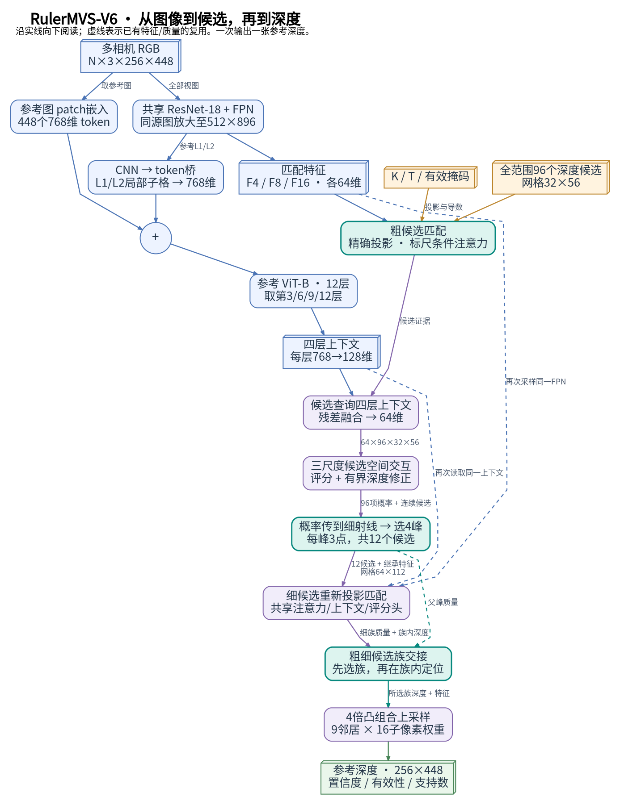

# RulerMVS-V6：投影敏感度匹配与分层候选族交接

本文对应正式训练的 **RulerMVS-V6**，不包含未采用的V7研究分支。图由当前实现及官方基线源码核对绘制；数值引用既有实验，本次没有重新训练或测量性能。

## 计算图

推荐直接打开 [draw.io计算图合集（10页）](diagrams/v6_baselines_20261102/V6与三种Baseline_计算图合集.drawio)，用底部标签切换方法与展开页。**已按数据依赖重新绘制，替代原来的行列式布局**：从输入沿实线向下，分支在实际融合处汇合，虚线表示已有特征/质量复用或可选与训练支路。所有框、连线、文字均可编辑；同目录提供每页SVG、PDF和PNG。

| 方法 | 独立draw.io | 详细页面 | 总览预览 |
|---|---|---|---|
| **RulerMVS-V6** | [4页](diagrams/v6_baselines_20261102/RulerMVS_V6.drawio) | 总览；CNN–ViT编码；标尺匹配；候选族交接 | [SVG](diagrams/v6_baselines_20261102/RulerMVS_V6_01.svg) / [PDF](diagrams/v6_baselines_20261102/RulerMVS_V6_01.pdf) |
| **MVSAnywhere HERO** | [2页](diagrams/v6_baselines_20261102/MVSAnywhere_HERO.drawio) | 总览；metadata匹配、Patchifier与融合ViT | [SVG](diagrams/v6_baselines_20261102/MVSAnywhere_HERO_01.svg) / [PDF](diagrams/v6_baselines_20261102/MVSAnywhere_HERO_01.pdf) |
| **MVSFormer++** | [2页](diagrams/v6_baselines_20261102/MVSFormerPlusPlus.drawio) | 总览；SVA、特征交互与候选体Transformer | [SVG](diagrams/v6_baselines_20261102/MVSFormerPlusPlus_01.svg) / [PDF](diagrams/v6_baselines_20261102/MVSFormerPlusPlus_01.pdf) |
| **PatchmatchNet** | [2页](diagrams/v6_baselines_20261102/PatchmatchNet.drawio) | 总览；单次候选传播与自适应评价 | [SVG](diagrams/v6_baselines_20261102/PatchmatchNet_01.svg) / [PDF](diagrams/v6_baselines_20261102/PatchmatchNet_01.pdf) |

立体框表示流动的数据，圆角框表示计算模块，圆圈表示相加、拼接或汇聚。蓝色表示图像特征，橙色表示几何，紫色表示候选推理，青色突出V6重点机制；连线注明实际传递的数据。图中尺寸采用共同RGB **256×448** 的示例，不等于各论文的官方训练尺寸；V6匹配支路由共同RGB放大至512×896，不获得额外图像信息。`C×D×H×W`分别表示通道、候选数及空间网格，省略batch维。



## 1. 方法定位与主要区别

已标定多视图深度估计存在两种不同的歧义：**观测是否支持当前深度假设，以及精细搜索是否应推翻已有粗层判断。** V6将它们分别交给投影敏感度条件匹配与候选族交接处理。其设计主线是：标定指导证据解释，保留多个竞争深度，再把选面与连续定位分开。

| 方法 | 图像与候选如何交互 | 粗到细的主要路径 | 与V6的关键区别 |
|---|---|---|---|
| [MVSAnywhere](https://arxiv.org/html/2503.22430v1) | 参考单目ViT与逐源metadata匹配体，经Patchifier和第二个ViT反复融合，DPT预测深度 | 64格代价体经连续解码；可调整范围后重跑 | V6在解码中保留显式候选及父族身份，不使用其融合ViT和DPT |
| [MVSFormer++](https://arxiv.org/html/2401.11673v1) | 全视图DINOv2侧路交互、匹配特征Transformer；粗候选体使用3D位置编码和全局注意力 | 32→16→8→4候选，围绕上级深度级联 | V6用轻量空间卷积处理粗候选，并把4个竞争峰同时送入细层 |
| [PatchmatchNet](https://arxiv.org/abs/2012.01411) | 轻量CNN提供匹配特征，学习传播邻域、评价邻域及源视图权重 | 随机初始化、局部扰动和传播，三尺度迭代 | V6显式维护全范围粗分布及粗细族质量，额外使用参考图上下文 |

三种baseline都使用标定，已有方法也具有学习式视图聚合和多候选搜索。**本文的区别不能概括成“首次使用几何”“首次多候选”或“首次CNN与Transformer融合”。** 当前V6仍是单参考深度网络；四参考输出共享匹配CNN，再分别执行参考分支，不是一次对称联合生成整个场景。

## 2. 核心机制与原理

### 2.1 投影敏感度条件匹配

对参考射线上的候选点\(X(Z)\)，从标定解析计算源视图中的深度投影导数

\[
g_i(Z)=\frac{\partial\pi_i(X(Z))}{\partial Z}
      =J_i(X)\frac{\partial X}{\partial Z}.
\]

V6将导数方向、\(\log(1+\|g_i\|h)\)与参考/源描述子的乘积、绝对差及分组相关共同送入成对MLP；\(h\)为候选区间半宽。4头跨源注意力同时读取外观与该几何条件，并提供无匹配槽。加权导数平方和再与聚合特征一起进入候选编码。所有候选仍精确投影，导数只用于条件化与局部尺度估计。

**原理。** 相同深度扰动在不同焦距、基线、距离处产生的图像位移不同；\(\|g_i\|h\)把候选区间换算成特征像素尺度，使网络能区别“几何上几乎不可区分”和“应产生明显位移”的匹配。它给已有图像证据提供物理坐标，不增加新观测，也不能替代纹理与遮挡判断。相比一般位姿元数据或3D位置编码，V6更直接描述**当前候选变化对当前源图匹配的影响**。

**证据。** 保留精确投影、只关闭源融合中的导数几何条件后，同预算短训的完整VAL中9/11分区MAE变差，支持这一组合的作用。尺度路由和半像素搜索扩宽属于另外两项用途：前者效果较小，后者有MAE与远距误差的取舍，不能把三者统一包装为必然获益。该组几何消融只有一个训练种子。[实验223](research_memory.md)

### 2.2 候选族交接：保护粗判断，同时保留局部定位

粗层在stride8上保留96个对数深度候选，通过三尺度可分离3D卷积交换空间信息。随后先把四个粗邻居的**同深度刻度概率**传到细射线，再选4峰；每峰生成3个局部候选，在stride4上重新投影取证。粗特征和粗峰质量随父族身份一起传递。

设细层第\(g\)族、第\(k\)点得分为\(s_{gk}\)，连续修正后的深度为\(z_{gk}\)。先分别计算族内分布与细层族质量：

\[
r_{gk}=\operatorname{softmax}_k(s_{gk}),\qquad
p_{f,g}=\frac{\sum_k e^{s_{gk}}}{\sum_{g',k}e^{s_{g'k}}},\qquad
\mu_g=\sum_k r_{gk}z_{gk}.
\]

父族质量\(p_c\)与细族质量\(p_f\)通过对数意见池融合：

\[
q_g=\frac{p_{f,g}^{1-\alpha}p_{c,g}^{\alpha}}
          {\sum_{g'}p_{f,g'}^{1-\alpha}p_{c,g'}^{\alpha}},\qquad
g^*=\arg\max_gq_g,\qquad \hat Z=\mu_{g^*}.
\]

每像素的\(\alpha\)由父/细分布熵、分布内积、JS分歧、无匹配质量及有效源比例共6个量预测，网络仅129参数。父质量与质量统计停止梯度；训练以各族**实际读出深度**构造族分类和风险目标，替换旧细层单点分类/风险，不再叠加另一套重型解码器。

**原理。** 单点赢家会偏好尖锐但可能错误的峰；跨峰全局平均又可能落到两个表面之间。族质量汇聚局部支持，族内均值负责连续定位；父质量则避免新细分数无条件抹掉已有判断。在固定正分布和有效集合下，上述融合是\((1-\alpha)\mathrm{KL}(q\|p_f)+\alpha\mathrm{KL}(q\|p_c)\)的最小化解，表达对两级判断的加权折中。两级来自同一组RGB，不能将其解释成独立观测的贝叶斯融合；意见池公式本身也不是本文首创。

**证据。** 从相同V5权重、相同数据顺序和预算出发的三种子短训，在完整VAL的11个分区中，交接方案的细层MAE均改善，最终MAE均值10/11改善；细层指标在共同stride8网格评价。双方粗预测均正确的像素上，细化破坏率11/11降低，例如MatrixCity由26.62%降至11.58%。但双方粗预测均错误时，纠错率9/11也下降；自适应门仅6/11胜可学习常数门。因此现有证据支持**减少正确粗判断被破坏**，尚不支持自适应门处处必要或纠错能力全面提升。[实验222及完整报告](v6_paper_results_20261101.md)

### 2.3 编码与计算分工

V6用ResNet-18的layer1/2提供2×2子格局部信息，经256→128→768桥接残差加入原始ViT patch token；参考ViT四层768维特征分别适配到128维，由候选条件查询重复读取。细层仅保留12候选，不再执行粗层空间3D块，也没有第二个融合ViT。桥接、编码共享和轻量读出是支撑设计；CNN–ViT混合与多尺度融合已有充分研究基础，不单独作为首创贡献。

## 3. 优势成立在哪里

现有结果更适合支持“部分场景下的精度—计算折中”，而非全面领先：

| 既有实验 | V6 | MVSAnywhere | 能支持的结论 |
|---|---:|---:|---|
| MatrixCity完整TEST MAE | 7.300 m | 细化10.617 m | 当前城市场景协议下误差较低 |
| MVS-Synth完整TEST MAE | 99.745 scene_unit | 细化257.183 scene_unit | 本场景单位与协议下优势明显，不能写成米 |
| CARLA下参考完整TEST MAE | 4.799 m | 首遍5.693 m；细化5.918 m | 特定视角下连同表面距离指标有一致改善 |
| 单参考延迟，eager | 33.081 ms | 首遍21.914 ms；细化37.029 ms | 快于细化版，慢于首遍 |
| 单参考延迟，局部编译 | 27.486 ms | 同上 | 部署优化另列；不能全部归因模型结构 |

精度来自固定VAL-best，速度为同卡RTX5090、FP32/TF32关闭、共同256×448输入的交替稳态计时，排除读盘、传输及点云融合。V6局部编译版已独立完成完整TEST，聚合精度近似一致但非逐像素相同。真实共享四参考耗时92.314 ms；这不是车端端到端时延。[完整精度与速度证据](v6_paper_results_20261101.md)

**机制解释与结论范围。** 多峰保持及父质量约束，为上述优势提供了可检验的结构解释；三种子消融支持其保护正确判断的作用。但不能仅由数据集胜负断言优势完全来自某个模块。CARLA四参考池化MAE仍为3.539 m，高于MVS细化3.064 m；ETH3D真实双目为2.154 m，高于0.989 m，Hypersim、DynamicReplica也存在短板。PatchmatchNet当前只有小预算CARLA适配，MVSFormer++尚无本轮完整公允主表，不能据这些图宣称胜过它们的充分训练上限。

最新ETH3D RMVD courtyard固定8组四视图外测中，V6/MVS细化MAE为6.732/0.184 m，进一步说明真实域泛化仍未解决；这是独立单场景协议，不与上表合并。[实验241](research_memory.md)

## 4. 论文应如何界定创新

建议将贡献聚焦为：**投影敏感度条件下的多视图候选匹配，以及保留父族身份、按质量交接的选族—定位解耦。** 前者解释如何使用标定，后者解释如何保留并利用候选证据，训练目标则与实际读出一致。

多假设保留已有 [NP-CVP-MVSNet](https://arxiv.org/abs/2205.03783)，粗层几何和概率向细层传递已有 [GeoMVSNet](https://openaccess.thecvf.com/content/CVPR2023/html/Zhang_GeoMVSNet_Learning_Multi-View_Stereo_With_Geometry_Perception_CVPR_2023_paper.html)，分类与连续深度估计已有 [UniMVSNet](https://arxiv.org/abs/2201.01501)。本文应针对**具体条件化、族身份传递和读出/监督组合**论证差异，不宣称这些宽泛思想首次出现。

V6使用通用DA-V2编码器与ImageNet ResNet初始化后继续训练，没有复用完整Hero推理通路。不同方法预训练与适配预算不同；最新审计还发现部分本项目测试帧标识出现在MVSAnywhere官方训练tuple中，不能统一称为双方未见的零样本测试。论文主张应受[数据协议审计](mvsanywhere_dataset_comparison_20261102.md)约束。

## 源码与复现索引

| 图中模块 | 实际代码 |
|---|---|
| V6编码与CNN桥 | [encoders.py](../jar/pretraining/encoders.py)、[V5基础编码路径](../research/rulermvs_v5_20261031/model.py)、[bridge.py](../research/rulermvs_v5_20261031/bridge.py) |
| 标尺匹配、空间交互、候选传递 | [CandidateViewAttention](../jar/pretraining/model.py)、[ruler_spatial.py](../jar/models/ruler_spatial.py)、[ruler_proposals.py](../jar/models/ruler_proposals.py) |
| V6交接与目标 | [model.py](../research/rulermvs_v6_20261101/model.py)、[handoff.py](../research/rulermvs_v6_20261101/handoff.py)、[objective.py](../research/rulermvs_v6_20261101/objective.py) |
| MVSAnywhere | [官方仓库](https://github.com/nianticlabs/mvsanywhere)、[本地vit_modules.py](../official_methods/methods/mvsanywhere/upstream/src/mvsanywhere/modules/vit_modules.py)、[本地训练/推理入口](../official_methods/methods/mvsanywhere/upstream/src/mvsanywhere/experiment_modules/sr_depth_model.py) |
| MVSFormer++ | [官方仓库](https://github.com/maybeLx/MVSFormerPlusPlus)、[本地模型](../official_methods/methods/mvsformerpp/upstream/models/networks/DINOv2_mvsformer_model.py)、[官方配置](../official_methods/methods/mvsformerpp/upstream/config/mvsformer++.json) |
| PatchmatchNet | [官方仓库](https://github.com/FangjinhuaWang/PatchmatchNet)、[本地模型](../official_methods/methods/patchmatchnet/upstream/models/net.py)、[PatchMatch迭代](../official_methods/methods/patchmatchnet/upstream/models/patchmatch.py) |

源码审计修正：MVSAnywhere匹配CNN实际为stem＋layer1，不能画成完整ResNet-18；其`compute_losses`最终使用多尺度log深度、梯度、法线及可用天空标签，虽然定义了多视图深度损失对象，当前并未将该对象加入总损失。图中按实际实现绘制。

在`jar_reconstruction/`运行以下命令可重新生成全部图（使用服务器已有的Graphviz与项目字体）；[sources.json](diagrams/v6_baselines_20261102/sources.json)记录本次对应源码哈希与检查范围。

```bash
official_methods/.venv/bin/python tools/render_v6_baseline_diagrams.py
```

图是当前深度推理路径，不把其输出画成已验证占据、free空间或完整三维场景；无匹配槽与支持数也不等于已证实遮挡判断。
