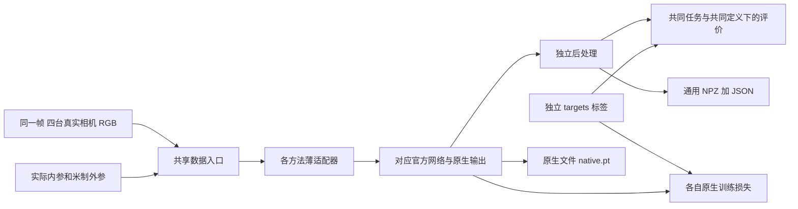

# 官方方法的独立集成

2026-10-31新增检查：六种深度基线已纳入当前数据适配，新增PatchmatchNet与DiffMVS/CasDiffMVS；见[本轮筛选、实测与公平比较说明](../research/baseline_audit_20261031/README.md)。OctreeOcc和GaussianFormer-2保持独立的占据任务限制，不计入深度主表。

每个方法的适配器、官方源码、配置和中文说明位于独立的 [`methods/<方法名>/`](methods/README.md) 目录。共享数据与训练工具保留在本目录。CARLA 已接入；空数据路径的配置是可移植模板，实际实验配置另存。自研模型的缺相机支持不代表所有 baseline 都支持缺失输入。

四目迁移和微调不等于论文指标复现。Fast-MVSNet、SimpleRecon Hero、MVSAnywhere Hero 已有真实 CARLA 实验；2026-10-13 专项检查 MVSAnywhere 的官方一致性与真实训练，入口见 [MVSAnywhere 独立说明](methods/mvsanywhere/README.md)。GaussianFormer-2 默认规模重复一致性和 OctreeOcc 发布代码缺失仍是已知限制，不能当作本轮已解决。

## 从这里阅读

| 方法 | 本地说明与计算图 | 保留的核心 |
|---|---|---|
| Fast-MVSNet | [说明](docs/fast_mvsnet.md) | 官方稀疏代价体、学习传播、Gauss–Newton 更新 |
| SimpleRecon Hero | [说明](docs/simplerecon.md) | EfficientNet 图像先验、ResNet 匹配、metadata MLP、2D 解码 |
| MVSAnywhere Hero | [说明](docs/mvsanywhere.md) | 视图独立 metadata MLP、两个完整 ViT-B、自适应深度范围、DPT |
| MVSFormer++ | [独立目录与实测](methods/mvsformerpp/README.md) | 冻结DINOv2-B、跨视图旁路、粗代价Transformer与细3D卷积；结构已实测，官方任务权重获取受阻 |
| PatchmatchNet | [独立目录与实测](methods/patchmatchnet/README.md) | 作者指定论文版本、随机候选、学习传播和自适应评价；原始DTU权重已严格加载 |
| DiffMVS / CasDiffMVS | [独立目录与实测](methods/diffmvs/README.md) | 置信度控制扩散、局部候选、循环更新和凸上采样；任务权重待获取 |
| OctreeOcc | [阻塞审计与图解](docs/octreeocc.md) | 原代码已获取；整模型缺失部分未虚构 |
| GaussianFormer-2 | [说明](docs/gaussianformer2.md) | Prob-256、概率分布初始化、稀疏高斯更新、概率与语义叠加 |

[数据格式、坐标、标签与评价细则](docs/data_and_evaluation.md) 集中说明共同协议。每个方法的中文文档包含原生代码入口、损失、训练参数、权重来源、许可证、适配差异及未验证项。



## 目录与版本

```text
official_methods/
  methods/<name>/   adapter.py、upstream/、configs/、patches/、README.md
  upstream/         指向各方法源码的兼容软链，以及 DINOv2 等共享依赖
  patches/          指向各方法补丁的兼容软链及统一来源清单
  configs/          指向各方法配置的兼容软链
  data.py           复用项目 CARLA 帧接口，缩放/裁剪/掩码
  occupancy_labels.py  从首个可见深度生成观测 free/hit/unknown
  cli.py            train / infer / evaluate，DDP、续训、计时
  postprocess.py    明确分离的重采样与深度反投影
  metrics.py        深度、表面、占据指标
  prediction_io.py  跨环境 NPZ/JSON 与原生结果封装
  tests/            合成几何、真实文件契约、模型及 CUDA 算子测试
  docs/             中文文档和 Mermaid 图
  environment/      两套环境的依赖冻结记录
```

| 仓库 | 固定 commit | 许可证核查 |
|---|---|---|
| svip-lab/FastMVSNet | `ccb686dda2717613c67d8a289dfe7b2aeb60e2fd` | MIT |
| nianticlabs/simplerecon | `113b825084cc62166c6f5584d526650928127317` | 官方 Niantic 许可，含非商业限制 |
| nianticlabs/mvsanywhere | `5bd49bba0992aa56060e1aa3bb40b2150b04726f` | 官方 Niantic 许可，含非商业限制 |
| 4DVLab/OctreeOcc | `54afdd64b210fa45a0b1e1f255e4f88739b4e5a8` | MIT |
| huang-yh/GaussianFormer | `b7e22bfc04cd6360cdee74be5af7fdace102f0a3` | 此提交 LICENSE 文件为空，不能假定为 MIT |
| facebookresearch/dinov2 | `7764ea0f912e53c92e82eb78a2a1631e92725fc8` | Apache-2.0；外部权重许可另查 |

某些仓库最初按固定 commit 和 Git blob 校验取得核心代码。2026-10-13 已完整拉取 MVSAnywhere 独立参考仓库，并补齐本地训练、评估、配置和数据划分源码；仅不分发 9 个演示图片资源。已有官方 Hero 完整权重缓存在数据盘，SHA256 与加载记录随实验保存。此轮复用现有权重，没有重新下载大权重。

## 服务器与环境

实际服务器：8×RTX 5090，单卡 32607 MiB，驱动 570.133.07。Python 3.10、PyTorch 2.8.0+cu128；CUDA 扩展明确用 `/usr/local/cuda-12.8`、GCC/G++ 10、架构 `sm_120`。系统默认 `nvcc` 是 10.1，不能直接用于 5090 编译。构建要求与依赖冻结见 [环境说明](docs/environment.md)。

依赖分别写入 `.venv` 和 `.venv_occ`，没有修改原 Conda 环境或系统驱动。以服务器已验证的 Python/PyTorch 建立**独立包副本**，不是 `--system-site-packages` 共享依赖；旧环境只作为只读来源。

深度方法环境：

```bash
cd /home/liuzonghao/3Dscene/jar_reconstruction
bash official_methods/scripts/install_depth_env.sh
official_methods/.venv/bin/python -m pip check
```

需要新服务器安装时先准备 Python 3.10 与 PyTorch 2.8.0+cu128/torchvision 0.23.0+cu128，再以 `BASE_PYTHON=/path/to/python` 指定来源。实际版本冻结文件在 `environment/depth_environment.freeze.txt`。GaussianFormer-2 的依赖、扩展安装和固定源码获取见 [环境说明](docs/environment.md)，不能仅安装深度环境就声称所有方法可用。现有环境与算子已实测；新安装脚本在全新空目录的端到端安装尚未重新执行。

## 启动命令

以下命令均从 `jar_reconstruction` 目录执行。

先做小规模合成测试：

```bash
official_methods/.venv/bin/python -m pytest official_methods/tests/test_shared.py official_methods/tests/test_manifest.py -q
official_methods/.venv/bin/python -m official_methods.tests.test_fast_mvsnet --device cpu --output official_methods/artifacts/fast_mvsnet_cpu.json
CUDA_VISIBLE_DEVICES=0 official_methods/.venv/bin/python -m official_methods.tests.niantic_smoke --method simplerecon --device cuda --output official_methods/artifacts/simplerecon_gpu.json
CUDA_VISIBLE_DEVICES=0 official_methods/.venv/bin/python -m official_methods.tests.niantic_smoke --method mvsanywhere --device cuda --output official_methods/artifacts/mvsanywhere_gpu.json
```

共享训练、断点续训与无标签推理示例：模型和训练参数只读配置文件。合成配置的 `training.max_steps` 默认为 1；第二次启动续训前改为 2。`--max-batches` 仅限制本次评测/推理帧数。

```bash
bash official_methods/scripts/run.sh fast_mvsnet train \
  --config official_methods/configs/fast_mvsnet_synthetic.json --synthetic \
  --output official_methods/artifacts/example_train
# 先将 training.max_steps 改为 2，再续训。
bash official_methods/scripts/run.sh fast_mvsnet train \
  --config official_methods/configs/fast_mvsnet_synthetic.json --synthetic \
  --checkpoint official_methods/artifacts/example_train/last.pt \
  --output official_methods/artifacts/example_resume
bash official_methods/scripts/run.sh fast_mvsnet infer \
  --config official_methods/configs/fast_mvsnet_synthetic.json --synthetic --max-batches 1 \
  --checkpoint official_methods/artifacts/example_resume/last.pt \
  --output official_methods/artifacts/example_infer
```

按 [官方数据合同](docs/data_and_evaluation.md) 转换当前数据后，把 `*_carla.json` 中四个数据路径填好。单卡或八卡运行：

```bash
CUDA_VISIBLE_DEVICES=0 bash official_methods/scripts/run.sh simplerecon train --output runs/official_simplerecon
GPUS=8 bash official_methods/scripts/run.sh mvsanywhere train --output runs/official_mvsanywhere
bash official_methods/scripts/run.sh simplerecon evaluate --split test \
  --checkpoint runs/official_simplerecon/last.pt --output runs/official_simplerecon_test
```

`GPUS=8` 使用 `python -m torch.distributed.run`，不依赖可能指向旧环境的 `torchrun` 可执行文件。当前实测多卡验收使用两卡，不把它写成已测八卡满负载。每卡 batch 在各自配置中设置，正式训练按实测显存调整，不替换骨干以凑入显存。

`*_official.json` 是原始实验协议快照；完整官方配置文件也原样保留在 `upstream`。它们可能使用 3/5/6/8 视图或原数据集时序，不能套入四目入口冒充官方协议，因此公共命令明确要求 `*_carla.json`。原数据集训练/测试脚本见各方法文档，尚未运行原论文数据集评测。

优化器、损失及调度保持方法差异；不统一成同一个 Adam 或共同预测头。checkpoint 保存模型、优化器、调度器、epoch、批次位置和每个 DDP rank 的随机状态与 BN buffers。默认 CUDA 训练重复会有非逐值差异，续训通过表示状态和步骤可恢复，不保证浮点训练轨迹逐位一致。因此不能将续训成功描述为确定性训练复现。

## 文件结果

推理默认每 batch 输出：

- `prediction_000000.npz`：可用 NumPy `allow_pickle=False` 读取，含实际支持的深度/占据、标定及独立后处理点云。
- `prediction_000000.json`：字段、形状、单位、样本 ID、参考相机、配置与后处理说明。
- `prediction_000000.native.pt`：保留原生网络返回值，用该方法环境读取。
- `infer_report.json` / `evaluate_report.json`：是否读取标签、指标、四目完整耗时与显存。

没有的输出字段不伪造。深度方法不直接参与语义占据 IoU；占据方法没有原生深度时也不直接参与深度排行榜。

## OctreeOcc 为什么暂时不能完成整模型

固定提交的官方配置有重复关键字语法错误，引用不存在的 `temporal_self_attention.py`，配置模型名与注册类名不一致；语义引导的初始结构依赖离线 `seg_structure_l1/l2`，未提供 RGB→结构的完整生成流程和对应模型。论文时序机制与发布配置/推理代码也有差异。

这些问题不是四张图变六张图或换一个稀疏体素网络就能忠实解决。已下载公开源码、运行审计，并在 5090 上测试公开布尔八叉树掩码算子；**整模型前向、反向、训练与推理未完成**。后续需要补齐作者缺失模块、初始化器与时序协议依据。详见 [审计 JSON](docs/octreeocc_audit.json)。

## GaussianFormer-2 尚未通过的一致性验收

固定 RGB、标定、随机初始化权重和随机种子后，完整 Prob-256 的两次推理仍有明显差异。一次默认合成诊断中，25,600 个高斯量化后只有 7,788 个唯一网格索引；两次稀疏卷积输入完全相同，但其输出已经不同，最终约 16.77% 的语义网格预测不同。这个数字是**程序重复性诊断，不是重建精度或真实数据误差**。

官方实现直接把重复索引传入 spconv 的 SubMConv3d；维护者明确该算子不支持重复索引。当前没有自动平均、合并或删除高斯来掩盖问题。少量不碰撞高斯的原生适配一致性与 checkpoint 测试通过，不能推广成完整 Prob-256 一致性通过。替代后端的诊断因 NVRTC 不识别 sm_120 未执行成功，未把该后端测试计为通过。

具体记录见 [默认规模诊断](docs/gaussianformer2_prob256_repeatability.json)。此外，公开仓库未给出初始化器第一阶段的完整训练配置；补充的初始化器训练/导出入口不等于复现了该阶段论文超参数。正式比较前应先解决这两项。

上游 Python 源码仅另作标准排版；算法补丁保留在 `patches/*.patch`，排版前后哈希单独记录于 `patches/formatting.json`。读取来源时不能把排版差异当成新架构。
