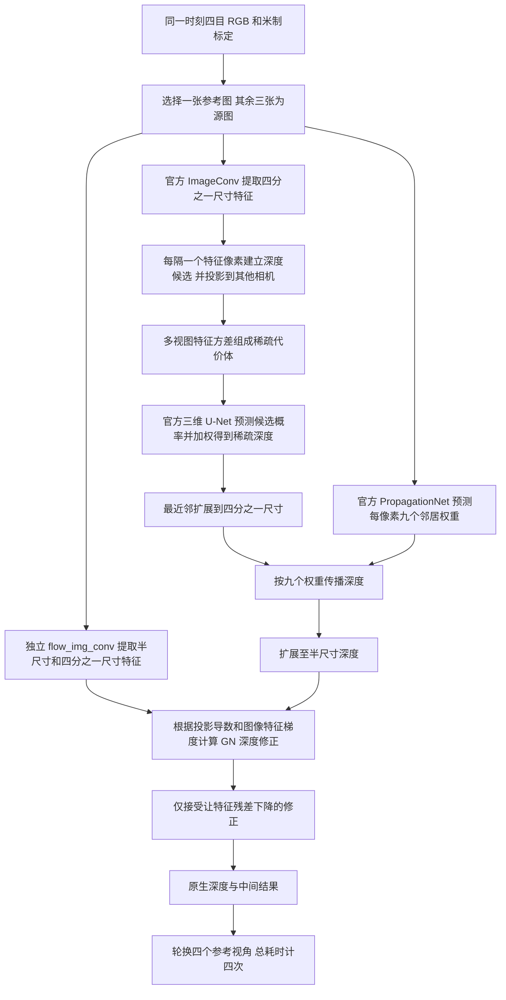

# Fast-MVSNet：官方网络与四目适配说明

> 2026-10-11 更新：当前已接入真实 CARLA 同步四目，数据、训练和评估状态见 [本轮核查记录](carla_status_20261011.json)。下文原始安装/合成验收描述中的“尚未真实训练”属于历史状态；本轮采用 `configs/carla_comparison/`，不是旧的空路径示例配置。


这里直接实例化作者发布的 `fastmvsnet.model.FastMVSNet`，保留稀疏深度估计、图像引导的学习式传播和 Gauss–Newton 细化。它没有被项目已有的 JAR 或普通 MVSNet 替换。当前合成测试证明程序能够训练和推理，不代表复现论文精度。

## 来源、版本和依赖

- [论文及附录](https://arxiv.org/html/2003.13017v1)、[官方仓库](https://github.com/svip-lab/FastMVSNet)、[官方配置](https://github.com/svip-lab/FastMVSNet/blob/master/configs/dtu.yaml)。
- 固定提交：`ccb686dda2717613c67d8a289dfe7b2aeb60e2fd`，2020-03-31；MIT 许可证保存在仓库内。机器可读来源与权重校验值见 `fast_mvsnet_provenance.json`。
- 核心模型只依赖 PyTorch 和 NumPy，无自定义 CUDA 算子，也无需外部预训练骨干。原训练工具另用 yacs、OpenCV、TensorBoardX 等，共享训练入口直接调用模型与损失，无需安装其整个旧工具环境。
- 仓库自带 `outputs/pretrained.pth`，约 3.6 MB。文件中使用旧名 `upnet.*`，发布源码中对应名为 `propagation_net.*`；适配器只重命名这一前缀，然后严格核验全部参数名称与形状。没有用 `strict=False` 忽略传播模块。
- 默认 CARLA 配置权重路径为空，从头训练；需要权重时显式设置 `model.weights`。DTU 预训练数据与从头训练结果必须分开报告。

## 一张参考图是怎样得到深度的



`coarse_img_conv` 负责最初的匹配特征；`coarse_vol_conv` 通过三维卷积整理深度候选；`propagation_net` 通过参考图学习邻居深度的混合权重；`flow_img_conv` 和官方 `FeatureGradFetcher`、`PointGrad` 构成细化步骤。全模型参数量为 **455472**，tiny 测试只缩小图像和候选数量，没有减少通道或移除阶段。

原生输出是米制光轴深度，不是射线长度。适配器输出 `depth [B,R,H/2,W/2]`（预热训练为四分之一尺寸）、对应内参 `depth_K`、参考相机编号和完整 `native` 列表。原生概率只在粗深度处产生，因此单独保留 `coarse_confidence`，没有伪造细化深度的置信度。此网络没有占据、语义或直接点云预测头；深度反投影应通过独立后处理完成。

## 训练设置与已核实的论文/代码差异

官方训练使用 3 视图、512×640 图像、48 个等间距光轴深度候选；测试使用 5 视图、960×1280 图像、96 个候选。论文的 DTU 范围约为 425–921 mm。共享配置使用等价的米制数值，实际 CARLA 范围则独立配置，绝不从测试标签估算。

原优化器为 RMSprop，学习率 0.0005、alpha 0.9；非 BN 参数衰减 0.001；StepLR 每 2 epoch 乘 0.9。官方总 batch 为 16（4 卡），先训练 4 epoch 稀疏估计与传播，再用 12 epoch 联合训练。适配器 `set_epoch` 从零计数，0–3 关闭 GN，4 起启用；推理总是启用 GN。多卡训练需 `find_unused_parameters=True`，因为发布的传播网络保留了没有在 forward 中调用的 `conv1/conv2`。

实际代码与论文概括不完全相同，当前以发布代码为依据：

1. 官方 `PointMVSNetLoss` 是按深度候选间隔归一化的有效像素 L1，且对 batch 求和。GN 阶段为 coarse、flow1、flow2 三项平均；flow1 的尺度和 coarse 相同，原实现直接返回，所以这两张深度相同、归一化间隔不同。没有把它擅自改成另一种 loss。
2. 官方训练加载器将参考深度范围边缘的标签置零；适配器执行同样标签筛选。无效或未知标签不会变为空闲空间监督。
3. 官方训练加载器中图像归一化被注释，实际输入为 BGR 0–255；测试加载器却执行逐图逐通道标准化。`fast_mvsnet_official.json` 保留这种发布代码行为。CARLA 配置显式设为训练/推理都标准化，属于记录在案的数据预处理修正，不能把它称为完全未经改动的官方 DTU 协议。
4. 官方损失将全分辨率标签用旧 `nearest` 下采样。当前保留其监督采样方式；这与半像素中心下采样的边界选点不完全相同，可能影响细小物体，需要后续在真实数据上单独消融，不能宣称这一历史细节已被精度验证。
5. GN 更新包含 `1e-6` 数值稳定项和残差下降接受判断，但没有预测深度范围裁剪。输出可能落到搜索范围之外；适配器保留原数值，只用有限性与正深度给出有效性掩码。共同评测还需统一的米制范围。

## 几何与兼容补丁

项目的整数像素中心约定经过显式转换成为官方 `0.5, 1.5, ...` 坐标。训练的官方相机内参在四分之一图像尺度，测试内参为原图尺度，适配器分别提供。返回的 `depth_K` 转回项目整数像素中心约定；半分辨率位置 `(u,v)` 对应原图 `(2u+0.5,2v+0.5)`。

补丁 `patches/fast_mvsnet_pytorch28.patch` 为官方特征采样显式设置 `align_corners=True`。原因是它以 `(width-1)`、`(height-1)` 将坐标归一化；当前 PyTorch 默认 `False` 与这套坐标不一致。此补丁不更换网络或采样算法，恒等投影和反向梯度已经实际验证。不过发布环境没有固定 torch 版本，因此这里准确称为**几何一致性兼容补丁**，不能断言与作者所有历史运行的隐式默认值完全相同。适配器与原生网络的一致性测试比较的是应用该明确补丁后的官方网络。

图像高、宽必须是 64 的倍数，候选数须为 8 的倍数，这是原三维 U-Net 尺寸约束。默认不会偷偷缩放或复制相机。官方网络没有缺失视图/带孔图像的掩码聚合接口，适配器对这种输入明确报错，应在数据准备阶段裁剪为完整有效矩形；不会把无效相机当成重复的正常相机。

## 验证命令与限制

```bash
official_methods/.venv/bin/python -m official_methods.tests.test_fast_mvsnet \
  --device cpu --output runs/fast_mvsnet_cpu.json
CUDA_VISIBLE_DEVICES=0 official_methods/.venv/bin/python -m official_methods.tests.test_fast_mvsnet \
  --device cuda --output runs/fast_mvsnet_cuda.json
```

脚本在几何一致四目场景验证预热/完整 GN 两阶段的损失与梯度、优化、四参考推理、checkpoint 恢复、标签隔离及原生/适配器一致性。合成配置预热为 0，真实训练仍为 4 epoch。默认 CARLA 尺寸为 384×512、batch=1、训练48候选；测试小图不能代表该规模性能。

未进行 CARLA 完整训练或 DTU 精度复现。DTU 官方点云融合依赖单独的 fusibile，本项目共享反投影不是其替代实现。历史 CUDA 续训与连续训练存在非逐值差异，状态恢复不等于确定性浮点轨迹。
