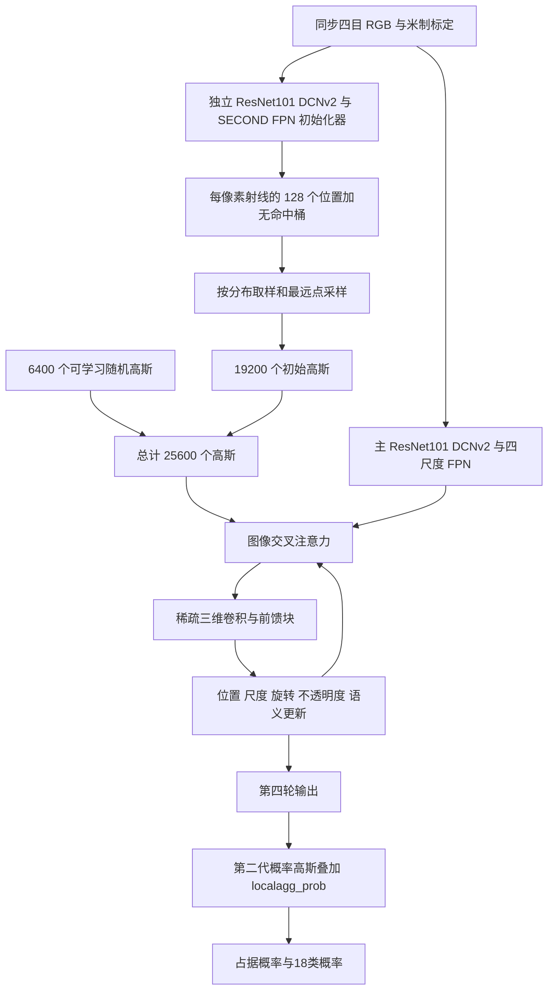

# GaussianFormer-2 Prob-256：官方实现的四目适配

版本：官方 [GaussianFormer 共用仓库](https://github.com/huang-yh/GaussianFormer)，提交 `b7e22bfc04cd6360cdee74be5af7fdace102f0a3`，选择 `config/prob/nuscenes_gs25600.py`。不是第一代。论文及附录见 [原文](https://arxiv.org/html/2412.04384v1)，安装要求见 [官方文档](https://github.com/huang-yh/GaussianFormer/blob/main/docs/installation.md)。

**当前已跑通原生CUDA前后向、双卡训练/续训及共享推理评测，但默认Prob-256的重复推理一致性未通过。** 官方稀疏卷积使用重复整数坐标，在固定输入与随机状态时仍产生显著输出差异，详情见 [默认规模重复性诊断](gaussianformer2_prob256_repeatability.json)。不能称为全部复现验收完成。

## 用直观方式理解计算过程

网络先猜“相机每个小图块对应的射线上，哪些位置可能有物体”。一条射线上可以有多处物体，所以它预测的是一整条占据分布，而不只是最近的一个深度。根据这些分布，选出一批初始三维高斯。高斯可以理解为大小、形状、朝向可调的空间小椭球，每个还带有物体类别信息。

接下来反复做四轮更新：高斯附近的邻居交换信息；高斯投影回各相机读取图像信息；更新高斯位置、形状和语义。最后查询体素格子，计算附近高斯共同给出的占据概率和类别概率。这里是三维占据概率叠加，不是绘制新视角图像的普通 3D Gaussian Splatting。

## 官方模块对应关系

| 功能 | 实际运行的官方模块 |
|---|---|
| 主模型与图像特征 | `model/segmentor/bev_segmentor.py:BEVSegmentor` |
| 概率分布初始化 | `model/lifter/gaussian_lifter_v2.py:GaussianLifterV2`、`gaussian_initializer/resnet_secondfpn.py` |
| 四轮高斯编码 | `model/encoder/gaussian_encoder/gaussian_encoder.py:GaussianOccEncoder` |
| 标定投影和变形采样 | `deformable_module.py`、`ops/src/deformable_aggregation_cuda.cu` |
| 邻域信息 | `spconv3d_module.py:SparseConv3D`，保留原生 spconv |
| 第二代更新头 | `refine_module_v2.py:SparseGaussian3DRefinementModuleV2` |
| 第二代概率合成 | `model/head/gaussian_head.py` 和 `model/head/localagg_prob/` |
| 原生占据损失 | `loss/occupancy_loss.py:OccupancyLoss`、`loss/bce_loss.py:PixelDistributionLoss` |

薄适配器在 `methods/gaussianformer2/adapter.py`，不更换骨干或预测头。原生网络保存在 `native_model`，原生输出保存在返回字典的 `native`。提供占据、语义和占据概率；不伪造深度、表面点云、法线或网络未知类别。高斯参数可以从 `native['gaussian']` 读取。

## 版本、配置与训练边界

Prob-256 实际由 19200 个分布初始化高斯和 6400 个随机高斯构成，隐藏维度 128，四个更新块。官方六目配置输入为 `864×1600`，不等于论文文字中的 `900×1600`。初始化器默认取 1–72 米的 128 个光轴深度位置；CARLA 若改深度范围须明确配置，不从标签读取范围。官方 config 使用 AdamW `4e-4`，骨干乘 `.1`，weight decay `.01`，裁剪 35；论文文字的最高学习率为 `2e-4`。这里默认跟随指定官方 config。20 epochs、迭代级余弦下降、500 步预热来自原训练代码。

占据损失为交叉熵权重 10 加 Lovasz 权重 1，并列出射线分布损失；`freeze_lifter=True` 使第二阶段初始化器被冻结，因此这一阶段分布损失不会训练初始化器。官方配置直接加载 `out/prob/init/init.pth`，仓库没有提供完整的第一阶段训练配置。适配器为同一个原生初始化器提供 `model.training_stage=initializer` 的可运行训练入口：仅用独立占据标签训练其图像骨干和概率预测层，再将 `native_model.lifter.state_dict()` 存为初始化器权重。这个补充训练入口不是已验证过的论文第一阶段超参数复现。

初始化器阶段配置为 `configs/gaussianformer2_initializer_carla.json`。使用 `python -m official_methods.tools.export_gaussian_initializer --checkpoint ... --output ...` 导出官方键名的初始化器参数及BN缓冲区；然后把结果填写到第二阶段配置。实际合成优化、导出和重载已执行。训练增强复用官方颜色扰动并保留几何一致随机镜像；输入尺寸的固定缩放作为四目迁移差异记录。

真实第二阶段必须提供 `initializer_checkpoint` 或完整 `checkpoint`；两者默认为空，缺失时明确报错。主骨干 FCOS3D 预训练和 Prob-256 权重来源均在官方 README 的权重链接中。本次不自动下载大权重。`synthetic_random_init=true` 仅证明真实架构能运行；它不产生可报告的重建性能。

## 四目与监督适配

CARLA 配置把 720×1280 标定一致缩放为 384×512，作为共享比较分辨率（原生 SECONDFPN 要求高宽可被 32 整除），改相机数为 4，使用各自真实标定，不复制成六目，不使用历史帧或其他传感器输入。默认 ROI 是 `x=[0,64], y=[-24,24], z=[-2,6]` 米，0.5 米体素。右手 rig 的 x 前、y 左、z 上与原 nuScenes LiDAR 场景网格通过明确坐标约定适配，投影矩阵直接由 `K @ T_cam_from_rig` 构造。模型保持官方 RGB 均值/标准差；图像尺寸或裁剪由共享数据层同步修正 K。

原生图像采样采用图像边界为零、像素中心为半整数的坐标；项目几何采用整数像素中心。适配时在 K 的主点上加 0.5，之后保持原生精确投影。推理固定网格仅来自配置，不能从 GT 获得范围。

原生代码将标签的记账逻辑混在 forward 中。`patches/gaussianformer2_native.patch` 允许缺标签时跳过标签查询，并让协方差求逆结果回到原张量所在设备；没有更改高斯生成或合成公式。`forward(inputs)` 不接受 targets。损失阶段再读取独立 `targets['occupancy']`：0 free、1 occupied、2 unknown；映射 free→17，已知语义命中→0…16，unknown/未标语义→255。没有语义标签的 occupied 不冒充某个类别。射线分布损失仅计算已观测位置，无命中桶只有整条有限射线已知时才监督，防止遮挡后方被当成空闲。这个可见性掩码是 CARLA 部分标签所需的适配差异。

补丁还修正了原生Lovasz在全部有效标签均为free时返回空矩阵的问题：返回有梯度链的标量0，不改变有有效非空标签时的计算。占据训练若存在命中但所有命中都缺少语义，会明确报错，避免只学习free类别。

`localagg_prob` 的 CUDA `NUM_CHANNELS` 固定为 18，目前必须把 CARLA 类别明确映射到 17 个非空槽位加 free。修改类别数必须同步重新编译此常量；当前未假装支持任意类别数。官方算子每 GPU 只支持 B=1，用梯度累积和 DDP 扩大有效批量。没有 CPU 近似网络；CUDA 计算中的关键几何与概率保持 float32。

## 环境与已运行验证

独立环境 `.venv_occ` 使用 PyTorch 2.8.0+cu128。MMCV 2.0.1、GF2 原生 CUDA 扩展针对 `sm_120` 编译，编译器 `/usr/local/cuda-12.8/bin/nvcc` 与 g++-10，不使用系统默认旧 nvcc。MMCV 编译需把 C++14 更新到 C++17，补丁单独记录。spconv 使用官方 `spconv-cu126==2.3.8`；最远点采样使用 Pointcept 官方 `pointops`，它是原仓库安装说明漏列的依赖，源码固定提交和许可证另存 `upstream/pointcept/`。

原生算子验证入口是 `tools/probe_occupancy_cuda.py`，同时检查前向与反向。独立概率公式只作为测试对照，没有替代模型算子。历史大体积过程输出已清理，保留默认规模失败诊断；本次格式整理不表示重新通过 GPU 整网测试。

**整网、checkpoint、原生/适配器一致性及 DDP 的最终结果，以本目录实际生成的测试报告为准；仅算子通过不等于完整模型通过。** 合成结果只检查程序，不是 CARLA、SurroundOcc 或论文精度。

## 许可证

当前官方仓库的顶层 `LICENSE` 是零字节，不能标记为 MIT。概率聚合目录的源文件带有 Inria/GRAPHDECO 研究、非商业使用声明并引用 `LICENSE.md`，但该文件未随仓库发布。保留全部原声明，并明确记录许可证不完整；本次研究集成没有赋予上游不存在的额外授权。第三方 Pointcept 与 MMLab 组件保留各自许可证。
