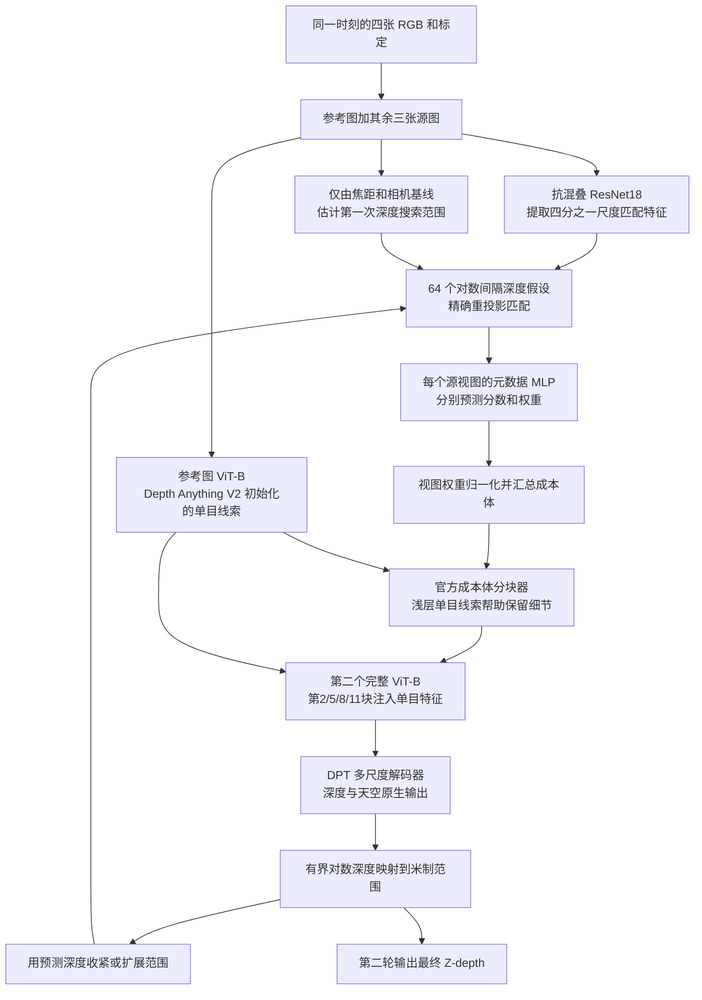

# MVSAnywhere Hero 官方实现集成（中文）

> 2026-10-13 更新：当前代码已独立封装，入口见 [方法目录](../methods/mvsanywhere/README.md)。已接入真实 CARLA 同步四目，并进行独立官方源码一致性检查和微调；源码审计见 [专项报告](mvsanywhere_source_audit_20261013.md)。下文保留算法与接口说明。


本模块直接封装 CVPR 2025 官方 `mvsanywhere_hero` 架构，保留元数据 MLP、两个 ViT-B、成本体分块器、单目/多目融合及原生 DPT 解码头。没有用 dot 消融替换。

Copyright © Niantic Spatial, Inc. 2024. All rights reserved. 代码及修改须遵守 [原许可证](../upstream/mvsanywhere/LICENSE)，含非商业用途限制。DINOv2 采用其 [Apache-2.0 许可证](../upstream/dinov2/LICENSE)；Depth Anything V2 Base 权重的许可应以权重官方页面为准，不得把整个组合自动标为 Apache。

## 固定版本与原资料

- [论文与附录](https://arxiv.org/html/2503.22430v1)、[官方仓库](https://github.com/nianticlabs/mvsanywhere)、[项目主页](https://nianticlabs.github.io/mvsanywhere/)。
- MVSAnywhere commit：`5bd49bba0992aa56060e1aa3bb40b2150b04726f`。
- 本地 DINOv2 commit：`7764ea0f912e53c92e82eb78a2a1631e92725fc8`。原代码动态取 torch.hub 默认分支，未固定 DINOv2 版本；本次固定所取代码便于复现。此版本差异已记录，未宣称等于作者训练当天的提交。
- 官方配置：[mvsanywhere_model.yaml](../upstream/mvsanywhere/configs/models/mvsanywhere_model.yaml)，入口 `src/mvsanywhere/experiment_modules/sr_depth_model.py:DepthModel`。
- [Hero 完整权重](https://storage.googleapis.com/niantic-lon-static/research/mvsanywhere/mvsanywhere_hero.ckpt)。已缓存并严格加载完整权重，SHA256 为 `00878bab903b1d384cd6bb9ea092e247a9036d429cb8bcc3d6dcbb81f67e556d`。若从骨干初始化训练，还涉及 [Depth Anything V2 Base](https://github.com/DepthAnything/Depth-Anything-V2) 和 [DINOv2](https://github.com/facebookresearch/dinov2)。随机初始化合成结果不能称为原模型零样本结果。

## 初学者计算图



“视图无关”表示每个源图先由同一个 MLP 单独评价，随后才把三张源图的结果加权汇总，所以四目无需改变这一层的输入宽度。第二轮范围来自第一轮预测，不来自 GT。与 SimpleRecon 相比，这是原方法本身的机制差异，并非适配器自行添加的新算法。

| 核心模块 | 官方类 |
|---|---|
| 参考单目 ViT-B | `DINOv2`，6 个中间特征层 |
| 共享匹配编码 | `ResnetMatchingEncoder` |
| 含几何信息的视图独立评分/权重 | `ViewAgnosticFeatureVolumeManager` |
| 成本体分块及单/多目 ViT 融合 | `CostVolumePatchEmbed`、`ViTCVEncoder` |
| 四尺度深度/天空解码 | `DPTHead` |
| 范围估计、预测后范围修正 | `get_heuristic_depth_range`、`refine_depth_range` |

## 输入、参数化、训练

共享输入及像素中心换算与 [SimpleRecon 说明](simplerecon.md) 一致：原生 `+0.5` 中心，公共输入输出为整数中心；已知 rig→camera 外参只求逆/组合，不预测、不自由修改。真实四目输入无补图、无历史帧。严格零基线会使原范围启发式退化，适配器明确报错，避免 log(0) 和假米制输出。

官方使用 640×480 RGB、64 个对数深度格、四分之一匹配尺度；最终深度与 RGB 同分辨率。深度头输出先经 sigmoid，再在当前最小和最大深度的对数之间插值，最后取指数。因此保留原范围自适应是忠实复现的一部分。

训练的 `prepare_training_inputs` 只在 `train()` 调用：取训练标签有效深度的最小/最大值，分别乘 `[0.5,1]`、`[1,2]` 的随机比例，复现官方数据范围增强。它还保留官方几何翻转；颜色增强直接使用上游 `CustomColorJitter`。`eval()` 始终调用标定范围启发式，忽略内部训练范围字段。测试标签不参与输入范围或几何查询。

原生 loss 保留四尺度 log-L1、梯度、法线，天空标签存在时保留原天空 loss（权重 0.1）；没有天空标签时传 NaN 表示未知。上游对稀疏监督过滤高误差 20% 项的逻辑保留。SimpleRecon 的多视角深度 loss 在此官方版本的最终总损失中没有使用，本集成也不擅自加进去。

官方优化为三组 AdamW：匹配/元数据 `1e-4`、参考单目编码器 `5e-6`、解码器与第二 ViT `5e-5`，weight decay `1e-4`。匹配学习率在 70k/80k optimizer update 后降档，其余两组 70k 更新内线性衰减到初始值的 0.001。适配层把三个互不重叠的优化器合并成三参数组 AdamW，逐组学习率和更新公式相同；保留每两次 microbatch 更新一次的梯度累计。原训练总配置 `max_steps=220000` 在 Lightning 手动多优化器下的计数与统一 runner 的 optimizer-step 计数不能直接等同，实际训练预算须记录图像数和各组更新数。

官方训练用了八个合成数据集（Hypersim、TartanAIR、BlendedMVG、MatrixCity、VKITTI2、Dynamic Replica、MVSSynth、SAIL-VOS 3D）；官方 zero-shot 协议是 RMVD（KITTI、ScanNet、ETH3D、DTU、Tanks and Temples）。CARLA 微调和四目对比另列，绝不能标作上述原始零样本结果。

## 依赖与明确的源码差异

原环境 Python 3.10.14 / PyTorch 2.1.2 / CUDA 11.8 / Lightning 2.2。当前独立环境采用 PyTorch 2.8 CUDA 12.8 支持 5090。网络本体不要求 Open3D、COLMAP、pytorch3d、gsplat 或 nerfstudio；它们属于上游其他导出/重建流程。本集成不声称那些旁支已运行。

本地为固定源码分发目录，不依赖嵌套 `.git`。查看 `methods/mvsanywhere/patches/mvsanywhere.patch`、统一来源记录和专项独立比对报告可核对修改：

1. 给两个 DINOv2 构造器增加本地源码路径和显式预训练开关，保持 ViT-B 层数/宽度/权重键不变。
2. 匹配 ResNet 同样增加 `pretrained` 开关，供无大权重合成测试使用。
3. 官方 loss 中硬编码 `.cuda()` 改为跟随输入设备，使 CPU 与非零 GPU/DDP 可运行，数值运算不变。
4. 适配层对 DA 权重采用严格检查，替代上游“加载失败捕获后仅写日志”的行为。
5. 无有效监督集合时返回图连通零损失，保留有效样本上的原公式；含义是该项无监督，不是将未知当作零深度。
6. 改图像尺寸时只重建解析像素网格 buffer，严格检查全部可训练权重。任意像素孔洞不能传给未支持该掩码的原生匹配器，适配器明确报错。

需注意已检查到的上游行为：天空输出在 forward 已 sigmoid，而 `compute_losses` 又使用 `binary_cross_entropy_with_logits`；`depth_gt_grad` 被构造但梯度 loss 仍传原 `depth_gt`。本版保留其代码行为，并明确记录这两个疑点，不能擅自修正后还宣称和官方完全相同。若未来比较修复版本，应另设实验和版本号。天空输出保留在 `native`，没有伪装成通用语义占据。

## 配置与验证

`configs/mvsanywhere_official.json` 保留官方典型 8 视图与 640×480，`configs/mvsanywhere_carla.json` 固定同步 4 视图，统一 CARLA 对比分辨率为 384×512，每卡 batch=1；与官方 480×640 的分辨率差异单独记录。模型本身可变源视角数量；四目仍是自然输入。CARLA 合成配置默认 `pretrained=false` 仅用于离线构造完整真实架构；官方 reference 配置使用 `pretrained=true`。后者在没有完整 Hero checkpoint 时要求提供正确 DA Base 权重，否则明确报错，避免仅以 DINOv2 初始化冒充原 Hero。填写 `model.weights` 时先离线构造再严格加载完整官方权重，避免额外重复下载骨干。

```bash
official_methods/.venv/bin/python -m official_methods.tests.niantic_smoke --method mvsanywhere --device cpu --output official_methods/artifacts/mvsanywhere_cpu.json
CUDA_VISIBLE_DEVICES=1 official_methods/.venv/bin/python -m official_methods.tests.niantic_smoke --method mvsanywhere --device cuda --output official_methods/artifacts/mvsanywhere_gpu.json
```

上述冒烟脚本使用真实投影关系四目合成场景、完整 64-bin 与两个 12-block ViT-B；只把 RGB 减至 64×96。检查五个核心模块梯度、loss、优化、原生/薄适配一致、checkpoint 严格恢复及训练字段不泄入 eval。实际报告中的 `status` 为准，不将未执行命令当作通过。完整 CARLA 训练、预训练精度、RMVD 协议、8 卡吞吐及真实小障碍性能仍需数据和后续实验验证。

## 运行边界

空路径迁移模板为 384×512；当前实际 CARLA 微调配置 `methods/mvsanywhere/configs/carla_finetune.json` 为 256×448，每卡 batch=1、梯度累计2。两者不能混写。专项实验已执行真实训练、验证和两卡 DDP；未复现原论文数据集精度，也未验证八卡吞吐、完整 TSDF 网格重建或小障碍物实例级性能。
