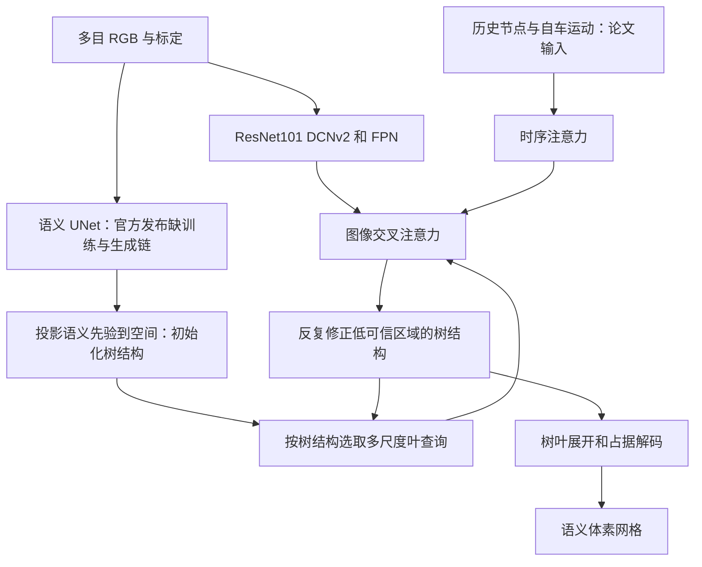

# OctreeOcc：源码审计与当前阻塞

审计日期：2026-09-24。**当前没有完成 OctreeOcc 整网复现，不能用于五方法性能表。**

官方仓库为 [4DVLab/OctreeOcc](https://github.com/4DVLab/OctreeOcc)，固定提交 `54afdd64b210fa45a0b1e1f255e4f88739b4e5a8`。论文与补充见 [arXiv 全文](https://arxiv.org/html/2312.03774v3)。下载的核心源码在 `upstream/octreeocc/`，每个原文件按官方 Git tree 中的 blob SHA-1 校验，索引保存在 `UPSTREAM_TREE.json`。许可证是仓库原始 MIT，保留在同目录。

## 这套网络原本怎样工作

先对相机图像做语义分割：例如道路、建筑、汽车。把三维空间格子的中心投影到图像，观察它落在哪类区域。位于汽车等前景区域的格子获得较高的细分优先级，道路区域较低。这一步给出第一棵粗细不同的树。

随后，用树的叶节点作为待更新的三维表示。每个节点读取相机特征，按论文还读取对齐的历史节点。编码后的特征能够反过来修正“哪些地方应该继续分开”，不是把另一模型输出简单转换为八叉树。最终把叶节点信息展开到统一体素网格，预测各格子的空闲或物体类别。

## 官方代码中的具体问题

可运行只读审计见 `methods/octreeocc/adapter.py:audit_repository`，实际审计结果在 [octreeocc_audit.json](octreeocc_audit.json)。

| 问题 | 已核对的源码位置 | 影响 |
|---|---|---|
| 配置的同一个 `dict(...)` 重复传入 `loss_octree_pred` | `projects/configs/OctreeOcc/octreeocc_base.py` | Python 编译直接出现 `SyntaxError: keyword argument repeated`，不能仅安装依赖解决 |
| 配置选择 `OctreeOcc_pred`，实际发布 detector 名为 `OctreeOcc` | 同配置与 `bevformer/detectors/octree_occ.py` | 注册器找不到配置中的模型 |
| 导入未发布的 `temporal_self_attention.py` | `bevformer/modules/octree_transformer.py` | 模块导入失败 |
| 初始化只读取离线 `oct_struct_from_seg_prior.npz` | `datasets/pipelines/loading.py:LoadSegPriorFromFile` | 仓库没有完整的 RGB→UNet→初始树生成与训练脚本，也未找到对应 UNet 权重/配置 |
| 论文、配置和测试代码的时序行为不一致 | 论文 §3.5、配置 `queue_length=16`、`operation_order` 与 detector `forward_test` | 论文使用历史查询，配置没有 `self_attn` 操作，测试却固定传 `prev_bev=None`。不能擅自挑一个版本称完整论文复现 |
| 官方配置写死作者绝对目录 | `_base_`、head 的先验统计文件路径 | 需要普通路径适配，但解决路径并不能补齐前述缺失 |

仓库 README 仍把详细指南和数据生成脚本列为待发布。文件 `LoadSegPriorFromFile` 的历史 docstring 提及深度/LiDAR，但实际执行内容是读取语义先验树；这里**不能仅凭这个过期注释认定方法用 GT 深度推理**。可以确认的是：当前发布无法核对离线先验的完整生成链，因此我们没有把 GT 语义或 GT 八叉树当成输入来“跑通”。

## 论文与代码的超参数差异

论文描述三层编码器、三层树，初始 `50×50×4`，最终 `200×200×16`，分裂比例 20%/60%，特征维度 256，ResNet101-DCN，FPN 四尺度。论文损失列出 focal、Lovasz、Dice、几何/语义亲和性及树结构损失；仓库 head 的实际实现与权重须进一步核准。官方配置指定 AdamW，学习率 `2e-4`、weight decay `.01`、骨干学习率乘 `.1`、梯度裁剪 35、余弦衰减、500 步预热、240 epochs；论文优化器/损失权重表述并不完全相同。不得把其中任一组未经测试的数字写成已复现训练设置。

官方评测目标是 Occ3D-nuScenes 语义占据：空间 `[-40,40]×[-40,40]×[-1,5.4]` 米、0.4 米体素、18 类含 free。与仅可见表面的 CARLA 深度转占据标签不是相同任务。官方配置提及 `r101_dcn_fcos3d_pretrain.pth`，本次未下载大权重，发布中未核到可用整网或语义初始化器权重。

## 目前已做与没有做

已集成官方公开核心源码及其许可证、官方/四目配置描述、可重复审计入口。已用 CUDA 12.8、PyTorch 2.8、`sm_120` 编译公开 `ops/octree_ops.*`，在 RTX 5090 验证 L1→L2→L3 的八子节点布尔掩码传播逐元素正确；可用 `tools/probe_occupancy_cuda.py` 重新验收，历史过程输出已清理。这是离散布尔算子，原实现没有可微反向，报告标为“不适用”。

**整网前向、损失反向、权重恢复、四目训练和 DDP 均未通过、也未声称完成。** 两类 JSON 配置都保留数据空路径并标记 `blocked_upstream_incomplete`；统一命令选择本方法会明确报错，不会构造其他网络替代。

后续应先获得作者补齐的初始化器/生成代码与确定可执行的配置、澄清时序版本。若只研究无历史四目变体，必须单独标记为改动后的单帧消融；本次没有静默删除这个机制。
