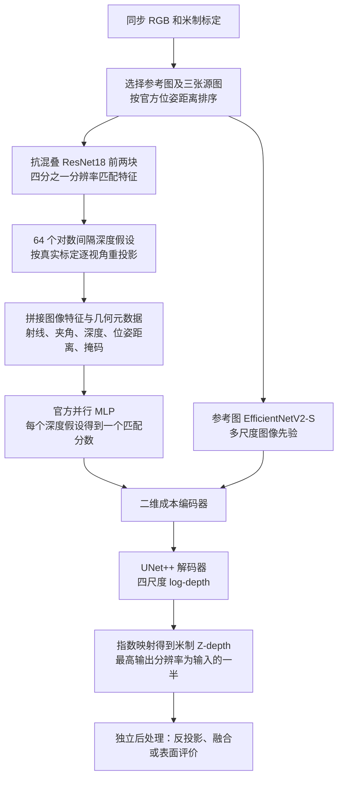

# SimpleRecon Hero 官方实现集成（中文）

> 2026-10-11 更新：当前已接入真实 CARLA 同步四目，数据、训练和评估状态见 [本轮核查记录](carla_status_20261011.json)。下文原始安装/合成验收描述中的“尚未真实训练”属于历史状态；本轮采用 `configs/carla_comparison/`，不是旧的空路径示例配置。


这是对官方 Hero 的直接封装，不是重新设计的简化网络。当前 CARLA 数据路径为空；合成验证只检验程序，不能作为 ECCV 2022 精度复现。

Copyright © Niantic Spatial, Inc. 2022. All rights reserved. 上游代码及改动遵循其 [原许可证](../upstream/simplerecon/LICENSE)，包含非商业用途限制；不能按 MIT/Apache 宣称本模块可自由商用。

## 采用版本与依据

- [论文](https://arxiv.org/abs/2208.14743)、[官方代码](https://github.com/nianticlabs/simplerecon)、[补充材料](https://nianticlabs.github.io/simplerecon/resources/SimpleRecon_supp.pdf)。
- 固定 commit：`113b825084cc62166c6f5584d526650928127317`。
- 官方配置：[hero_model.yaml](../upstream/simplerecon/configs/models/hero_model.yaml)。官方入口：`experiment_modules/depth_model.py:DepthModel`。
- 本次选择 `mlp_feature_volume`、`resnet` matching、`efficientnet` image prior、`multi_scale_encoder`、`unet_pp`，不采用 dot-product 消融。
- 官方 README 的 2022-12-31 修复覆盖内参来源、几何翻转、投影归一化/掩码。当前 commit 已包含这些代码；官方要求新代码配套新权重。[修复后 Hero 权重入口](https://drive.google.com/file/d/1hCuKZjEq-AghrYAmFxJs_4eeixIlP488/view?usp=sharing)。未下载或校验该大权重，不能声明已验证官方权重加载与官方精度。

## 网络怎样运行



这里的深度是相机前轴方向的距离，不是从相机到表面的斜线长度。MLP 不只看两张图像是否相像，也能看到这种匹配在几何上是否合理。输出是参考图的稠密深度；点云、网格及占据不是此网络原生预测头。

| 原模块 | 保留的职责 |
|---|---|
| `ResnetMatchingEncoder` | 抗混叠 ResNet18 和 InstanceNorm 匹配特征 |
| `FeatureVolumeManager` | 校准 plane sweep、全部元数据、固定视图拼接 MLP |
| timm `tf_efficientnetv2_s_in21ft1k` | 官方图像先验骨干 |
| `CVEncoder` | 多尺度二维成本融合 |
| `DepthDecoderPP` | UNet++ 多尺度对数深度 |
| `compute_losses`、`losses.py` | 原生几何损失组合 |

## 官方设置与四目迁移的边界

`configs/simplerecon_official.json` 保留官方 8 视图、512×384 RGB、64 深度格、0.25–5 m、半分辨率输出设置。`configs/simplerecon_carla.json` 使用同一时刻 4 视图，范围改成预先固定 2–80 m。米制范围来自配置，不从测试标签推断。图片缩放、裁剪由共享数据层同步修改内参。

**视图数量改变会改变 Hero 元数据 MLP 的输入宽度。** CARLA 模型通过官方 `num_source_views=3` 构造；原八目 Hero 该层权重不兼容。加载采用严格检查，不复制图片、不补零、不偷偷裁剪权重。四目模型可以按完整官方架构重新训练；这不等于复现原八目论文实验。若要迁移兼容骨干层，需要显式另做迁移实验并记录未加载层，当前不自动执行这种转换。

每个 forward 默认只预测一张参考图。共同评估轮换四个参考图，由共享 runner 统计四次完整开销。`native` 保存每次官方原始输出；公共 `depth` 为 `[B,R,H/2,W/2]`，`depth_K` 描述这个深度网格。没有原生可校准 confidence 或 occupancy，适配器不伪造这些字段。

## 几何与训练细节

共享接口 `K` 以整数为像素中心，官方以 `u+0.5,v+0.5` 为中心。适配时先把主点加 0.5，再按图像尺度缩放；公共输出内参再减 0.5。外参 `T_cam_from_rig` 直接对应官方 `cam_T_world`，逆矩阵是 `world_T_cam`。源视角按官方位姿距离排序。此桥接不会改动真实标定。

训练保留图像色彩增强、官方几何翻转和网络内特征翻转。几何翻转在适配器内部构造虚拟相机 x 轴反射，并同步翻转主点/图像/标签；公共输出再回到未翻转像素网格。反射矩阵不是新的真实相机标定。

损失直接调用官方函数：四尺度 log-L1（权重 1、1/2、1/4、1/8）、多尺度深度梯度、法线误差及 0.2 倍多视角深度误差。预测和 GT 法线均由原 `NormalGenerator` 计算。原论文公式排版中的尺度权重与当前代码表达略有不同，本集成采用当前官方代码。GT 无效深度为 NaN，仅参与损失；推理只接收 RGB 和标定。

优化器直接采用原 AdamW，学习率 `1e-4`、weight decay `1e-4`，70k/80k 更新后分别降到 0.1/0.01 倍；官方默认 110k steps、batch 16。四目训练预算需与其他方法单独记录，不能只比较迭代数。全部标签无效时返回图连通零损失，不生成伪造深度监督。

## 依赖与修改

原环境为 Python 3.9.7 / PyTorch 1.10 / CUDA 11.3。本服务器使用独立环境内 PyTorch 2.8 + CUDA 12.8，核心网络没有自行编译 CUDA 算子。依赖 timm、antialiased-cnns、pytorch-lightning、kornia、torchvision、einops；可视化模块的导入还需要 matplotlib/moviepy。Open3D 和自定义 marching cubes 不属于网络本体，未冒充已经实现其原官方融合评估。

上游源码修改全部可用 `git -C official_methods/upstream/simplerecon diff` 查看：

1. 绝对导入改为独立命名空间，避免同项目多个官方仓库的 `modules/utils/losses` 冲突。
2. 增加显式 `opts.pretrained` 构造开关，不改变任何层。CARLA 合成配置为了可离线测试使用随机初始化，官方 reference 配置保留 pretrained=true；正式训练需记录 ImageNet21k→1k EfficientNet 和抗混叠 ImageNet ResNet 预训练，或提供兼容官方 checkpoint。
3. 无有效梯度/法线/跨视图监督集合时返回图连通零损失，避免空集合均值产生 NaN；有效监督公式完全保留。
4. 改变图像尺寸加载权重时只重新生成解析像素网格 buffer；所有可训练权重仍 strict 校验，并记录重建项。原生不支持任意像素孔洞，适配器明确拒绝这类输入，请先用共享裁剪获取有效矩形。

## 验证命令

在 `jar_reconstruction` 下：

```bash
official_methods/.venv/bin/python -m official_methods.tests.niantic_smoke --method simplerecon --device cpu --output official_methods/artifacts/simplerecon_cpu.json
CUDA_VISIBLE_DEVICES=0 official_methods/.venv/bin/python -m official_methods.tests.niantic_smoke --method simplerecon --device cuda --output official_methods/artifacts/simplerecon_gpu.json
```

脚本实际构造四目一致纹理平面/细柱/方体与遮挡场景，检查完整 64-bin 网络、原生与适配器逐元素一致、像素中心射线一致、五个核心模块梯度、一次优化、checkpoint 破坏再恢复和推理标签隔离。只有实际生成的 `status:passed` 报告才代表运行通过；命令存在本身不代表已通过。

官方评测使用 ScanNetv2/7-Scenes、DeepVideoMVS 八目关键帧协议与跨帧 TSDF 融合。CARLA 同步四目公共深度/表面评测必须另列，不能与其官方表格直接混比。未知空间不由本网络自动判定为空闲。

## 运行边界

共同 CARLA 配置为 384×512、每卡 batch=1；必须记录实际预训练、GPU 数量、梯度累计和总训练预算。历史大体积冒烟 checkpoint 与过程报告已清理，保留可重新执行的测试。当前代码整理的回归结果见主项目 README；未在本轮重复全部 GPU 验收，也未进行真实数据训练或原论文精度复现。
