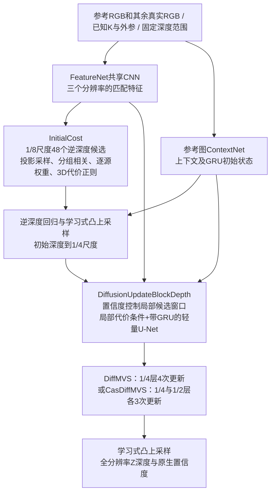

# DiffMVS / CasDiffMVS 独立基线

**2026-11-01更新：** DiffMVS已通过RTX5090双卡NCCL、真实CARLA 256×448两步训练，随后独立四卡训练启动。配置`configs/train_carla_20261101.json`，独立入口本目录`train.sh`。当前无官方任务权重，因此此轮显式随机初始化，只是CARLA先导训练，不是与V5等预训练预算的最终架构对照。完整VAL选择best，final独立保留，训练结束后自动固定TEST；推理仍不传标签。详见[本轮报告](../../../docs/v5_evaluation_20261101.md)。后文未测试GPU的描述是10月31日历史边界；本轮没有额外验证CasDiffMVS的GPU训练或发布权重精度。

这里直接运行官方完整网络，没有用自研网络替代。论文为 **Lightweight and Accurate Multi-View Stereo with Confidence-Aware Diffusion Model，IEEE TPAMI 2025**：[论文](https://arxiv.org/abs/2509.15220)、[官方仓库](https://github.com/cvg/diffmvs)。许可证为 Apache-2.0，原文件保留在 `upstream/LICENSE`。

固定源码提交为 `cd10d5c282a9cabd45a2f64598cd2b990b408d35`。服务器直连下载了全部 37 个运行源码、配置脚本、列表和许可证文件，并逐一核对官方 Git blob；仅省略 README 展示图片。`source_manifest.json` 记录版本与文件哈希。唯一兼容补丁 `compatibility.patch` 删除 `models/module.py` 在导入时执行的、结果未使用的 `cuda:0` 逆矩阵热身；网络计算公式和参数没有改动。不能把这个快照冒充完整 Git 历史。

## 原生结构与封装边界



`adapter.py` 只转换输入、选择参考图、包装输出和调用原损失。默认 `variant=diffmvs`，754,246 个参数；`variant=casdiffmvs` 使用官方级联结构，925,435 个参数。两者均保留官方推理随机噪声，不把噪声关闭后称为原方法。原生全部中间输出保留在 `prediction['native']`。

输入为项目 `rgb: [B,N,3,H,W]`，RGB 范围 0～1，不做 ImageNet 标准化；`K` 为对应当前图像的内参，`T_cam_from_rig` 为阵列到相机的变换。返回全分辨率光轴 Z 深度，单位跟外参平移和固定范围一致。2/3/4 视图均已运行，不复制图片、不额外输入历史帧。完整四目比较时，各方法使用同一组相机；轮换四参考必须计入四次完整网络费用，当前没有声称实现共享编码加速。

原生特征采样网格以整数像素中心定义，逐层内参按 1/8、1/4、1/2 缩放；`grid_sample` 保留 `align_corners=True`。输入图像高宽必须为 32 的倍数；图像缩放由公共加载器完成并同步内参，标签不决定推理范围。无需 COLMAP/VGGT 求位姿：项目已有标定直接提供原生网络所需相机矩阵，官方演示中这些求位姿步骤是数据准备，不是深度网络本体。

缺少整幅源图时，封装可直接剔除该源；同一 batch 的有效相机集合必须一致，可用 batch=1 或预先分桶。参考图缺失、少于两幅图、有效图内部有孔洞会明确报错。共同完整输入主表和缺相机鲁棒性实验需要分别统计，不能悄悄改变参与比较的样本。

## 训练、推理和权重

默认保留 DiffMVS 官方 DTU 训练超参数：48 个初始化候选、384 份逆深度刻度、4 次局部更新、6 个局部候选、噪声尺度 0.5、置信度损失系数 0.05。优化器 AdamW，学习率 0.001、权重衰减 0.001、梯度裁剪 2；OneCycle 按官方设置使用 `planned_steps+100`、5% 预热、线性退火。原生多阶段归一化逆深度误差与置信度损失逐项保留，阶段权重为 0.9 的指数序列。

**扩散训练与推理是两条不同的数据路径。** 训练时独立 `targets` 中的深度用于构造带噪训练样本，这是原方法本身；`model(inputs, targets=targets)` 只在训练态允许。评测必须 `model.eval(); model(inputs)`，显式传入 targets 会报错。不能用训练时加噪预测结果冒充无标签推理精度。

CasDiffMVS 的 `pretraining_domain=dtu` 使用官方噪声 `[0,0.5,0.1]`；`blendedmvs` 使用官方最后微调阶段 `[0,0.125,0.025]`。原作者还发布了 BlendedMVG 微调版本，曝光不同，应单独登记。这里未执行完整 DTU→BlendedMVS 多段训练，不声称统一 CARLA 训练器等价于原论文数据增强、视图选择或训练预算。

官方权重来源：[四种 DiffMVS/CasDiffMVS 权重包](https://drive.google.com/file/d/1GUpNJlxwcLyyYW622d3Jso0qdEP6LGx5/view)、[CasDiffMVS 新 BlendedMVG 权重](https://drive.google.com/file/d/1O-Tkc9NiA2C0cqsrw0CZghUH7TUp1-pN/view)。**本次服务器直连 Google Drive 超时，权重尚未取得**；没有改用用户本地网络或未核实镜像。配置 `model.weights` 后严格加载，缺少权重时默认报错；只有显式 `allow_random_init=true` 才允许从头训练/管线测试。不能将随机初始化输出列入精度排行榜。

三个配置为 `configs/official.json`、`configs/carla.json`、`configs/synthetic.json`。真实数据根路径和清单默认空字符串；官方参考配置仅记录 DTU 设置，完整论文协议应运行 `upstream/scripts/train/`、`upstream/scripts/test/`。CARLA 配置保持原生模块，调整为四目及共同米制范围，不等于复现论文 DTU 指标。

在 `jar_reconstruction/` 下执行：

```bash
# 六项CPU检查，其中完整网络前后向覆盖两个变体×N=2/3/4。
OMP_NUM_THREADS=2 MKL_NUM_THREADS=2 official_methods/.venv/bin/python \
  -m official_methods.methods.diffmvs.test_adapter

# 明确启用合成数据的一次优化；真实路径为空不会自动回退合成。
official_methods/.venv/bin/python -m official_methods.cli train \
  --config official_methods/methods/diffmvs/configs/synthetic.json \
  --synthetic --device cpu --output runs/active/baseline_audit_20261031/diffmvs/train_smoke
```

配置真实数据和权重后，使用公共 `train/infer/evaluate` 入口；多卡使用 `torch.distributed.run --nproc_per_node=8` 启动公共训练器。两进程 CPU/Gloo DDP 已通过，但不等于 RTX 5090/NCCL 多卡已验证；本轮保留正在进行的 V5 八卡训练，尚未运行 DiffMVS GPU 测试与正式速度测量。

## 本轮实际检查与限制

六项 CPU 测试已通过：完整图两个变体的 2/3/4 视图前后向、各主分支有限非零梯度、独立构造官方输入与封装逐位一致、一次优化后模型和优化器严格重载、推理不读标签、缺源剔除，以及固定随机种子下的近似尺度等变。共享CLI的单进程训练、checkpoint后无标签推理、两进程CPU/Gloo训练均已实际通过。还已在新 CARLA 的一个真实 VAL 样本执行无标签 CPU 推理，输入 `[1,4,3,64,96]`、输出 `[1,1,64,96]` 全部有限。以上均为随机权重管线检查，不是精度结果。

尺度等变初次以 `rtol=2e-5` 检查时有少量像素超差；相机基线/范围同比缩放的几何公式未变，多次 float32 采样及细化会放大误差。最终固定初始化种子、按 `rtol=1e-4` 验证近似等变；不宣称逐位不变，也不将此测试当做精度提升。独立同输入原生输出比较仍要求逐位相同。

本次未验证：官方权重实际可加载、原论文精度、正式数据训练效果、GPU/NCCL DDP、端到端四参考延迟、原生点云融合。表面点云需要独立后处理；占据/语义不是该网络原生能力，不能伪造字段。

2026-10-31共同套件补测：DiffMVS在八个现有数据域各一帧VAL、256×448、真实N=2/4的无标签CPU前向均通过，见 `runs/active/baseline_audit_20261031/suite/diffmvs_val_inputs.json`。仍无精度或GPU速度结论。
