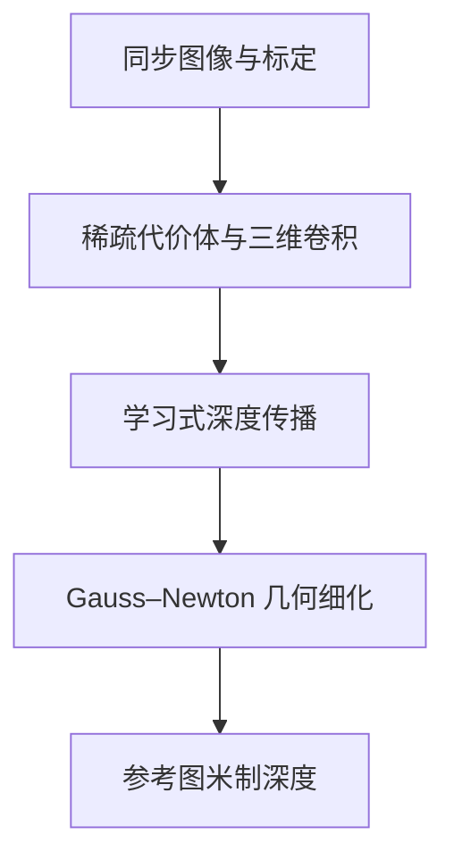

# Fast-MVSNet

直接调用官方 FastMVSNet，保留稀疏深度估计、学习式传播和 Gauss–Newton 细化；网络没有被普通 MVSNet 替换。

## 本目录如何组织

- `adapter.py`：数据、训练与公共输出的适配层；公共导入仍是 `official_methods.methods.fast_mvsnet`。
- `upstream/`：官方源码实体及其原始声明，核心入口是 [`upstream/fastmvsnet/model.py`](upstream/fastmvsnet/model.py)。
- `configs/official.json`：官方参考设置；`configs/carla.json`：同步四目迁移模板。模板的数据路径默认留空。
- `README.md`：本方法入口；[详细实现与适配说明](../../docs/fast_mvsnet.md)保留历史验证记录。

旧的 `official_methods/upstream/`、`official_methods/configs/` 和相应 `official_methods/patches/` 条目通过相对软链指向此目录，同一份代码没有复制。公共数据、评测、训练循环和 Niantic 几何适配仍集中共享；不同官方模型使用独立命令进程，避免上游全局包名冲突。

## 计算流程



## 版本和运行边界

[官方仓库](https://github.com/svip-lab/FastMVSNet)固定提交为 `ccb686dda2717613c67d8a289dfe7b2aeb60e2fd`。迁移目录不修改官方模型公式；已有兼容补丁与修改记录仍须随实验保存。许可证：MIT；原文保存在 `upstream/LICENSE`。

官方模型不支持缺失视图或图像有效区域中的孔洞，适配器会明确拒绝。原生输出深度与中间结果，不提供语义或占据预测。预训练、训练预算和数据预处理差异必须单独记录。

## 2026-10-31 重新核验

通过服务器直连重新取得上述固定提交，未使用本地电脑代理。官方文件没有缺失；主模型、层定义和损失的语法树保持一致，除格式与注释排版外，实际行为补丁只有三处 `grid_sample(..., align_corners=True)`。它恢复现有坐标公式的几何一致性，但作者没有锁定历史 PyTorch 版本，不能称所有历史隐式默认值均已逐值复现。

本轮 CPU 实际通过预热/完整 GN 的前向、损失、有限反向及优化步骤、原生调用零差异、严格 checkpoint 重载、四参考输出和半像素几何测试。作者仓库自带 DTU 权重严格加载通过；在当前 TartanAir 四目、VKITTI2 双目各一个 256×448 的 VAL 样例上，无标签推理均输出有限正深度。真实样例使用共同 TRAIN 配置中的范围，没有从 VAL 标签决定候选范围。

详见 [机器可读审计](audit/source_audit_20261031.json)；源码快照与真实样例脚本位于 `runs/active/baseline_audit_20261031/fast_mvsnet/`。这只证明官方架构与数据接口可运行，没有新精度或速度结论；本轮没有占用 GPU，也没有重跑原论文 DTU 点云评测。其 96 个均匀 Z 候选面对公共域宽范围时与 DTU 原范围差异很大，正式比较须同时报告范围、预训练和共同微调预算，不能以作者 DTU 权重的跨域成绩代表同预算架构上限。

## 命令

从项目 `jar_reconstruction` 目录执行。先修改本目录配置中的数据路径、权重和训练参数，再启动；缺数据时正常入口会报错，不会自动切换随机数据。输出目录请使用已指向数据盘的运行目录。

```bash
bash official_methods/scripts/run.sh fast_mvsnet train --config official_methods/methods/fast_mvsnet/configs/carla.json --output runs/fast_mvsnet_carla
bash official_methods/scripts/run.sh fast_mvsnet infer --config official_methods/methods/fast_mvsnet/configs/carla.json --checkpoint runs/fast_mvsnet_carla/last.pt --output runs/fast_mvsnet_carla/infer
bash official_methods/scripts/run.sh fast_mvsnet evaluate --config official_methods/methods/fast_mvsnet/configs/carla.json --checkpoint runs/fast_mvsnet_carla/last.pt --output runs/fast_mvsnet_carla/evaluate
```

训练脚本通过 `CUDA_VISIBLE_DEVICES` 选择显卡，通过 `GPUS` 指定 DDP 进程数；网络与训练超参数写在配置里。

独立验证命令：

```bash
official_methods/.venv/bin/python -m official_methods.tests.test_fast_mvsnet --device cpu --output /tmp/fast_mvsnet_cpu.json
```

命令存在不代表测试已运行。合成测试只验证程序及部分几何逻辑，不能作为论文指标或 CARLA 性能结论；真实实验请查看对应运行目录中保存的配置和结果。
