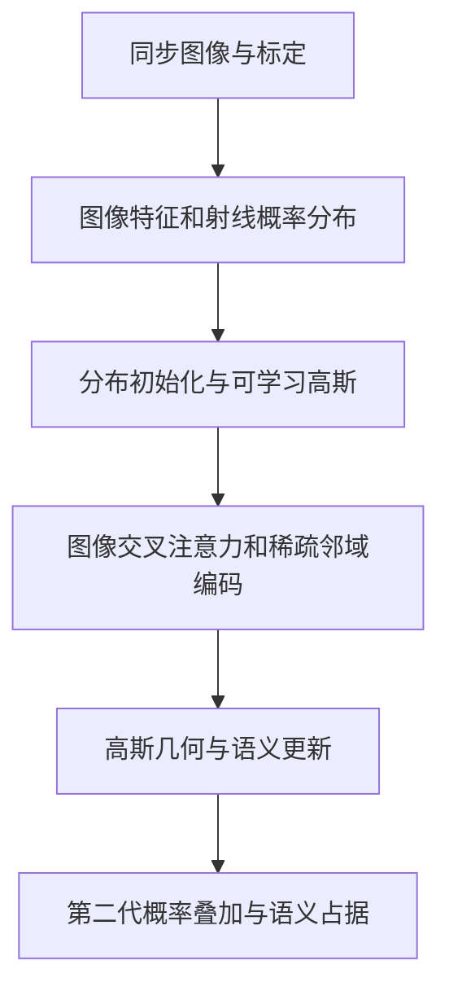

# GaussianFormer-2 Prob-256

选择共用官方仓库的第二代 Prob-256 配置，保留 GaussianLifterV2 概率分布初始化、高斯编码、语义预测与 localagg_prob 概率叠加。

## 本目录如何组织

- `adapter.py`：数据、训练与公共输出的适配层；公共导入仍是 `official_methods.methods.gaussianformer2`。
- `upstream/`：官方源码实体及其原始声明，核心入口是 [`upstream/config/prob/nuscenes_gs25600.py`](upstream/config/prob/nuscenes_gs25600.py)。
- `configs/official.json`：官方参考设置；`configs/carla.json`：同步四目迁移模板。模板的数据路径默认留空。
- `README.md`：本方法入口；[详细实现与适配说明](../../docs/gaussianformer2.md)保留历史验证记录。

旧的 `official_methods/upstream/`、`official_methods/configs/` 和相应 `official_methods/patches/` 条目通过相对软链指向此目录，同一份代码没有复制。公共数据、评测、训练循环和 Niantic 几何适配仍集中共享；不同官方模型使用独立命令进程，避免上游全局包名冲突。

## 计算流程



## 版本和运行边界

[官方仓库](https://github.com/huang-yh/GaussianFormer)固定提交为 `b7e22bfc04cd6360cdee74be5af7fdace102f0a3`。迁移目录不修改官方模型公式；已有兼容补丁与修改记录仍须随实验保存。许可证：官方顶层 LICENSE 为空，部分算子带研究/非商业声明；许可缺失必须保留说明，不能自行标记为 MIT。

依赖单独的 CUDA 环境和原生算子，没有 CPU 近似替代。默认规模重复推理存在未解决的非确定性，详情见历史审计；不应当作已通过全部复现验收。真实训练还需要初始化器或完整权重及可匹配的占据/语义标签。

## 命令

从项目 `jar_reconstruction` 目录执行。先修改本目录配置中的数据路径、权重和训练参数，再启动；缺数据时正常入口会报错，不会自动切换随机数据。输出目录请使用已指向数据盘的运行目录。

```bash
bash official_methods/scripts/run.sh gaussianformer2 train --config official_methods/methods/gaussianformer2/configs/carla.json --output runs/gaussianformer2_carla
bash official_methods/scripts/run.sh gaussianformer2 infer --config official_methods/methods/gaussianformer2/configs/carla.json --checkpoint runs/gaussianformer2_carla/last.pt --output runs/gaussianformer2_carla/infer
bash official_methods/scripts/run.sh gaussianformer2 evaluate --config official_methods/methods/gaussianformer2/configs/carla.json --checkpoint runs/gaussianformer2_carla/last.pt --output runs/gaussianformer2_carla/evaluate
```

训练脚本通过 `CUDA_VISIBLE_DEVICES` 选择显卡，通过 `GPUS` 指定 DDP 进程数；网络与训练超参数写在配置里。

独立验证命令：

```bash
official_methods/.venv_occ/bin/python -m pytest official_methods/tests/test_occupancy_methods.py -q
```

命令存在不代表测试已运行。合成测试只验证程序及部分几何逻辑，不能作为论文指标或 CARLA 性能结论；真实实验请查看对应运行目录中保存的配置和结果。
