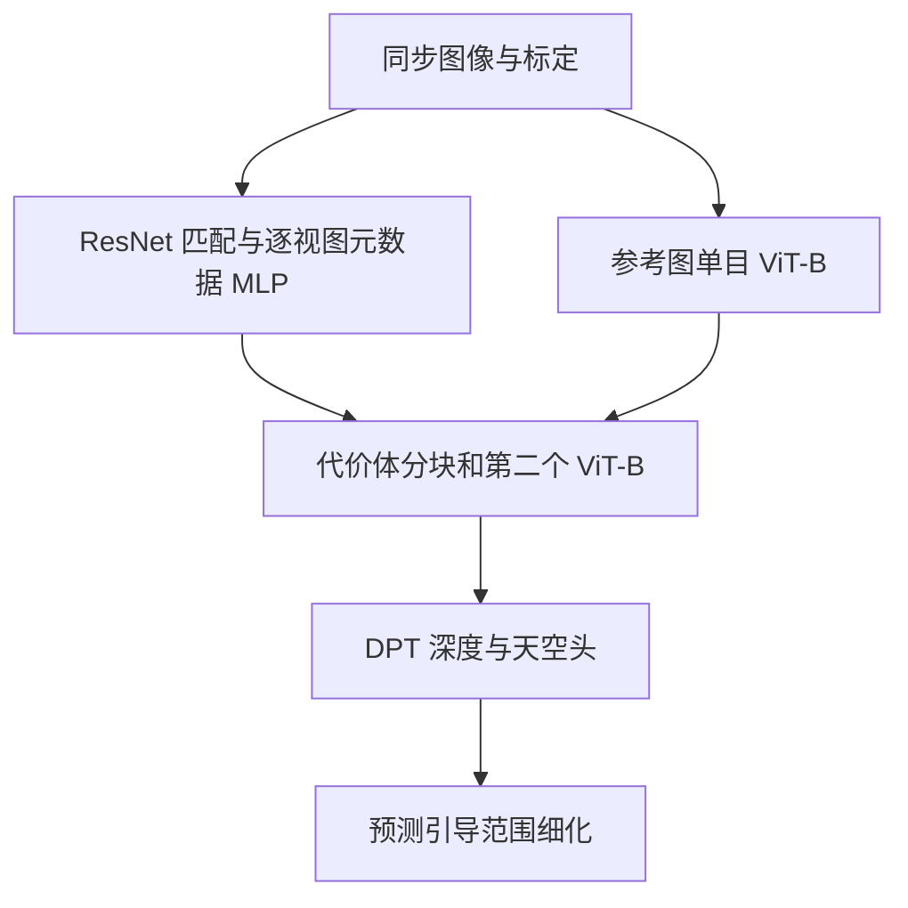

# MVSAnywhere Hero

官方 Hero 的独立封装。核心网络保留视图无关元数据 MLP、两个 ViT-B、代价体分块器、单目与多目融合、DPT 深度/天空头和自适应深度范围。

2026-10-31 新CARLA无标签输入与独立原始官方源码的复核见[本轮审计](audit_20261031.md)。下文2026-10-13的66/25/200帧配置与产物只作历史记录，不应直接用于当前新采集数据的训练和汇报。

2026-10-13 已完成独立官方源码审计、修复和真实 CARLA 微调。请先看 [源码详细核查](../../docs/mvsanywhere_source_audit_20261013.md) 与 [实际测试及结果](audit/runtime_20261013.md)。网络是原版 Hero；必要的设备、空监督和数据适配有明确记录，不能笼统称所有训练条件与论文相同。

## 本目录如何组织

- `adapter.py`：数据、训练与公共输出的适配层；公共导入仍是 `official_methods.methods.mvsanywhere`。
- `upstream/`：官方源码实体及其原始声明，核心入口是 [`upstream/src/mvsanywhere/experiment_modules/sr_depth_model.py`](upstream/src/mvsanywhere/experiment_modules/sr_depth_model.py)。
- `configs/official.json`：官方参考设置；`configs/carla.json`：同步四目迁移模板。模板的数据路径默认留空。
- `README.md`：本方法入口；[详细实现与适配说明](../../docs/mvsanywhere.md)保留历史验证记录。

旧的 `official_methods/upstream/`、`official_methods/configs/` 和相应 `official_methods/patches/` 条目通过相对软链指向此目录，同一份代码没有复制。公共数据、评测、训练循环和 Niantic 几何适配仍集中共享；不同官方模型使用独立命令进程，避免上游全局包名冲突。

## 计算流程



## 版本和运行边界

[官方仓库](https://github.com/nianticlabs/mvsanywhere)固定提交为 `5bd49bba0992aa56060e1aa3bb40b2150b04726f`。迁移目录不修改官方模型公式；已有兼容补丁与修改记录仍须随实验保存。许可证：Niantic 原许可证包含非商业限制，见 `upstream/LICENSE`；DINOv2 和 Depth Anything 权重仍遵守各自许可。

CARLA 微调属于目标域训练，不能称为原模型零样本结果。监督只能进入训练准备和损失；评估深度范围来自标定和预测。完整 Hero 权重通过配置的 model.weights 显式加载，随机初始化合成测试不代表论文精度。

## 命令

从项目 `jar_reconstruction` 目录执行。先修改本目录配置中的数据路径、权重和训练参数，再启动；缺数据时正常入口会报错，不会自动切换随机数据。输出目录请使用已指向数据盘的运行目录。

```bash
bash official_methods/scripts/run.sh mvsanywhere train --config official_methods/methods/mvsanywhere/configs/carla.json --output runs/mvsanywhere_carla
bash official_methods/scripts/run.sh mvsanywhere infer --config official_methods/methods/mvsanywhere/configs/carla.json --checkpoint runs/mvsanywhere_carla/last.pt --output runs/mvsanywhere_carla/infer
bash official_methods/scripts/run.sh mvsanywhere evaluate --config official_methods/methods/mvsanywhere/configs/carla.json --checkpoint runs/mvsanywhere_carla/last.pt --output runs/mvsanywhere_carla/evaluate
```

训练脚本通过 `CUDA_VISIBLE_DEVICES` 选择显卡，通过 `GPUS` 指定 DDP 进程数；网络与训练超参数写在配置里。

独立验证命令：

```bash
official_methods/.venv/bin/python -m official_methods.tests.niantic_smoke --method mvsanywhere --device cpu --output /tmp/mvsanywhere_cpu.json
```

当前服务器真实数据已经写入 `configs/carla_finetune.json`，该文件使用官方完整 Hero 权重、训练66帧和验证25帧；`carla.json` 继续保持空路径模板。此次经修复后重新训练的权重为 `runs/mvsanywhere_audit_20261013/finetune_verified/last.pt`，整个运行目录软链接到数据盘。推理示例：

```bash
CUDA_VISIBLE_DEVICES=0 bash official_methods/scripts/run.sh mvsanywhere infer \
  --config official_methods/methods/mvsanywhere/configs/carla_finetune.json \
  --checkpoint runs/mvsanywhere_audit_20261013/finetune_verified/last.pt \
  --split val --output runs/mvsanywhere_audit_20261013/my_inference
```

修改训练长度、图像尺寸、学习率时直接编辑 JSON。输入高宽应为16的整数倍；恢复完整 checkpoint 时不再依赖最初的外部预训练文件。共享训练器的一步是三组参数的一次联合更新，官方 Lightning 的步数累计方式不同，见专项审计。

命令存在不代表测试已运行。合成测试只验证程序及部分几何逻辑，不能作为论文指标或 CARLA 性能结论；真实实验请查看对应运行目录中保存的配置和结果。
