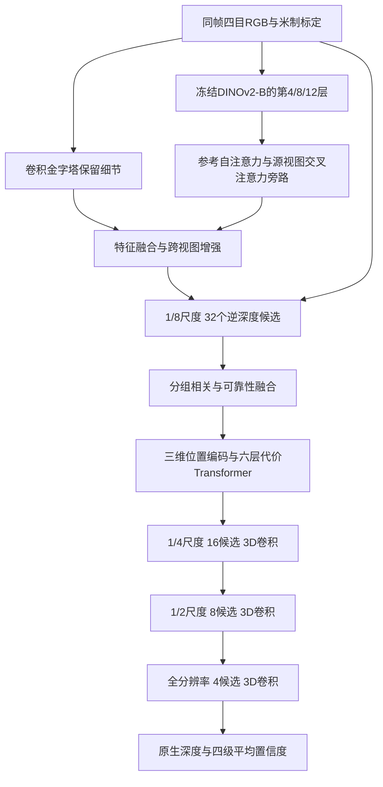

# MVSFormer++：官方完整网络的独立封装

已保留并运行官方完整结构：冻结的12层 DINOv2-B、跨视图旁路、卷积金字塔、分组相关、视图可靠性融合、6层粗代价体 Transformer、三个细尺度3D卷积阶段，以及32/16/8/4逆深度候选和四级分类损失。总参数126,054,413，可训练39,473,933。

这是官方架构的可运行 CARLA 适配。目前完整官方任务权重下载受阻；当前随机初始化冒烟测试不能用于宣称复现论文精度，也不能作为与已有预训练 baseline 的正式性能比较。

## 来源与目录

- [官方仓库](https://github.com/maybeLx/MVSFormerPlusPlus)，固定提交 `bdd980cfbae9a863b5489e2ed973612b192d11a5`。
- [论文及附录](https://arxiv.org/html/2401.11673v1)，ICLR 2024。
- `upstream/` 是实际拉取的完整源码实体，排除了 `.git`；保留 `LICENSE` 及内嵌依赖声明。
- `adapter.py` 仅负责输入标准化、相机/标签适配、原生调用和公共输出。
- `configs/official.json` 记录原实验参考条件；`configs/carla.json` 是空数据路径模板。
- `configs/synthetic.json` 为显式合成结构测试；`configs/carla_smoke.json` 是2026-10-14旧CARLA的历史两步随机结构测试，不能直接用于已经更换的新CARLA。
- `audit/source.json` 记录提交及源码哈希，`patches/mvsformerpp_compatibility.patch` 记录两处兼容修复。
- `audit/native_parity_20261014.json` 是独立原始仓库与适配器的逐张量对照记录。

## 模块对应关系

| 流程 | 原生代码 |
| --- | --- |
| 主模型、冻结骨干与四级调度 | `upstream/models/networks/DINOv2_mvsformer_model.py:DINOv2MVSNet` |
| 多层DINOv2输出 | `upstream/models/dino/dinov2.py:forward_interval_features` |
| 跨层/跨视图融合 | `upstream/models/module.py:CrossVITDecoder` 与 `models/FMT.py` |
| 分组相关、源视图可靠性、深度输出 | `upstream/models/cost_volume.py:StageNet` |
| 粗代价Transformer、细3D卷积 | `upstream/models/module.py:PureTransformerCostReg/CostRegNet/CostRegNet3D` |
| 相机反投影位置编码 | `upstream/models/position_encoding.py:get_position_3d` |
| 四级CE监督 | `upstream/models/losses.py:get_multi_stage_losses` |
| 原生参数分组与预热余弦学习率 | `upstream/utils.py:get_parameter_groups/get_lr_schedule_with_warmup` |



## 四目与坐标适配

推理仅接收 `rgb [B,4,3,H,W]`、`K [B,4,3,3]`、`T_cam_from_rig [B,4,4,4]` 和有效性信息。RGB是0..1，进入官方网络前使用ImageNet均值/标准差。内部rig坐标为x前/y左/z上，相机为x右/y下/z前；深度为米制光轴Z值。

每次选一张参考图，其余三张为源图。训练模板默认参考槽2；新CARLA已有各相机自身深度，可按真实标签选择参考图。完整四目推理可以在配置中令 `evaluation.reference_indices=[0,1,2,3]`。必须统计四次原生前向的总开销。没有复制视图、历史帧或额外传感器。

官方几何采用整数像素中心。各级内参前两行除以8/4/2/1；最终预测恢复原图分辨率，因此 `depth_K` 等于输入参考相机内参。公共加载器的resize/crop已经同步修改内参。分级标签使用与官方 `cv2.INTER_NEAREST` 对应的 `nearest`，不能换成另一种像素中心规则。官方网络不支持带孔输入或缺失相机，此版本明确报错。

返回 `native`（完整逐级结果）、`depth`、`depth_K`、`confidence`、`reference_indices`、`valid`。原生置信度来自候选概率，不是经标定的误差概率；不伪造占据/语义输出。深度转点云仍由公共后处理负责。

## 与官方的差异

1. 原论文使用五目，CARLA为四目；深度范围在配置中固定，不从测试标签读取。
2. 原生图像高宽需为64的倍数。CARLA配置为256×448；官方训练多尺度尺寸及原DTU协议保存在原始配置和参考说明里。公共固定尺寸训练没有冒充完整的原数据增强与训练预算。
3. 两处源码修复：某一级没有落在候选范围内的监督时，原CE空集合会NaN，现返回可微零；eval的ViT特征原索引仅对batch1正确，现改为显式batch/view维度，batch1计算不变。没有修改网络层、参数形状或有监督集合的损失。
4. 原生FlashAttention2类已经提供PyTorch SDPA后备路径。本环境使用它，数学上仍是同样的softmax注意力，没有换成线性注意力。实际测试版本torch2.8.0+cu128、RTX5090；无需自定义CUDA编译。OmegaConf2.3.0加入项目独立环境依赖，系统环境和驱动不变。
5. 优化器保留官方实际代码：AdamW，冻结ViT后其他参数组weight_decay=0。不能被外层配置0.01误导。调度保留原生预热+余弦。短测试必须显式设置warmup_steps小于总步数。

## 权重来源及当前阻塞

官方提供完整DTU/Tanks权重的 [OneDrive目录](https://1drv.ms/f/s!AnZvbwfkzTydkk0TEvkA7M8cRY92?e=ZjncP5)。2026-10-14实际尝试：分享链接跳转后SSL连接失败；公开drive和shares API均返回401，因此尚未获取文件清单/大小及完整任务权重。没有把其他方法的权重冒充本方法权重。

官方训练初始化使用 [DINOv2 ViT-B/14权重](https://dl.fbaipublicfiles.com/dinov2/dinov2_vitb14/dinov2_vitb14_pretrain.pth)。`model.dinov2_weights` 只加载该骨干，`model.weights` 严格加载完整MVSFormer++，两者不等价。没有权重时正常配置明确报错；仅显式 `allow_random_init=true` 可做结构测试。公共checkpoint恢复会绕过外部初始权重要求。

## 使用命令

在项目 `jar_reconstruction` 运行。修改JSON决定数据、训练长度、学习率与参考视图；输出目录须位于现有数据盘软链下。

```bash
# CPU：完整网络，合成数据，未缩小通道或层数
OMP_NUM_THREADS=2 official_methods/.venv/bin/python -m pytest -q official_methods/tests/test_mvsformerpp.py

# 单卡训练；先在carla.json中配置数据路径与官方权重
CUDA_VISIBLE_DEVICES=0 bash official_methods/scripts/run.sh mvsformerpp train \
  --config official_methods/methods/mvsformerpp/configs/carla.json \
  --output runs/deep_architecture_20261014/mvsformerpp_train --device cuda

# 恢复、推理和评估使用同一checkpoint
CUDA_VISIBLE_DEVICES=0 bash official_methods/scripts/run.sh mvsformerpp train \
  --config official_methods/methods/mvsformerpp/configs/carla.json \
  --checkpoint runs/deep_architecture_20261014/mvsformerpp_train/last.pt \
  --output runs/deep_architecture_20261014/mvsformerpp_train --device cuda
CUDA_VISIBLE_DEVICES=0 bash official_methods/scripts/run.sh mvsformerpp evaluate \
  --config official_methods/methods/mvsformerpp/configs/carla.json \
  --checkpoint runs/deep_architecture_20261014/mvsformerpp_train/last.pt \
  --output runs/deep_architecture_20261014/mvsformerpp_eval --device cuda

# DDP通过GPUS与CUDA_VISIBLE_DEVICES选择；实际验证状态见audit/runtime_20261014.md
GPUS=2 CUDA_VISIBLE_DEVICES=0,1 bash official_methods/scripts/run.sh mvsformerpp train \
  --config official_methods/methods/mvsformerpp/configs/carla.json \
  --output runs/deep_architecture_20261014/mvsformerpp_ddp --device cuda
```

当前已执行结果详见 [运行记录](audit/runtime_20261014.md)。几何与CPU/GPU程序验证不代表原论文精度已复现；原始CARLA深度编码标尺仍待采集脚本核实。

## 2026-10-31 重新核验与修正

通过服务器直连重新下载固定提交。全部105个官方文件中，103个逐字节一致，两个差异正是已记录的空监督保护和batch索引修复，没有替换任何网络层。重新用独立原仓库、独立进程比较，26个原生输出张量逐位一致。

本轮补齐官方权重加载细节：与作者 `test.py/test_tt.py` 一样排除旧 `pe_dict` 位置缓存键，其余参数仍 `strict=True`。新增测试确认真实缺参数仍报错，不用宽松加载掩盖不兼容。CPU共9项通过，覆盖真实完整网络、训练反向、空监督、冻结ViT、原生输出一致、相机格点、batch2及真实N=2/N=3输入；没有把双目复制成四目。

另在当前 TartanAir 四目、VKITTI2 双目各一个256×448的VAL样例上完成 `load_targets=False` 推理，范围来自共同TRAIN配置。完整随机网络输出有限，但包含非正深度：原生逆深度细化区间未默认限制正值（`schedule_inverse_range(..., shift=False)`），随机初值下可能跨过零。保留原输出与有效性标记，没有靠截断或删掉困难像素包装成精度结果。正式深度评价必须保留共同GT分母并单列无效率。

本轮官方OneDrive链接仍在301跳转后连接超时，完整任务权重没有取得；随机模型的结构测试不能加入正式精度排行榜。新CARLA的米制光轴深度证据见主经验文档148–159，前段“待采集脚本核实”仅是2026-10-14旧数据的历史结论。没有在本轮占用GPU、重训、测速或宣称原论文精度复现。

证据：[机器可读审计](audit/source_audit_20261031.json)，以及数据盘 `runs/active/baseline_audit_20261031/mvsformerpp/` 中的原始源码快照与真实样例脚本。
