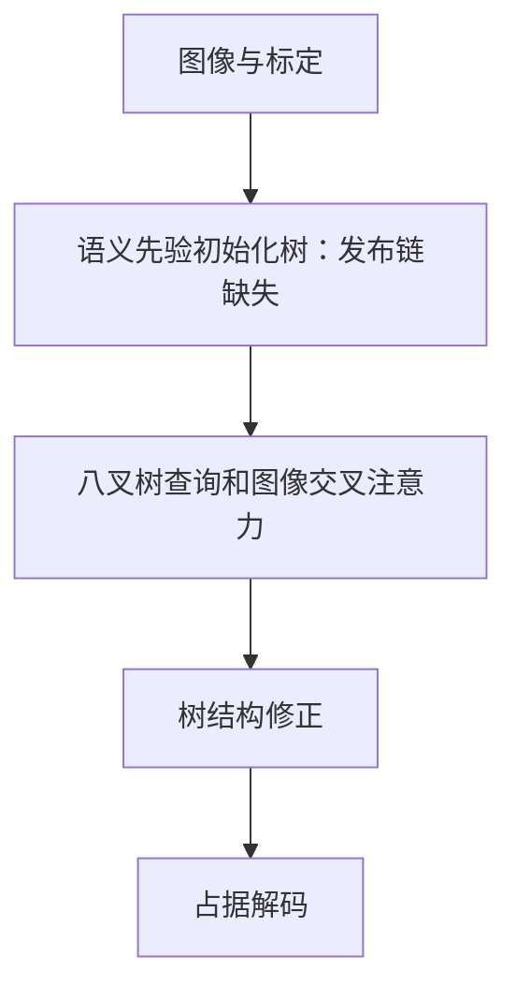

# OctreeOcc

保存官方发布代码和可执行完整性审计。目前官方缺失初始化语义先验生成链、被引用的时序模块，且配置存在错误；没有用另一种稀疏网络冒充原方法。

## 本目录如何组织

- `adapter.py`：数据、训练与公共输出的适配层；公共导入仍是 `official_methods.methods.octreeocc`。
- `upstream/`：官方源码实体及其原始声明，核心入口是 [`upstream/projects/mmdet3d_plugin/bevformer/detectors/octree_occ.py`](upstream/projects/mmdet3d_plugin/bevformer/detectors/octree_occ.py)。
- `configs/official.json`：官方参考设置；`configs/carla.json`：同步四目迁移模板。模板的数据路径默认留空。
- `README.md`：本方法入口；[详细实现与适配说明](../../docs/octreeocc.md)保留历史验证记录。

旧的 `official_methods/upstream/`、`official_methods/configs/` 和相应 `official_methods/patches/` 条目通过相对软链指向此目录，同一份代码没有复制。公共数据、评测、训练循环和 Niantic 几何适配仍集中共享；不同官方模型使用独立命令进程，避免上游全局包名冲突。

## 计算流程



## 版本和运行边界

[官方仓库](https://github.com/4DVLab/OctreeOcc)固定提交为 `54afdd64b210fa45a0b1e1f255e4f88739b4e5a8`。迁移目录不修改官方模型公式；已有兼容补丁与修改记录仍须随实验保存。许可证：官方 MIT，见 `upstream/LICENSE`。

本目录不是已跑通的完整模型。训练、推理入口会准确报告上游阻塞；独立打包不能消除这些缺失。审计能运行不等于网络前后向通过。

## 命令

从项目 `jar_reconstruction` 目录执行。先修改本目录配置中的数据路径、权重和训练参数，再启动；缺数据时正常入口会报错，不会自动切换随机数据。输出目录请使用已指向数据盘的运行目录。

```bash
bash official_methods/scripts/run.sh octreeocc train --config official_methods/methods/octreeocc/configs/carla.json --output runs/octreeocc_carla
bash official_methods/scripts/run.sh octreeocc infer --config official_methods/methods/octreeocc/configs/carla.json --checkpoint runs/octreeocc_carla/last.pt --output runs/octreeocc_carla/infer
bash official_methods/scripts/run.sh octreeocc evaluate --config official_methods/methods/octreeocc/configs/carla.json --checkpoint runs/octreeocc_carla/last.pt --output runs/octreeocc_carla/evaluate
```

训练脚本通过 `CUDA_VISIBLE_DEVICES` 选择显卡，通过 `GPUS` 指定 DDP 进程数；网络与训练超参数写在配置里。OctreeOcc 当前会报告上述发布缺失，列出的命令不是已完成运行的证据。

独立验证命令：

```bash
official_methods/.venv/bin/python -m pytest official_methods/tests/test_occupancy_methods.py -k OctreeReleaseAudit -q
```

命令存在不代表测试已运行。合成测试只验证程序及部分几何逻辑，不能作为论文指标或 CARLA 性能结论；真实实验请查看对应运行目录中保存的配置和结果。
