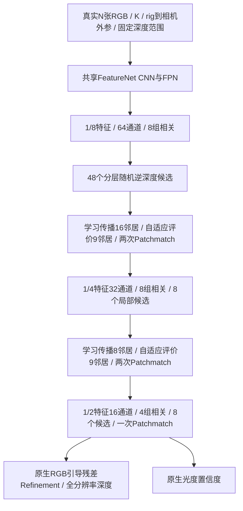

# PatchmatchNet：独立官方基线

**2026-11-01更新：** RTX5090双卡NCCL、真实CARLA 256×448两步训练已通过；当前独立四卡迁移训练已启动。配置是`configs/train_carla_20261101.json`，独立入口是本目录`train.sh`。新增完整VAL选best、独立final、续训状态和200GiB存储下限，原生网络/损失不变。共同174帧TEST的官方DTU权重迁移已完成；不能与181帧历史结果混比，也不能将未充分迁移的结果视作架构上限。具体结果、启动命令和状态见[本轮报告](../../../docs/v5_evaluation_20261101.md)。下文“本轮未验证GPU”是10月31日记录，其GPU边界由此更新覆盖。

直接运行 [CVPR 2021 Oral论文](https://openaccess.thecvf.com/content/CVPR2021/html/Wang_PatchmatchNet_Learned_Multi-View_Patchmatch_Stereo_CVPR_2021_paper.html)的[作者代码](https://github.com/FangjinhuaWang/PatchmatchNet)。许可证 MIT。

**固定版本为 `c6d2dce962be8109779afcdb3b79880d35ff9c83`，不是当前 main。** 作者在2025年更新README明确说明：main中的权重经过其他贡献者重训，复现论文应使用此历史提交。本目录保存该提交的完整官方压缩包内容及原始DTU任务权重；`source_manifest.json`记录下载地址、SHA256与逐文件哈希。权重文件软链接到数据盘。

## 结构保留了什么



原生 `models/net.py::PatchmatchNet`、`models/patchmatch.py::PatchMatch` 和 `patchmatchnet_loss` 均直接调用。保留粗到细三阶段、学习传播、自适应代价聚合、随机候选、各阶段停止梯度和最终细化；没有换成普通MVSNet。新增封装不提供原生网络没有的占据或语义。

唯一上游兼容修改：`ref_feature.get_device()` 两处改为 `ref_feature.device`，让CPU可运行，CUDA设备语义相同。原生插值默认值保留；固定版本要求PyTorch1.4，其 `grid_sample` 默认已经是 `align_corners=False`，这里没有擅自改为True。补丁见 `patches/patchmatchnet_cpu_device.patch`。

输入RGB为0–1。K与T均来自同一原图，统一加载器缩放原图时更新K；原生特征层K再按stride直接缩放，不额外添加半像素位移。输出是参考相机光轴深度，单位等于平移与深度范围的单位。图像尺寸须为8的倍数，至少两个真实视图。缺失整幅图或图内孔洞会明确拒绝；共同主表使用完整输入子集，不能填零补图。

## 训练与迁移边界

官方 `train.sh` 是DTU、五目、512×640、batch4、8轮，Adam学习率0.001、无weight decay。默认学习率下降里程碑10/12/14来自 `train.py`，8轮脚本不会触发。原生损失是每次Patchmatch输出及最终细化的SmoothL1求和。统一入口按epoch步进调度器，不偷换优化器。

CARLA配置改变视图数、范围、图像尺寸和batch；这是数据迁移，不是原论文训练设置完全复现。还必须记录：

- 原DTU深度以毫米表示，SmoothL1的默认转折点1对应1毫米；米制数据使用同一公式时转折点变成1米。后续共同训练应显式决定损失单位/权重，并用VAL选定，不能宣称物理目标完全相同。
- 共同训练标签按固定监督范围过滤；原DTU加载器仅使用数据集mask，这是公开的数据协议差异。
- 所有阶段无有效标签时返回有梯度连接的零损失，避免 `mean(empty)` 的NaN；正常标签直接调用官方损失函数。
- 推理保留随机候选。原生/适配器一致性和checkpoint测试必须恢复同一随机状态；正式精度实验保存seed并评估随机波动。
- `configs/official.json` 保存官方参考设置；`carla.json` 的路径默认空；`synthetic.json` 才用于显式合成运行。

## 已运行与命令

在项目根 `jar_reconstruction/`：

```bash
official_methods/.venv/bin/python -m pytest official_methods/tests/test_patchmatchnet.py -q

official_methods/.venv/bin/python -m official_methods.cli train \
  --config official_methods/methods/patchmatchnet/configs/synthetic.json \
  --synthetic --device cpu --output runs/active/baseline_audit_20261031/patchmatchnet/cli_train
```

本轮6项CPU测试通过：完整221,925参数网络N=2/3/4前后向、五个核心组有限非零梯度、一次优化、官方损失一致性、官方任务权重严格加载、原生输出逐位一致、checkpoint恢复、标签隔离、四参考输出、像素投影与原加载器预处理一致性、空监督/缺图边界。另运行统一CLI单步训练及两进程CPU/Gloo两步训练。八个真实数据域各一帧VAL的256×448无标签前向全部通过。

配置真实数据和权重后，用同一CLI的 `train / infer / evaluate`；CUDA使用 `--device cuda`，多卡使用 `python -m torch.distributed.run --standalone --nproc_per_node=8 -m official_methods.cli train ...`。**本轮未测试PatchmatchNet的RTX5090或GPU DDP，未运行完整DTU指标、全数据集精度或速度测试**；当前八卡V5训练保持运行。

证据位于 `runs/active/baseline_audit_20261031/patchmatchnet/` 和 `suite/patchmatchnet_val_inputs.json`。CPU管线成功不能当作论文精度，也不能把CPU执行时间当车端速度。
