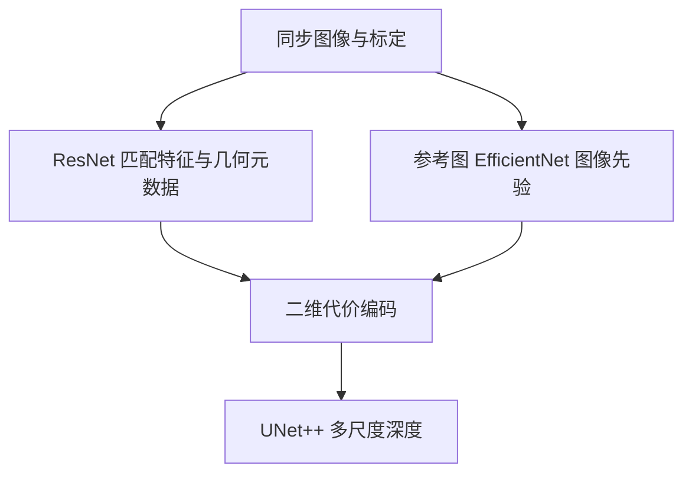

# SimpleRecon Hero

直接调用官方 Metadata + ResNet Matching 主模型，保留 EfficientNet 图像先验、元数据匹配、二维代价编码和 UNet++ 深度头。

2026-10-31 已完成[独立官方源码、完整CPU前反向和新CARLA输入复核](audit_20261031.md)，并修复恢复完整checkpoint时不必要的外部预训练依赖。四目适配不等于已加载官方八目权重；缺源深度监督的扩展单独记录。

## 本目录如何组织

- `adapter.py`：数据、训练与公共输出的适配层；公共导入仍是 `official_methods.methods.simplerecon`。
- `upstream/`：官方源码实体及其原始声明，核心入口是 [`upstream/experiment_modules/depth_model.py`](upstream/experiment_modules/depth_model.py)。
- `configs/official.json`：官方参考设置；`configs/carla.json`：同步四目迁移模板。模板的数据路径默认留空。
- `README.md`：本方法入口；[详细实现与适配说明](../../docs/simplerecon.md)保留历史验证记录。

旧的 `official_methods/upstream/`、`official_methods/configs/` 和相应 `official_methods/patches/` 条目通过相对软链指向此目录，同一份代码没有复制。公共数据、评测、训练循环和 Niantic 几何适配仍集中共享；不同官方模型使用独立命令进程，避免上游全局包名冲突。

## 计算流程



## 版本和运行边界

[官方仓库](https://github.com/nianticlabs/simplerecon)固定提交为 `113b825084cc62166c6f5584d526650928127317`。迁移目录不修改官方模型公式；已有兼容补丁与修改记录仍须随实验保存。许可证：Niantic 原许可证包含非商业限制，见 `upstream/LICENSE`。

四目与官方八目 Hero 的元数据 MLP 输入宽度不同，八目整网权重不能直接严格加载到四目模型。不会复制图像或静默裁剪权重。输出为参考图深度；点云与表面评测使用独立后处理。

## 命令

从项目 `jar_reconstruction` 目录执行。先修改本目录配置中的数据路径、权重和训练参数，再启动；缺数据时正常入口会报错，不会自动切换随机数据。输出目录请使用已指向数据盘的运行目录。

```bash
bash official_methods/scripts/run.sh simplerecon train --config official_methods/methods/simplerecon/configs/carla.json --output runs/simplerecon_carla
bash official_methods/scripts/run.sh simplerecon infer --config official_methods/methods/simplerecon/configs/carla.json --checkpoint runs/simplerecon_carla/last.pt --output runs/simplerecon_carla/infer
bash official_methods/scripts/run.sh simplerecon evaluate --config official_methods/methods/simplerecon/configs/carla.json --checkpoint runs/simplerecon_carla/last.pt --output runs/simplerecon_carla/evaluate
```

训练脚本通过 `CUDA_VISIBLE_DEVICES` 选择显卡，通过 `GPUS` 指定 DDP 进程数；网络与训练超参数写在配置里。

独立验证命令：

```bash
official_methods/.venv/bin/python -m official_methods.tests.niantic_smoke --method simplerecon --device cpu --output /tmp/simplerecon_cpu.json
```

命令存在不代表测试已运行。合成测试只验证程序及部分几何逻辑，不能作为论文指标或 CARLA 性能结论；真实实验请查看对应运行目录中保存的配置和结果。
