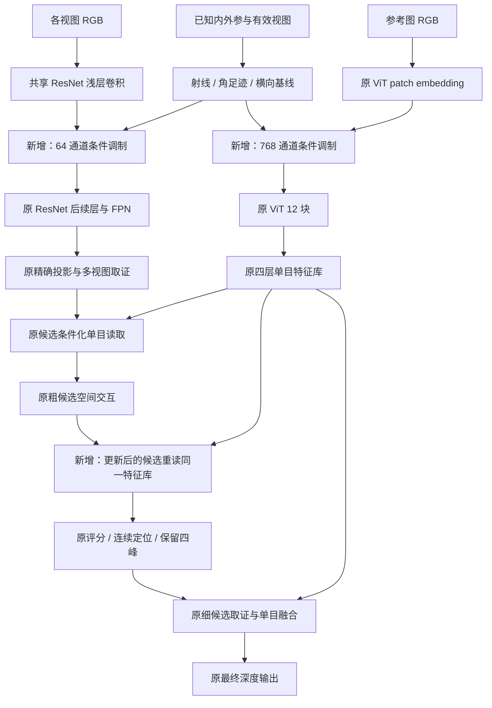

# 早期相机条件与候选判断后的单目重读

这是独立研究入口，不替换生产模型。它研究两个问题：已知标定是否应更早参与特征编码；候选经过空间判断后，是否应重新读取已有的单目特征。精度结论以本次实际生成的结果为准，实验决策统一追加到 `docs/research_memory.md`。

## 物理依据与不能解决的问题

同样大小的图像纹理，在不同焦距下对应不同的视角范围。没有内参的图像编码器只能通过训练分布间接学习这种区别。给它内参，提供的是对图像采样方式的解释，不是额外的真实深度。

设主图像素为 `p = (u, v, 1)`，`q = inverse(K) p`，单位射线为 `r = q / ||q||`。射线对像素坐标的导数为：

```text
dr / d(u,v) = (I - r rᵀ) inverse(K)[:, :2] / ||q||
```

将两列分别乘以当前特征格点的像素采样间距，可以得到角足迹。它近似回答“一个采样格对应多大的视角”，不回答“这个物体有多少米”。这不是CNN完整感受野：stem的采样步长是4，卷积感受野却更大。物体尺寸还需要深度和表面朝向。此处微分仅描述采样尺度，后续三维候选仍精确投影。

对于相机 i 和 j，在相机 i 坐标中计算相对中心位移 `b_ij`，取其垂直于当前射线的部分：

```text
b_perp² = ||b_ij||² - (b_ij · r)²
```

可用源视图的均方根横向基线是潜在的测距杠杆。它不保证视野重叠、不保证纹理可匹配、更不证明当前像素未被遮挡。共心纯旋转时该量为零，早期编码不能凭空解除深度尺度歧义。

每个位置使用 7 维条件：单位射线 3 维、两方向角足迹的对数 2 维、两方向导数夹角余弦 1 维、`log1p(横向基线 / depth_scale)` 1 维。`depth_scale` 沿用各域从 TRAIN 固定的单位归一化常数，不读取当前标签。场景坐标及该常数同时换单位时条件不变；整体刚体变换不影响条件。

## 实际实现



三个新增位置独立开关。图示的“重读”没有新建第二个 ViT，也没有更新单目特征库本身。

### 编码器内的调制

采用 `F_new = F * (1 + 0.1 * tanh(MLP(condition)))`。MLP 为 `7 → 32 → C`，最后一层零初始化，因此安装时函数与旧模型相同。通道相关的乘性调制可以改变特征方向；若只乘一个统一标量，后续 L2 归一化会抵消它。乘性操作使零特征仍为零，但不保证非零均匀纹理不会出现由条件产生的空间变化。

更早注入不一定更好：同一个真实表面在不同相机中的条件不同，逐通道调制也可能将原本接近的匹配特征拉开。单目语义特征需要相机条件解释透视；匹配描述子还需要跨视图可比性，两者不能默认采用同一种条件化就必然同时受益。本次用独立开关和后续条件干预检查这一区别。

- 匹配支路：在 ResNet stem/maxpool 后、layer1 前注入，宽度 64，主设置网格为 128×224。随后经过原层级编码，保留原 FPN 和匹配头。
- 参考支路：在 ViT patch embedding 后、位置嵌入与 Transformer 块前注入，宽度 768，网格 16×28。没有增加 token，CLS 与原位置编码保留。
- 匹配图为 512×896、主图为 256×448 时，匹配 stem 格点映回主图的中心为 `(4j + 0.5)/2 - 0.5`；ViT patch 中心为 `16j + 7.5`，不能混用。
- 新参数必须通过冻结骨干反向传播。原骨干 `eval()` 只冻结其统计和随机行为，不能把整个编码器放进 `no_grad()`；块级 checkpoint 控制训练显存。

### 更新候选后的重读

原模型已经在粗、细两阶段读取四层单目特征。新分支只在粗候选空间交互后再次读取：以新的候选状态为 query，对同一像素位置的四层特征做注意力汇聚。复用原 `raw_query/raw_output`，只新增 64 个零初始化通道增益：

```text
new_candidate = candidate_after_spatial
              + 0.1 * tanh(gain) * (read_after - read_before)
```

相减试图只加入“候选判断更新后需要改变的单目解释”，而非无条件重复加一份图像先验。这是待验证假设，不是已证明最优融合。此次最小实现只改变粗评分、定位与后续候选供给；向细层继承的粗特征仍走原路径。若粗层改善但细层退化，需要进一步检查这一交接。

`read_after` 的 query 相比 `read_before` 还经过了首次融合与归一化，因此不能将二者差分全部归因于空间模块本身。

## 对照与证据边界

公共七域和新 CARLA 分别从本轮独立训练的 best 开始，每组比较：

| 名称 | 改动 |
| --- | --- |
| control | 旧解码器同预算继续训练 |
| appearance | 两个早期适配器，但条件全为常数 |
| early | 两个早期适配器，使用真实相机条件 |
| late | 只增加粗空间判断后的重读 |
| both | 早期条件与重读同时启用 |

另保留每组的训练前结果。公共每域 128 TRAIN，合计 448 更新；CARLA 497 TRAIN，249 更新，batch 2。固定训练顺序和增强，原编码器/FPN冻结，只训练原解码器与新增参数；末步固定，不按 VAL 换 checkpoint，不访问 TEST。

每域 16 个历史已查看的 VAL 样本分两部分报告，不能称盲测。近距定义沿用现有评测，`scene_unit` 域不写成米、不跨单位平均绝对误差。比较完整输出和共同 stride8 的粗、细、最终深度。速度在训练进程退出后，同卡交替、FP32、TF32 关闭、位置缓存实际命中，单参考网络延迟不等于四参考完整场景延迟。

`early > appearance` 仍不足以证明物理标尺是唯一原因：常数条件与空间变化条件的有效表达能力不同，固定相机配置下也可能只学到位置偏置。需要再用保持实际投影标定不变的条件干预，以及后续未见相机设置验证。短训失败也不能证明充分联合训练后必然无效。

特别是全零条件使第一层权重没有输入梯度；appearance 是同参数总量的全局通道适配对照，不是有效函数容量完全相同的对照。本轮仅验证 FP32；`camera_descriptor` 中的 `no_grad` 不会禁用 autocast，未来使用 BF16 时需显式保护几何精度并单独回归。

## 运行

```bash
cd /home/liuzonghao/3Dscene/jar_reconstruction
OMP_NUM_THREADS=1 official_methods/.venv/bin/python -m unittest \
  research.early_geometry_20261030.test_encoding \
  research.early_geometry_20261030.test_fusion -v

# 单组配置驱动；同名已有结果拒绝覆盖。
official_methods/.venv/bin/python research/early_geometry_20261030/pilot.py \
  --config research/early_geometry_20261030/configs/public_early.json
```

各组权重、日志、数据清单和源码快照保存到 `runs/active/early_geometry_20261030/`，沿用数据盘软链接。`run_pilots.sh smoke`、`run_pilots.sh formal` 提供八卡独立对照队列，不是同一模型的八卡 DDP 全量训练。

## 本轮实际结论（2026-10-30）

已完成编码/融合13项CPU测试、干预3项CPU测试、10组真实完整ViT GPU冒烟、12组固定预算短训，以及320次固定权重条件干预前向。全部训练已结束，没有替换默认模型、没有访问TEST。最初10组按上述五种设计；最后2组根据诊断删除ViT条件，仅训练匹配几何/匹配常数，以验证减法。

下表是每域固定VAL中8帧分区的**近距MAE**，不是完整测试集。另8帧及完整指标见结果CSV；后三个非米制公共域必须保留scene_unit。

| 数据域 | 单位 | 冻结起点 | 原结构续训 | 双支路常数条件 | 双支路几何条件 |
| --- | --- | ---: | ---: | ---: | ---: |
| MatrixCity | m | .34547 | .30412 | .30088 | .30029 |
| Hypersim | m | .58645 | .59464 | .59432 | .59373 |
| DynamicReplica | scene_unit | .08709 | .08962 | .09185 | .09225 |
| CARLA上 | m | .53811 | .56442 | .53878 | .56022 |
| CARLA下 | m | .60385 | .38071 | .36484 | .35442 |

早期几何有局部收益，但普通通道适配解释了不少改善；部分域连冻结起点也没有超过。后重读的实际增益平均绝对值只有公共.00240/CARLA.00173，短训下新增作用很弱，没有普遍升级。

同批5090四目单上参考网络耗时，原结构续训/早期几何/后重读/组合为31.296/33.190/32.511/34.415ms。参数量小不意味着开销小。详见 [首轮速度](../../runs/active/early_geometry_20261030/latency_carla.json)。

固定权重干预发现公共域关闭ViT条件可能改善，但CARLA通常退化。随后实际从原起点只训练匹配条件，Tartan近距.817711→.811319m，Matrix却.304124→.316691m；不能把推理关支路的结果当成独立架构训练成果。该减法另批同卡耗时31.282→32.237ms，仍不足以支持默认接入。

本轮不扩大同种方案的训练。更合理的后续假设是：匹配支路优先维持跨视图特征可比性，单目支路负责透视解释，候选交接阶段利用几何证据决定何时接受单目补全。这个后续分工尚未实现为新的已验证模型。

- [全域首轮指标](../../runs/active/early_geometry_20261030/metrics.csv)
- [匹配单支路重训指标](../../runs/active/early_geometry_20261030/matching_metrics.csv)
- [条件干预与实际字段变化审计](../../runs/active/early_geometry_20261030/diagnostic_audit.json)
- 决策、失败原因和重试条件统一记录于 [research_memory.md，166–169](../../docs/research_memory.md)。

## 借鉴边界

- [CAM-Convs](https://arxiv.org/abs/1904.02028)：相机参数参与特征计算的研究依据；早期相机条件本身不能宣称首创。
- [UniDepth](https://arxiv.org/abs/2403.18913)：相机条件与深度表示分工、跨相机几何一致性的依据。本实现使用已知标定，不增加相机预测网络。
- [MVSAnywhere](https://arxiv.org/abs/2503.22430)：代价体压缩时及后续融合过程中持续利用单目信息的依据。本实现保留独立标尺候选与原解码器，不接入其完整融合 ViT、DPT 或 Hero 任务权重。

这些论文证明相关设计原则值得研究，不证明本项目上述具体插入位置、参数量与训练预算必然有效。
