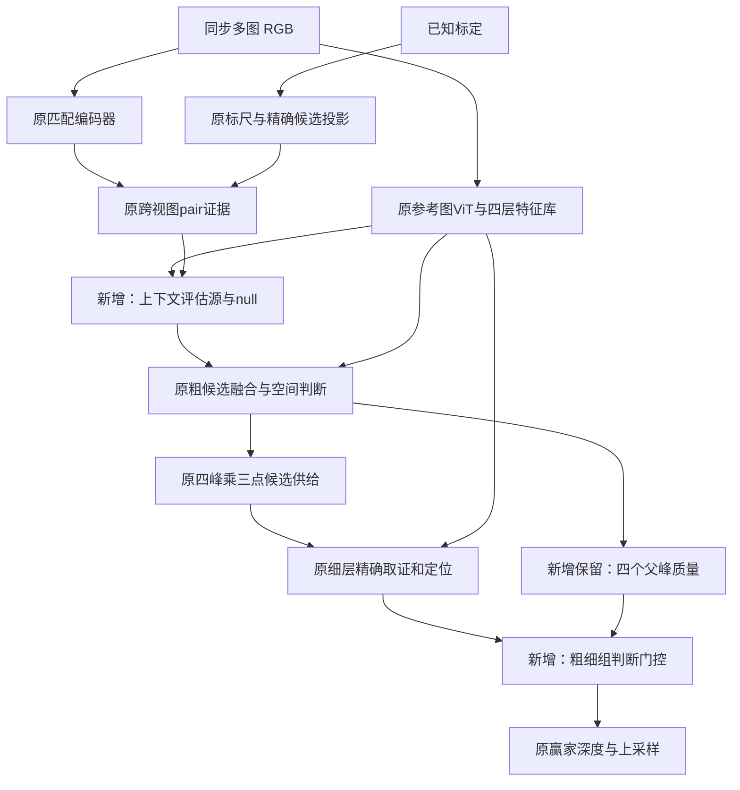

# 按职责融合与粗细表面判断交接

本研究保留独立V2的编码器、标尺条件、精确投影、多候选、粗空间交互、细候选取证与连续深度读出。没有引入Hero任务权重、第二套融合ViT或baseline预测头。原型只通过本目录入口显式安装，默认模型不变。

## 先诊断，再修改

对当前公共/CARLA独立训练best，固定Matrix/Hyp/Dynamic/CARLA上各16个VAL样本，在相同stride8位置比较：

| 数据域 | 单位 | 粗MAE | 细MAE | 细采样最优候选MAE | 细连续最优候选MAE |
| --- | --- | ---: | ---: | ---: | ---: |
| MatrixCity | m | .30356 | .48710 | .10771 | .10627 |
| Hypersim | m | .63161 | .63403 | .28156 | .27915 |
| DynamicReplica | scene_unit | .08153 | .08298 | .02003 | .02227 |
| CARLA上 | m | .82940 | .59134 | .40097 | .40635 |

最后两列用GT离线挑选，只表示供给潜力，不能当方法精度。四域粗赢家中心在细采样集合中均保留100%，不能再把该组样本的问题归因为“细层删掉了粗赢家”。细层仍需要重新决定哪组表面可信、该组内哪一个位置可信。

细层相对其连续候选最优解的选择遗憾，组间/组内比例分别是Matrix63/37%、Hyp57/43%、Dynamic20/80%、CARLA72/28%。这里的组是粗峰派生的三个细候选，不是已认证互斥物体表面。

固定权重把父质量接回细层，Matrix显著改善但CARLA退化；后者细层本来就在纠正粗层。因此不能全局锁定父峰。严格窄区间抛物线定位又只带来小幅近距改善，Dynamic全范围退化4.86%，未接入新模型。原4倍cosine旁路在这四域删除后均变差，本轮保留。

## 方案A：单目上下文负责证据仲裁

前一轮把相机条件直接写入CNN/ViT特征，出现跨域冲突。本轮保持编码特征不变，将单目信息用于回答：“这个位置的哪些匹配证据值得相信？”

原源注意力已经计算包含特征乘积、差异、分组相关与投影导数的pair evidence。现在将四层单目bank在当前候选网格对齐并拼接，512维投影到64维；与归一化pair evidence按4头交互，修正每源注意力logit：

```text
source_correction = 0.5 * tanh(dot(project(mono), normalize(pair_evidence)) / sqrt(16))
null_correction   = 0.5 * tanh(project_null(mono))
```

两个投影全零初始化，安装时与旧模型逐张量一致。新增34884参数，不改变CNN描述子、原query/key/pair值，也没有增加投影取证次数。单目上下文改变的是使用证据的权重；它不是额外几何观测，也不能认证遮挡。pair值本来含几何，因此仍可能学到位置偏置，需要实际对照。

## 方案B：粗层选面与细层定位分工

原模型只将粗概率用于选出四组候选，细层评分时没有显式保留这份判断。现在沿原候选传递保存父质量，连续候选位置和offset算法不变。

记粗层所选四组质量归一化为p，细层每组三点logit为s；细层组质量q由每组logsumexp再softmax得到。用门控eta协调两份判断：

```text
new_score[group, point] = old_score[group, point]
                       + eta * (log(p[group]) - log(q[group]))
```

于是新组质量正比于 `q^(1-eta) * p^eta`。这等价于在两个估计之间做加权KL折中，没有假设粗细重复使用的RGB是独立观测。每组内部的三点相对分数不变：只协调跨组选择，保留细层的组内定位职责。

eta由已有细候选特征的概率加权池化，加6个质量量预测：粗组熵、细组熵、分布内积、分布差异、平均null质量、源投影合法比例。70→16→1的1×1网络仅1153参数。输入统计停止梯度，防止通过修改置信度来投机门控；实际分布池化仍对细logit反传。

eta初始为sigmoid(-2)，约0.119，**不是恒等初始化**。所以实验单独保存安装后未训练的initial结果，不能把初始化重评分收益全部归给训练。门控合法性和熵不是已校准的真值置信度；它也不能补回缺失候选、解决所有组内错误。



两个方案独立开关，另测组合；图中未画出的源注意力在粗细两层都执行。方案A同时作用于两个层级；方案B只改变细层跨组评分。

## 实验口径

- 公共七域及CARLA分别有control/context/carry/both四组。相同独立best起点、seed20261030、batch2；公共每域128TRAIN、448更新，CARLA497TRAIN、249更新。原编码器/FPN冻结，只训原解码器和新增参数；不读取TEST。
- 旧解码器LR公共1e-5、CARLA5e-6；新增参数1e-3；原depth目标及fine_actual_regret保持一致。不为某新模块单独更换监督或挑选训练样本。
- 固定16VAL分两个各8帧子集，均属历史已查看VAL，不能叫新盲测。固定末步，不挑best。报告全范围/近中远、阶段、MAE/RMSE/AbsRel，非米制域不写成米。
- context/control做实际初值逐张量一致检查；carry/both保存非恒等初值。新增context_projection/context_null/handoff_gate分别验证非零有限梯度和参数更新。
- 全部精度任务退出后，同5090、FP32/TF32off、实际位置缓存命中、交替计时。单参考耗时不等于四参考完整场景耗时。

```bash
cd /home/liuzonghao/3Dscene/jar_reconstruction
OMP_NUM_THREADS=1 official_methods/.venv/bin/python -m unittest \
  research.role_fusion_20261030.test_context \
  research.role_fusion_20261030.test_carry \
  research.role_fusion_20261030.test_variants \
  research.role_fusion_20261030.test_runner -v

official_methods/.venv/bin/python research/role_fusion_20261030/pilot.py \
  --config research/role_fusion_20261030/configs/public_both.json
```

输出通过 `runs/active/role_fusion_20261030` 保存到数据盘，已有实验目录拒绝覆盖。训练队列和恢复读取都使用本目录入口，不能将研究checkpoint交给不安装研究结构的普通加载器。

## 来源与原创边界

[Stereo Anywhere](https://arxiv.org/abs/2412.04472)支持单目/双目都可失败、需互补仲裁的思想；[ACVNet](https://arxiv.org/abs/2203.02146)支持匹配线索与内容信息分工；[Vis-MVSNet](https://arxiv.org/abs/2008.07928)强调逐源质量；[UCS-Net](https://arxiv.org/abs/1911.12012)利用前级不确定性指导后级采样。我们没有复现它们的整套网络，保留自己的标尺候选、空间判断、精确取证和连续几何流程。log-opinion pool与低秩条件化本身是已有数学工具，不宣称首次提出。所有论文及未采用方案的边界见 `sources.json`。

阶段结论与失败记录统一追加到 `docs/research_memory.md`；诊断数据保留在 `runs/active/role_fusion_20261030/diagnosis/`。本说明不代表新模型已经超过baseline。

## 已完成的第一轮结果与补充验证

20项CPU测试、8组完整ViT GPU冒烟、8组正式短训和独占计时均通过。每个新模块分别验证了梯度与参数更新。首轮context初始输出与原模型逐张量一致；carry/both初始已改函数，`summary.csv` 同时保留 `variant_initial`，没有把所有收益归为训练所得。

首轮16VAL之后，每域排除这16个索引和历史实验163的另外16个，再取16个固定VAL；5模型×11域共880前向。仍属同VAL序列，可能邻帧相关，不是新场景盲测，更不是完整TEST。

下表是这次补充VAL的完整输出分辨率近距MAE，对应 `summary.json` 的 `depth.near` / CSV 的 `level=depth`。CSV 的 `level=final` 是抽样到共同stride8网格的最终深度，仅用于阶段对比，与此表不是同一个采样网格。

| 数据域 | 单位 | 冻结原模型 | 同预算原结构 | context | carry | 组合 |
| --- | --- | ---: | ---: | ---: | ---: | ---: |
| TartanAir | m | .869155 | .854522 | .855864 | .849029 | .847080 |
| MatrixCity | m | .296690 | .279758 | .286318 | .243937 | .248648 |
| Hypersim | m | .597318 | .603083 | .609424 | .601898 | .606784 |
| MVS-Synth | scene_unit | 1.899213 | 2.183668 | 2.164174 | 2.137568 | 2.127929 |
| VKITTI2 | m | .225668 | .230817 | .225881 | .227751 | .221210 |
| BlendedMVS | scene_unit | .885676 | .830273 | .711606 | .729847 | .602793 |
| DynamicReplica | scene_unit | .083897 | .087807 | .080564 | .089497 | .081877 |
| CARLA左 | m | .534274 | .453078 | .444859 | .435629 | .429339 |
| CARLA右 | m | .374221 | .335752 | .331649 | .313163 | .314631 |
| CARLA上 | m | .575686 | .613740 | .593688 | .585932 | .580146 |
| CARLA下 | m | .624646 | .421157 | .419530 | .419538 | .410830 |

候选判断协调对Matrix的收益保持，上下文仲裁更适合Dynamic/Blended；组合不是每域最优。Hyp仍退化，Synth虽比续训控制好却明显不及冻结起点。VK组合近距MAE改善但RMSE增加4.43%，Matrix全图RMSE也微升，不能只看MAE。CARLA组合四参考近距和全图MAE都优于控制，但上参考仍不及冻结起点。

同批5090、单参考、FP32、TF32关闭、位置缓存命中计时：

| 输入 | 原结构续训 | context | carry | 组合 |
| --- | ---: | ---: | ---: | ---: |
| Tartan四目 | 31.352 ms | 33.650 ms | 31.649 ms | 33.961 ms |
| VK双目 | 24.287 ms | 25.858 ms | 24.611 ms | 26.184 ms |
| CARLA四目上参考 | 31.499 ms | 33.804 ms | 31.790 ms | 34.129 ms |

carry只增加约0.3ms，值得作为速度优先候选；context约增加2.3ms，需与改善的域及任务权衡。此表没有重新测试baseline，不能与不同批次的历史耗时拼成“全面胜出”。

机制证据：首轮Matrix同stride8近距，原结构粗→细→最终为 `.178834→.536832→.329942m`，carry为 `.182896→.246248→.214613m`，符合减少交接破坏的预期。观察门控也确有空间变化，但未证明它已校准为真实正确率。

为区分新增机制与旧解码器续训漂移，还另做了“只训练新模块”的减法实验。其结论追加在统一研究记录，不重新选择上表的VAL索引，不将复用样本叫新的盲测。

完整证据位于 `runs/active/role_fusion_20261030/` 的 `summary.csv`、`fresh_public/metrics.csv`、`fresh_carla/metrics.csv`、`latency_public.json`、`latency_carla.json`。默认模型保持不变。

## 最后一轮：只训练新增模块的取舍

针对公共域续训漂移，最后只改变训练职责：冻结全部旧参数，仅训练 `context_projection`、`context_null` 和 `handoff_gate`，共36037参数。网络结构、数据、起点、随机种子、批次顺序、448/249更新预算和原生损失均保持；新增参数学习率仍为0.001，没有教师或额外损失。旧版默认训练规则不变，研究配置的 `trainable_prefixes=[]` 才启用这一模式。

两组先各做1步真实GPU冒烟，再完成公共448步/896样本曝光、CARLA249步/497样本曝光，以及原16VAL评测；随后沿用上一节完全相同的补充VAL索引，每域16帧，新增权重共176次前向。旧三种权重的结果经权重哈希校验后原样引用。没有再次选帧，不将已经看过的VAL称作盲测，没有读取TEST。

下表仍为**完整输出分辨率的近距MAE**（`level=depth`），不是 `level=final` 的stride8采样值：

| 数据域 | 单位 | 冻结原模型 | 同预算原结构 | 组合：旧解码器也训练 | 组合：只训新模块 |
| --- | --- | ---: | ---: | ---: | ---: |
| TartanAir | m | .869155 | .854522 | .847080 | .861723 |
| MatrixCity | m | .296690 | .279758 | .248648 | .271527 |
| Hypersim | m | .597318 | .603083 | .606784 | .598472 |
| MVS-Synth | scene_unit | 1.899213 | 2.183668 | 2.127929 | 1.836134 |
| VKITTI2 | m | .225668 | .230817 | .221210 | .224460 |
| BlendedMVS | scene_unit | .885676 | .830273 | .602793 | .732324 |
| DynamicReplica | scene_unit | .083897 | .087807 | .081877 | .085675 |
| CARLA左 | m | .534274 | .453078 | .429339 | .506564 |
| CARLA右 | m | .374221 | .335752 | .314631 | .345376 |
| CARLA上 | m | .575686 | .613740 | .580146 | .539263 |
| CARLA下 | m | .624646 | .421157 | .410830 | .595550 |

这是一项训练取舍，**不是全面升级**。只训新模块减轻了Synth/Hyp的漂移，CARLA上参考近距也好于冻结原模型，但Hyp仍未胜冻结起点；Dynamic仍退化，CARLA左/右/下明显不及联合训练。不能在看过VAL后逐域拼选最好权重再称作一个统一模型。两个训练分工均保留为研究结果，不替换默认架构或默认权重。

MAE也不能代表全部误差：只训新模块的Synth全范围RMSE为566.253，冻结起点为568.548；CARLA上参考近距RMSE从冻结起点1.265降至1.226m，但全范围RMSE为3.911m，仍高于联合训练的3.680m。所有域、所有阶段的近距/全范围MAE和RMSE保存在 `fresh_public_adapters/metrics.csv`、`fresh_carla_adapters/metrics.csv`；原16VAL结果在 `adapter_summary.csv`。比较时固定同一 `level` 和 `region`。

距离划分使用固定GT掩码和既有域配置，不由当前预测或本次VAL统计重新确定：

- 米制公共域近距是有效Z深度 `<10m`；CARLA先限制 `[2,80]m`，因此近距为 `[2,10)m`。公共域全范围没有额外 `eval_range` 截断，只使用有效深度/图像/视图掩码。
- 非米制域近距阈值为 `5 * depth_scale`：MVS-Synth为133.125、BlendedMVS为18.212797、DynamicReplica为1.024414，单位均为各自scene_unit。不同域数值不能当成同一种米制尺度横向平均。
- 中距为近距阈值到远距阈值之前；米制远距阈值40m，非米制为 `20 * depth_scale`。指标先在域内汇总像素误差，再计算MAE/RMSE，不是逐帧指标的简单平均。
- `depth`使用完整输出网格；`coarse/fine/final`均使用相同stride8格点，便于分析交接问题。即使都叫“最终深度”，两种网格也有不同分母和不同数值。

冻结与运行证据：两组均核查315个旧参数张量，以及包含持久统计在内的379个旧状态张量，训练前后哈希逐位相同。唯一排除的是随域 `set_range` 重建的运行时 `decoder.depth_lattice`，不是可训练权重。三个新增模块各自都有非零有限梯度和参数变化，详见各组 `old_model_frozen.json`、`new_module_checks.json`。仅检查总梯度不能替代这项检查。

最终审计 `final_audit.json` 确认：10组正式训练和10组冒烟的步数正确，26个已保存退出码全部为0；新增两组fresh计划与原计划一致，六种权重在11域×4网格×6区域的264组GT分母一致，所有非空区域预测覆盖率100%。本轮5项CPU训练规则测试通过；最终对当前context/carry/variants/runner合跑21项CPU测试，0.259s全部通过。没有选择性删掉困难像素。只训新模块与联合训练的推理结构相同，因此没有重复计时。产物全部沿既有软链接存于数据盘，结束时空闲约298GiB。
