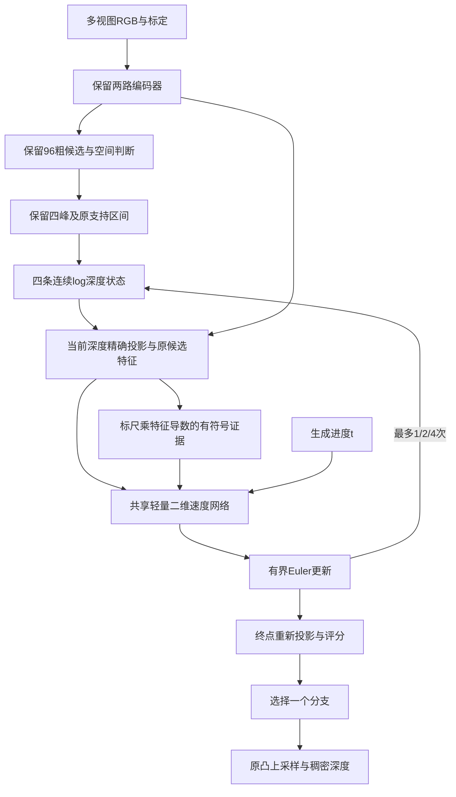

# 四峰标尺条件流：独立可行性实验

本目录保留原RulerMVS-V2的编码器、96粗候选、标尺、空间交互、四峰传递和凸上采样，在研究实例中替换细层。所有原模型、配置及权重保持。没有下载扩散大权重，没有接入Hero任务通路。当前实现为局部 **Flow Matching** 对照，并非DiffMVS、DDPM或DepthFM复现。

## 研究问题与职责

本轮检查三个不同问题：四个连续分支能否替代原12个离散细候选；空间更新网络本身是否有用；相同更新网络使用Flow目标是否比普通残差目标更好。只有最后一项对照能够归因到训练目标。



四个分支保持竞争身份，输出不在不同表面之间做均值。原每峰三点中心为 `anchor`，支持区间是原三点加连续offset的并集，近远裁剪一致。区间完全由输入及标尺决定；GT不扩大窗口。四峰都没覆盖真值时，局部更新也无法可靠恢复该表面。

## 网络、几何与训练的实际定义

局部坐标为 `q=(log Z-log anchor)/radius`，radius是左右log区间跨度较大值。`flow.py` 的共享小头读取64维原候选特征、10维方向证据和10维状态/时间/质量条件，隐藏宽度32，两个深度可分离空间残差块使用膨胀率1、2。速度与分支评分头零初始化，合计5666参数；普通残差对照与Flow结构完全相同。邻域同rank不保证是同一物体，状态及候选位置提供区分线索，但当前网络没有物理表面邻接保证。

`direction.py` 使用固定matching stride4特征及其双线性分段导数，精确投影当前深度。局部q变化造成的特征像素位移是 `J · dX/dZ · Z · radius · matching_scale/4`，明确处理特征归一化的导数。输出包含有符号匹配斜率、阻尼GN建议、曲率、纹理、有效支持和方向一致性。缺图、共心纯旋转与无纹理不制造可靠GN。它是独立固定尺度方向证据，不等于原动态LOD匹配函数的完整导数；主实验把这些量作为当前观测detach，不把错误匹配的强梯度当成正确性证明。

训练比较：

- `direct`：在带小噪声的起点预测到GT局部终点的残差，辅助时间固定0。
- `flow`：在起点与GT终点之间随机采样时间和中间状态，重新投影读取证据，回归两个端点之差。
- 两者具有相同结构、初始权重、起点噪声、辅助取证次数、优化器及原生深度/评分监督。独立随机生成器避免影响数据增强及后续随机流。
- 多个区间覆盖GT时，只给最近可达分支定位监督；未覆盖GT不造新分支、不扩窗，完整输出损失与评测仍包含该像素。推理始终保留所有分支。
- 旧网络参数与持久统计全部冻结，只有新增头训练。训练时GT路径仅存在于 `training_loss`，不回写预测或模型缓存。

辅助训练噪声标准差为0.05，主推理从确定性零局部偏移开始。所有训练轨迹为1步；同一Flow权重再测1、2、4步。此处的有界Euler更新和确定性主推理**不被解释为严格概率密度模型或已校准不确定性**。更多步数不保证更准确。

终点会重新取证，所以K步更新实际需要K+1次细证据调用，即1/2/4步分别处理8/12/20个分支位置，方向证据另有采样成本。原模型一次处理12个细候选。因此“两步只有8个位置所以更快”的估算不适用于本实现，速度必须实测。

## 对照与接口

对照包括冻结原12候选、原结构同预算续训、四峰零更新、direct一步、flow一步/两步/四步、去方向输入的flow相同步数。四峰零更新同时停用了原fine offset，是采样和读出联合替换对照，不能称为纯候选数消融。

公共七域每域128个TRAIN、448更新，CARLA497个TRAIN、249更新；batch2、固定末步，原有数据划分和单位。VAL是历史已看研发样本，不是新场景盲测，完整TEST不参与选择。主表采用全输出分辨率 `depth`；阶段诊断的 `coarse/fine/final` 是共同stride8，不能混表。米制域近距有效深度<10m，CARLA同时遵守[2,80]m评价范围；非米制域按固定TRAIN尺度分段，不能写成米。

目录职责：

- `flow.py`：更新网络及训练路径；`direction.py`：物理方向证据。
- `variants.py`：研究实例安装、原粗阶段复用、连续更新、终点读出和辅助损失。
- `pilot.py`、`configs/`：独立短训、严格恢复与固定评价入口。
- `diagnostics.py`：覆盖、选择与随机扰动诊断；`latency.py`：真实网络计时。
- `sources.json`、`theory.md`、`接口审计.md`：来源、推导和限制。阶段结论统一追加到 `docs/research_memory.md`。

```bash
cd /home/liuzonghao/3Dscene/jar_reconstruction
OMP_NUM_THREADS=1 official_methods/.venv/bin/python -m unittest \
  research.ruler_flow_20261030.test_direction \
  research.ruler_flow_20261030.test_flow \
  research.ruler_flow_20261030.test_followup \
  research.ruler_flow_20261030.test_variants \
  research.ruler_flow_20261030.test_runner \
  research.ruler_flow_20261030.test_diagnostics -v

official_methods/.venv/bin/python research/ruler_flow_20261030/pilot.py \
  --config research/ruler_flow_20261030/configs/public_flow.json
```

配置里的输出路径不允许覆盖已有实验；重跑时须改成新的输出文件夹。所有大产物经 `runs/active/ruler_flow_20261030` 软链接存到数据盘，并执行至少200GiB余量检查。

## 已执行结果与结论

最后合跑35项CPU测试通过（1.892s），14组真实GPU单步冒烟及14组正式短训均完成。测试包含投影有限差分、单位/缺图/无纹理/纯旋转、Flow路径、原粗层/范围保持、各实际存在输出头的梯度和更新、严格checkpoint恢复、固定inputs修改targets推理不变。两组对照训练规则不同（旧decoder续训 vs 新小头），训练目标净效应只能由同结构direct/flow判断。

首轮公共/CARLA各4组，之后根据速度场入口与评分诊断只增加最后3组，而没有继续搜索参数：

- `flow_anchor`：一半辅助训练时刻设为起点，其余仍均匀分布；不增加取证或训练步数。
- `direct_rank_fixed`、`flow_rank_fixed`：删除新quality残差头，仅训练速度网络，各5633参数。名字中的rank_fixed指冻结原评分参数，**不代表固定赢家或固定分数**；原评分器仍对移动后的候选重新取证评分。
- 这三个方案仍从相同原best、相同seed和448/249步预算开始。它们没有改变生产默认，也没有叠加上一轮context/carry模块。

下表为原16VAL的8帧确认分区、完整输出分辨率近距MAE，均属于已查看研发数据。`depth`与stride8的`final`不能混用。

| 数据域 | 单位 | 冻结原V2 | 同预算续训V2 | direct，删新评分头 | Flow，删新评分头，1步 |
| --- | --- | ---: | ---: | ---: | ---: |
| TartanAir | m | .836590 | .817815 | .893861 | .947482 |
| MatrixCity | m | .345470 | .303733 | .309694 | .355884 |
| Hypersim | m | .586447 | .594490 | .582917 | .585679 |
| MVS-Synth | scene_unit | 2.477451 | 2.502645 | 2.502411 | 2.669440 |
| VKITTI2 | m | .205544 | .210797 | .203498 | .220299 |
| BlendedMVS | scene_unit | .407787 | .434546 | .467246 | .519204 |
| DynamicReplica | scene_unit | .087086 | .089853 | .071474 | .072876 |
| CARLA左 | m | .525051 | .444727 | .529327 | .541490 |
| CARLA右 | m | .393704 | .370593 | .413175 | .426072 |
| CARLA上 | m | .538107 | .564404 | .571774 | .579473 |
| CARLA下 | m | .603847 | .380698 | .614077 | .614649 |

删除新评分头后，直接残差在这11个域/参考的近距均好于同结构Flow；这不等于超过原V2。直接残差的公共4/7域近距优于冻结原模型，CARLA四参考近距都未超过冻结原模型。全范围也有明显取舍：DynamicReplica全图MAE从原V2的.092152降到.064296，BlendedMVS却从3.289790升到4.028534，MVS-Synth从85.581284升到87.711427（均为各自scene_unit）。不能逐域挑不同模型后包装成统一升级。

首轮Flow的1→2→4步在公共七域确认分区近距全部逐步变差。增加起点训练占比没有带来普遍修复。因此本轮不保留“更多Flow步数必然更好”的说法，也不启动全数据重训或覆盖原模型。完整DEV/确认、近中远/边界、MAE/RMSE/AbsRel见首轮 `summary.csv` 和包含最后六组的 `summary_followup.csv`，两个文件均保留。

### 为什么做最后六组

固定4域×4DEV、32次前向的quality反事实只把新增quality输出置零，权重和速度轨迹不变，候选深度逐位相同。CARLA上参考共同stride4近距的候选oracle保持.626370m，实际fine从1.125219降到.878196m，选择遗憾从.498849降到.251826m；完整输出近距从1.043650降到.812612m。Dynamic也改善，但Hyp退化；Matrix细层改善，完整输出反而退化。它支持评分与上采样交接需要独立分析，不能将改善/退化全部归因于候选供给。

这些4DEV数值与上表8帧确认分区不同；其共同stride4网格也不同于上表完整输出网格。固定权重屏蔽不是去头重训结果；后续删头重训另列在上表。入口速度场、零噪声起点、噪声重复的详细诊断保存在 `diagnosis/bridge_*.json`、`diagnosis/summary.json`，不把随机输出方差当成校准置信度。

### 同批真实速度

全部训练和诊断退出后，独占一张5090，FP32、TF32关闭、位置缓存真实命中、输入常驻GPU，3样本各10次预热与40次交替计时。下面均为网络本体中位数；四参考是实测四次完整调用，包含重复编码，不是单参考耗时的手工乘数，不含读盘/传输/预处理或场景融合。

| 方法 | Tartan四目单参考 | VK双目单参考 | CARLA四目单参考 | CARLA顺序四参考 |
| --- | ---: | ---: | ---: | ---: |
| 冻结原V2 | 31.319ms | 24.255ms | 31.545ms | 125.529ms |
| direct，原新增评分头 | 40.157ms | 33.327ms | 40.712ms | 162.528ms |
| Flow，1步 | 40.162ms | 33.328ms | 40.712ms | 162.584ms |
| Flow，2步 | 47.291ms | 39.818ms | 48.013ms | 191.610ms |
| Flow，4步 | 61.577ms | 52.769ms | 62.628ms | 249.894ms |
| Flow，1步，无方向证据 | 35.330ms | 28.723ms | 35.733ms | 142.739ms |
| direct，删新评分头 | 40.121ms | 33.296ms | 40.663ms | 162.321ms |
| Flow，删新评分头，1步 | 40.163ms | 33.293ms | 40.670ms | 162.417ms |
| Flow，删新评分头，2步 | 47.244ms | 39.738ms | 47.922ms | 191.277ms |

本轮没有加速：原V2四参考约7.97Hz，direct删新评分头约6.16Hz，均未达到四参考10Hz目标。减少参数或候选数并不自动节约延迟；方向证据、重复取证与多个小算子调用都有成本。anchor只改变训练时刻分布，推理结构相同，未重复计时。完整均值、P95、频率、额外allocated显存、原结构续训控制及权重哈希见 `latency_public.json`、`latency_carla.json`；该显存字段不包括同时常驻的模型权重，不能当成独占总显存。本轮没有重新测MVSAnywhere，不能拼历史数字宣称胜出。

### 可复核产物

`final_audit.json` 核查28组冒烟/正式任务、35个已保存退出码全部成功，合并35904项指标的528组评价分母一致，非空区域覆盖率100%。新模块之外的旧参数和持久统计哈希保持，仅排除随域重建的 `decoder.depth_lattice`；训练控制组按设计允许原decoder更新。每组 `source.zip` 保存启动时关键源码，`shared_source_dependencies.zip` 补充共享jar及研究辅助源码，第三方库仍由原环境管理。结束时数据盘空闲约286.84GiB，所有GPU计算进程已退出。

本轮结论是保留独立研究实现和失败证据。小预算结果不能否定全部Flow方法；但当前四峰局部Flow没有取得全面精度优势，也没有速度优势，不替换生产架构或推荐权重。
