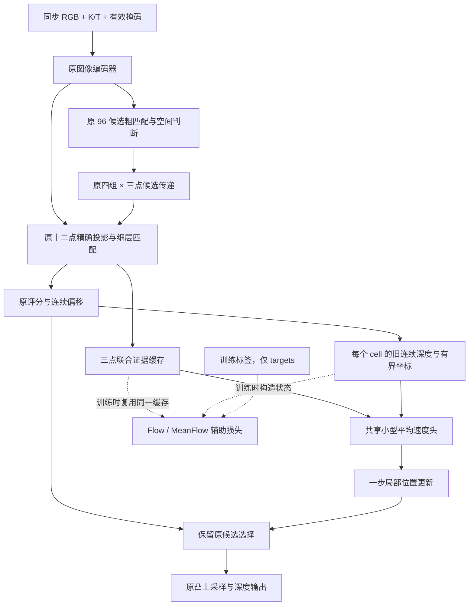

# Ruler Flow V2：保留匹配证据的局部平均流

设计日期：2026-10-31，北京时间。本文说明本研究分支的设计依据，不代表已经取得准确率或速度提升。实际配置、已执行测试和启动状态以本目录 README 与实验记录为准。

## 为什么重新设计，而不是继续增加上轮的迭代次数

原 RulerMVS-V2 已经完成两项成本较高的工作：用标定构造真实空间候选，并在这些候选上读取多视角图像证据。上一轮研究把十二个细候选换成四个移动分支，混合了删证据、取消旧连续偏移、增加评分头、反复投影四种改变。实验 174–178 发现：桥内速度损失较低，但真实起点修正能力不足；新增评分可能破坏位置收益；额外取证使完整推理变慢。因此，这一轮将生成式更新放在**已经建立的局部匹配证据之上**，而不重新生成整张深度图。

核心分工是：

- 标定、粗候选和源视图注意力负责提供真实匹配证据及候选支持区间。
- 原评分头负责选择可见表面的候选身份；不同表面之间不平均深度。
- 新平均流负责在原有支持区间内解释三点响应，修正连续位置。
- 原凸上采样继续处理图像分辨率恢复；不因为新位置改变而偷偷更换它的输入语义。

这是一次保留原模型能力的增量结构探索。旧模型、旧权重和旧研究分支均保持独立；没有将 MVSAnywhere 的任务权重引入新模型。

## 数据流与固定证据的含义

默认输入仍为四目 RGB、真实相机内外参和有效掩码。支持真实的较少相机数和缺失视图，不复制相机图像。以下尺寸对应网络图像 256×448，匹配分支输入 512×896。

| 阶段 | 张量或操作 | 设计理由 |
|---|---|---|
| 图像编码 | 原单图 ViT 四层特征，以及共享匹配 FPN | 保留已经训练出的表示，不把生成头误当成新图像证据 |
| 粗匹配 | 96 个深度候选，32×56，64 通道 | 全范围歧义仍由原模型解决；局部流不能补回被删除的远处表面 |
| 候选传递 | 四个表面组，每组三个细候选 | 保留多峰，不将前后表面先平均成一个深度 |
| 细匹配 | `[B,64,12,64,112]`，一次精确重投影和源注意力 | 十二个位置全部保留，避免上一轮四点读出损失 |
| 固定证据上下文 | 每组三点联合编码为 48 通道上下文；各组共享参数 | 三点相对响应比单点偏移头更能描述局部峰形，通道宽度控制额外成本 |
| 平均流 | 每个细候选的局部状态、两个时刻，以及固定证据上下文 | 学习有限时间位移，而不是反复求瞬时更新后重新取证 |
| 输出 | 原评分选择候选，新连续位置，原凸上采样 | 将选面与定位分离，避免增加一个与旧分数竞争的质量头 |

固定证据包括原候选特征、匹配分数、相似度、null 质量、支持数与位置/区间信息。它们描述的是**原采样位置**。流状态移动后，这些量不会被重新命名为“新位置的可见性”或“新位置的真实匹配分数”。支持数仍然只是几何可采样源数，不等于无遮挡认证。

具体层定义位于 `field.py`：每组三点的 64 通道特征展开为 192 通道，再拼接 26 个统计/几何通道，经 `Conv1×1(218→48) → GroupNorm(8组) → SiLU`。26 个通道由八类三点量与两个组尺度量组成：相对分数、相似度、支持比例、null 质量、相对深度、相对宽度、投影足迹、有效性各三个通道，另有组中心的归一化 log 深度及组跨度。

上下文采用四邻域差分，而非对整个场景做两两注意力。两个相邻同序号组的深度区间交叠长度除以两组宽度的最大值，作为门控；它是有界相容度，不是区间 IoU。掩蔽图像环绕边界与无效邻居，将门控差分归一化，再经 `Conv1×1(48→48)` 残差、GroupNorm 与 SiLU。这个上下文只计算一次。

速度头输入为 48 维上下文、三个当前状态、三个旧 anchor 和四个时间量 `(r,t,t−r,sin(πt))`，共 58 通道；采用 `Conv1×1(58→48) → SiLU → Conv1×1(48→48) → SiLU → Conv1×1(48→3)`，输出为 `2*tanh`。三个输出分别对应组内三个 cell，最后一层零初始化。JVP 只穿过这一小速度头，固定上下文阶段不反复执行。

相邻像素的第一个表面组不一定属于同一物体。区间交叠门控只能降低不合理混合，不能保证跨像素表面身份一致；它也没有使用图像边缘或法线认证，不能描述成精确表面传播。



## 局部坐标、支持区间和零初始化

对一个细候选，用 `L=max(near, cell_lower)` 和 `U=min(far, cell_upper)` 定义真实可达区间。二者仅由输入、原候选和标定产生，不用 GT 扩大区间。记原连续预测为 `Z_old`，宽度为 `w=U−L`。非退化 cell 的坐标为：

```text
anchor = 2 * (Z_old - L) / w - 1
q_GT   = 2 * (Z_GT  - L) / w - 1
Z_new  = Z_old + 0.5 * w * (q_new - anchor)
```

状态限制在 `[-1,1]`，对应原可达区间。宽度为零的 cell 不产生定位监督，输出保留旧位置。实现必须对除数设数值下限，同时用真实宽度决定可训练掩码。

这种坐标具有三点作用：不同数据域的单位尺度不会直接改变状态大小；局部更新不会跨越未观测的大范围；更新为零时，采用上面的残差表达可精确恢复旧连续深度，避免 `exp(log(Z_old))` 等重算引入差异。

不采用 `atanh(q_GT)` 作为监督目标。GT 接近支持边界时它会发散，并引入人为截断；在当前有界细化任务中没有必要承担这种不稳定性。对输出状态作区间投影是实际数值求解约束，不应描述成不受约束的精确概率流。

## 真正的 MeanFlow 目标

本分支采用与 MeanFlow 原文一致的反向时间约定：`t=1` 是预测起点，`t=0` 是训练目标。设 `s` 是旧预测的 anchor，`y` 是可达的 GT 局部坐标，构造：

```text
q_t = (1 - t) * y + t * s
v   = s - y
```

小网络 `u(q_t, r, t, context)` 预测区间 `[r,t]` 的平均速度。训练目标为：

```text
JVP      = d/dt u(q_t, r, t, context)
         = (∂u/∂q_t) * v + ∂u/∂t
u_target = stop_gradient(v - (t-r) * JVP)
L_mean   = mean((u - u_target)^2)
```

JVP 的方向是 `(q_t: v, r: 0, t: 1)`。求导时，证据缓存、cell 坐标定义和标定视作条件，不沿它们重新采样。只对小头求 JVP，避开投影采样的高阶导数开销；目标整体停止梯度，不对 JVP 目标再作二阶反传。普通训练输出仍可通过上下文回传到编码器。

推理一步为：

```text
q_new = clamp(anchor - u(anchor, 0, 1, context), -1, 1)
```

如果把 `r=t`，JVP 修正系数为零，目标退化成普通条件 Flow Matching。本分支的时间采样将一部分样本放在 `r=t`，其余由两次均匀采样排序得到 `r≤t`。比例属于训练超参数，有原工作混合瞬时与平均速度训练的经验参考，但并无“50% 一定最优”的理论保证。

默认起点不加噪声，因此当前任务是**确定性的条件位置纠错**，不是从高斯噪声生成完整场景。可选噪声试验需要单独记录训练/推理分布，不得把输出方差解释成已经校准的不确定性。

## 为什么仍必须监督真实起点

上轮实验发现，GT 插值桥越靠近目标越容易预测，并不意味着模型知道如何纠正真实初值。MeanFlow 的平均速度恒等式解决了一步积分目标问题，却不会自动解决证据不足、错误分支或训练条件偏移。

因此，本分支同时保留：

1. 原模型真实一步输出上的全分辨率深度、粗/细分类与位置损失。
2. 真实起点的端点监督：`u(anchor,0,1) → anchor−q_GT`。
3. 权重较小的 MeanFlow 辅助损失。

起点损失权重 1、MeanFlow 权重 0.25 是优先保护部署路径的初始设置，不是经过完整搜索得到的最优比例。若实际使用额外的预测轨迹端点监督，应在配置中单独记录；不能把它冒充标准 MeanFlow 恒等式的一部分。

GT 只进入训练标签和训练辅助状态。推理接口不接收 GT，不能根据 GT 选择窗口、分支、输入范围或是否更新。

## 候选责任和不可达像素

定位监督仅适用于 GT 位于真实 cell 内的候选。不把 GT 夹进 cell 再宣称其可达；没有可达候选的像素仍进入完整深度损失与评测，只跳过不适用的局部速度监督。

当前实现对多个重叠 cell 选择 `|log(采样深度)−log(GT)|` 最小的可达候选。每个像素至多一个定位责任，不因重复候选获得数倍监督权重。旧原生分类标签仍保留；记录它的最近采样候选与新增最近可达责任之间的不一致数量，不悄悄更改评分头定义。

所有辅助标签及坐标参考在目标构造中停止梯度，防止模型通过移动坐标系缩小目标误差；原生最终深度路径仍保留正常梯度。全无效、单图、退化基线和缺相机条件下应保持有限输出及正确掩码。

## 与普通回归的区别及可证伪点

同结构直接残差对照使用相同上下文、层尺寸、初始化和真实起点损失，只不加入 MeanFlow 辅助。只有这样的对照才能辨认平均流训练带来的增益；新小头优于旧单点偏移，并不能直接归功于 Flow Matching。

新结构有充分理由值得全量训练探索：它保留旧模型初值、完整十二点观测、旧选面和上采样，补充三点联合解释，并消除了上一轮反复重投影的额外开销。可是，它仍有明确上限：GT 不在候选支持中时不能恢复缺失表面；保留旧赢家时不能直接修复组间选错；小头可能只学会普通残差；端到端训练仍可能漂移旧表示。

因此，八卡训练是基于结构与训练可行性的研究投入，不是“已保证超过原模型”。启动前应验证零初始化等价、有限梯度、JVP 数学、同输入标签隔离、checkpoint 恢复、单卡和八卡 DDP，以及实际完整网络延迟。小规模局部收益、旧原型失败和新全训结果必须分别报告。

## 来源与采用边界

- [Flow Matching for Generative Modeling](https://arxiv.org/abs/2210.02747)：采用条件速度回归的基本方法，不借此证明本任务一定优于回归。
- [Mean Flows for One-step Generative Modeling](https://arxiv.org/html/2505.13447v1)及[官方代码](https://github.com/Gsunshine/meanflow)：采用平均速度、两时刻条件和 JVP 目标。这里不使用其图像生成模型或权重，也不沿用其图像生成精度结论。
- [DiffuVolume 官方仓库](https://github.com/iSEE-Laboratory/DiffuVolume)：任务证据体可以作为生成过程作用对象，而非必须生成 RGB。只借鉴这种分工理念，没有集成其完整网络。
- 项目实验 170–178：保留候选证据、区分定位与选面、控制反复取证成本的直接经验依据。

来源核查明细见 `sources.json`。这些构成方法基础，不支持宣称基础 Flow、MeanFlow、有界残差或证据缓存为本项目首创。
