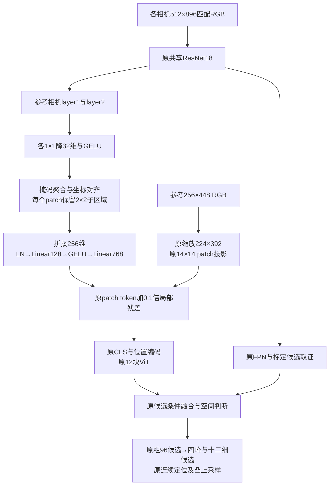

# RulerMVS-V5：共享匹配CNN的局部信息补充ViT

V5以2026-10-29独立训练的RulerMVS-V2为底座，仅新增一个可拆卸的CNN→ViT连接。原V2的ResNet18、FPN、RGB patch投影、12块ViT、标尺候选、空间判断、十二点细候选及凸上采样全部保留；不加入V3面片或V4 Flow。原生产文件和旧权重不覆盖。架构标识为`rulermvs_v5`。

设计依据是[TransUNet](https://arxiv.org/abs/2102.04306)的局部/全局分工，以及[ViT-Adapter](https://arxiv.org/abs/2205.08534)、[ViT-CoMer](https://arxiv.org/abs/2403.07392)保留强预训练路径、补充空间先验的思想。这里不复制它们的分割头、完整混合骨干或任务权重。CNN+ViT、残差和子格展开都有已有基础，本实现不宣称组合首创。完整实验结论继续追加到`docs/research_memory.md`，本目录说明实现和操作。



**每层怎样设计。** 以下省略batch维；四相机只计算一次共享匹配CNN，连接先取参考相机再投影，避免给不输出的相机重复增加桥计算。

| 步骤 | 输入→输出 | 依据与作用 |
|---|---|---|
| 读取layer1 | 64×128×224 | stride4，理论感受野约43个匹配像素，相对偏局部轮廓 |
| 读取layer2 | 128×64×112 | stride8，感受野约99像素，提供更宽上下文；不是原始像素细节 |
| 各自1×1卷积＋GELU | 64/128→32通道 | 为新通路学习特征选择，不改变原匹配描述子；已有CNN负责空间卷积，不再重复堆叠3×3 |
| 掩码加权面积聚合与对齐 | 两层均得到32×32×56子格特征 | 每个ViT图块对应四个子区域，先降低采样噪声，再按真实像素中心插值 |
| 子格展开 | 每层448×128 | 四格按左上、右上、左下、右下排列，保留方向布局，不先压成均值 |
| 双层拼接与LayerNorm | 448×256 | 只归一化新支路，不改变原RGB token的尺度或初始函数 |
| Linear＋GELU | 256→128 | 非线性组合两个尺度与四格布局，限制额外容量 |
| 零初始化Linear | 128→768，无bias | 新增残差最初严格为零，原V2功能保持 |
| 残差相加 | 原448×768＋0.1×新残差 | 不增加token数；固定非零系数使末投影首步可训练 |
| 原ViT | 448个patch＋1个CLS，12块 | 注入发生于patch_embed后、CLS/位置编码前；仍读取原第3/6/9/12块 |

双层新增137856参数，单layer1新增117120参数。`layers`与`subcells`可配置，单层是本轮真实训练过的消融；`subcells=1`可运行但本轮未训练比较。四子格可以线性表示区域均值、水平差、垂直差、对角差；仅均值无法保留后三项。这只是保留已有CNN特征的布局，不代表256→128压缩无损，也不代表能够恢复图像缩放前已经消失的物体。

**坐标与缺图。** ViT在原主图中的子格中心为`16*j+3.5`及`16*j+11.5`；在两倍匹配图中为`32*j+7.5`及`32*j+23.5`。ResNet特征中心是`stride*j`，因此layer1聚合4格后的原点为6、间距16，layer2聚合2格后的原点为4、间距16，不能直接同尺寸插值。代码依据实际主/匹配图比例计算网格，使用`align_corners=False`；分子和掩码经过相同聚合/插值后才相除。边缘零填充造成部分覆盖时保守衰减残差，不称严格面积积分。整块无效时残差严格为零，避免归一化bias产生假证据。

V5在输入边界统一`image_mask & view_mask`；这修正矛盾掩码时旧V2可能将缺参考标成有效的情况。正常数据加载器已提供一致掩码，因此数值不变；生产V2没有修改。主图尺寸仍遵循原ViT与解码器的整除契约，不宣称支持任意尺寸主图。

**梯度和训练。** 新桥位于ViT之前，冻结ViT参数也必须允许梯度穿过ViT。`model.py`按token是否需要梯度决定checkpoint，不能用`no_grad`包住整个ViT。默认桥对匹配特征执行detach，阻止新的单目输入损失改变局部匹配骨干；末投影首步有梯度，其前面各层在末投影更新后获得梯度。原候选/深度损失直接训练新桥，不增加baseline教师或新辅助loss。

公共训练从原V2公共best重新建立零桥初值，不沿用短试训练结果。沿用七域既有配比、图像尺寸、增强、深度范围与原生损失，公共42598唯一组，9轮15030更新/480960次曝光；倍率Tartan/Matrix/Hyp/Synth/VK/Blended/Dynamic为1/1/8/1/1.5/1/4，重复曝光不等于新增场景。

| 阶段 | 轮数 | 训练参数及学习率 |
|---|---:|---|
| 公共1 | 1 | 仅桥，1e-3，让新入口先适配成熟下游 |
| 公共2 | 2 | 桥3e-4；原decoder/FPN 1e-5 |
| 公共3 | 6 | 桥1e-4；decoder/FPN 5e-6；ResNet layer3/4 5e-7；ViT末4块5e-8 |
| 新CARLA1 | 6 | 本次公共best迁移；桥1e-4、decoder1e-5、FPN5e-6 |
| 新CARLA2 | 18 | 桥5e-5、decoder5e-6、FPN2e-6、ResNet layer3/4 2e-7；ViT冻结 |

ResNet layer1/2始终冻结。新CARLA仍只用captured_data0+2训练、1验证、3测试，排除tele，按真实可用相机和同相机标签训练；四参考完整VAL等权参与选模。公共7957VAL和CARLA四参考VAL决定本次best，实际末步另存final，训练不回退旧V2。具体LR/轮数是结合参数成熟度与旧试验的工程选择，不是已证明最优；正式训练额外预算必须在与原V2/baseline比较时披露。

**短试事实。** 已完成公共448步/CARLA249步的control、单layer1、双层六组；相同起点、TRAIN/VAL、调度和初始结果严格核对一致。固定VAL16分开发/确认，不读取TEST。公共确认近距单层七域胜control且均胜双层；双层在CARLA四参考全图都胜单层/control，尤其上参考最终近距0.55901→0.40521m、共同stride8粗近距0.76581→0.36577m。公共双层综合风险开发分区略变差，不能声称全面提升。

本轮优先训练双层版本，依据是目标CARLA四参考一致的全图收益与上参考候选改善；单层保留为更精简、公共域更强的对照，不能从本轮小样本推断双层普遍最佳。全量训练后需要固定完整TEST检验。完整数据见数据盘`summary.json/csv`和`candidate_diagnostic.json`，不是论文指标。

实测整网单参考（5090、FP32/TF32off、相同位置缓存、10预热/40交替同步调用、GPU常驻RGB）：CARLA原V2/单层/双层31.683/32.322/32.760ms；共享四参考107.219/110.464/112.149ms（双层约8.92Hz），没有达到完整四参考10Hz。公共四图单参考31.564/32.198/32.647ms。单样本成本检查不含读盘/传输，不将187的0.116ms探针冒充新整网成本；本轮没有重测baseline速度。

**代码与运行。** 参数通过JSON修改；命令行只指定配置或恢复路径。

```bash
cd /home/liuzonghao/3Dscene/jar_reconstruction

# CPU单元测试（真实ResNet，轻量ViT替身）
official_methods/.venv/bin/python -m unittest research.rulermvs_v5_20261031.test_bridge

# 独立V5初值与预算；已经启动正式训练后拒绝重新生成
official_methods/.venv/bin/python research/rulermvs_v5_20261031/prepare.py --migrate

# 八卡公共→新CARLA→两套完整评测，由外部tmux托管
bash research/rulermvs_v5_20261031/run_full.sh

# 推理不加载标签，bridge_enabled在JSON中控制
official_methods/.venv/bin/python research/rulermvs_v5_20261031/infer.py \
  --config research/rulermvs_v5_20261031/configs/infer_carla_new.json

# 短试的分阶段与候选供给检查
official_methods/.venv/bin/python research/rulermvs_v5_20261031/diagnose.py \
  --config research/rulermvs_v5_20261031/configs/diagnostic.json
```

`bridge.py`只定义新模块；`model.py`复用原编码/解码并封装接入；`training.py`复用既有DDP与保存流程；`evaluation.py`单独注册V5工厂，baseline仍走官方适配器；`infer.py`用`load_targets=False`。`pilot.py`、`diagnose.py`、`latency.py`、`summarize.py`只用于研究验证。所有大产物位于`runs/active/rulermvs_v5_20261031`数据盘软链接；启动空间门槛220GiB，保存检查200GiB。

关闭`bridge_enabled`仅是训练后同权重消融；底座可能已经适配，因此不等于历史V2权重。`model.v2_state_dict()`可物理移除桥参数，严格加载回原V2类；原V2 checkpoint仍独立保留。新旧权重和数据范围不能混用。自动TEST固定比较V5 best/final、原V2、MVSAnywhere细化，分别报告原生像素信息和共同RGB信息；不按TEST选权重或修改默认模型。
