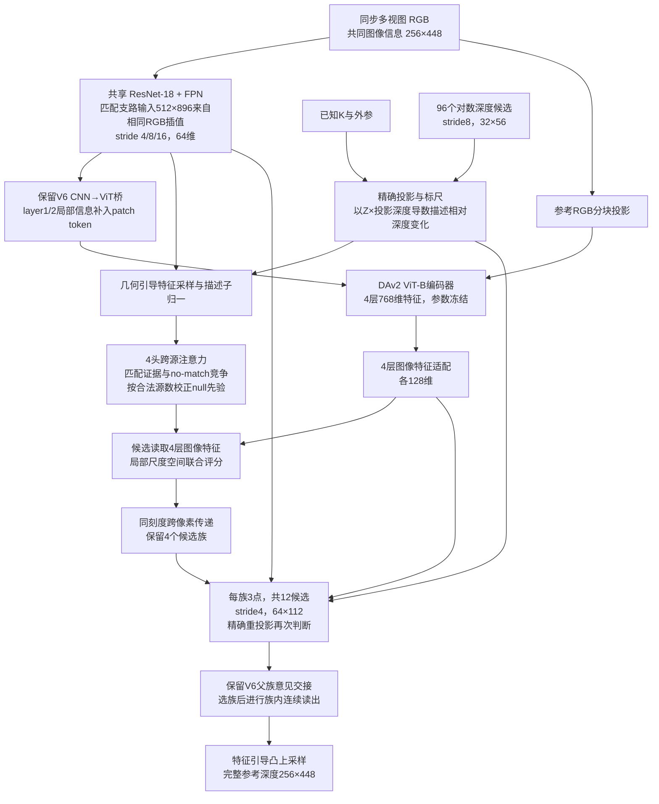

# RulerMVS-V8：保留 V6 的速度，减少对训练分布的依赖

日期：2026-11-03。V8 是以公共数据重训的 V6 为起点的独立续训版本，**不是加载 MVSAnywhere/Hero 主干再改名**。原 V6 代码和权重保持原样。当前已完成配对短训和机制验证；完整训练后的零样本收益尚待测量，不能据此声称超过 MVSAnywhere。

## 为什么采用这条路线

已有真实域外测表明，同数据预算重训的 MVSAnywhere 仍明显优于 V6。因此，问题不只有官方预训练数据更多。源码审查确认三个值得处理的依赖：

1. 评分网络看到的投影导数会随内部深度单位改变，而真实图像关系并未改变。
2. 可用源图数量会改变源证据和 no-match 的竞争比例。增加独立观测应有价值，但简单复制同一批证据不应无条件提高可信度。
3. 训练外观扰动较弱，候选搜索范围与训练域分布相关。扩大范围时粗评分首先退化。

借鉴的原则来自 [MVSAnywhere](https://arxiv.org/abs/2503.22430) 的几何元数据与范围处理、[RobustMVD](https://arxiv.org/abs/2209.06681) 的代价体分布增强，以及 [MVSFormer++](https://arxiv.org/abs/2401.11673) 对通用特征冻结与任务适配的分工。具体源码依据、适用限制与历史实验区别见 [literature.md](literature.md)。本实现保留自研候选评分、跨尺度传递及父族交接，没有复用上述方法的完整深度通路。

## 完整数据流



保留 V6 的编码器次数、96/12 候选预算、粗细空间模块和输出头；**新增参数为 0**。参考视图由输入指定，训练继续轮换，不复制相机、不增加历史帧。

## 实际修改

### 单位一致的标尺信息

旧评分使用 `g = d(pixel)/dZ`。V8 使用 `Z*g = d(pixel)/d(log Z)`：内部深度和相机平移同时换单位时，该量不变。候选半宽同步改为 `half_width/Z`，因此原图像投影跨度 `|g|*half_width` 保持不变。信息通道为 `log1p(sum(w*|Z*g|²)/100)`；除以100只是固定数值归一，不是额外尺度估计或测试集拟合。

合法视差判断也使用相对深度敏感度。实际候选始终精确重投影，没有用局部导数近似大范围投影。投影实现中的极小正数阈值和离散换峰仍有浮点边界，不能宣称任意极端输入逐位不变。

### 源数量校正

对每个候选，用合法源数 `m` 将 null 分数增加 `log(max(m,1)/3)`。三个合法源时与原四图先验相同；全无效时由 null 接管。它消除整批相同源集合等倍复制带来的证据总量膨胀，不是对任意复制单个源完全不变，也不是可见性真值。

### 候选规则的关键修正

第一版把候选间隔和细化上限都解释为原输入单位的固定数，意外改变了不同域原本的候选供给。例如 MVS-Synth 的原细步上限约2662.5个场景单位被缩到100，远处纠错受限。

固定权重消融确认恢复原规则能够改善多个域，而粗层结果完全不变。因此正式版本使用：

`本次内部阈值 = V6配置阈值 × nominal_depth_scale / depth_scale`

没有单位扰动时精确保留 V6 候选规则；训练时单位改变而物理规则保持。训练数据接口显式提供原 `nominal_depth_scale`。推理缺省时视当前 `depth_scale` 为基准；如人为改变单位做等变测试，必须同时保留原 nominal 字段，不能省略该契约。

## 已执行实验

四路从同一 V6 best 开始，各双卡、global batch32、256更新8192曝光；相同数据比例、学习率和冻结范围。初末采用每域64组固定 VAL，没有用 ETH3D/Tanks 挑选方案。

| 短试 | VAL64归一分区风险↓ | 正常范围压力子集风险↓ | 宽范围压力子集风险↓ |
|---|---:|---:|---:|
| 原V6，未续训 | 0.442297 | 0.13080 | 0.20290 |
| V6同预算续训 | 0.442175 | 0.12947 | 0.19289 |
| V6新增训练增强 | 0.440406 | 0.12045 | 0.15800 |
| V8单位联合修正 | 0.441159 | 0.12495 | 0.15113 |
| V8单位+源数修正 | 0.440551 | 0.12272 | 0.15034 |

后两列是七域各16组的等权 `mean(log1p(AbsRel))`，不是米制MAE，与第二列也不是同一指标。宽范围测试固定 `near×0.25、far×4`，不读取GT决定输入范围。训练增强已解释较大部分收益，不能全归因于新几何公式。最后一行恢复旧候选规则后，正常范围风险为0.12019，宽范围为0.15858。此消融用于决定正式版本，尚未代表完整训练结果。

短训仍有局部退化：V8单位+源数方案在 VAL64 的 Hypersim MAE从0.56760降至0.53111，Blended从2.17915降至2.02864；但Synth、VKITTI2等退化。因此没有宣称“精度已经保持”。独立记录和完整逐域值在数据盘 `pilots/` 与 `diagnostics/stress_*.json`；场景单位数据不能当作米制跨域平均。

同一5090、四图单参考、同FP32/TF32关闭、10次预热/30次交替：原V6 **27.15ms**，单位一致性版 **27.18ms**，加源数校正 **27.32ms**。这是固定MatrixCity输入的部署探针，排除IO与编译，不是完整数据集速度或训练后速度；全部关闭V8开关输出与V6完全一致。

## 正式训练

配置：[configs/v8_full.json](configs/v8_full.json)。从249新V6公共 `best.pt` 独立续训，**不从短试权重开始，不使用Hero权重或教师**。原始V6仍是回退参照。

- 七域64198个TRAIN组：TartanAir、MatrixCity、Hypersim、MVS-Synth、VKITTI2、BlendedMVS、DynamicReplica。保留原各域重放比例，每轮全部覆盖；每轮84672曝光，3轮254016曝光、7938更新。
- 8卡、每卡batch4、累积1，总batch32；BF16前向，几何和损失FP32，TF32关闭，梯度裁剪1。
- 冻结DA参数，但桥接通路仍经过其运算反传；训练匹配CNN/FPN、桥接、候选评分与解码。学习率decoder/handoff 2e-5、bridge/FPN 1e-5、matching 2e-6，100步预热后连续余弦，不增加推理模块。
- 图像40%保持原样；其余共享轻外观扰动，并对源相机做适量独立曝光/噪声/模糊/小遮挡，少量合法丢源；保留参考与至少一个源。K/T/GT不随颜色变化修改。
- 范围采用40%登记范围、20%预设宽范围、40%GT向外log边距扩展，并保持所有有效TRAIN深度覆盖。GT只参与训练，VAL/推理不调用该函数。
- 范围审计**未支持“候选位置标准差更大”这一初始猜想**：56个TRAIN样本中，平均位置标准差反而减小；新方案主要增加了宽范围曝光，96格oracle相对误差均值约1.81%→2.23%（B8），这是明确的离散化代价。不能把增强称为已经实现深度直方图均匀化。新覆盖没有裁掉有效GT。
- 初始及每轮完整7957组VAL；保存 `best.pt`、`final.pt`、含优化器/RNG的 `last.pt`。另有 `best_guarded.pt`，只有各域全/近/中/远MAE及RMSE均不超过原V6的103%才生成，不回滚训练来掩盖退化。

本轮使用额外续训预算，不能直接当作与249三模型相同训练预算的架构对比。ETH3D与Tanks保持零训练曝光，最终使用固定权重外测后才能判断真实域泛化是否提升。

## 运行与存储

所有大产物：`runs/active/rulermvs_v8_20261103` → `/data/liuzonghao_data/dataset/RulerMVS_V8_20261103`。保存安全线208GiB，旧V6及baseline权重不覆盖。本轮没有下载内容。

```bash
# CPU测试
official_methods/.venv/bin/python -m pytest -q \
  research/rulermvs_v8_20261103/test_model.py \
  research/rulermvs_v8_20261103/test_data.py

# 正式启动器（GPU和全部参数只从文件读取；已有运行不要重复启动）
official_methods/.venv/bin/python research/rulermvs_v8_20261103/run_job.py \
  --config research/rulermvs_v8_20261103/configs/v8_full.json

# 故障恢复，必须同配置、同8卡
official_methods/.venv/bin/python research/rulermvs_v8_20261103/run_job.py \
  --config research/rulermvs_v8_20261103/configs/v8_full.json \
  --resume runs/active/rulermvs_v8_20261103/full/last.pt
```

模块与数据CPU测试共28项通过；实际双卡四路短训已完成。八卡冒烟、恢复和正式任务状态见数据盘 `smoke8/job_status.json`、`full/job_status.json` 与 `startup_verification.json`，以文件中实测记录为准。所有本轮结论增量写入主经验文档 `docs/research_memory.md`。
