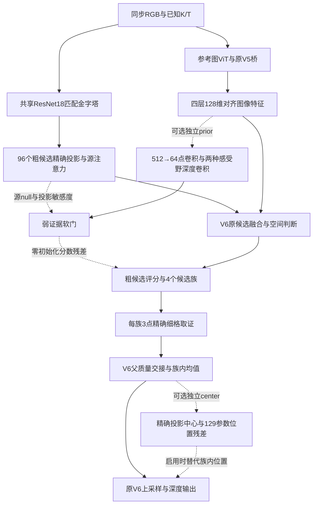

# ETH3D / CARLA 专项研究（V7候选分支）

所有新结构都是待验证候选，不替换V6默认。先读项目 `docs/research_memory.md` 第227条及以后条目。结果在 `runs/active/v7_domain_20261102/`，实际位于数据盘；V6两套正式best及270个源码/配置文件的保留清单见 `v6_preserved/preservation.json`。

**本轮固定TEST已确认：当前合成联合候选没有达到升级条件，V6保持原样，未启动新八卡全量训练。** 完整结论见[专项报告](../../docs/v7_eth3d_carla_20261102.md)。CARLA完整VAL改善不能替代TEST；ETH粗层略好但末端未保住。下面的全训入口准备不等于训练已经执行。

当前文件分工：

| 文件 | 作用 |
|---|---|
| `diagnosis.py` / `diagnosis_report.py` | 冻结V6、MVS首遍/细化的弱视差、边界、无源覆盖诊断；ETH只作既有外测归因，不用于训练 |
| `model.py`、`center.py`、`prior.py` | 两条互相独立的零初始化结构原型：投影域族内定位、缺证据区域粗层图像先验 |
| `train.py`、`configs/` | 三结构×两种增强，同预算固定末步TRAIN/VAL比较 |
| `fullval.py`、`validation_queue.py` | 完整VAL，核对编码器完全一致后共享编码；不是部署测速 |
| `stress_val.py` | 灰度、最近真实源对及两者组合的公共VAL压力测试 |
| `speed_probe.py` | 三帧交替计时，单参考/统一输出、相同部署优化；保存每次耗时 |
| `synthetic_pair.py` | 最近像素投放的历史原型，发现半像素量化，不用于弱视差正式训练 |
| `synthetic_pair_bilinear.py` | 同K/R的小平移、遮挡筛选、双线性投放；保持未知洞，显式重建源标签 |
| `coordinate_prior.py`、`model_round2.py`、`train_round2.py` | 第二轮：连续深度坐标条件替代固定96个槽位；仅新模块与联合训练质量保持的对照 |
| `inference_round2.py` | 粗候选坐标共享时复用深度编码；不改变参数，保留原函数回退 |
| `train_synthetic.py` / `train_synthetic_control.py` | 相同几何再生成，分别保留/物理删除新增先验的受控短训 |
| `full_training.py` / `full_training_round2.py` | 独立全量训练接口；仅CPU接口验证，不代表实际DDP或八卡全训成功 |
| `confirm_candidate.py` / `confirmation_report.py` | 固定单一候选的ETH/CARLA TEST确认、与旧V6/基线复核及图表 |
| `train_target_audit.py` | 实际已曝光TRAIN的粗标签、门控运行路径和保持约束审计 |

## 第一轮结构的数据流



默认256×448图像；粗候选格为32×56，细候选格为64×112。匹配输入512×896由共同256×448图像放大，不能写成增加真实图像信息。新prior不增加编码器或候选数；center增加几何计算，已实测其开销。四参考场景需要轮换参考并计入总成本。

研究依据见 `literature.md`；训练细节和历史结果见 `training_design.md`；再生成的几何契约和限制见 `SYNTHETIC_PAIR_BILINEAR.md`。对每一次结果必须同时报告起点、训练预算、划分、单位和阶段；不得把VAL、oracle、合成解析误差称为真实TEST重建精度。

`TRAINING_STRATEGY_REVIEW.md` 给出下一步成对清洁保持的设计依据和接口缺口；该方案尚未实现并训练，不能当作本轮有效方法。`target_audit_findings.md` 解释为何30%左右的相邻候选标签差异并不是CARLA当前主要误差来源。

## 基本命令

```bash
official_methods/.venv/bin/python -m pytest -q research/v7_domain_20261102/test_*.py
official_methods/.venv/bin/python research/v7_domain_20261102/train.py --config research/v7_domain_20261102/configs/prior_original_public.json
official_methods/.venv/bin/python research/v7_domain_20261102/summarize_pilots.py
```

训练配置中的输出目录已存在时入口拒绝覆盖，应复制配置并指定新的数据盘目录。原V6、baseline权重、数据划分和正式测试统计均不覆盖。未知区域不填成真实深度，监督标签不进入模型前向。
